# CloseCode developer guide: every screen, picture, numbers, behaviour and code

Who this is for: the developer (or the AI developer) who restyles the CloseCode Android app (Kotlin, Jetpack Compose).

## How to use this document

The pictures are the target. Each screen section starts with the picture of that screen (light theme on the left, dark theme on the right). Build exactly what the picture shows. Do not invent anything.

Work one screen at a time. Read the shared parts first (Part 0, 1 and 2), then take one screen section at a time.

Learn from the code, do not paste it over your project. The code under each picture shows how to build that screen exactly: the spacing, colours, icons, corner shapes and behaviour. Read it, then change the existing code of the project so it gives the same result. Copy the important numbers, shapes, icons and helpers. Keep the project's own data, view models and logic. The code in this document has not been compiled, so fix imports and names to match the project.

Compare before you move on. When a screen is done, take a screenshot of the running app and put it next to the picture. Check spacing, icons, corners, colours and texts one by one. Fix every difference, then go to the next screen.

Real data only. Every name, number and list in the pictures is an example. Real data comes from the project; when there is none, show the empty state described in the section.

Not every screen is pictured. Any screen of the app that has no picture must be restyled with the same colours, fonts, icons, spacing and components.

Corrections to older text: 02 Start a project and 03 Switch project are tall bottom sheets (layer 4), as the pictures show, even where an older paragraph calls them full screens. In screen 09 the Logcat tile uses the icon named in the Tool list of Part 2.4. Always follow the picture.

## Contents

Part 0: Read this first, design numbers, icon table, corrections, dark colours

Part 1: How the app works (layers, state machine, swipe, animations, data rules)

Part 2: Shared code (icons, theme, components, navigation shell)

Part 3: Every screen, 01 to 57 (picture, numbers, behaviour, code)

Part 4: Navigation rules, screen table, states and acceptance checklist

# PART 0. READ THIS FIRST

## Read this first

CloseCode is a working app with many features already built. This document changes how it looks and how screens connect. It must not remove, break or replace any feature that already works.

### Scope

Follow the mockups exactly. Build exactly what the mockup pictures and the numbers in this document show: the same spacing, sizes, icons, colours, corners, order of items and texts. Do not invent anything that is not described here. Do not add, remove, move, resize, recolour or rename anything because it seems better. Do not use a library default look (Material default colours, shapes, icon sets, fonts, elevations) where this document gives a value. If something is missing or two things seem to disagree, keep the existing behaviour of the app, copy the closest mockup, and ask. Before you call a screen finished, put your screenshot next to the mockup picture and compare spacing, icons and text one by one. Everything in the pictures that is a name, number or list is an example and must come from real data.

OpenCode must not be included in this development. Leave everything about it exactly as it is today.

Do not add features that are not already in the app. Only restyle what exists and add the navigation rules below.

### Real data only (no fake content)

The pictures use example names so the layout can be seen. Every name, number, date, list and state in a picture is an example. Nothing in the app may be hard-coded to match a picture. Read every value from where the app already gets it:

| Shown in a picture | Must come from |
|---|---|---|---|
| Project names, letters, colours, types, last-opened times | The user's real projects on this phone (created, cloned or imported by the user). The letter is the first letter of the real name. Tile colour is stored per project or derived from the name. Empty list when there are none |
| Recent projects and project counts | Real project list sorted by last opened |
| File tree, open files, tabs, file icons | The real project folder and real open-file state. Icon by real extension |
| Code, line numbers, cursor | The real file content in the editor |
| Git marks (M, A, D), counts, branch, commits, authors, hashes, times, diffs | The real repository (git status, log, diff) |
| GitHub account, repositories | The real signed-in account. Not signed in means the not-connected screen |
| Problems, errors, warnings | Real results of the project's checks and build |
| Build steps, percentages, sizes, times, file names | The real running build |
| Logcat and Console lines | The real log stream |
| Terminal output, sessions, saved commands | Real shells and the user's saved commands |
| Versions, build number, storage sizes, download progress | Real values from the app and device |
| Settings values and toggles | The real saved settings (toggle shows what is saved and saves on change) |
| Package name, SDK levels, version name and code | The real project configuration |
| Templates | The real list of templates the app ships with |

If a value does not exist yet, show the empty state (see States), never an example. No placeholder projects, no demo files, no sample repositories, no fake commits.

### Not every screen is shown here

The app already has more screens and features than the pictures cover. The pictures are a design system, not a full screen list. Any screen or feature that is not shown must be restyled with the same design: same colours, type, spacing, shapes, icons, components and navigation rules from this document. See "Screens that are not shown" for the recipe. Do not leave an old-style screen next to new-style screens, and do not remove a screen because it has no picture.

### How to read the numbers

All sizes are in dp (px in the pictures equal dp) on a 360 dp wide phone. Text is in sp. Where a picture and a number here differ, the number wins. Scale spacing together on wider phones.

## Design numbers

Define every value once as a theme token and use the token everywhere. No screen may contain a loose hex colour, font size or corner radius.

### Colours (light theme)

| Token | Hex | Used for |
|---|---|---|---|---|
| rail | #E3E5EA | Left tool rail, status bar area, outer background behind the panel |
| panel | #F1F2F5 | Side panel, bottom sheets, popup menus |
| content | #FAFAFB | Editor and every full screen background. Never pure white |
| field | #E9EBEF | Text fields, grouped settings cards, unselected chips, key row keys, back button, result cards |
| selectedRow | #DCDFE5 | Selected row in lists |
| selectedFile | #DDE0FB | Selected file in the tree (text #2E3036) |
| border | #D5D8DE | Card, menu and sheet borders (1 dp) |
| divider | #E3E5EA | Lines between header and content, between rows (1 dp) |
| toggleOff | #B8BCC5 | Toggle track when off |
| text | #1F2024 | Titles, main text |
| text2 | #2E3036 | Body text, code text |
| textSoft | #4F535C | Secondary button text, unselected chip text |
| muted | #626772 | Descriptions, sub lines, section labels |
| faint | #858A95 | Line numbers, hints, disabled icons |
| accent | #5865F2 | Primary buttons, selected rail item, selected chip, links, toggle on, progress, focus ring |
| green | #248046 | Run button, success, added lines, "Ready" |
| amber | #C98A0A | Modified, warnings |
| red | #DA373C | Errors, delete, badges, "Not installed" |
| blue | #2F6FE0 | Info and config file icons |
| purple | #7B5CE0 | Code file icons |
| yellow | #D99A06 | Folder icons |
| teal | #1F9D6B | Success icons |
| orange | #D97706 | Warning triangle |
| pink | #DB4C9B | Image icon |
| diffAddBg / diffAddText | #DDF3E4 / #1A7F37 | Added lines |
| diffDelBg / diffDelText | #FBE4E5 / #DA373C | Removed lines, error rows |
| matchBg / matchText | #FBE7A1 / #6B4E00 | Search match highlight |
| dim | rgba(30,35,50,0.30) | Layer behind sheets and menus (0.38 behind first-time dialogs, 0.18 behind small menus) |
| shadow | rgba(30,35,50,0.25), blur 30, y 12 | Popup menus and the sliding editor card |

Icon tile tint: the tile behind a coloured icon is the icon colour at 13% opacity (hex alpha 22).

Syntax colours (light): keyword #8250DF, type #1B7C83, string #A5461D, function #6F5A00, number #0A7D4F, comment #5E7F46, variable #0A5EA8, plain #2E3036. Apply only to real code tokens of the file's language. Plain text and Markdown stay plain.

Project tile colours: each project has its own colour (saved with the project or derived from its name from this set: #2563EB, #16A34A, #EA580C, #0E7490, #7C3AED, #BE185D). Letter on the tile is white, weight 800.

### Type

UI font Inter. Code and terminal font JetBrains Mono. Line height 1.4 of the size unless noted.

| Style | Size / weight | Used for |
|---|---|---|---|---|
| Hero | 33 sp / 800, tracking -1 | Welcome headline |
| Setup title | 27 sp / 800 | First-time setup title |
| Panel title | 21 to 22 sp / 800 | Title at the top of a side panel |
| Sheet title | 19 to 20 sp / 800 | Bottom sheet titles |
| Screen title | 16.5 sp / 700 | Header title of full screens |
| Item title | 14.5 sp / 600 | List and settings row titles |
| Body | 14 sp / 400 to 500 | Buttons in menus, descriptions |
| Small | 13 to 13.5 sp | Field text, tree rows |
| Caption | 12 to 12.5 sp | Sub lines, labels above fields |
| Section label | 11 sp / 700, uppercase, tracking 0.8 | Group titles |
| Code | 11.5 sp mono, line height 21 | Editor |
| Terminal and logs | 10.5 to 12 sp mono | Terminal, Logcat, Console |

### Spacing and shape

Screen side padding 14 to 18. Row padding 8 by 14. Gap between related items 8 to 12.

Radius: tiles 13 to 15, buttons 12 to 16, cards 18 to 20, grouped settings cards 18, chips and pill fields 15 to 22, sheets 26 (top corners), panel 26 (top-left), phone preview 30.

Borders 1 dp. Selected outline 2 dp accent. Focus ring 1.5 dp accent.

Status bar area 34 dp. Header 56 dp. Home indicator area 16 dp.

### Motion

Sidebar swipe: the editor card follows the finger, rests 300 dp to the right, spring (damping 0.85, stiffness 400). Release past 40% opens; otherwise it snaps back.

Sheets slide up in 250 ms ease-out. Menus fade and scale from 0.95 in 120 ms.

Screen push slides in from the right in 220 ms; back reverses it.

Toggle knob 160 ms. Progress bars animate 200 ms between values.

Respect the system setting for reduced animation.

## Icons

All icons are simple line icons on a 24 by 24 grid, drawn as vectors (SVG path or Compose ImageVector) with stroke width 1.8 (2.2 for chevrons and back, 2.4 for ticks), round caps, round joins, no fill (only Play is filled). Colour is the token named in the table. Use these everywhere in the app. If the app uses an icon that is not in this list, draw a new one in the same style (same grid, same stroke, rounded) and add it to your icon set.

### Icon sizes

| Place | Size | Stroke |
|---|---|---|---|---|
| Rail tool icon | 22 | 1.8 |
| Back button chevron | 20 | 2.2 |
| Header action (undo, redo, share, clear) | 17 to 19 | 1.9 |
| Panel action button (plus, folder, refresh) | 17 to 18 | 1.9 |
| List and settings tile | 18 (settings) / 21 (panel rows) | 1.8 |
| Button icon | 15 to 17 | 2.0 |
| Run button play | 17 filled | none |
| Tree row icon | 17 to 18 | 1.7 |
| Chevron in rows | 15 to 17 | 2.2 |
| Tick in lists | 18 | 2.4 |
| Empty-state and hero icon | 36 to 38 | 1.6 |
| Badge glyph | 10 to 12 | 3 |

Touch target for any icon button is at least 38 by 38 dp (44 preferred).

### Icon path data (24 by 24)

| Name | Path |
|---|---|---|---|
| folder | M4 20h16a2 2 0 0 0 2-2V8a2 2 0 0 0-2-2h-7.9a2 2 0 0 1-1.69-.9L9.6 3.9A2 2 0 0 0 7.93 3H4a2 2 0 0 0-2 2v13c0 1.1.9 2 2 2Z |
| refresh | M3 12a9 9 0 0 1 9-9 9.75 9.75 0 0 1 6.74 2.74L21 8M21 3v5h-5M21 12a9 9 0 0 1-9 9 9.75 9.75 0 0 1-6.74-2.74L3 16M8 16H3v5 |
| branch | M6 3v12M18 9a3 3 0 1 0 0-6 3 3 0 0 0 0 6zM6 21a3 3 0 1 0 0-6 3 3 0 0 0 0 6zM18 9a9 9 0 0 1-9 9 |
| history | M3 12a9 9 0 1 0 3-6.7L3 8M3 3v5h5M12 7v5l4 2 |
| down | M21 15v4a2 2 0 0 1-2 2H5a2 2 0 0 1-2-2v-4M7 10l5 5 5-5M12 15V3 |
| up | M21 15v4a2 2 0 0 1-2 2H5a2 2 0 0 1-2-2v-4M17 8l-5-5-5 5M12 3v12 |
| more | M12 5v.01M12 12v.01M12 19v.01 |
| plus | M12 5v14M5 12h14 |
| check | M20 6L9 17l-5-5 |
| cd | M6 9l6 6 6-6 |
| cl | M15 18l-6-6 6-6 |
| cr | M9 18l6-6-6-6 |
| search | M11 19a8 8 0 1 0 0-16 8 8 0 0 0 0 16zM21 21l-4.3-4.3 |
| filter | M3 6h18M7 12h10M10 18h4 |
| copy | M9 9h11v11H9zM5 15H4V4h11v1 |
| file | M14 2H6a2 2 0 0 0-2 2v16a2 2 0 0 0 2 2h12a2 2 0 0 0 2-2V8zM14 2v6h6 |
| undo | M9 14L4 9l5-5M4 9h10a6 6 0 0 1 0 12h-3 |
| redo | M15 14l5-5-5-5M20 9H10a6 6 0 0 0 0 12h3 |
| save | M19 21H5a2 2 0 0 1-2-2V5a2 2 0 0 1 2-2h11l5 5v11a2 2 0 0 1-2 2zM17 21v-8H7v8M7 3v5h8 |
| term | M4 17l6-6-6-6M12 19h8 |
| menu | M4 6h16M4 12h16M4 18h16 |
| x | M18 6L6 18M6 6l12 12 |
| bolt | M13 2L3 14h9l-1 8 10-12h-9z |
| kbd | M4 5h16a2 2 0 0 1 2 2v10a2 2 0 0 1-2 2H4a2 2 0 0 1-2-2V7a2 2 0 0 1 2-2zM6 9h.01M10 9h.01M14 9h.01M18 9h.01M7 15h10 |
| code | M16 18l6-6-6-6M8 6l-6 6 6 6 |
| layers | M12 2l10 5-10 5L2 7zM2 17l10 5 10-5M2 12l10 5 10-5 |
| image | M5 3h14a2 2 0 0 1 2 2v14a2 2 0 0 1-2 2H5a2 2 0 0 1-2-2V5a2 2 0 0 1 2-2zM9 8a1 1 0 1 0 0 .01M21 15l-5-5L5 21 |
| trash | M3 6h18M8 6V4h8v2M19 6l-1 14H6L5 6 |
| share | M4 12v8h16v-8M16 6l-4-4-4 4M12 2v13 |
| bug | M8 2l1.9 1.9M14.1 3.9L16 2M9 7.1V6a3 3 0 0 1 6 0v1.1M12 20a6 6 0 0 1-6-6v-3a4 4 0 0 1 4-4h4a4 4 0 0 1 4 4v3a6 6 0 0 1-6 6zM12 20v-9M6.5 13H2M17.5 13H22 |
| flask | M10 2v7.5L4 20a1 1 0 0 0 .9 1.5h14.2A1 1 0 0 0 20 20l-6-10.5V2M8.5 2h7 |
| alert | M12 9v4M12 17h.01M10.3 3.9L1.8 18a2 2 0 0 0 1.7 3h17a2 2 0 0 0 1.7-3L13.7 3.9a2 2 0 0 0-3.4 0z |
| gh | M15 22v-4a4.8 4.8 0 0 0-1-3.5c3 0 6-2 6-5.5.08-1.25-.27-2.48-1-3.5.28-1.15.28-2.35 0-3.5 0 0-1 0-3 1.5-2.64-.5-5.36-.5-8 0C6 2 5 2 5 2c-.3 1.15-.3 2.35 0 3.5A5.403 5.403 0 0 0 4 9c0 3.5 3 5.5 6 5.5-.39.49-.68 1.05-.85 1.65-.17.6-.22 1.23-.15 1.85v4M9 18c-4.51 2-5-2-7-2 |
| send | M22 2L11 13M22 2l-7 20-4-9-9-4z |
| cog | M12 15a3 3 0 1 0 0-6 3 3 0 0 0 0 6zM19.4 15a1.65 1.65 0 0 0 .33 1.82l.06.06a2 2 0 1 1-2.83 2.83l-.06-.06a1.65 1.65 0 0 0-1.82-.33 1.65 1.65 0 0 0-1 1.51V21a2 2 0 1 1-4 0v-.09A1.65 1.65 0 0 0 9 19.4a1.65 1.65 0 0 0-1.82.33l-.06.06a2 2 0 1 1-2.83-2.83l.06-.06A1.65 1.65 0 0 0 4.68 15a1.65 1.65 0 0 0-1.51-1H3a2 2 0 1 1 0-4h.09A1.65 1.65 0 0 0 4.6 9a1.65 1.65 0 0 0-.33-1.82l-.06-.06a2 2 0 1 1 2.83-2.83l.06.06A1.65 1.65 0 0 0 9 4.68a1.65 1.65 0 0 0 1-1.51V3a2 2 0 1 1 4 0v.09a1.65 1.65 0 0 0 1 1.51 1.65 1.65 0 0 0 1.82-.33l.06-.06a2 2 0 1 1 2.83 2.83l-.06.06A1.65 1.65 0 0 0 19.4 9a1.65 1.65 0 0 0 1.51 1H21a2 2 0 1 1 0 4h-.09a1.65 1.65 0 0 0-1.51 1z |
| ext | M18 13v6a2 2 0 0 1-2 2H5a2 2 0 0 1-2-2V8a2 2 0 0 1 2-2h6M15 3h6v6M10 14L21 3 |
| play | M7 4.5v15l13-7.5z |
| user | M20 21v-2a4 4 0 0 0-4-4H8a4 4 0 0 0-4 4v2M12 11a4 4 0 1 0 0-8 4 4 0 0 0 0 8z |
| panel | M5 3h14a2 2 0 0 1 2 2v14a2 2 0 0 1-2 2H5a2 2 0 0 1-2-2V5a2 2 0 0 1 2-2zM9 3v18 |
| globe | M12 22a10 10 0 1 0 0-20 10 10 0 0 0 0 20zM2 12h20M12 2a15 15 0 0 1 0 20 15 15 0 0 1 0-20z |
| flag | M4 22V4M4 4h13l-2 4 2 4H4 |
| moon | M21 12.8A9 9 0 1 1 11.2 3a7 7 0 0 0 9.8 9.8z |
| sun2 | M12 17a5 5 0 1 0 0-10 5 5 0 0 0 0 10zM12 1v2M12 21v2M4.2 4.2l1.4 1.4M18.4 18.4l1.4 1.4M1 12h2M21 12h2M4.2 19.8l1.4-1.4M18.4 5.6l1.4-1.4 |
| lock | M5 11h14v10H5zM8 11V7a4 4 0 0 1 8 0v4 |
| info | M12 22a10 10 0 1 0 0-20 10 10 0 0 0 0 20zM12 16v-4M12 8h.01 |
| db | M12 8c4.4 0 8-1.3 8-3s-3.6-3-8-3-8 1.3-8 3 3.6 3 8 3zM4 5v14c0 1.7 3.6 3 8 3s8-1.3 8-3V5M4 12c0 1.7 3.6 3 8 3s8-1.3 8-3 |

Tool colours in the rail (unselected): Files yellow, Search blue, GitHub text2, Terminal blue, Logcat green, Problems orange, Settings textSoft. Selected tool: white icon on an accent tile.

File icons are chosen by the real file extension: code files (kt, java, ts, js, py, html, css, xml, json, gradle) use the code icon in purple; folders use the folder icon in yellow; everything else uses the file icon in blue. Use the app's existing extension mapping where it has one.

# CORRECTIONS AFTER THE FIRST BUILD (read this first)

MOCKUPS ARE THE LAW. Build exactly what the mockup pictures and the numbers in this document show: the same spacing, sizes, icons, colours, corners, order of items and texts. Do not invent anything that is not described here. Do not add, remove, move, resize, recolour or rename anything because it seems better. Do not use a library default look (Material default colours, shapes, icon sets, fonts, elevations) where this document gives a value. If something is missing or two things seem to disagree, keep the existing behaviour of the app, copy the closest mockup, and ask. Before you call a screen finished, put your screenshot next to the mockup picture and compare spacing, icons and text one by one. Everything in the pictures that is a name, number or list is an example and must come from real data.

These points come from the first screenshots of the build. They override anything shorter or different further down.

Colour. The accent is blurple #5865F2. The build uses bright blue on the selected rail tile, Sign in button, links and tab chip. Use only CcTheme.colors.accent. Search the code for any hard-coded blue and remove it.

Panel action buttons. In the panel title area, New file and New folder (and any refresh or other action) are each a 38 by 38 rounded button, radius 12, grey field colour #E9EBEF, with the icon 18 inside. Bare icons are wrong. Same for the header actions on full screens.

Swipe. The sidebar opens with a right swipe from anywhere on the editor, not only the edge. It works when the swipe is mostly horizontal and the code cannot scroll further left. The left 40 dp edge always works. See Part 1, section 3, and SidebarHost in Part 2.

File tree. Names must always be visible. Indent is 10 dp per level (not 16), no vertical guide lines, folders with a single folder inside are joined (src/main, java/com/app), and the name gets all the remaining width with an ellipsis.

Buttons and text. Buttons never wrap and never cut their label with "...". Use short labels ("Sign in", "Clone from link"). Empty-state sentences may wrap, buttons may not.

Run card. The panel is 234 dp wide. The Run button is a 40 by 40 green icon-only button (play icon). The project name column takes the rest and is cut with an ellipsis. Nothing overlaps. See Run card in Components and RunCard in Part 2.

Dim layer and sidebar width. Behind the sliding editor card use 30% of #1E2332, not a dark grey. The card must still look light. The sidebar is 300 dp wide (rail 66 + panel 234), so the editor card slides 300 dp to the right and only a 60 dp strip of it stays visible. In the first build the card stopped at 250 dp, which left the panel too narrow (buttons cut off, names squeezed). The middle layer (the panel) must be a rounded card: both its top-left and its top-right corners are rounded, radius 26, exactly as in the mockups. In the first build the top-right corner of the panel was square. That is wrong. The editor card keeps its rounded left corners. The panel's own top-left corner is also rounded, radius 26, exactly as in the mockups.

Existing chips (for example the OPEN list). Keep them, but they scroll sideways and cut long names with an ellipsis, never show half a word.

Tool highlight. In the rail, the highlighted tool must always match the panel that is showing. If a tool opens a full screen instead of a panel, do not move the highlight.

# WHAT THE WORDS IN THE PROJECT LISTS MEAN

This explains the small texts under each project name (Welcome "Recent projects", the project switcher, and the Run card). All of it is read from real data. The examples in the pictures ("Build ok", "2 problems") are only examples of the kinds of text.

## The project row

[B]  Blank app                         >
     Android · main · Build ok

| Part | Meaning | Where it comes from |
|---|---|---|---|---|
| Coloured tile with a letter | The project's colour and the first letter of its name | Project record (colorHex, name.first()) |
| Small red or orange number on the tile | How many problems (errors and warnings) the project has right now. Red when there is at least one error, orange when only warnings. Hidden at 0 | Real diagnostics of that project |
| Name | The project name | Project record |
| First word of the sub line (Android, Website) | The project type | Project config / template used |
| main | The current git branch of the project. Not shown when the project is not a git repository | Real git |
| Build ok | The result of the last build: it finished without errors | Last real build result |
| Build failed | The last build ended with an error (shown in red) | Last real build result |
| Not built yet | There is no build result yet (shown in muted grey) | No build record |
| 2 problems | The project has 2 errors or warnings (shown in orange or red) | Real diagnostics |
| 2 days ago, 4 days ago | When the project was last opened | Project record, formatted by relativeTime() |
| 7 failed tests (example) | Only if the app has a test runner and the last test run failed | Real last test result. Do not show it if the app has no tests |
| > chevron | Tap to open the project |  |
| 6 projects (top right of the list header) | How many projects exist | Real count |

## The one sub line rule

Build the sub line from pieces and join them with " · ". Show only the pieces that exist. Show each piece once. Never repeat the project name inside it.

Order: type, branch, status.

Status is the most important single thing about the project, chosen in this order:

Build failed if the last build failed (red).

N problems if there are problems (orange, or red if any is an error).

Build ok if the last build succeeded (green).

Otherwise the relative last-opened time (2 days ago, muted).

data class ProjectStatus(val text: String, val kind: Kind) { enum class Kind { Ok, Warning, Error, Muted } }

fun projectStatus(p: Project, lastBuild: BuildResult?, problems: Problems): ProjectStatus = when {
    lastBuild is BuildResult.Failed -> ProjectStatus("Build failed", ProjectStatus.Kind.Error)
    problems.total > 0 -> ProjectStatus("${problems.total} ${if (problems.total == 1) "problem" else "problems"}",
        if (problems.errors > 0) ProjectStatus.Kind.Error else ProjectStatus.Kind.Warning)
    lastBuild is BuildResult.Success -> ProjectStatus("Build ok", ProjectStatus.Kind.Ok)
    else -> ProjectStatus(relativeTime(p.lastOpened), ProjectStatus.Kind.Muted)
}

fun projectSubLine(p: Project, branch: String?, s: ProjectStatus): List<Pair<String, ProjectStatus.Kind>> =
    buildList {
        add(p.typeLabel to ProjectStatus.Kind.Muted)                 // "Android" or "Website"
        if (branch != null) add(branch to ProjectStatus.Kind.Muted)  // "main"
        add(s.text to s.kind)
    }

@Composable
fun ProjectSubLine(parts: List<Pair<String, ProjectStatus.Kind>>) {
    val c = CcTheme.colors
    val text = buildAnnotatedString {
        parts.forEachIndexed { i, (t, kind) ->
            if (i > 0) append(" · ")
            withStyle(SpanStyle(color = when (kind) {
                ProjectStatus.Kind.Ok -> c.green; ProjectStatus.Kind.Warning -> c.amber
                ProjectStatus.Kind.Error -> c.red; ProjectStatus.Kind.Muted -> c.muted })) { append(t) }
        }
    }
    Text(text, style = CcType.caption.copy(fontSize = 12.5.sp), maxLines = 1, overflow = TextOverflow.Ellipsis)
}

## The Run card text

In the panel's Run card the second line is branch · state. main · ok means: the branch is main and the last build is ok. Use the same words as above: main · ok, main · failed, main · not built, main · building 42% (while a build runs). The state word is green for ok, red for failed, muted otherwise. If the project has no git repository, show only the state.

## Mistakes seen in the first build

The same value appeared twice in the sub line (for example the name again). Show each piece once.

Texts that are not real: 7 failed tests or 2 problems typed in. They must be computed.

Text wrapping to a second line. The sub line is always one line with an ellipsis at the end.

# DARK THEME COLOURS

The app can also show the dark theme (pictures at the end). Use the same tokens with these dark values. Switch with the Appearance setting (Light, Dark, Follow system). Nothing else changes: layout, sizes, shapes and icons are the same.

| Token | Dark hex | Light hex |
|---|---|---|---|---|
| rail | #1E1F22 | #E3E5EA |
| panel | #2B2D31 | #F1F2F5 |
| content | #313338 | #FAFAFB |
| field | #383A40 | #E9EBEF |
| selectedRow | #404249 | #DCDFE5 |
| border | #3F4147 | #D5D8DE |
| divider | #26272B | #E3E5EA |
| toggleOff | #4A4D55 | #B8BCC5 |
| text | #F2F3F5 | #1F2024 |
| text2 | #DBDEE1 | #2E3036 |
| textSoft | #B5BAC1 | #4F535C |
| muted | #949BA4 | #626772 |
| faint | #6D6F78 | #858A95 |
| accent | #5865F2 | #5865F2 |
| green | #23A559 | #248046 |
| amber | #F0B232 | #C98A0A |
| red | #F23F42 | #DA373C |
| dim (scrim) | rgba(0,0,0,0.50) | rgba(30,35,50,0.30) |

val DarkCcColors = LightCcColors.copy(
    rail = Color(0xFF1E1F22), panel = Color(0xFF2B2D31), content = Color(0xFF313338), field = Color(0xFF383A40),
    selectedRow = Color(0xFF404249), selectedFile = Color(0xFF404249), border = Color(0xFF3F4147), divider = Color(0xFF26272B),
    toggleOff = Color(0xFF4A4D55), text = Color(0xFFF2F3F5), text2 = Color(0xFFDBDEE1), textSoft = Color(0xFFB5BAC1),
    muted = Color(0xFF949BA4), faint = Color(0xFF6D6F78), green = Color(0xFF23A559), amber = Color(0xFFF0B232),
    red = Color(0xFFF23F42), dim = Color(0x80000000))

@Composable
fun CcTheme(mode: ThemeMode, content: @Composable () -> Unit) {
    val dark = when (mode) { ThemeMode.Dark -> true; ThemeMode.Light -> false; ThemeMode.System -> isSystemInDarkTheme() }
    CompositionLocalProvider(LocalCcColors provides if (dark) DarkCcColors else LightCcColors) { MaterialTheme(content = content) }
}

Syntax colours in the dark theme use brighter versions: keyword #C792EA, type #4EC9B0, string #CE9178, function #DCDCAA, number #B5CEA8, comment #6A9955, variable #9CDCFE, plain #DBDEE1.

# PART 1. HOW THE APP WORKS AND SHARED CODE

MOCKUPS ARE THE LAW. Build exactly what the mockup pictures and the numbers in this document show: the same spacing, sizes, icons, colours, corners, order of items and texts. Do not invent anything that is not described here. Do not add, remove, move, resize, recolour or rename anything because it seems better. Do not use a library default look (Material default colours, shapes, icon sets, fonts, elevations) where this document gives a value. If something is missing or two things seem to disagree, keep the existing behaviour of the app, copy the closest mockup, and ask. Before you call a screen finished, put your screenshot next to the mockup picture and compare spacing, icons and text one by one. Everything in the pictures that is a name, number or list is an example and must come from real data.

This part explains the structure and the behaviour in plain words. Part 2 gives the Kotlin Jetpack Compose code for every piece. Part 3 is the visual spec (numbers, colours, components, screens). When the words and the code seem to disagree, the code in Part 2 is the reference.

## 1. The four layers (what is "full screen" and what is "half screen")

Your developer is confused because the app has four different kinds of screen. Each has its own rules.

| Layer | What it is | Covers | How it opens | How it closes |
|---|---|---|---|---|---|---|
| 1. Editor card | The code editor. This is the home screen | The whole phone | It is always there at the bottom | Never closes. Back at the editor asks to exit |
| 2. Sidebar (the "two panels") | A thin tool rail plus a side panel, behind the editor card | The left 300 dp. The editor card slides right and stays visible on the right edge | Swipe right anywhere on the editor (no button) | Tap the editor card, swipe left, or Back |
| 3. Full screens | Clone, Source control, History, Diff, Terminal session, Run, Preview, Settings and its pages, Project settings, Welcome, Start project | The whole phone, including the sidebar and rail | Tap an action in a panel or a row in Settings | Back button in the header, or system Back. One step back |
| 4. Sheets, menus, dialogs | Project switcher, file menu, new command, confirm dialogs | Bottom part of the screen or a floating box over whatever is below | Tap on a button or long-press | Back, tap outside, swipe down |

The two panels are NOT a minimised app. They are one thing: the sidebar. It is made of two parts side by side:

Rail: 66 dp wide. Only icons. The tool list (Files, Search, GitHub, Terminal, Logcat, Problems) and Settings at the bottom. Project avatar on top.

Panel: the rest of the 300 dp (234 dp). The panel is a rounded card: its top-left AND top-right corners are rounded, radius 26 (the right corner is where the editor card starts). It shows the content of the selected tool: file tree for Files, results for Search, and so on.

The editor card is on top of the sidebar. When the user swipes, the card moves to the right and the sidebar is revealed under it. The card is still showing (a strip of the card on the right edge, with rounded left corners, radius 26), slightly smaller and rounded, and it is dimmed. Tapping it closes the sidebar. The sidebar is not a separate screen and it does not have its own header.

## 2. The state machine (the logic of the whole app)

Keep ONE source of truth for navigation. Do not let each screen decide for itself.

AppState
  project: Project?                 // the open project (real, from the database)
  sidebarOpen: Boolean              // layer 2
  sidebarTool: Tool                 // Files, Search, GitHub, Terminal, Logcat, Problems
  stack: List<Route>                // layer 3, empty when we are on the editor
  sheet: Sheet?                     // layer 4 (only one at a time)
  openFiles: List<OpenFile>         // editor tabs
  activeFile: OpenFile?

Rules, in the order the system Back button must handle them (the first one that applies wins):

If a sheet, menu or dialog is open: close it. Stop.

If the stack has a full screen: pop one route. Stop.

If the sidebar is open: close it. Stop.

If we are on the editor and the last Back was less than 2 seconds ago: finish the app.

Otherwise show the toast "Press back again to exit" and remember the time.

Every full screen header has a back button that calls exactly the same function as the system Back (onBack()), so they can never disagree.

### What opens what

| User action | State change |
|---|---|---|---|
| Swipe right on the editor (anywhere) | sidebarOpen = true (follows the finger first, then settles) |
| Tap a rail tool (Files, Search, GitHub, Terminal, Logcat, Problems) | sidebarTool = that tool. Sidebar stays open |
| Tap Settings in the rail | push(Route.Settings) (full screen). The sidebar stays open underneath |
| Tap a file in the Files panel | openFile(file), sidebarOpen = false |
| Tap an action in a panel (Clone, Source control, History) | push(Route.X) (full screen) |
| Tap the project avatar | sheet = Sheet.ProjectSwitcher |
| Long-press a file | sheet = Sheet.FileMenu(file) (popup menu) |
| Tap Run in the Run card | push(Route.Run) and start the real build |
| Tap Back button in a header | onBack() |

### Where each tool shows its detail

| Tool in the rail | Panel (half screen, in the sidebar) | Full screens it can open |
|---|---|---|---|---|
| Files | File tree, filter, new file, new folder, Run card | Editor (closes sidebar) |
| Search | Query, options, results, Run card | Editor at the line |
| GitHub | Account and repository actions | Clone a repository, Source control, History, Commit, Diff, GitHub sign in |
| Terminal | List of sessions, new session, Run card | Terminal session, New command (sheet) |
| Logcat | Live log with filter chips, Run card | none |
| Problems | Errors and warnings list, Run card | Editor at the line |
| Settings (rail bottom) | none | Settings (full screen) then each settings page |

## 3. The swipe (exact behaviour)

The user can start the swipe anywhere on the editor, not only at the edge. A drag counts as "open the sidebar" when it moves to the right, is mostly horizontal (sideways movement more than twice the up or down movement, after a 10 dp touch slop), AND the editor content under the finger cannot scroll further left (the code is not scrolled sideways, or the finger is on the tab row, the header or an empty area).

If the code view IS scrolled sideways, a right swipe first scrolls the code back. A swipe that starts in the left 40 dp edge always opens the sidebar, even then.

Vertical drags and upward or downward scrolling are never taken by the sidebar.

A drag to the left while the sidebar is closed does nothing here (the editor keeps it).

The editor card follows the finger. Progress goes 0.0 to 1.0 over 300 dp.

While dragging: translationX = 300 dp * progress, the card's left corners get radius 26 dp * progress, scrim (dark layer) 0.30 * progress.

On release: open if progress > 0.4 or the fling velocity to the right is above 800 dp/s. Close if progress < 0.4 or the fling goes left.

Settle with spring(dampingRatio = 0.85f, stiffness = 400f).

While open, the card ignores taps on its content. A tap anywhere on the card closes the sidebar.

The sidebar is NOT opened by a button. No hamburger icon.

When the keyboard is up, the swipe is disabled.

## 4. Why each full screen exists (purpose, behaviour, back)

| Screen | Why it is there | Behaviour | Back goes to |
|---|---|---|---|---|---|
| Welcome | First screen when there is no open project | Three buttons. Recent real projects below | Exit app |
| Start a project | Create a new project from a real template | Fill name and location, Create. Shows progress, then opens the editor | Welcome or editor |
| Clone a repository | Download a git repository | URL, optional branch, destination. Clone starts the progress screen | GitHub panel |
| Cloning progress | Shows the real progress of the clone | Cancel stops it and deletes the half-cloned folder | Clone screen |
| First-time setup | Downloads the tools the build needs | Real download progress per card. Finish enabled when all required cards are done | Welcome or editor |
| Source control | Stage, commit, pull and push | Real git status. Commit needs a message | GitHub panel |
| History | The commit list | Tap a commit to open it | Source control |
| Commit detail | Files that changed in one commit | Tap a file for the diff | History |
| Diff | Lines changed in one file | Read only. Colours from diff tokens | Commit detail or Source control |
| Terminal session | A real shell | Typing sends to the shell. Key row sends Tab, Ctrl, Esc, arrows | Terminal panel |
| Run and build | Shows the build steps | Real steps and percent. Cancel stops the build | Editor |
| Build finished | Result of the build | Ready: Open app, Share. Failed: real error text and a Problems link | Editor |
| Website preview | Shows the local web page | Address pill, reload, Console button | Run |
| Console | The page's console | Live lines | Preview |
| Compose previews | Shows the preview functions | List of real previews. Empty state when none | Run |
| Settings and pages | The app settings | Each toggle saves at once | Settings, then editor |
| Project settings | Name, colour, package, SDK | Save on change | Where it was opened from |

## 5. Animations (what moves, how long, which curve)

| What | Animation | Duration or spec |
|---|---|---|---|---|
| Sidebar open and close | Spring on the editor card offset | damping 0.85, stiffness 400 |
| Tool switch in the panel | Cross-fade the panel content | 120 ms |
| Rail selected pill | Height 8 to 30 and tile colour change | 160 ms |
| Full screen push | Slide in from the right (full width) with the old screen moving 25% left | 220 ms, FastOutSlowIn |
| Full screen pop | The reverse | 200 ms |
| Bottom sheet | Slide up from the bottom, scrim fades to 0.30 | 250 ms ease-out |
| Popup menu | Fade and scale from 0.95, origin at the touch point | 120 ms |
| Toggle | Knob slides, track colour fades | 160 ms |
| Progress bar | Animate to each new value | 200 ms linear |
| Toast | Fade in 150 ms, wait 2 s, fade out 200 ms |  |
| Button press | Alpha 0.9 | instant |

Always check LocalReduceMotion / Settings.Global.ANIMATOR_DURATION_SCALE. If the scale is 0, use snap() instead of springs.

## 6. Data rules (real data, repeated because it matters)

Every list is a StateFlow or Flow from the real database or the real file system. Screens only display. They never contain sample items.

A project's colour and letter: stored in the project table (colorHex, derived from the name if not set). Letter is name.first().uppercase().

Times are formatted from real timestamps by one function relativeTime(millis).

If a list is empty, call EmptyState(...) (Part 2). If data is loading, call LoadingList(). If it failed, call ErrorCard(message, onRetry).

## 7. What your developer should NOT do

Do not add a menu button to open the sidebar.

Do not show the rail on full screens.

Do not keep a permanent text-labelled rail.

Do not invent projects, files, commits or users.

Do not change any logic. Only change how things look and how screens connect.

# PART 2. THE CODE (Kotlin, Jetpack Compose)

Package names and file names are suggestions. Put each block in its own file. Every block compiles against Compose BOM 2024.09 or newer with Material 3. Nothing here contains sample data. Every screen takes its data as parameters from the real ViewModel.

## 2.1 How icons are built (the letters and numbers)

The letters and numbers your developer sees (for example M15 18l-6-6 6-6) are SVG path data. It is a tiny drawing language. Letters are commands, numbers are coordinates on a 24 by 24 grid:

| Letter | Meaning | Example |
|---|---|---|---|---|
| M x y | Move the pen to the point (no line) | M15 18 |
| L x y | Draw a line to the point | L9 12 |
| l dx dy | Draw a line, relative to the current point | l-6-6 means 6 left, 6 up |
| H x, h dx | Horizontal line | H21 |
| V y, v dy | Vertical line | v4 |
| A rx ry rot large sweep x y | Arc (curve of a circle) | a2 2 0 0 1 2 2 |
| C, c | Curve |  |
| Z | Close the shape |  |

So M15 18l-6-6 6-6 means: go to (15,18), draw to the left-up, then draw right-up. That is the back chevron "<". The Kotlin code can read this text directly. You do not draw the icons by hand and you do not need a drawable file for each icon. Keep the path text in one list and build the vectors from it.

All icons: viewport 24 by 24, stroke only, stroke width 1.8 (2.2 chevrons, 2.4 ticks), round cap, round join, no fill (Play is filled).

### File ui/icons/CcIcons.kt

package com.closecode.ui.icons

import androidx.compose.foundation.layout.size
import androidx.compose.material3.Icon
import androidx.compose.runtime.Composable
import androidx.compose.runtime.remember
import androidx.compose.ui.Modifier
import androidx.compose.ui.graphics.Color
import androidx.compose.ui.graphics.SolidColor
import androidx.compose.ui.graphics.StrokeCap
import androidx.compose.ui.graphics.StrokeJoin
import androidx.compose.ui.graphics.vector.ImageVector
import androidx.compose.ui.graphics.vector.PathParser
import androidx.compose.ui.graphics.vector.path
import androidx.compose.ui.unit.Dp
import androidx.compose.ui.unit.dp

/** Path data for every icon in the design. 24 x 24 grid. */
object CcIconPaths {
    val all: Map<String, String> = mapOf(
    "folder" to "M4 20h16a2 2 0 0 0 2-2V8a2 2 0 0 0-2-2h-7.9a2 2 0 0 1-1.69-.9L9.6 3.9A2 2 0 0 0 7.93 3H4a2 2 0 0 0-2 2v13c0 1.1.9 2 2 2Z",
    "refresh" to "M3 12a9 9 0 0 1 9-9 9.75 9.75 0 0 1 6.74 2.74L21 8M21 3v5h-5M21 12a9 9 0 0 1-9 9 9.75 9.75 0 0 1-6.74-2.74L3 16M8 16H3v5",
    "branch" to "M6 3v12M18 9a3 3 0 1 0 0-6 3 3 0 0 0 0 6zM6 21a3 3 0 1 0 0-6 3 3 0 0 0 0 6zM18 9a9 9 0 0 1-9 9",
    "history" to "M3 12a9 9 0 1 0 3-6.7L3 8M3 3v5h5M12 7v5l4 2",
    "down" to "M21 15v4a2 2 0 0 1-2 2H5a2 2 0 0 1-2-2v-4M7 10l5 5 5-5M12 15V3",
    "up" to "M21 15v4a2 2 0 0 1-2 2H5a2 2 0 0 1-2-2v-4M17 8l-5-5-5 5M12 3v12",
    "more" to "M12 5v.01M12 12v.01M12 19v.01",
    "plus" to "M12 5v14M5 12h14",
    "check" to "M20 6L9 17l-5-5",
    "cd" to "M6 9l6 6 6-6",
    "cl" to "M15 18l-6-6 6-6",
    "cr" to "M9 18l6-6-6-6",
    "search" to "M11 19a8 8 0 1 0 0-16 8 8 0 0 0 0 16zM21 21l-4.3-4.3",
    "filter" to "M3 6h18M7 12h10M10 18h4",
    "copy" to "M9 9h11v11H9zM5 15H4V4h11v1",
    "file" to "M14 2H6a2 2 0 0 0-2 2v16a2 2 0 0 0 2 2h12a2 2 0 0 0 2-2V8zM14 2v6h6",
    "undo" to "M9 14L4 9l5-5M4 9h10a6 6 0 0 1 0 12h-3",
    "redo" to "M15 14l5-5-5-5M20 9H10a6 6 0 0 0 0 12h3",
    "save" to "M19 21H5a2 2 0 0 1-2-2V5a2 2 0 0 1 2-2h11l5 5v11a2 2 0 0 1-2 2zM17 21v-8H7v8M7 3v5h8",
    "term" to "M4 17l6-6-6-6M12 19h8",
    "menu" to "M4 6h16M4 12h16M4 18h16",
    "x" to "M18 6L6 18M6 6l12 12",
    "bolt" to "M13 2L3 14h9l-1 8 10-12h-9z",
    "kbd" to "M4 5h16a2 2 0 0 1 2 2v10a2 2 0 0 1-2 2H4a2 2 0 0 1-2-2V7a2 2 0 0 1 2-2zM6 9h.01M10 9h.01M14 9h.01M18 9h.01M7 15h10",
    "code" to "M16 18l6-6-6-6M8 6l-6 6 6 6",
    "layers" to "M12 2l10 5-10 5L2 7zM2 17l10 5 10-5M2 12l10 5 10-5",
    "image" to "M5 3h14a2 2 0 0 1 2 2v14a2 2 0 0 1-2 2H5a2 2 0 0 1-2-2V5a2 2 0 0 1 2-2zM9 8a1 1 0 1 0 0 .01M21 15l-5-5L5 21",
    "trash" to "M3 6h18M8 6V4h8v2M19 6l-1 14H6L5 6",
    "share" to "M4 12v8h16v-8M16 6l-4-4-4 4M12 2v13",
    "bug" to "M8 2l1.9 1.9M14.1 3.9L16 2M9 7.1V6a3 3 0 0 1 6 0v1.1M12 20a6 6 0 0 1-6-6v-3a4 4 0 0 1 4-4h4a4 4 0 0 1 4 4v3a6 6 0 0 1-6 6zM12 20v-9M6.5 13H2M17.5 13H22",
    "flask" to "M10 2v7.5L4 20a1 1 0 0 0 .9 1.5h14.2A1 1 0 0 0 20 20l-6-10.5V2M8.5 2h7",
    "alert" to "M12 9v4M12 17h.01M10.3 3.9L1.8 18a2 2 0 0 0 1.7 3h17a2 2 0 0 0 1.7-3L13.7 3.9a2 2 0 0 0-3.4 0z",
    "gh" to "M15 22v-4a4.8 4.8 0 0 0-1-3.5c3 0 6-2 6-5.5.08-1.25-.27-2.48-1-3.5.28-1.15.28-2.35 0-3.5 0 0-1 0-3 1.5-2.64-.5-5.36-.5-8 0C6 2 5 2 5 2c-.3 1.15-.3 2.35 0 3.5A5.403 5.403 0 0 0 4 9c0 3.5 3 5.5 6 5.5-.39.49-.68 1.05-.85 1.65-.17.6-.22 1.23-.15 1.85v4M9 18c-4.51 2-5-2-7-2",
    "send" to "M22 2L11 13M22 2l-7 20-4-9-9-4z",
    "cog" to "M12 15a3 3 0 1 0 0-6 3 3 0 0 0 0 6zM19.4 15a1.65 1.65 0 0 0 .33 1.82l.06.06a2 2 0 1 1-2.83 2.83l-.06-.06a1.65 1.65 0 0 0-1.82-.33 1.65 1.65 0 0 0-1 1.51V21a2 2 0 1 1-4 0v-.09A1.65 1.65 0 0 0 9 19.4a1.65 1.65 0 0 0-1.82.33l-.06.06a2 2 0 1 1-2.83-2.83l.06-.06A1.65 1.65 0 0 0 4.68 15a1.65 1.65 0 0 0-1.51-1H3a2 2 0 1 1 0-4h.09A1.65 1.65 0 0 0 4.6 9a1.65 1.65 0 0 0-.33-1.82l-.06-.06a2 2 0 1 1 2.83-2.83l.06.06A1.65 1.65 0 0 0 9 4.68a1.65 1.65 0 0 0 1-1.51V3a2 2 0 1 1 4 0v.09a1.65 1.65 0 0 0 1 1.51 1.65 1.65 0 0 0 1.82-.33l.06-.06a2 2 0 1 1 2.83 2.83l-.06.06A1.65 1.65 0 0 0 19.4 9a1.65 1.65 0 0 0 1.51 1H21a2 2 0 1 1 0 4h-.09a1.65 1.65 0 0 0-1.51 1z",
    "ext" to "M18 13v6a2 2 0 0 1-2 2H5a2 2 0 0 1-2-2V8a2 2 0 0 1 2-2h6M15 3h6v6M10 14L21 3",
    "play" to "M7 4.5v15l13-7.5z",
    "user" to "M20 21v-2a4 4 0 0 0-4-4H8a4 4 0 0 0-4 4v2M12 11a4 4 0 1 0 0-8 4 4 0 0 0 0 8z",
    "panel" to "M5 3h14a2 2 0 0 1 2 2v14a2 2 0 0 1-2 2H5a2 2 0 0 1-2-2V5a2 2 0 0 1 2-2zM9 3v18",
    "globe" to "M12 22a10 10 0 1 0 0-20 10 10 0 0 0 0 20zM2 12h20M12 2a15 15 0 0 1 0 20 15 15 0 0 1 0-20z",
    "flag" to "M4 22V4M4 4h13l-2 4 2 4H4",
    "moon" to "M21 12.8A9 9 0 1 1 11.2 3a7 7 0 0 0 9.8 9.8z",
    "sun2" to "M12 17a5 5 0 1 0 0-10 5 5 0 0 0 0 10zM12 1v2M12 21v2M4.2 4.2l1.4 1.4M18.4 18.4l1.4 1.4M1 12h2M21 12h2M4.2 19.8l1.4-1.4M18.4 5.6l1.4-1.4",
    "lock" to "M5 11h14v10H5zM8 11V7a4 4 0 0 1 8 0v4",
    "info" to "M12 22a10 10 0 1 0 0-20 10 10 0 0 0 0 20zM12 16v-4M12 8h.01",
    "db" to "M12 8c4.4 0 8-1.3 8-3s-3.6-3-8-3-8 1.3-8 3 3.6 3 8 3zM4 5v14c0 1.7 3.6 3 8 3s8-1.3 8-3V5M4 12c0 1.7 3.6 3 8 3s8-1.3 8-3",
    )
}

private val cache = HashMap<String, ImageVector>()

/** Builds (and caches) a stroked ImageVector from the path text. */
fun ccIconVector(name: String, strokeWidth: Float = 1.8f, filled: Boolean = false): ImageVector {
    val key = "$name|$strokeWidth|$filled"
    return cache.getOrPut(key) {
        val d = requireNotNull(CcIconPaths.all[name]) { "Unknown icon: $name" }
        ImageVector.Builder(
            name = name,
            defaultWidth = 24.dp, defaultHeight = 24.dp,
            viewportWidth = 24f, viewportHeight = 24f
        ).addPath(
            pathData = PathParser().parsePathString(d).toNodes(),
            fill = if (filled) SolidColor(Color.Black) else null,
            stroke = if (filled) null else SolidColor(Color.Black),
            strokeLineWidth = strokeWidth,
            strokeLineCap = StrokeCap.Round,
            strokeLineJoin = StrokeJoin.Round
        ).build()
    }
}

/** Use this everywhere. `tint` is a theme colour token. */
@Composable
fun CcIcon(
    name: String,
    tint: Color,
    size: Dp = 20.dp,
    strokeWidth: Float = 1.8f,
    modifier: Modifier = Modifier
) {
    val vector = remember(name, strokeWidth) {
        ccIconVector(name, strokeWidth, filled = name == "play")
    }
    Icon(imageVector = vector, contentDescription = null, tint = tint, modifier = modifier.size(size))
}

Usage: CcIcon("back", CcTheme.colors.text2, 20.dp, 2.2f). The tint replaces the black placeholder. Content descriptions are set by the button that contains the icon.

## 2.2 Theme tokens

### File ui/theme/CcTheme.kt

package com.closecode.ui.theme

import androidx.compose.runtime.Composable
import androidx.compose.runtime.CompositionLocalProvider
import androidx.compose.runtime.staticCompositionLocalOf
import androidx.compose.ui.graphics.Color
import androidx.compose.ui.text.TextStyle
import androidx.compose.ui.text.font.Font
import androidx.compose.ui.text.font.FontFamily
import androidx.compose.ui.text.font.FontWeight
import androidx.compose.ui.unit.dp
import androidx.compose.ui.unit.sp
import androidx.compose.foundation.shape.RoundedCornerShape
import androidx.compose.material3.MaterialTheme
import androidx.compose.material3.lightColorScheme
import com.closecode.R

data class CcColors(
    val rail: Color, val panel: Color, val content: Color, val field: Color,
    val selectedRow: Color, val selectedFile: Color, val border: Color, val divider: Color,
    val toggleOff: Color, val text: Color, val text2: Color, val textSoft: Color,
    val muted: Color, val faint: Color, val accent: Color, val green: Color,
    val amber: Color, val red: Color, val blue: Color, val purple: Color,
    val yellow: Color, val teal: Color, val orange: Color, val pink: Color,
    val diffAddBg: Color, val diffAddText: Color, val diffDelBg: Color, val diffDelText: Color,
    val matchBg: Color, val matchText: Color, val dim: Color
)

val LightCcColors = CcColors(
    rail = Color(0xFFE3E5EA), panel = Color(0xFFF1F2F5), content = Color(0xFFFAFAFB),
    field = Color(0xFFE9EBEF), selectedRow = Color(0xFFDCDFE5), selectedFile = Color(0xFFDDE0FB),
    border = Color(0xFFD5D8DE), divider = Color(0xFFE3E5EA), toggleOff = Color(0xFFB8BCC5),
    text = Color(0xFF1F2024), text2 = Color(0xFF2E3036), textSoft = Color(0xFF4F535C),
    muted = Color(0xFF626772), faint = Color(0xFF858A95), accent = Color(0xFF5865F2),
    green = Color(0xFF248046), amber = Color(0xFFC98A0A), red = Color(0xFFDA373C),
    blue = Color(0xFF2F6FE0), purple = Color(0xFF7B5CE0), yellow = Color(0xFFD99A06),
    teal = Color(0xFF1F9D6B), orange = Color(0xFFD97706), pink = Color(0xFFDB4C9B),
    diffAddBg = Color(0xFFDDF3E4), diffAddText = Color(0xFF1A7F37),
    diffDelBg = Color(0xFFFBE4E5), diffDelText = Color(0xFFDA373C),
    matchBg = Color(0xFFFBE7A1), matchText = Color(0xFF6B4E00),
    dim = Color(0x4D1E2332)            // 30% of 1E2332
)

val Inter = FontFamily(
    Font(R.font.inter_regular, FontWeight.Normal),
    Font(R.font.inter_medium, FontWeight.Medium),
    Font(R.font.inter_semibold, FontWeight.SemiBold),
    Font(R.font.inter_bold, FontWeight.Bold),
    Font(R.font.inter_extrabold, FontWeight.ExtraBold)
)
val Mono = FontFamily(
    Font(R.font.jetbrains_mono_regular, FontWeight.Normal),
    Font(R.font.jetbrains_mono_semibold, FontWeight.SemiBold),
    Font(R.font.jetbrains_mono_bold, FontWeight.Bold)
)

object CcType {
    val hero = TextStyle(fontFamily = Inter, fontSize = 33.sp, fontWeight = FontWeight.ExtraBold, letterSpacing = (-1).sp)
    val setupTitle = TextStyle(fontFamily = Inter, fontSize = 27.sp, fontWeight = FontWeight.ExtraBold)
    val panelTitle = TextStyle(fontFamily = Inter, fontSize = 21.sp, fontWeight = FontWeight.ExtraBold)
    val sheetTitle = TextStyle(fontFamily = Inter, fontSize = 19.sp, fontWeight = FontWeight.ExtraBold)
    val screenTitle = TextStyle(fontFamily = Inter, fontSize = 16.5.sp, fontWeight = FontWeight.Bold)
    val itemTitle = TextStyle(fontFamily = Inter, fontSize = 14.5.sp, fontWeight = FontWeight.SemiBold)
    val body = TextStyle(fontFamily = Inter, fontSize = 14.sp, fontWeight = FontWeight.Medium)
    val small = TextStyle(fontFamily = Inter, fontSize = 13.sp)
    val caption = TextStyle(fontFamily = Inter, fontSize = 12.sp)
    val section = TextStyle(fontFamily = Inter, fontSize = 11.sp, fontWeight = FontWeight.Bold, letterSpacing = 0.8.sp)
    val code = TextStyle(fontFamily = Mono, fontSize = 11.5.sp, lineHeight = 21.sp)
    val log = TextStyle(fontFamily = Mono, fontSize = 11.sp, lineHeight = 16.sp)
}

object CcShape {
    val tile = RoundedCornerShape(13.dp)
    val tileLarge = RoundedCornerShape(15.dp)
    val button = RoundedCornerShape(15.dp)
    val card = RoundedCornerShape(18.dp)
    val chip = RoundedCornerShape(15.dp)
    val sheetTop = RoundedCornerShape(topStart = 26.dp, topEnd = 26.dp)
    val panelTopLeft = RoundedCornerShape(topStart = 26.dp)
    val menu = RoundedCornerShape(16.dp)
    val dialog = RoundedCornerShape(24.dp)
}

private val LocalCcColors = staticCompositionLocalOf { LightCcColors }

object CcTheme {
    val colors: CcColors @Composable get() = LocalCcColors.current
}

@Composable
fun CcTheme(content: @Composable () -> Unit) {
    CompositionLocalProvider(LocalCcColors provides LightCcColors) {
        MaterialTheme(
            colorScheme = lightColorScheme(
                primary = LightCcColors.accent, background = LightCcColors.content,
                surface = LightCcColors.content, onSurface = LightCcColors.text
            ),
            content = content
        )
    }
}

/** Tile tint = colour at 13% opacity. */
fun Color.tint() = this.copy(alpha = 0.13f)

Add the font files (Inter and JetBrains Mono) to res/font/ with the names used above. Tell Android Studio to use the app's existing fonts if it already has them. ## 2.3 Components

### File ui/components/Basics.kt (buttons, fields, toggle, chips, rows)

package com.closecode.ui.components

import androidx.compose.animation.animateColorAsState
import androidx.compose.animation.core.animateDpAsState
import androidx.compose.animation.core.tween
import androidx.compose.foundation.*
import androidx.compose.foundation.interaction.MutableInteractionSource
import androidx.compose.foundation.layout.*
import androidx.compose.foundation.shape.CircleShape
import androidx.compose.foundation.shape.RoundedCornerShape
import androidx.compose.foundation.text.BasicTextField
import androidx.compose.runtime.*
import androidx.compose.ui.Alignment
import androidx.compose.ui.Modifier
import androidx.compose.ui.draw.alpha
import androidx.compose.ui.draw.clip
import androidx.compose.ui.graphics.Color
import androidx.compose.ui.graphics.SolidColor
import androidx.compose.ui.text.style.TextOverflow
import androidx.compose.ui.unit.Dp
import androidx.compose.ui.unit.dp
import androidx.compose.material3.Text
import com.closecode.ui.icons.CcIcon
import com.closecode.ui.theme.*

/** Text that never wraps in headers, rows and buttons. */
@Composable
fun OneLine(text: String, style: androidx.compose.ui.text.TextStyle, color: Color, modifier: Modifier = Modifier) =
    Text(text, style = style, color = color, maxLines = 1, overflow = TextOverflow.Ellipsis, modifier = modifier)

@Composable
fun PrimaryButton(
    text: String, onClick: () -> Unit, modifier: Modifier = Modifier,
    icon: String? = null, enabled: Boolean = true, container: Color = CcTheme.colors.accent,
    height: Dp = 48.dp, radius: Dp = 15.dp
) {
    val c = CcTheme.colors
    val source = remember { MutableInteractionSource() }
    val pressed by source.collectIsPressedAsState()
    Row(
        modifier = modifier
            .height(height)
            .clip(RoundedCornerShape(radius))
            .background(if (enabled) container else c.field)
            .alpha(if (pressed) 0.9f else 1f)
            .clickable(interactionSource = source, indication = null, enabled = enabled, onClick = onClick)
            .padding(horizontal = 16.dp),
        horizontalArrangement = Arrangement.Center, verticalAlignment = Alignment.CenterVertically
    ) {
        if (icon != null) { CcIcon(icon, if (enabled) Color.White else c.muted, 17.dp, 2f); Spacer(Modifier.width(8.dp)) }
        OneLine(text, CcType.body.copy(fontSize = 15.sp, fontWeight = androidx.compose.ui.text.font.FontWeight.Bold),
            if (enabled) Color.White else c.muted)
    }
}

@Composable
fun SecondaryButton(text: String, onClick: () -> Unit, modifier: Modifier = Modifier,
                    icon: String? = null, destructive: Boolean = false, height: Dp = 48.dp) {
    val c = CcTheme.colors
    val color = if (destructive) c.red else c.textSoft
    Row(
        modifier.height(height).clip(RoundedCornerShape(15.dp)).background(c.field)
            .clickable(onClick = onClick).padding(horizontal = 16.dp),
        horizontalArrangement = Arrangement.Center, verticalAlignment = Alignment.CenterVertically
    ) {
        if (icon != null) { CcIcon(icon, color, 16.dp, 2f); Spacer(Modifier.width(7.dp)) }
        OneLine(text, CcType.body.copy(fontWeight = androidx.compose.ui.text.font.FontWeight.SemiBold), color)
    }
}

/** 42 x 25 toggle. Off: toggleOff track. On: accent track. Knob moves 160 ms. */
@Composable
fun CcToggle(checked: Boolean, onCheckedChange: (Boolean) -> Unit, modifier: Modifier = Modifier) {
    val c = CcTheme.colors
    val track by animateColorAsState(if (checked) c.accent else c.toggleOff, tween(160), label = "track")
    val knobX by animateDpAsState(if (checked) 20.dp else 3.dp, tween(160), label = "knob")
    Box(
        modifier.size(42.dp, 25.dp).clip(RoundedCornerShape(13.dp)).background(track)
            .clickable(interactionSource = remember { MutableInteractionSource() }, indication = null) {
                onCheckedChange(!checked)
            }
    ) {
        Box(Modifier.offset(x = knobX, y = 3.dp).size(19.dp).clip(CircleShape).background(Color.White))
    }
}

@Composable
fun CcChip(text: String, selected: Boolean, onClick: () -> Unit) {
    val c = CcTheme.colors
    Box(
        Modifier.height(30.dp).clip(CcShape.chip)
            .background(if (selected) c.accent else c.field).clickable(onClick = onClick)
            .padding(horizontal = 13.dp), contentAlignment = Alignment.Center
    ) { OneLine(text, CcType.caption.copy(fontWeight = androidx.compose.ui.text.font.FontWeight.SemiBold),
        if (selected) Color.White else c.textSoft) }
}

/** Labelled text field, 44 dp tall, focus ring 1.5 dp accent, error line in red. */
@Composable
fun CcTextField(
    value: String, onValueChange: (String) -> Unit, modifier: Modifier = Modifier,
    label: String? = null, hint: String = "", mono: Boolean = false, error: String? = null,
    leadingIcon: String? = null, singleLine: Boolean = true
) {
    val c = CcTheme.colors
    var focused by remember { mutableStateOf(false) }
    Column(modifier) {
        if (label != null) {
            Text(label, style = CcType.caption.copy(fontWeight = androidx.compose.ui.text.font.FontWeight.SemiBold), color = c.textSoft)
            Spacer(Modifier.height(6.dp))
        }
        Row(
            Modifier.fillMaxWidth().height(44.dp).clip(RoundedCornerShape(13.dp)).background(c.field)
                .border(if (focused) 1.5.dp else 0.dp, if (focused) c.accent else Color.Transparent, RoundedCornerShape(13.dp))
                .padding(horizontal = 14.dp),
            verticalAlignment = Alignment.CenterVertically
        ) {
            if (leadingIcon != null) { CcIcon(leadingIcon, c.muted, 16.dp); Spacer(Modifier.width(8.dp)) }
            Box(Modifier.weight(1f)) {
                if (value.isEmpty()) Text(hint, style = CcType.small.copy(fontSize = 12.5.sp), color = c.muted)
                BasicTextField(
                    value = value, onValueChange = onValueChange, singleLine = singleLine,
                    textStyle = (if (mono) CcType.code.copy(fontSize = 12.5.sp, lineHeight = 18.sp) else CcType.small.copy(fontSize = 12.5.sp)).copy(color = c.text),
                    cursorBrush = SolidColor(c.accent),
                    modifier = Modifier.fillMaxWidth().onFocusChanged { focused = it.isFocused }
                )
            }
        }
        if (error != null) { Spacer(Modifier.height(4.dp)); Text(error, style = CcType.caption.copy(fontSize = 11.5.sp), color = c.red) }
    }
}

/** Row used in side panels and plain lists (tile 42, title, sub line, trailing). */
@Composable
fun PanelRow(
    icon: String, tint: Color, title: String, sub: String?, selected: Boolean = false,
    onClick: () -> Unit, trailing: @Composable (() -> Unit)? = null
) {
    val c = CcTheme.colors
    Row(
        Modifier.fillMaxWidth().padding(horizontal = if (selected) 8.dp else 0.dp)
            .clip(RoundedCornerShape(14.dp)).background(if (selected) c.selectedRow else Color.Transparent)
            .clickable(onClick = onClick).heightIn(min = 58.dp).padding(horizontal = 14.dp, vertical = 8.dp),
        verticalAlignment = Alignment.CenterVertically
    ) {
        Box(Modifier.size(42.dp).clip(CcShape.tile).background(tint.tint()), contentAlignment = Alignment.Center) {
            CcIcon(icon, tint, 21.dp)
        }
        Spacer(Modifier.width(12.dp))
        Column(Modifier.weight(1f)) {
            OneLine(title, CcType.itemTitle, c.text)
            if (sub != null) OneLine(sub, CcType.caption.copy(fontSize = 12.5.sp), c.muted)
        }
        if (trailing != null) trailing() else CcIcon("cr", c.faint, 16.dp, 2.2f)
    }
}

/** Grouped settings card. Each row is SettingRow. */
@Composable
fun SettingsGroup(label: String, content: @Composable ColumnScope.() -> Unit) {
    val c = CcTheme.colors
    Text(label.uppercase(), style = CcType.section, color = c.muted, modifier = Modifier.padding(start = 18.dp, top = 16.dp, bottom = 6.dp))
    Column(Modifier.padding(horizontal = 12.dp).fillMaxWidth().clip(CcShape.card).background(c.field), content = content)
}

@Composable
fun SettingRow(
    icon: String, tint: Color, title: String, sub: String? = null,
    value: String? = null, onClick: (() -> Unit)? = null,
    trailing: @Composable (() -> Unit)? = null, showDivider: Boolean = true
) {
    val c = CcTheme.colors
    Column {
        Row(
            Modifier.fillMaxWidth().then(if (onClick != null) Modifier.clickable(onClick = onClick) else Modifier)
                .padding(horizontal = 14.dp, vertical = 12.dp),
            verticalAlignment = Alignment.CenterVertically
        ) {
            Box(Modifier.size(36.dp).clip(RoundedCornerShape(12.dp)).background(tint.tint()), contentAlignment = Alignment.Center) {
                CcIcon(icon, tint, 18.dp)
            }
            Spacer(Modifier.width(12.dp))
            Column(Modifier.weight(1f)) {
                OneLine(title, CcType.itemTitle, c.text)
                if (sub != null) Text(sub, style = CcType.caption.copy(lineHeight = 17.sp), color = c.muted)
            }
            if (value != null) { OneLine(value, CcType.small, c.muted); Spacer(Modifier.width(4.dp)) }
            if (trailing != null) trailing() else if (onClick != null) CcIcon("cr", c.faint, 15.dp, 2.2f)
        }
        if (showDivider) Box(Modifier.padding(start = 62.dp).fillMaxWidth().height(1.dp).background(c.divider))
    }
}

(Add import androidx.compose.ui.focus.onFocusChanged and import androidx.compose.ui.unit.sp.)

### File ui/components/States.kt (empty, loading, error)

@Composable
fun EmptyState(icon: String, title: String, message: String,
               actionText: String? = null, onAction: (() -> Unit)? = null, modifier: Modifier = Modifier) {
    val c = CcTheme.colors
    Column(modifier.fillMaxWidth().padding(32.dp), horizontalAlignment = Alignment.CenterHorizontally) {
        Box(Modifier.size(64.dp).clip(RoundedCornerShape(20.dp)).background(c.field), contentAlignment = Alignment.Center) {
            CcIcon(icon, c.muted, 28.dp, 1.6f)
        }
        Spacer(Modifier.height(14.dp))
        Text(title, style = CcType.itemTitle.copy(fontSize = 16.sp, fontWeight = FontWeight.Bold), color = c.text)
        Spacer(Modifier.height(4.dp))
        Text(message, style = CcType.small, color = c.muted, textAlign = TextAlign.Center)
        if (actionText != null && onAction != null) { Spacer(Modifier.height(16.dp)); PrimaryButton(actionText, onAction) }
    }
}

@Composable
fun LoadingList(rows: Int = 4) {
    val c = CcTheme.colors
    Column(Modifier.padding(16.dp), verticalArrangement = Arrangement.spacedBy(10.dp)) {
        repeat(rows) { Box(Modifier.fillMaxWidth().height(42.dp).clip(RoundedCornerShape(13.dp)).background(c.field)) }
    }
}

@Composable
fun ErrorCard(message: String, onRetry: (() -> Unit)?) {
    val c = CcTheme.colors
    Column(Modifier.padding(14.dp).fillMaxWidth().clip(RoundedCornerShape(14.dp)).background(c.diffDelBg).padding(12.dp)) {
        Text(message, style = CcType.small, color = c.red)   // the REAL error text from the system
        if (onRetry != null) { Spacer(Modifier.height(10.dp)); SecondaryButton("Retry", onRetry, icon = "refresh", height = 40.dp) }
    }
}

@Composable
fun ProgressLine(label: String, percent: Float, right: String? = null) {
    val c = CcTheme.colors
    val p by animateFloatAsState(percent.coerceIn(0f, 1f), tween(200, easing = LinearEasing), label = "p")
    Column {
        Row { Text(label, style = CcType.caption.copy(fontWeight = FontWeight.Bold), color = c.accent, modifier = Modifier.weight(1f))
              if (right != null) Text(right, style = CcType.caption, color = c.muted) }
        Spacer(Modifier.height(6.dp))
        Box(Modifier.fillMaxWidth().height(6.dp).clip(RoundedCornerShape(4.dp)).background(c.rail)) {
            Box(Modifier.fillMaxHeight().fillMaxWidth(p).background(c.accent))
        }
    }
}

### File ui/components/Header.kt (header with back button and origin)

/** Every full screen uses this. `origin` is the screen the user came from (bold), `title` is this screen (muted). */
@Composable
fun ScreenHeader(
    origin: String?, title: String, onBack: () -> Unit,
    actions: @Composable RowScope.() -> Unit = {}
) {
    val c = CcTheme.colors
    Column(Modifier.background(c.content)) {
        Row(Modifier.fillMaxWidth().height(56.dp).padding(start = 12.dp, end = 14.dp), verticalAlignment = Alignment.CenterVertically) {
            Box(
                Modifier.size(36.dp).clip(RoundedCornerShape(12.dp)).background(c.field)
                    .clickable(onClick = onBack).semantics { contentDescription = "Back" },
                contentAlignment = Alignment.Center
            ) { CcIcon("back", c.text2, 20.dp, 2.2f) }
            Spacer(Modifier.width(10.dp))
            Row(Modifier.weight(1f), verticalAlignment = Alignment.CenterVertically) {
                if (origin != null) {
                    OneLine(origin, CcType.screenTitle, c.text, Modifier.weight(1f, fill = false))
                    Spacer(Modifier.width(7.dp))
                    OneLine(title, CcType.caption.copy(fontWeight = FontWeight.Medium), c.muted)
                } else OneLine(title, CcType.screenTitle, c.text)
            }
            Row(horizontalArrangement = Arrangement.spacedBy(10.dp), verticalAlignment = Alignment.CenterVertically, content = actions)
        }
        Box(Modifier.fillMaxWidth().height(1.dp).background(c.divider))
    }
}

@Composable
fun HeaderAction(icon: String, description: String, enabled: Boolean = true, onClick: () -> Unit) {
    val c = CcTheme.colors
    Box(Modifier.size(38.dp).clip(RoundedCornerShape(12.dp)).background(c.field)
        .clickable(enabled = enabled, onClick = onClick).semantics { contentDescription = description },
        contentAlignment = Alignment.Center) { CcIcon(icon, if (enabled) c.text2 else c.faint, 18.dp, 1.9f) }
}

### File ui/components/Sheets.kt (bottom sheet, popup menu, dialog, toast)

/** Use Material3's ModalBottomSheet with our colours and handle. */
@OptIn(ExperimentalMaterial3Api::class)
@Composable
fun CcBottomSheet(title: String, onDismiss: () -> Unit, content: @Composable ColumnScope.() -> Unit) {
    val c = CcTheme.colors
    ModalBottomSheet(
        onDismissRequest = onDismiss, containerColor = c.panel, scrimColor = c.dim,
        shape = CcShape.sheetTop,
        dragHandle = { Box(Modifier.padding(top = 12.dp, bottom = 8.dp).size(40.dp, 5.dp).clip(RoundedCornerShape(3.dp)).background(c.toggleOff)) }
    ) {
        Column(Modifier.padding(start = 16.dp, end = 16.dp, bottom = 24.dp)) {
            Text(title, style = CcType.sheetTitle, color = c.text)
            Spacer(Modifier.height(12.dp))
            content()
        }
    }
}

data class MenuItem(val icon: String, val text: String, val destructive: Boolean = false, val onClick: () -> Unit)

@Composable
fun CcPopupMenu(expanded: Boolean, onDismiss: () -> Unit, items: List<MenuItem>) {
    val c = CcTheme.colors
    DropdownMenu(
        expanded = expanded, onDismissRequest = onDismiss,
        modifier = Modifier.width(210.dp).background(c.panel, CcShape.menu).border(1.dp, c.border, CcShape.menu),
        shape = CcShape.menu, containerColor = c.panel, shadowElevation = 12.dp
    ) {
        items.forEach { m ->
            Row(Modifier.fillMaxWidth().height(42.dp).clickable { onDismiss(); m.onClick() }.padding(horizontal = 14.dp),
                verticalAlignment = Alignment.CenterVertically) {
                CcIcon(m.icon, if (m.destructive) c.red else c.text2, 17.dp)
                Spacer(Modifier.width(11.dp))
                OneLine(m.text, CcType.body, if (m.destructive) c.red else c.text)
            }
        }
    }
}

@Composable
fun CcConfirmDialog(title: String, text: String, confirmText: String, destructive: Boolean,
                    onConfirm: () -> Unit, onDismiss: () -> Unit) {
    val c = CcTheme.colors
    Dialog(onDismissRequest = onDismiss) {
        Column(Modifier.width(300.dp).clip(CcShape.dialog).background(c.panel).padding(20.dp)) {
            Text(title, style = CcType.itemTitle.copy(fontSize = 17.sp, fontWeight = FontWeight.ExtraBold), color = c.text)
            Spacer(Modifier.height(8.dp))
            Text(text, style = CcType.small.copy(fontSize = 13.5.sp), color = c.textSoft)
            Spacer(Modifier.height(18.dp))
            Row(horizontalArrangement = Arrangement.spacedBy(10.dp)) {
                SecondaryButton("Cancel", onDismiss, Modifier.weight(1f), height = 44.dp)
                if (destructive) SecondaryButton(confirmText, onConfirm, Modifier.weight(1f), destructive = true, height = 44.dp)
                else PrimaryButton(confirmText, onConfirm, Modifier.weight(1f), height = 44.dp)
            }
        }
    }
}

/** Simple toast host. Show with toast.show("Press back again to exit"). */
class ToastState { var message by mutableStateOf<String?>(null)
    suspend fun show(text: String) { message = text; delay(2000); message = null } }

@Composable
fun ToastHost(state: ToastState, modifier: Modifier = Modifier) {
    val c = CcTheme.colors
    AnimatedVisibility(state.message != null, modifier, enter = fadeIn(tween(150)), exit = fadeOut(tween(200))) {
        Box(Modifier.padding(bottom = 28.dp).clip(RoundedCornerShape(20.dp)).background(c.text2).padding(horizontal = 16.dp, vertical = 10.dp)) {
            Text(state.message ?: "", style = CcType.small, color = Color.White)
        }
    }
}

## 2.4 The shell: state, navigation, sidebar and swipe

### File app/AppState.kt (one source of truth)

enum class Tool(val icon: String, val label: String) {
    Files("folder", "Files"), Search("search", "Search"), GitHub("gh", "GitHub"),
    Terminal("term", "Terminal"), Logcat("bug", "Logcat"), Problems("alert", "Problems")
}

/** Full screens (layer 3). Each knows where it came from through the stack. */
sealed interface Route {
    val title: String
    data object Settings : Route { override val title = "Settings" }
    data class SettingsPage(val page: String) : Route { override val title get() = page }
    data object StartProject : Route { override val title = "Start a project" }
    data object Clone : Route { override val title = "Clone a repository" }
    data object Cloning : Route { override val title = "Cloning" }
    data object FirstSetup : Route { override val title = "Set up" }
    data object SourceControl : Route { override val title = "Source control" }
    data object History : Route { override val title = "History" }
    data class Commit(val hash: String) : Route { override val title get() = hash.take(7) }
    data class Diff(val path: String) : Route { override val title get() = path.substringAfterLast('/') }
    data class TerminalSession(val id: String, val name: String) : Route { override val title get() = name }
    data object Run : Route { override val title = "Run" }
    data object BuildFinished : Route { override val title = "Build finished" }
    data object Preview : Route { override val title = "Preview" }
    data object Console : Route { override val title = "Console" }
    data object ComposePreviews : Route { override val title = "Previews" }
    data object GitHubSignIn : Route { override val title = "Sign in" }
    data object ProjectSettings : Route { override val title = "Project settings" }
}

sealed interface Sheet {
    data object ProjectSwitcher : Sheet
    data class FileMenu(val path: String) : Sheet
    data object NewCommand : Sheet
}

class AppNav : ViewModel() {
    var sidebarOpen by mutableStateOf(false)
    var sidebarTool by mutableStateOf(Tool.Files)
    val stack = mutableStateListOf<Route>()
    var sheet by mutableStateOf<Sheet?>(null)
    private var lastBackAtEditor = 0L
    val toast = ToastState()

    fun push(r: Route) { stack.add(r) }
    fun closeSidebar() { sidebarOpen = false }

    /** The origin shown in a header = the screen under it in the stack, or the open tool, or the project name. */
    fun originOf(index: Int, projectName: String?): String? = when {
        index > 0 -> stack[index - 1].title
        stack[index] is Route.SettingsPage -> "Settings"
        else -> when (stack[index]) {
            Route.Clone, Route.SourceControl, Route.GitHubSignIn -> "GitHub"
            is Route.TerminalSession -> "Terminal"
            Route.ProjectSettings -> projectName
            else -> null
        }
    }

    /** Returns true when the app should finish. Same function for the header back button and system Back. */
    fun onBack(nowMillis: Long): BackResult {
        return when {
            sheet != null -> { sheet = null; BackResult.Handled }
            stack.isNotEmpty() -> { stack.removeAt(stack.lastIndex); BackResult.Handled }
            sidebarOpen -> { sidebarOpen = false; BackResult.Handled }
            nowMillis - lastBackAtEditor < 2000 -> BackResult.Exit
            else -> { lastBackAtEditor = nowMillis; BackResult.AskAgain }
        }
    }
}
enum class BackResult { Handled, AskAgain, Exit }

In the Activity: BackHandler(enabled = true) { when (nav.onBack(SystemClock.elapsedRealtime())) { BackResult.Exit -> finish(); BackResult.AskAgain -> scope.launch { nav.toast.show("Press back again to exit") }; else -> {} } }. Header back buttons call the same code through a helper onBack().

### File app/Sidebar.kt (rail + panel + the swipe)

private val SidebarWidth = 300.dp
private val RailWidth = 66.dp
private val EdgeZone = 40.dp

/** Wraps the editor. `sidebar` is the rail+panel content, drawn BEHIND the editor card. */
@Composable
fun SidebarHost(
    open: Boolean, onOpenChange: (Boolean) -> Unit, keyboardVisible: Boolean,
    canScrollLeft: () -> Boolean,          // true while the code view is scrolled sideways (editor gives this)
    sidebar: @Composable () -> Unit, editor: @Composable () -> Unit
) {
    val c = CcTheme.colors
    val density = LocalDensity.current
    val widthPx = with(density) { SidebarWidth.toPx() }
    val edgePx = with(density) { EdgeZone.toPx() }
    val offset = remember { Animatable(0f) }        // 0 .. widthPx
    val scope = rememberCoroutineScope()
    val spec = spring<Float>(dampingRatio = 0.85f, stiffness = 400f)

    // keep the animation in step with the state (Back button, tool taps...)
    LaunchedEffect(open) { offset.animateTo(if (open) widthPx else 0f, spec) }

    val progress = (offset.value / widthPx).coerceIn(0f, 1f)

    Box(Modifier.fillMaxSize().background(c.rail)) {
        // layer 2: the two panels (rail + panel) sit under the card
        Box(Modifier.fillMaxHeight().width(SidebarWidth)) { sidebar() }

        // layer 1: the editor card. It slides right 300 dp and keeps its left corners rounded (radius 26).
        Box(
            Modifier.fillMaxSize()
                .graphicsLayer {
                    translationX = offset.value
                    shape = RoundedCornerShape(topStart = (26f * progress).dp, bottomStart = (26f * progress).dp)
                    clip = true
                    shadowElevation = 24f * progress
                }
                .pointerInput(open, keyboardVisible, canScrollLeft) {
                    if (keyboardVisible) return@pointerInput
                    awaitEachGesture {
                        // Initial pass: we see the touch before the editor does, but we only take it when it is our swipe.
                        val down = awaitFirstDown(requireUnconsumed = false, pass = PointerEventPass.Initial)
                        val inEdge = down.position.x <= edgePx                       // 40 dp edge zone
                        val slop = awaitHorizontalTouchSlopOrCancellation(down.id) { change, over ->
                            val dy = abs(change.position.y - down.position.y)
                            val goingRight = over > 0f
                            val mostlyHorizontal = abs(over) > 2f * dy
                            val allowed = open || inEdge || !canScrollLeft()          // the code cannot scroll left any more
                            if ((open || goingRight) && mostlyHorizontal && allowed) change.consume()
                        } ?: return@awaitEachGesture
                        val tracker = VelocityTracker()
                        horizontalDrag(slop.id) { change ->
                            val dx = change.positionChange().x
                            tracker.addPosition(change.uptimeMillis, change.position)
                            change.consume()
                            scope.launch { offset.snapTo((offset.value + dx).coerceIn(0f, widthPx)) }
                        }
                        val v = tracker.calculateVelocity().x
                        val fast = 800f.dpToPx(density)
                        val target = when { v > fast -> true; v < -fast -> false; else -> offset.value / widthPx > 0.4f }
                        onOpenChange(target)
                        scope.launch { offset.animateTo(if (target) widthPx else 0f, spec) }
                    }
                }
        ) {
            editor()
            // dim and block taps on the editor while it is open
            if (progress > 0f) Box(Modifier.fillMaxSize().background(c.dim.copy(alpha = 0.30f * progress))
                .pointerInput(Unit) { detectTapGestures { onOpenChange(false) } })
        }
    }
}
private fun Float.dpToPx(d: Density) = with(d) { this@dpToPx.dp.toPx() }

Note: the editor passes canScrollLeft = { codeScrollState.value > 0 }. When the code is at its left end, a right swipe anywhere opens the sidebar. When it is scrolled sideways, the swipe scrolls the code back first, and a swipe from the 40 dp left edge still opens the sidebar. Pass canScrollLeft = { false } on screens without sideways scrolling.

### File app/Rail.kt

@Composable
fun ToolRail(
    project: Project?, selected: Tool, badges: Map<Tool, Int>,
    onSelect: (Tool) -> Unit, onSettings: () -> Unit, onProjectClick: () -> Unit
) {
    val c = CcTheme.colors
    Column(Modifier.fillMaxHeight().width(66.dp).background(c.rail)
        .statusBarsPadding().padding(start = 14.dp, top = 12.dp, bottom = 16.dp)) {
        // project avatar from the REAL project; null project -> a plain "plus" tile
        Box(Modifier.size(46.dp).clickable(onClick = onProjectClick)) {
            Box(Modifier.fillMaxSize().clip(CcShape.tileLarge).background(project?.color ?: c.field), contentAlignment = Alignment.Center) {
                if (project != null) Text(project.letter, style = CcType.itemTitle.copy(fontSize = 18.sp, fontWeight = FontWeight.ExtraBold), color = Color.White)
                else CcIcon("plus", c.text2, 20.dp)
            }
            Box(Modifier.align(Alignment.BottomEnd).size(16.dp).clip(CircleShape).background(c.rail), contentAlignment = Alignment.Center) {
                CcIcon("cd", c.text2, 10.dp, 2.6f)
            }
        }
        Spacer(Modifier.height(10.dp))
        Box(Modifier.padding(start = 8.dp).size(30.dp, 2.dp).background(c.border))
        Spacer(Modifier.height(10.dp))
        Tool.entries.forEach { tool ->
            RailItem(tool.icon, tool.label, toolColor(tool), tool == selected, badges[tool] ?: 0) { onSelect(tool) }
            Spacer(Modifier.height(11.dp))
        }
        Spacer(Modifier.weight(1f))
        RailItem("cog", "Settings", c.textSoft, false, 0, onSettings)
    }
}

@Composable
private fun toolColor(t: Tool): Color = with(CcTheme.colors) {
    when (t) { Tool.Files -> yellow; Tool.Search -> blue; Tool.GitHub -> text2
        Tool.Terminal -> blue; Tool.Logcat -> green; Tool.Problems -> orange }
}

@Composable
private fun RailItem(icon: String, description: String, tint: Color, selected: Boolean, badge: Int, onClick: () -> Unit) {
    val c = CcTheme.colors
    val radius by animateDpAsState(if (selected) 15.dp else 23.dp, tween(160), label = "r")
    val pill by animateDpAsState(if (selected) 30.dp else 0.dp, tween(160), label = "pill")
    Box(Modifier.size(46.dp)) {
        // the white pill on the left edge, 10 dp outside the tile
        Box(Modifier.align(Alignment.CenterStart).offset(x = (-10).dp).size(5.dp, pill)
            .clip(RoundedCornerShape(topEnd = 4.dp, bottomEnd = 4.dp)).background(Color.White))
        Box(Modifier.fillMaxSize().clip(RoundedCornerShape(radius)).background(if (selected) c.accent else c.panel)
            .clickable(onClick = onClick).semantics { contentDescription = description },
            contentAlignment = Alignment.Center) { CcIcon(icon, if (selected) Color.White else tint, 22.dp) }
        if (badge > 0) Box(Modifier.align(Alignment.TopEnd).offset(x = 4.dp, y = (-4).dp).defaultMinSize(19.dp, 19.dp)
            .clip(CircleShape).background(c.red).border(3.dp, c.rail, CircleShape).padding(horizontal = 4.dp),
            contentAlignment = Alignment.Center) {
            Text(if (badge > 99) "99+" else "$badge", style = CcType.caption.copy(fontSize = 10.sp, fontWeight = FontWeight.Bold), color = Color.White)
        }
    }
}

### File app/Panel.kt (side panel frame and Run card)

/** The panel is 234 dp wide (300 - 66). Every tool draws its content inside this frame. */
@Composable
fun SidePanel(title: String, subtitle: String?, actions: @Composable RowScope.() -> Unit = {},
              runCard: (@Composable () -> Unit)? = null, body: @Composable ColumnScope.() -> Unit) {
    val c = CcTheme.colors
    Box(Modifier.fillMaxHeight().width(234.dp).clip(CcShape.panelTop).background(c.panel)) {
        Column(Modifier.fillMaxSize()) {
            Row(Modifier.statusBarsPadding().padding(start = 16.dp, top = 16.dp, end = 12.dp), verticalAlignment = Alignment.CenterVertically) {
                Column(Modifier.weight(1f)) {
                    OneLine(title, CcType.panelTitle, c.text)
                    if (subtitle != null) OneLine(subtitle, CcType.caption, c.muted)
                }
                Row(horizontalArrangement = Arrangement.spacedBy(6.dp), content = actions)
            }
            Column(Modifier.weight(1f).verticalScroll(rememberScrollState()), content = body)
            Spacer(Modifier.height(if (runCard != null) 84.dp else 0.dp))
        }
        if (runCard != null) Box(Modifier.align(Alignment.BottomCenter).padding(start = 10.dp, end = 10.dp, bottom = 12.dp)) { runCard() }
    }
}

@Composable
fun RunCard(project: Project, branch: String?, state: RunState, onRun: () -> Unit) {
    val c = CcTheme.colors
    Row(Modifier.fillMaxWidth().height(64.dp).clip(RoundedCornerShape(22.dp)).background(c.content)
        .border(1.dp, c.border, RoundedCornerShape(22.dp)).padding(12.dp),
        verticalAlignment = Alignment.CenterVertically) {
        Box(Modifier.size(36.dp).clip(RoundedCornerShape(12.dp)).background(project.color), contentAlignment = Alignment.Center) {
            Text(project.letter, style = CcType.itemTitle.copy(fontSize = 15.sp, fontWeight = FontWeight.ExtraBold), color = Color.White)
        }
        Spacer(Modifier.width(8.dp))
        Column(Modifier.weight(1f)) {                                  // takes what is left, so it can never overlap the button
            OneLine(project.name, CcType.itemTitle.copy(fontSize = 14.sp, fontWeight = FontWeight.Bold), c.text)
            Row(verticalAlignment = Alignment.CenterVertically) {
                CcIcon("branch", c.muted, 11.dp)
                Spacer(Modifier.width(3.dp))
                OneLine(listOfNotNull(branch, state.label).joinToString(" - "), CcType.caption.copy(fontSize = 11.5.sp),
                    when (state) { RunState.Failed -> c.red; RunState.Ready -> c.green; else -> c.muted })
            }
        }
        Spacer(Modifier.width(8.dp))
        Box(Modifier.size(40.dp).clip(RoundedCornerShape(14.dp)).background(c.green).clickable(onClick = onRun)
            .semantics { contentDescription = "Run" }, contentAlignment = Alignment.Center) {
            CcIcon("play", Color.White, 17.dp)
        }
    }
}

The panel is 234 dp wide, but the mockups use an icon-only Run button, so the Run button is icon only and the name column gets the remaining width with an ellipsis. Never let the project name or the state wrap or overlap the button.

### File `app/MainScreen.kt` (puts everything together)

```kotlin
@Composable
fun MainScreen(vm: MainViewModel, nav: AppNav) {
    val project by vm.project.collectAsState()              // REAL project or null
    val c = CcTheme.colors
    val imeVisible = WindowInsets.isImeVisible

    Box(Modifier.fillMaxSize().background(c.rail)) {
        SidebarHost(
            open = nav.sidebarOpen, onOpenChange = { nav.sidebarOpen = it }, keyboardVisible = imeVisible,
            sidebar = {
                Row {
                    ToolRail(project, nav.sidebarTool, vm.badges.collectAsState().value,
                        onSelect = { nav.sidebarTool = it },
                        onSettings = { nav.push(Route.Settings) },
                        onProjectClick = { nav.sheet = Sheet.ProjectSwitcher })
                    Crossfade(nav.sidebarTool, animationSpec = tween(120), label = "tool") { tool ->
                        when (tool) {
                            Tool.Files -> FilesPanel(vm, nav)
                            Tool.Search -> SearchPanel(vm, nav)
                            Tool.GitHub -> GitHubPanel(vm, nav)
                            Tool.Terminal -> TerminalPanel(vm, nav)
                            Tool.Logcat -> LogcatPanel(vm, nav)
                            Tool.Problems -> ProblemsPanel(vm, nav)
                        }
                    }
                }
            },
            canScrollLeft = { vm.codeScrollX > 0 },
            editor = { if (project == null) WelcomeScreen(vm, nav) else EditorScreen(vm, nav) }
        )

        // layer 3: full screens slide over everything, including the sidebar
        nav.stack.forEachIndexed { index, route ->
            val isTop = index == nav.stack.lastIndex
            AnimatedVisibility(
                visible = true,
                enter = slideInHorizontally(tween(220, easing = FastOutSlowInEasing)) { it },
            ) {
                Box(Modifier.fillMaxSize().background(c.content)
                    .pointerInput(Unit) {})) {     // blocks touches reaching what is underneath
                    RouteScreen(route, origin = nav.originOf(index, project?.name), vm = vm, nav = nav)
                }
            }
        }

        // layer 4: sheets
        when (val s = nav.sheet) {
            Sheet.ProjectSwitcher -> ProjectSwitcherSheet(vm, nav)
            is Sheet.FileMenu -> FileMenu(s.path, vm, nav)
            Sheet.NewCommand -> NewCommandSheet(vm, nav)
            null -> {}
        }
        ToastHost(nav.toast, Modifier.align(Alignment.BottomCenter))
    }
}

RouteScreen is a when (route) that calls each full screen in 2.5. Project is the app's real project model: name, letter = name.first().uppercase(), color (stored or derived).

# PART 3. EVERY SCREEN

## Screens 01 to 09 (start, editor, sidebar)

Notes that apply to every section below (screens 01 to 09). Imports are omitted: they are the usual androidx.compose.foundation.*, foundation.layout.*, foundation.lazy.*, runtime.*, ui.*, material3.Text, plus CcTheme, CcType, CcShape, CcIcon, OneLine, ScreenHeader, PrimaryButton, CcTextField, EmptyState, LoadingList, ErrorCard, tint() from d2/d3, and SecLabel (written in the notes of the Files panel section, screens 10 to 21). All hex values are the LIGHT theme. Where a mockup colour was a dark-theme value, the token name is what matters: c.rail = E3E5EA, c.panel = F1F2F5, c.content = FAFAFB, c.field = E9EBEF, c.border = D5D8DE, c.divider = E3E5EA, c.text = 1F2024, c.text2 = 2E3036, c.textSoft = 4F535C, c.muted = 626772, c.faint = 858A95, c.accent = 5865F2, c.green = 248046, c.red = DA373C, c.toggleOff = B8BCC5.

Two helpers are shared by screens 01 and 03 (project avatar) and two by 02 and 03 (tall sheet). They are written once here and only called afterwards.

/** One project row as the screens need it. Every field comes from the real project store; nothing is typed in. */
data class ProjectUi(
    val id: String, val name: String,
    val color: Color, val colorEnd: Color? = null,   // colorEnd != null -> 135 degree gradient (the mockup's orange tile)
    val kind: String? = null,                        // "Android", "Website"
    val branch: String? = null,                      // current git branch, null when not a repo
    val statusText: String? = null,                  // "Build ok", "2 problems", "2 days ago": computed from build state or last-opened time
    val problems: Int = 0                            // red badge, hidden at 0
)

/** Square letter tile with the red count badge. Welcome: 44 / 14 / 16 sp. Switch sheet: 42 / 14 / 16 sp. */
@Composable
fun ProjectAvatar(p: ProjectUi, size: Dp, radius: Dp, fontSize: TextUnit, badgeBorder: Color) {
    val c = CcTheme.colors
    Box(Modifier.size(size)) {
        Box(Modifier.fillMaxSize().clip(RoundedCornerShape(radius))
            .background(Brush.linearGradient(listOf(p.color, p.colorEnd ?: p.color))), contentAlignment = Alignment.Center) {
            Text(p.name.firstOrNull()?.uppercase() ?: "?",
                style = CcType.itemTitle.copy(fontSize = fontSize, fontWeight = FontWeight.ExtraBold), color = Color.White)
        }
        if (p.problems > 0) Box(
            Modifier.align(Alignment.BottomEnd).offset(5.dp, 5.dp).defaultMinSize(19.dp, 19.dp)
                .clip(CircleShape).background(c.red).border(3.dp, badgeBorder, CircleShape).padding(horizontal = 3.dp),
            contentAlignment = Alignment.Center
        ) { Text(if (p.problems > 99) "99+" else "${p.problems}", style = CcType.caption.copy(fontSize = 10.sp, fontWeight = FontWeight.Bold), color = Color.White) }
    }
}

/** Tall bottom sheet that starts `topOffset` below the status bar and runs to the bottom (02: 90 dp, 03: 170 dp).
 *  The d3 CcBottomSheet is for content-height sheets; these two are fixed-top, so they are drawn in the screen layer. */
@Composable
fun SheetLayer(topOffset: Dp, onDismiss: () -> Unit, content: @Composable ColumnScope.() -> Unit) {
    val c = CcTheme.colors
    Box(Modifier.fillMaxSize()) {
        Box(Modifier.fillMaxSize().background(c.dim).pointerInput(Unit) { detectTapGestures { onDismiss() } })
        Column(
            Modifier.fillMaxSize().statusBarsPadding().padding(top = topOffset)
                .clip(CcShape.sheetTop).background(c.panel)
                .pointerInput(Unit) { detectTapGestures { } }             // taps inside never reach the scrim
                .navigationBarsPadding().padding(start = 16.dp, top = 10.dp, end = 16.dp, bottom = 24.dp)
        ) {
            Box(Modifier.align(Alignment.CenterHorizontally).size(40.dp, 5.dp).clip(RoundedCornerShape(3.dp)).background(c.toggleOff))
            Spacer(Modifier.height(12.dp))
            content()
        }
    }
}

### 01 Welcome


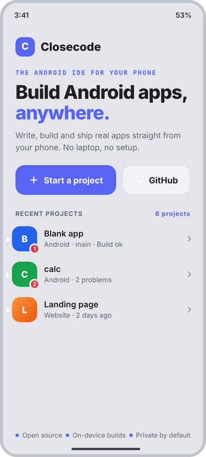
 
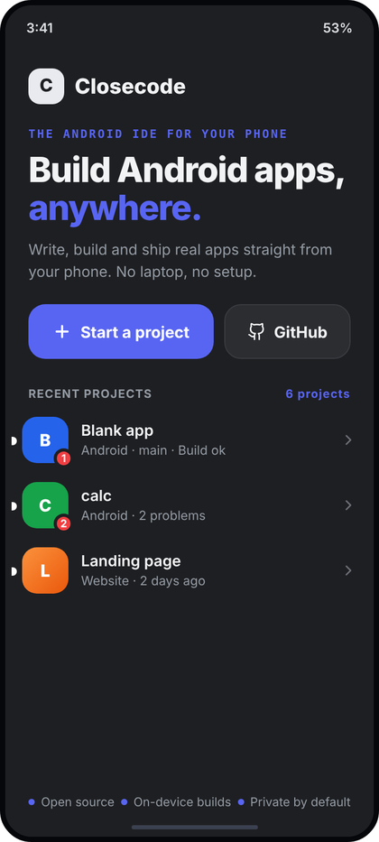

Left: light theme. Right: dark theme. All names and numbers in the pictures are examples.

What the picture shows. The home screen when no project is open (layer 3 root; the sidebar does not exist yet). Top left a small brand row (accent tile with the letter C and the name Closecode), then a mono tagline, a two-line headline whose last word is in the accent colour, one muted sentence, and two buttons side by side: Start a project (accent, wider) and GitHub (outlined). Under them a RECENT PROJECTS label with the total count at the right, and up to three project rows. Three small dotted facts sit at the bottom edge.

Numbers.

Screen: bg c.rail E3E5EA. Content padding start/end 22, top 26 (below the status bar).

Brand row: tile 34 x 34, radius 11, bg c.accent, letter 17 sp ExtraBold white; gap 10; name 20 sp ExtraBold c.text.

Tagline: mono (JetBrains Mono) 11 sp, SemiBold, letter spacing 1.6 sp, c.accent, margin top 22. Text "THE ANDROID IDE FOR YOUR PHONE".

Headline: CcType.hero (33 sp ExtraBold, letter spacing -1) with line height 1.08 = 35.6 sp, margin top 10. "anywhere." is c.accent, the rest c.text.

Sentence: 14 sp, line height 21 sp (1.5), c.muted, margin top 12.

Buttons: row margin top 20, gap 10, both 52 high, radius 16. Start a project weight 1.5, bg c.accent, text 15 sp Bold white, icon plus 18 dp stroke 2.6, gap 8. GitHub weight 1, bg c.panel F1F2F5, border 1 dp c.border, text 15 sp Bold c.text, icon gh 18 dp stroke 1.8 c.text, gap 7.

Section label row: padding start/end 22, top 26, bottom 6; "RECENT PROJECTS" is CcType.section c.muted; right text "N projects" same style in c.accent.

Project row: padding 16 horizontal, 9 vertical, gap 12. Avatar 44 dp, radius 14, letter 16 sp ExtraBold. Badge: min 19 x 19, red c.red, 3 dp ring in c.rail, 10 sp Bold white, offset 5 dp out of the bottom-right corner. Name 14.5 sp SemiBold c.text; sub line 12 sp c.muted, 2 dp under; chevron cr 16 dp stroke 2.2 c.faint.

Footer: left/right 22, bottom 26, three items spread (SpaceBetween), each a 6 dp c.accent dot, gap 6, text 11.5 sp c.muted: "Open source", "On-device builds", "Private by default".

The small white nubs on the left edge of each avatar in the picture are the rail's "unselected" pill from the shared mockup CSS. They do not belong on this screen: do not port them.

Behaviour. Data: recent = the last 3 opened projects from the project store, newest first; totalProjects = count of all projects on disk. Row subtitle = kind, branch and status joined with " · ", skipping empty parts (so a website without git shows "Website · 2 days ago"). Tap Start a project: opens the Start a project sheet (02). Tap GitHub: pushes Clone a repository (04) (if GitHub is not connected, 04 shows its own not-connected state). Tap a row: opens that project (editor, layer 1). With no projects at all the whole RECENT section, including its label, is hidden and the screen shows only brand, headline and buttons. With exactly one project the label reads "1 project". Back exits the app. The three footer facts are fixed app copy (put them in string resources).

Code.

@Composable
fun WelcomeScreen(
    recent: List<ProjectUi>, totalProjects: Int,
    onStartProject: () -> Unit, onGitHub: () -> Unit, onOpen: (ProjectUi) -> Unit
) {
    val c = CcTheme.colors
    Box(Modifier.fillMaxSize().background(c.rail).statusBarsPadding().navigationBarsPadding()) {
        Column(Modifier.fillMaxSize().verticalScroll(rememberScrollState()).padding(top = 26.dp, bottom = 64.dp)) {
            Column(Modifier.padding(horizontal = 22.dp)) {
                Row(verticalAlignment = Alignment.CenterVertically) {
                    Box(Modifier.size(34.dp).clip(RoundedCornerShape(11.dp)).background(c.accent), contentAlignment = Alignment.Center) {
                        Text("C", style = CcType.itemTitle.copy(fontSize = 17.sp, fontWeight = FontWeight.ExtraBold), color = Color.White)
                    }
                    Spacer(Modifier.width(10.dp))
                    Text("Closecode", style = CcType.itemTitle.copy(fontSize = 20.sp, fontWeight = FontWeight.ExtraBold), color = c.text)
                }
                Text("THE ANDROID IDE FOR YOUR PHONE", Modifier.padding(top = 22.dp),
                    style = CcType.code.copy(fontSize = 11.sp, fontWeight = FontWeight.SemiBold, letterSpacing = 1.6.sp, lineHeight = 14.sp), color = c.accent)
                Text(buildAnnotatedString {
                    append("Build Android apps, ")
                    withStyle(SpanStyle(color = c.accent)) { append("anywhere.") }
                }, Modifier.padding(top = 10.dp), style = CcType.hero.copy(lineHeight = 35.6.sp), color = c.text)
                Text("Write, build and ship real apps straight from your phone. No laptop, no setup.",
                    Modifier.padding(top = 12.dp), style = CcType.body.copy(fontWeight = FontWeight.Normal, lineHeight = 21.sp), color = c.muted)
                Row(Modifier.padding(top = 20.dp), horizontalArrangement = Arrangement.spacedBy(10.dp)) {
                    Row(Modifier.weight(1.5f).height(52.dp).clip(RoundedCornerShape(16.dp)).background(c.accent).clickable(onClick = onStartProject),
                        horizontalArrangement = Arrangement.Center, verticalAlignment = Alignment.CenterVertically) {
                        CcIcon("plus", Color.White, 18.dp, 2.6f); Spacer(Modifier.width(8.dp))
                        OneLine("Start a project", CcType.body.copy(fontSize = 15.sp, fontWeight = FontWeight.Bold), Color.White)
                    }
                    Row(Modifier.weight(1f).height(52.dp).clip(RoundedCornerShape(16.dp)).background(c.panel)
                        .border(1.dp, c.border, RoundedCornerShape(16.dp)).clickable(onClick = onGitHub),
                        horizontalArrangement = Arrangement.Center, verticalAlignment = Alignment.CenterVertically) {
                        CcIcon("gh", c.text, 18.dp, 1.8f); Spacer(Modifier.width(7.dp))
                        OneLine("GitHub", CcType.body.copy(fontSize = 15.sp, fontWeight = FontWeight.Bold), c.text)
                    }
                }
            }
            if (recent.isNotEmpty()) {
                Row(Modifier.fillMaxWidth().padding(start = 22.dp, top = 26.dp, end = 22.dp, bottom = 6.dp), horizontalArrangement = Arrangement.SpaceBetween) {
                    Text("RECENT PROJECTS", style = CcType.section, color = c.muted)
                    Text(if (totalProjects == 1) "1 project" else "$totalProjects projects", style = CcType.section, color = c.accent)
                }
                recent.forEach { p ->
                    Row(Modifier.fillMaxWidth().clickable { onOpen(p) }.padding(horizontal = 16.dp, vertical = 9.dp), verticalAlignment = Alignment.CenterVertically) {
                        ProjectAvatar(p, 44.dp, 14.dp, 16.sp, badgeBorder = c.rail)
                        Spacer(Modifier.width(12.dp))
                        Column(Modifier.weight(1f)) {
                            OneLine(p.name, CcType.itemTitle, c.text)
                            OneLine(listOfNotNull(p.kind, p.branch, p.statusText).filter { it.isNotBlank() }.joinToString(" · "),
                                CcType.caption, c.muted, Modifier.padding(top = 2.dp))
                        }
                        CcIcon("cr", c.faint, 16.dp, 2.2f)
                    }
                }
            }
        }
        Row(Modifier.align(Alignment.BottomCenter).fillMaxWidth().padding(start = 22.dp, end = 22.dp, bottom = 26.dp), horizontalArrangement = Arrangement.SpaceBetween) {
            listOf("Open source", "On-device builds", "Private by default").forEach {
                Row(verticalAlignment = Alignment.CenterVertically) {
                    Box(Modifier.size(6.dp).clip(CircleShape).background(c.accent)); Spacer(Modifier.width(6.dp))
                    Text(it, style = CcType.caption.copy(fontSize = 11.5.sp), color = c.muted)
                }
            }
        }
    }
}

### 02 Start a project


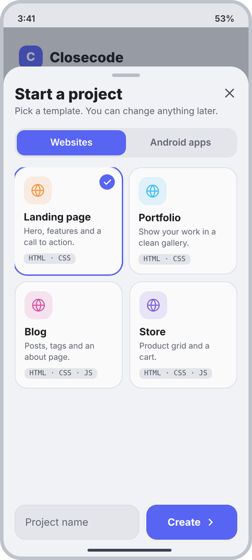
 
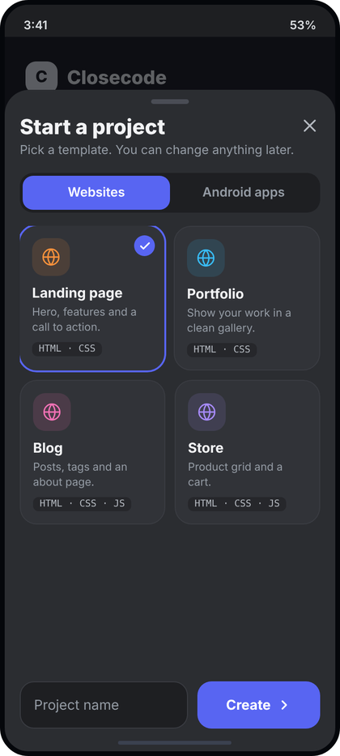

Left: light theme. Right: dark theme. All names and numbers in the pictures are examples.

What the picture shows. A tall bottom sheet over the Welcome screen (the Welcome content stays visible and dimmed at the top). It starts 90 dp below the status bar. Inside: a drag handle, the title with a one-line hint and a close X, a two-part switch (Websites / Android apps), a two-column grid of template cards (the first one is selected: accent outline and a check dot), and at the bottom a name field next to the Create button.

Numbers.

Sheet: SheetLayer(topOffset = 90.dp): bg c.panel, top radius 26 (CcShape.sheetTop), padding 16 / 10 / 16 / 24, scrim c.dim (30% of 1E2332). Handle 40 x 5, radius 3, c.toggleOff, 12 dp under it.

Title 22 sp ExtraBold c.text; hint 13 sp c.muted, 3 dp under; close icon x 22 dp c.textSoft, top-aligned at the right.

Switch: margin top 16, bottom 14, padding 3, radius 14, bg c.rail. Each part weight 1, height 36, radius 11, text 13.5 sp SemiBold; selected bg c.accent text white; unselected text c.muted.

Grid: 2 columns, gap 10 both ways. Card: radius 18 (CcShape.card), bg c.content, padding 13. Not selected: 1 dp c.border border. Selected: 2 dp c.accent outline (draw it as a 2 dp border and reduce the padding to 12 so the card does not grow).

Card content: icon tile 40 x 40 radius 13, bg template tint at 13%, icon 20 dp stroke 1.8 in the tint (the picture uses globe with orange, sky, pink, violet). Check dot: 22 dp circle c.accent, icon check 13 dp stroke 3 white, 10 dp from top and right. Name 14.5 sp Bold c.text, 10 dp below the tile. Description 11.5 sp, line height 16 sp, c.muted, 3 dp under, min height 32. Tag chip: 8 dp above, padding 7 / 2, radius 6, bg c.rail, mono 10 sp c.textSoft, text = tags joined with " · ".

Bottom row: margin top 8, gap 10. Name field: weight 1, height 50, radius 15, bg c.rail, 1 dp c.border, padding 14, text 14.5 sp c.text, hint "Project name" 14.5 sp c.muted. Create button: width 130, height 50, radius 15, bg c.accent, text 14.5 sp Bold white, then icon cr 16 dp stroke 2.6 white, gap 6. Disabled: bg c.field, text and icon c.muted.

Behaviour. Data: the tabs and templates are the ones the app really ships (TemplateUi list per tab; "Websites" and "Android apps" are the tab names provided by the template catalog). The first template of a tab is selected by default. Tap a card: select it. Tap the X, the scrim or Back: close the sheet (Welcome is underneath). Create is enabled when a template is selected and the name is valid; an invalid name (empty, already used, illegal characters) shows the error text in c.red 11.5 sp above the row, the text comes from the validator. Tap Create: creating = true (button shows the label "Creating" and ignores taps), files are written, the sheet closes and the editor opens. Empty template list: EmptyState("layers", "No templates", "Templates could not be loaded.") in place of the grid.

Code.

data class TemplateUi(val id: String, val name: String, val description: String, val tags: List<String>, val icon: String, val tint: Color)

@Composable
fun StartProjectSheet(
    tabs: List<String>, selectedTab: Int, onTab: (Int) -> Unit,
    templates: List<TemplateUi>, selectedId: String?, onSelect: (String) -> Unit,
    name: String, onName: (String) -> Unit, nameError: String?, creating: Boolean,
    onCreate: () -> Unit, onClose: () -> Unit
) {
    val c = CcTheme.colors
    val canCreate = selectedId != null && name.isNotBlank() && nameError == null && !creating
    SheetLayer(topOffset = 90.dp, onDismiss = onClose) {
        Row(verticalAlignment = Alignment.Top) {
            Column(Modifier.weight(1f)) {
                Text("Start a project", style = CcType.sheetTitle.copy(fontSize = 22.sp), color = c.text)
                Text("Pick a template. You can change anything later.", Modifier.padding(top = 3.dp), style = CcType.small, color = c.muted)
            }
            Box(Modifier.clickable(onClick = onClose).semantics { contentDescription = "Close" }) { CcIcon("x", c.textSoft, 22.dp) }
        }
        Row(Modifier.padding(top = 16.dp, bottom = 14.dp).fillMaxWidth().clip(RoundedCornerShape(14.dp)).background(c.rail).padding(3.dp)) {
            tabs.forEachIndexed { i, t ->
                Box(Modifier.weight(1f).height(36.dp).clip(RoundedCornerShape(11.dp)).background(if (i == selectedTab) c.accent else Color.Transparent)
                    .clickable { onTab(i) }, contentAlignment = Alignment.Center) {
                    OneLine(t, CcType.body.copy(fontSize = 13.5.sp, fontWeight = FontWeight.SemiBold), if (i == selectedTab) Color.White else c.muted)
                }
            }
        }
        if (templates.isEmpty()) EmptyState("layers", "No templates", "Templates could not be loaded.", Modifier.weight(1f))
        else LazyVerticalGrid(GridCells.Fixed(2), Modifier.weight(1f), horizontalArrangement = Arrangement.spacedBy(10.dp), verticalArrangement = Arrangement.spacedBy(10.dp)) {
            items(templates, key = { it.id }) { t ->
                val sel = t.id == selectedId
                Box(Modifier.clip(CcShape.card).background(c.content)
                    .border(if (sel) 2.dp else 1.dp, if (sel) c.accent else c.border, CcShape.card)
                    .clickable { onSelect(t.id) }.padding(if (sel) 12.dp else 13.dp)) {
                    Column {
                        Box(Modifier.size(40.dp).clip(RoundedCornerShape(13.dp)).background(t.tint.tint()), contentAlignment = Alignment.Center) { CcIcon(t.icon, t.tint, 20.dp, 1.8f) }
                        Text(t.name, Modifier.padding(top = 10.dp), style = CcType.itemTitle.copy(fontWeight = FontWeight.Bold), color = c.text)
                        Text(t.description, Modifier.padding(top = 3.dp).heightIn(min = 32.dp), style = CcType.caption.copy(fontSize = 11.5.sp, lineHeight = 16.sp), color = c.muted)
                        Text(t.tags.joinToString(" · "), Modifier.padding(top = 8.dp).clip(RoundedCornerShape(6.dp)).background(c.rail).padding(horizontal = 7.dp, vertical = 2.dp),
                            style = CcType.code.copy(fontSize = 10.sp, lineHeight = 14.sp), color = c.textSoft)
                    }
                    if (sel) Box(Modifier.align(Alignment.TopEnd).padding(top = 0.dp).size(22.dp).clip(CircleShape).background(c.accent), contentAlignment = Alignment.Center) {
                        CcIcon("check", Color.White, 13.dp, 3f)
                    }
                }
            }
        }
        if (nameError != null) Text(nameError, Modifier.padding(top = 6.dp), style = CcType.caption.copy(fontSize = 11.5.sp), color = c.red)
        Row(Modifier.padding(top = 8.dp), horizontalArrangement = Arrangement.spacedBy(10.dp)) {
            Box(Modifier.weight(1f).height(50.dp).clip(RoundedCornerShape(15.dp)).background(c.rail).border(1.dp, c.border, RoundedCornerShape(15.dp)).padding(horizontal = 14.dp),
                contentAlignment = Alignment.CenterStart) {
                if (name.isEmpty()) Text("Project name", style = CcType.body.copy(fontSize = 14.5.sp, fontWeight = FontWeight.Normal), color = c.muted)
                BasicTextField(name, onName, singleLine = true, cursorBrush = SolidColor(c.accent), modifier = Modifier.fillMaxWidth(),
                    textStyle = CcType.body.copy(fontSize = 14.5.sp, fontWeight = FontWeight.Normal, color = c.text))
            }
            Row(Modifier.width(130.dp).height(50.dp).clip(RoundedCornerShape(15.dp)).background(if (canCreate) c.accent else c.field)
                .clickable(enabled = canCreate, onClick = onCreate), horizontalArrangement = Arrangement.Center, verticalAlignment = Alignment.CenterVertically) {
                OneLine(if (creating) "Creating" else "Create", CcType.body.copy(fontSize = 14.5.sp, fontWeight = FontWeight.Bold), if (canCreate) Color.White else c.muted)
                if (!creating) { Spacer(Modifier.width(6.dp)); CcIcon("cr", if (canCreate) Color.White else c.muted, 16.dp, 2.6f) }
            }
        }
    }
}

The sheet is drawn above whatever screen opened it (Welcome here). It is a layer-4 sheet in the shell sense: push it with a Sheet.NewProject entry in AppNav or a local showStart boolean on Welcome.

### 03 Switch project


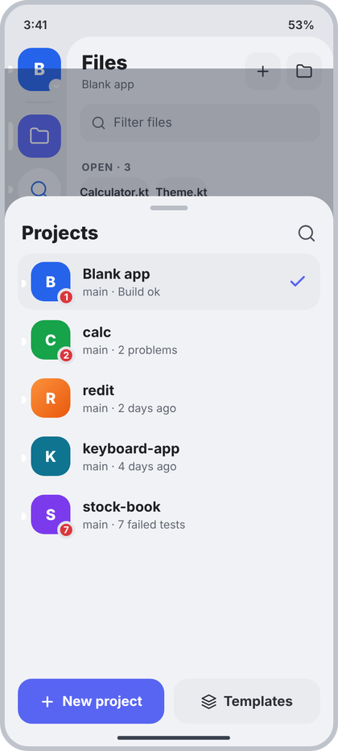
 
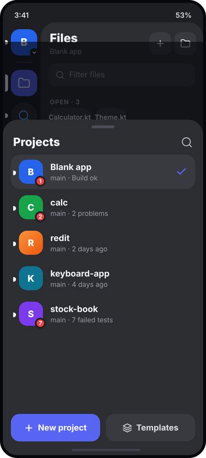

Left: light theme. Right: dark theme. All names and numbers in the pictures are examples.

What the picture shows. The project switcher, opened by tapping the project avatar at the top of the tool rail. It is a tall sheet (starts 170 dp below the status bar) over the open sidebar; the rail and the Files panel are visible and dimmed above it. Inside: handle, the title Projects with a search icon, one 60 dp row per project (the open one has a soft background and an accent check), and two buttons pinned at the bottom: New project and Templates.

Numbers.

Sheet: SheetLayer(topOffset = 170.dp) from screen 01/02 notes (bg c.panel, radius 26 top, padding 14 horizontal in this sheet, 10 top, 24 bottom). Because the shared layer uses 16 horizontal, pass the rows with Modifier.padding(horizontal = (-2).dp) or simply accept the 2 dp difference.

Title row: padding 0 / 4 / 8; title 20 sp ExtraBold c.text, search icon search 21 dp c.textSoft, stroke 1.8.

Rows: gap 2 between them, each height 60, padding 14 horizontal, radius 16, gap 13. Current row bg c.field E9EBEF. Avatar 42 dp, radius 14, letter 16 sp ExtraBold; badge as in 01 but ring colour c.rail. Name 15 sp Bold c.text; sub 12 sp c.muted, 2 dp under; sub = branch and status joined with " · ". Check: check 20 dp stroke 2.6 c.accent, only on the current row.

Bottom buttons: row gap 10, each weight 1, height 48, radius 15, text 14.5 sp Bold, gap 7. New project: bg c.accent, white, icon plus 17 dp stroke 2.6. Templates: bg c.field, text c.text2, icon layers 17 dp stroke 2.

Behaviour. Data: all projects from the project store, sorted by last opened, current one marked by currentId. Tap a row: onPick, the sheet closes and the editor, rail and panel switch to that project (open tabs restored per project). Tap the search icon: the title is replaced by a text field (CcTextField, leading icon search, hint "Find a project") that filters by name; tapping the icon again or Back clears it. Filter without result: "No projects match". Tap New project: opens the Start a project sheet (02) with the Websites tab or the last tab used. Tap Templates: opens the same sheet on the template list. Empty store: EmptyState("folder", "No projects yet", "Create your first project.", "New project", onNew). The list scrolls; the two buttons stay pinned. Scrim tap, Back: close.

Code.

@Composable
fun ProjectSwitcherSheet(
    projects: List<ProjectUi>, currentId: String?,
    onPick: (ProjectUi) -> Unit, onNew: () -> Unit, onTemplates: () -> Unit, onDismiss: () -> Unit
) {
    val c = CcTheme.colors
    var searching by remember { mutableStateOf(false) }
    var query by remember { mutableStateOf("") }
    val shown = if (query.isBlank()) projects else projects.filter { it.name.contains(query, ignoreCase = true) }
    SheetLayer(topOffset = 170.dp, onDismiss = onDismiss) {
        Row(Modifier.padding(start = 4.dp, end = 4.dp, bottom = 8.dp), verticalAlignment = Alignment.CenterVertically) {
            if (searching) CcTextField(query, { query = it }, Modifier.weight(1f), hint = "Find a project", leadingIcon = "search")
            else Text("Projects", Modifier.weight(1f), style = CcType.sheetTitle.copy(fontSize = 20.sp), color = c.text)
            Spacer(Modifier.width(10.dp))
            Box(Modifier.clickable { searching = !searching; if (!searching) query = "" }.semantics { contentDescription = "Search projects" }) {
                CcIcon(if (searching) "x" else "search", c.textSoft, 21.dp)
            }
        }
        when {
            projects.isEmpty() -> EmptyState("folder", "No projects yet", "Create your first project.", "New project", onNew, Modifier.weight(1f))
            shown.isEmpty() -> EmptyState("search", "No projects match", "Try another name.", modifier = Modifier.weight(1f))
            else -> LazyColumn(Modifier.weight(1f), verticalArrangement = Arrangement.spacedBy(2.dp)) {
                items(shown, key = { it.id }) { p ->
                    val current = p.id == currentId
                    Row(Modifier.fillMaxWidth().height(60.dp).clip(RoundedCornerShape(16.dp)).background(if (current) c.field else Color.Transparent)
                        .clickable { onPick(p) }.padding(horizontal = 14.dp), verticalAlignment = Alignment.CenterVertically) {
                        ProjectAvatar(p, 42.dp, 14.dp, 16.sp, badgeBorder = c.rail)
                        Spacer(Modifier.width(13.dp))
                        Column(Modifier.weight(1f)) {
                            OneLine(p.name, CcType.itemTitle.copy(fontSize = 15.sp, fontWeight = FontWeight.Bold), c.text)
                            OneLine(listOfNotNull(p.branch, p.statusText).filter { it.isNotBlank() }.joinToString(" · "), CcType.caption, c.muted, Modifier.padding(top = 2.dp))
                        }
                        if (current) CcIcon("check", c.accent, 20.dp, 2.6f)
                    }
                }
            }
        }
        Row(Modifier.padding(top = 8.dp), horizontalArrangement = Arrangement.spacedBy(10.dp)) {
            Row(Modifier.weight(1f).height(48.dp).clip(RoundedCornerShape(15.dp)).background(c.accent).clickable(onClick = onNew),
                horizontalArrangement = Arrangement.Center, verticalAlignment = Alignment.CenterVertically) {
                CcIcon("plus", Color.White, 17.dp, 2.6f); Spacer(Modifier.width(7.dp))
                OneLine("New project", CcType.body.copy(fontSize = 14.5.sp, fontWeight = FontWeight.Bold), Color.White)
            }
            Row(Modifier.weight(1f).height(48.dp).clip(RoundedCornerShape(15.dp)).background(c.field).clickable(onClick = onTemplates),
                horizontalArrangement = Arrangement.Center, verticalAlignment = Alignment.CenterVertically) {
                CcIcon("layers", c.text2, 17.dp, 2f); Spacer(Modifier.width(7.dp))
                OneLine("Templates", CcType.body.copy(fontSize = 14.5.sp, fontWeight = FontWeight.Bold), c.text2)
            }
        }
    }
}

Wire it in MainScreen layer 4: Sheet.ProjectSwitcher -> ProjectSwitcherSheet(vm.projects.collectAsState().value, project?.id, onPick = { vm.open(it); nav.sheet = null }, ...).

### 04 Clone a repository


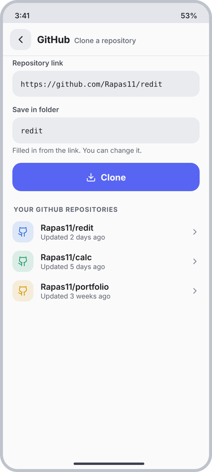
 
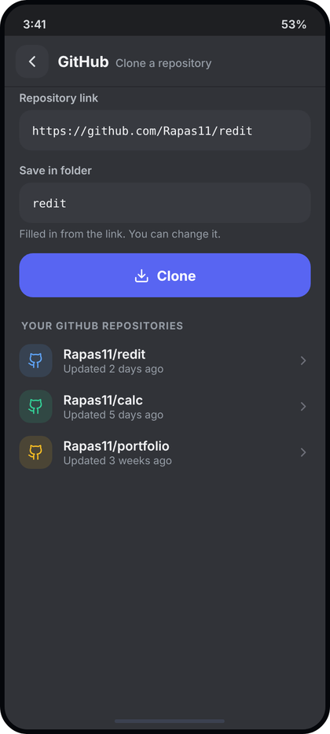

Left: light theme. Right: dark theme. All names and numbers in the pictures are examples.

What the picture shows. A full screen (layer 3) pushed from the GitHub tool or from Welcome. The header shows the origin GitHub in bold and the page name in muted text. Under it: a Repository link field and a Save in folder field (both mono) with a hint line, a wide Clone button with a download icon, and the label YOUR GITHUB REPOSITORIES followed by a list of the user's repositories.

Numbers.

Header: ScreenHeader("GitHub", "Clone a repository", onBack) (d3): 56 high, back tile 36, origin CcType.screenTitle, title 12 sp Medium c.muted, 1 dp c.divider line. Screen bg c.content FAFAFB.

Fields: horizontal padding 16, 10 below each. Label 12 sp SemiBold c.textSoft, 4 dp above and 6 below. Input: height 44, radius 13, bg c.field, padding 14, mono 12.5 sp c.text. Hint under the second field: 11.5 sp c.muted, 5 dp gap. (This is CcTextField(mono = true, label = ...) from d3 plus the hint line.)

Clone button: padding 4 / 16 / 8, height 48, radius 15, bg c.accent, text 15 sp Bold white, icon down 17 dp stroke 2, gap 8 (= PrimaryButton(icon = "down")). Disabled: bg c.field, text c.muted.

Section label: "YOUR GITHUB REPOSITORIES", SecLabel(start = 18, top = 16, bottom = 6).

Repo row: padding 16 / 7, gap 12. Tile 36 x 36 radius 12, bg tint 13%, icon gh 18 dp stroke 1.8; the tint cycles c.blue, c.green, c.yellow by row index. Name 14 sp SemiBold c.text; sub 11.5 sp c.muted; chevron cr 16 dp stroke 2.2 c.faint.

Behaviour. Data: url and folder are the user's text. folder is filled automatically from the link (last path part without ".git") until the user edits it by hand. Repositories come from the GitHub API (/user/repos, sorted by last update); the sub line is the relative time of updated_at ("Updated 2 days ago"). Tap a repo: fills the link with its clone URL and the folder with its name (does not start the clone). Tap Clone: validates (link looks like a git URL, folder name not empty and not already used, otherwise the field shows its red error line) and pushes Cloning (05). States for the list: loading = LoadingList; not connected = EmptyState("gh", "GitHub is not connected", "Sign in to see your repositories, or paste a link above.", "Sign in", onSignIn); error = ErrorCard with the real error text and Retry; zero repos = EmptyState("folder", "No repositories", "Paste a link above."). The link field works without a connection (public repos).

Code.

data class RepoUi(val fullName: String, val cloneUrl: String, val updatedText: String)
sealed interface RepoListState {
    data object Loading : RepoListState
    data object NotConnected : RepoListState
    data class Error(val message: String) : RepoListState
    data class Loaded(val repos: List<RepoUi>) : RepoListState
}

@Composable
fun CloneScreen(
    origin: String?, url: String, onUrl: (String) -> Unit, urlError: String?,
    folder: String, onFolder: (String) -> Unit, folderError: String?,
    repos: RepoListState, onPickRepo: (RepoUi) -> Unit, onRetry: () -> Unit, onSignIn: () -> Unit,
    onClone: () -> Unit, onBack: () -> Unit
) {
    val c = CcTheme.colors
    Column(Modifier.fillMaxSize().background(c.content)) {
        ScreenHeader(origin, "Clone a repository", onBack)
        Column(Modifier.weight(1f).verticalScroll(rememberScrollState())) {
            CcTextField(url, onUrl, Modifier.padding(start = 16.dp, top = 4.dp, end = 16.dp, bottom = 10.dp),
                label = "Repository link", hint = "https://github.com/owner/repo", mono = true, error = urlError)
            Column(Modifier.padding(start = 16.dp, end = 16.dp, bottom = 10.dp)) {
                CcTextField(folder, onFolder, label = "Save in folder", mono = true, error = folderError)
                if (folderError == null) Text("Filled in from the link. You can change it.", Modifier.padding(top = 5.dp), style = CcType.caption.copy(fontSize = 11.5.sp), color = c.muted)
            }
            PrimaryButton("Clone", onClone, Modifier.padding(start = 16.dp, top = 4.dp, end = 16.dp, bottom = 8.dp).fillMaxWidth(),
                icon = "down", enabled = url.isNotBlank() && folder.isNotBlank())
            SecLabel("Your GitHub repositories", start = 18.dp, top = 16.dp, bottom = 6.dp)
            when (repos) {
                RepoListState.Loading -> LoadingList(3)
                RepoListState.NotConnected -> EmptyState("gh", "GitHub is not connected", "Sign in to see your repositories, or paste a link above.", "Sign in", onSignIn)
                is RepoListState.Error -> ErrorCard(repos.message, onRetry)
                is RepoListState.Loaded ->
                    if (repos.repos.isEmpty()) EmptyState("folder", "No repositories", "Paste a link above.")
                    else repos.repos.forEachIndexed { i, r ->
                        val tint = listOf(c.blue, c.green, c.yellow)[i % 3]
                        Row(Modifier.fillMaxWidth().clickable { onPickRepo(r) }.padding(horizontal = 16.dp, vertical = 7.dp), verticalAlignment = Alignment.CenterVertically) {
                            Box(Modifier.size(36.dp).clip(RoundedCornerShape(12.dp)).background(tint.tint()), contentAlignment = Alignment.Center) { CcIcon("gh", tint, 18.dp, 1.8f) }
                            Spacer(Modifier.width(12.dp))
                            Column(Modifier.weight(1f)) {
                                OneLine(r.fullName, CcType.body.copy(fontWeight = FontWeight.SemiBold), c.text)
                                OneLine(r.updatedText, CcType.caption.copy(fontSize = 11.5.sp), c.muted)
                            }
                            CcIcon("cr", c.faint, 16.dp, 2.2f)
                        }
                    }
            }
            Spacer(Modifier.height(24.dp))
        }
    }
}

origin comes from nav.originOf(index, project?.name) (it is "GitHub" for this route).

### 05 Cloning progress


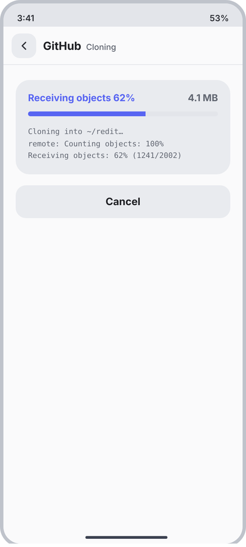
 
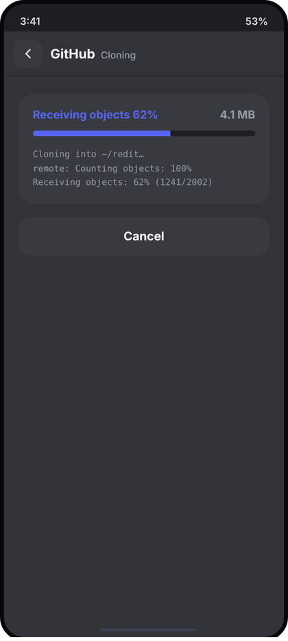

Left: light theme. Right: dark theme. All names and numbers in the pictures are examples.

What the picture shows. Full screen (layer 3) shown while a clone runs. Header with origin GitHub and the page name Cloning. One rounded card holds the current git phase with its percentage on the left in the accent colour, the downloaded size on the right, a thin progress bar and three lines of mono log text. A Cancel button sits under the card.

Numbers.

Header: ScreenHeader("GitHub", "Cloning", ...). Screen bg c.content. Body padding 22 top, 18 sides.

Card: padding 18, radius 20, bg c.field. Top row: phase text 14 sp Bold c.accent ("Receiving objects 62%"), size text 14 sp Bold c.muted at the right.

Bar: height 7, radius 4, track c.rail, fill c.accent, margin 11 top and 14 bottom, fill animates 200 ms linear.

Log: mono 11 sp, line height 17.6 sp (1.6), c.muted, 3 lines.

Cancel: 16 dp below the card, height 48, radius 15, bg c.field, text 15 sp Bold c.text, centred, full width.

Behaviour. Data: the git library's progress callbacks. phase = current task title ("Counting objects", "Receiving objects", "Resolving deltas"), percent 0..1, sizeText = bytes received formatted ("4.1 MB"), log = the last 3 lines the library printed (first line "Cloning into ~/folder..."). When the library reports no percentage (indeterminate phase) the fill is 0 and the phase text has no percent. Cancel (and the header back button and system Back) show the confirm dialog "Stop cloning?" (CcConfirmDialog, destructive "Stop"); on confirm the clone is cancelled, the half-written folder is deleted and the screen returns to Clone (04). Success: this screen is replaced by the editor with the new project open. Failure: the card is replaced by ErrorCard(real message, onRetry) and the button label becomes "Back".

Code.

@Composable
fun CloningScreen(
    origin: String?, phase: String, percent: Float?, sizeText: String, log: List<String>,
    error: String?, onRetry: () -> Unit, onCancel: () -> Unit, onBack: () -> Unit
) {
    val c = CcTheme.colors
    val p by animateFloatAsState((percent ?: 0f).coerceIn(0f, 1f), tween(200, easing = LinearEasing), label = "clone")
    Column(Modifier.fillMaxSize().background(c.content)) {
        ScreenHeader(origin, "Cloning", onCancel)
        Column(Modifier.padding(start = 18.dp, top = 22.dp, end = 18.dp)) {
            if (error != null) ErrorCard(error, onRetry)
            else Column(Modifier.fillMaxWidth().clip(RoundedCornerShape(20.dp)).background(c.field).padding(18.dp)) {
                Row {
                    OneLine(if (percent != null) "$phase ${(percent * 100).toInt()}%" else phase,
                        CcType.body.copy(fontWeight = FontWeight.Bold), c.accent, Modifier.weight(1f))
                    OneLine(sizeText, CcType.body.copy(fontWeight = FontWeight.Bold), c.muted)
                }
                Box(Modifier.padding(top = 11.dp, bottom = 14.dp).fillMaxWidth().height(7.dp).clip(RoundedCornerShape(4.dp)).background(c.rail)) {
                    Box(Modifier.fillMaxHeight().fillMaxWidth(p).background(c.accent))
                }
                log.takeLast(3).forEach { Text(it, style = CcType.code.copy(fontSize = 11.sp, lineHeight = 17.6.sp), color = c.muted, maxLines = 1, overflow = TextOverflow.Ellipsis) }
            }
            Box(Modifier.padding(top = 16.dp).fillMaxWidth().height(48.dp).clip(RoundedCornerShape(15.dp)).background(c.field)
                .clickable(onClick = if (error != null) onBack else onCancel), contentAlignment = Alignment.Center) {
                Text(if (error != null) "Back" else "Cancel", style = CcType.body.copy(fontSize = 15.sp, fontWeight = FontWeight.Bold), color = c.text)
            }
        }
    }
}

The Cancel confirm dialog lives in the host: onCancel should set a showStopDialog flag that renders CcConfirmDialog("Stop cloning?", "The files downloaded so far will be deleted.", "Stop", destructive = true, ...).

### 06 First-time setup


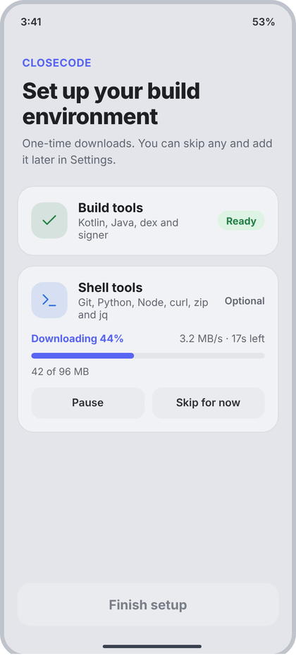
 
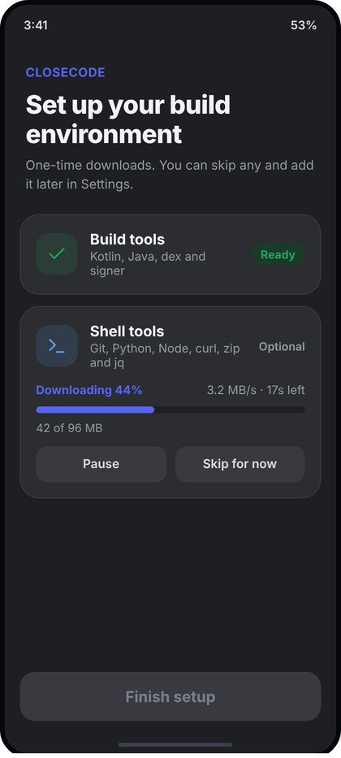

Left: light theme. Right: dark theme. All names and numbers in the pictures are examples.

What the picture shows. A full screen shown once, the first time the app runs (no header, no back button). A small accent label, a big two-line title and a muted sentence at the top. Below, one card per download: Build tools (finished, with a green Ready pill) and Shell tools (optional, downloading, with percent, speed, a bar, the size and two buttons Pause and Skip for now). A disabled Finish setup button waits at the bottom.

Numbers.

Screen bg c.rail E3E5EA. Top block padding start/end 22, top 30, bottom 20 (below the status bar).

"CLOSECODE" 13 sp Bold, letter spacing 0.5 sp, c.accent. Title 27 sp ExtraBold (CcType.setupTitle), line height 1.15 = 31 sp, letter spacing -0.5 sp, c.text, margin top 10. Sentence 13.5 sp, line height 20 sp, c.muted, margin top 8.

Card: margin 16 horizontal, 12 below; padding 16, radius 20, bg c.panel F1F2F5, border 1 dp c.border. Head row gap 13: tile 44 x 44, radius 14, bg tint 13%, icon 22 dp stroke 1.8 (Build tools: check, c.green; Shell tools: term, c.blue). Title 15.5 sp Bold c.text; sub 12.5 sp c.muted, 2 dp under, may wrap to 2 lines.

Status at the right: Ready pill height 24, padding 10, radius 12, bg c.diffAddBg DDF3E4, text 12 sp Bold c.green. "Optional": 12 sp SemiBold c.muted.

Progress block (margin top 14): left "Downloading 44%" 12.5 sp Bold c.accent, right "3.2 MB/s · 17s left" 12.5 sp c.muted; bar 7 high radius 4, track c.rail, fill c.accent, 9 dp below; size text "42 of 96 MB" 12 sp c.muted, 8 dp below the bar; buttons row 12 dp below, gap 9, each weight 1, height 38, radius 12, bg c.field, text 13 sp SemiBold c.text.

Finish setup: left/right 16, bottom 34, height 52, radius 16, text 16 sp Bold. Disabled: bg c.field, text c.faint. Enabled: bg c.accent, text white.

Behaviour. Data: one SetupStepUi per real download the app needs (build tools = required, shell tools = optional), with state from the download manager. States: Ready (pill), Waiting (status "Queued"), Downloading (percent, speed, ETA, bytes), Paused (label "Paused", Pause turns into Resume), Failed (status "Failed" in c.red, the error text under the sub line, button Retry replaces Pause), Skipped (status "Skipped"). Skip for now: stops that download, state Skipped (it can be added later in Settings, Build and Toolchain). Finish setup is enabled when every required step is Ready; optional steps may be anything. Tap Finish: stores setupDone = true and shows Welcome. Back does nothing until finished (it is a gate). Speed and ETA are computed from the last few seconds of bytes, shown only while Downloading.

Code.

sealed interface StepState {
    data object Ready : StepState
    data object Waiting : StepState
    data class Downloading(val percent: Float, val speedText: String, val etaText: String, val sizeText: String, val paused: Boolean = false) : StepState
    data class Failed(val message: String) : StepState
    data object Skipped : StepState
}
data class SetupStepUi(val id: String, val icon: String, val tint: Color, val title: String, val subtitle: String, val required: Boolean, val state: StepState)

@Composable
fun FirstSetupScreen(steps: List<SetupStepUi>, onPauseResume: (String) -> Unit, onSkip: (String) -> Unit, onRetry: (String) -> Unit, onFinish: () -> Unit) {
    val c = CcTheme.colors
    val canFinish = steps.filter { it.required }.all { it.state is StepState.Ready }
    Box(Modifier.fillMaxSize().background(c.rail).statusBarsPadding().navigationBarsPadding()) {
        Column(Modifier.fillMaxSize().verticalScroll(rememberScrollState()).padding(bottom = 100.dp)) {
            Column(Modifier.padding(start = 22.dp, top = 30.dp, end = 22.dp, bottom = 20.dp)) {
                Text("CLOSECODE", style = CcType.caption.copy(fontSize = 13.sp, fontWeight = FontWeight.Bold, letterSpacing = 0.5.sp), color = c.accent)
                Text("Set up your build environment", Modifier.padding(top = 10.dp), style = CcType.setupTitle.copy(lineHeight = 31.sp, letterSpacing = (-0.5).sp), color = c.text)
                Text("One-time downloads. You can skip any and add it later in Settings.", Modifier.padding(top = 8.dp),
                    style = CcType.body.copy(fontSize = 13.5.sp, fontWeight = FontWeight.Normal, lineHeight = 20.sp), color = c.muted)
            }
            steps.forEach { s ->
                Column(Modifier.padding(start = 16.dp, end = 16.dp, bottom = 12.dp).fillMaxWidth().clip(RoundedCornerShape(20.dp)).background(c.panel)
                    .border(1.dp, c.border, RoundedCornerShape(20.dp)).padding(16.dp)) {
                    Row(verticalAlignment = Alignment.CenterVertically) {
                        Box(Modifier.size(44.dp).clip(RoundedCornerShape(14.dp)).background(s.tint.tint()), contentAlignment = Alignment.Center) { CcIcon(s.icon, s.tint, 22.dp, 1.8f) }
                        Spacer(Modifier.width(13.dp))
                        Column(Modifier.weight(1f)) {
                            Text(s.title, style = CcType.itemTitle.copy(fontSize = 15.5.sp, fontWeight = FontWeight.Bold), color = c.text)
                            Text(s.subtitle, Modifier.padding(top = 2.dp), style = CcType.caption.copy(fontSize = 12.5.sp), color = c.muted)
                        }
                        Spacer(Modifier.width(8.dp))
                        when (val st = s.state) {
                            StepState.Ready -> Text("Ready", Modifier.clip(RoundedCornerShape(12.dp)).background(c.diffAddBg).padding(horizontal = 10.dp, vertical = 4.dp),
                                style = CcType.caption.copy(fontWeight = FontWeight.Bold), color = c.green)
                            is StepState.Failed -> Text("Failed", style = CcType.caption.copy(fontWeight = FontWeight.SemiBold), color = c.red)
                            StepState.Skipped -> Text("Skipped", style = CcType.caption.copy(fontWeight = FontWeight.SemiBold), color = c.muted)
                            else -> Text(if (s.required) "Required" else "Optional", style = CcType.caption.copy(fontWeight = FontWeight.SemiBold), color = c.muted)
                        }
                    }
                    (s.state as? StepState.Failed)?.let { Text(it.message, Modifier.padding(top = 8.dp), style = CcType.caption, color = c.red) }
                    (s.state as? StepState.Downloading)?.let { d ->
                        val p by animateFloatAsState(d.percent.coerceIn(0f, 1f), tween(200, easing = LinearEasing), label = "dl")
                        Row(Modifier.padding(top = 14.dp)) {
                            Text(if (d.paused) "Paused ${(d.percent * 100).toInt()}%" else "Downloading ${(d.percent * 100).toInt()}%",
                                Modifier.weight(1f), style = CcType.caption.copy(fontSize = 12.5.sp, fontWeight = FontWeight.Bold), color = c.accent)
                            if (!d.paused) Text("${d.speedText} · ${d.etaText}", style = CcType.caption.copy(fontSize = 12.5.sp), color = c.muted)
                        }
                        Box(Modifier.padding(top = 9.dp).fillMaxWidth().height(7.dp).clip(RoundedCornerShape(4.dp)).background(c.rail)) {
                            Box(Modifier.fillMaxHeight().fillMaxWidth(p).background(c.accent))
                        }
                        Text(d.sizeText, Modifier.padding(top = 8.dp), style = CcType.caption, color = c.muted)
                        Row(Modifier.padding(top = 12.dp), horizontalArrangement = Arrangement.spacedBy(9.dp)) {
                            SetupButton(if (d.paused) "Resume" else "Pause", Modifier.weight(1f)) { onPauseResume(s.id) }
                            SetupButton("Skip for now", Modifier.weight(1f)) { onSkip(s.id) }
                        }
                    }
                    if (s.state is StepState.Failed) Row(Modifier.padding(top = 12.dp)) { SetupButton("Retry", Modifier.weight(1f)) { onRetry(s.id) } }
                }
            }
        }
        Box(Modifier.align(Alignment.BottomCenter).padding(start = 16.dp, end = 16.dp, bottom = 34.dp).fillMaxWidth().height(52.dp)
            .clip(RoundedCornerShape(16.dp)).background(if (canFinish) c.accent else c.field).clickable(enabled = canFinish, onClick = onFinish), contentAlignment = Alignment.Center) {
            Text("Finish setup", style = CcType.body.copy(fontSize = 16.sp, fontWeight = FontWeight.Bold), color = if (canFinish) Color.White else c.faint)
        }
    }
}

@Composable
private fun SetupButton(text: String, modifier: Modifier, onClick: () -> Unit) =
    Box(modifier.height(38.dp).clip(RoundedCornerShape(12.dp)).background(CcTheme.colors.field).clickable(onClick = onClick), contentAlignment = Alignment.Center) {
        Text(text, style = CcType.small.copy(fontWeight = FontWeight.SemiBold), color = CcTheme.colors.text)
    }

### 07 Editor


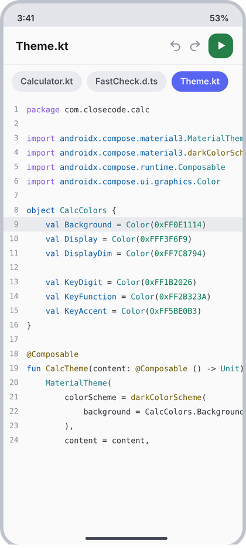
 
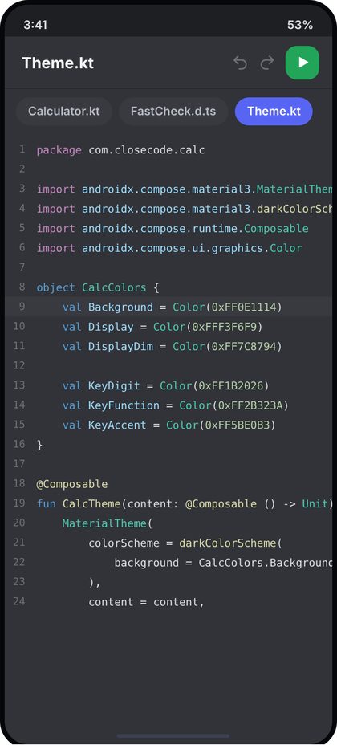

Left: light theme. Right: dark theme. All names and numbers in the pictures are examples.

What the picture shows. Layer 1 of the app, the screen the user lives in. A 56 dp header with the open file name at the left and, at the right, undo, redo and a green Run button. Under it a row of rounded tabs for the open files (the active one is accent). Then the code: line numbers in a fixed column, the current line highlighted, syntax colours, long lines cut off at the right edge (they scroll sideways). No sidebar button: the sidebar is opened by swiping right (screen 09). No Save, no More button.

Numbers.

Screen bg c.content FAFAFB. Below the status bar.

Header: height 56, padding start 18, end 14, gap 10, bottom line 1 dp c.divider. File name CcType.screenTitle (16.5 sp Bold) c.text, one line. Undo and redo: icons undo, redo, 19 dp, stroke 1.9, no tile, colour c.faint (greyed) when there is nothing to undo or redo, c.text2 when active. Run: 36 x 36, radius 12, bg c.green 248046, icon play 17 dp white (filled).

Tabs row: bg c.content, padding 12 horizontal, 9 vertical, gap 7, scrolls sideways. Tab: height 30, padding 13, radius 15, text 12.5 sp SemiBold. Active: bg c.accent, text white. Others: bg c.field, text c.textSoft.

Code area: top padding 6. Line: height 21 dp. Gutter 34 dp wide, numbers right-aligned with end padding 12, 11 sp mono c.faint. Code text: mono 11.5 sp (CcType.code), no wrapping. Current line: full-width bg c.field E9EBEF.

Syntax colours (light): keyword 8250DF, type 1B7C83, string A5461D, function and annotation 6F5A00, number 0A7D4F, comment 5E7F46, variable and property 0A5EA8, plain text c.text2 2E3036. Plain text and Markdown stay plain.

Behaviour. Data: tabs from the open files (real paths), lines from the file on disk run through the highlighter (the app's existing tokenizer returns an AnnotatedString per line built with CcSyntax), cursorLine from the caret. The file saves itself, so there is no Save. Tap a tab: switch file. Long text lines scroll sideways together: all lines share one horizontal ScrollState (scrollX); the sidebar host reads scrollX.value > 0 as canScrollLeft (see 09). Undo and redo are enabled from the editor's history. Run: starts the build/run flow for the open project (the Run screen, 25). No file open: EmptyState("file", "No file open", "Swipe right and pick a file."). Empty tab list hides the tab row. Unreadable or binary file: ErrorCard("This file cannot be shown as text.", null). Hardware Back at the editor: see AppNav.onBack (d4): press twice within 2 s to exit.

Code.

/** Light syntax tokens. Dark values come from the dark theme table. */
object CcSyntax {
    val keyword = Color(0xFF8250DF); val type = Color(0xFF1B7C83); val string = Color(0xFFA5461D)
    val function = Color(0xFF6F5A00); val number = Color(0xFF0A7D4F); val comment = Color(0xFF5E7F46)
    val variable = Color(0xFF0A5EA8)
}

data class EditorTab(val path: String, val name: String)

@Composable
fun EditorScreen(
    fileName: String?, tabs: List<EditorTab>, activePath: String?,
    canUndo: Boolean, canRedo: Boolean,
    lines: List<AnnotatedString>, cursorLine: Int, scrollX: ScrollState,
    imeVisible: Boolean, onKey: (EditorKey) -> Unit,
    onTab: (EditorTab) -> Unit, onUndo: () -> Unit, onRedo: () -> Unit, onRun: () -> Unit
) {
    val c = CcTheme.colors
    Column(Modifier.fillMaxSize().background(c.content).statusBarsPadding().imePadding()) {
        Row(Modifier.fillMaxWidth().height(56.dp).padding(start = 18.dp, end = 14.dp), verticalAlignment = Alignment.CenterVertically) {
            OneLine(fileName ?: "No file open", CcType.screenTitle, c.text, Modifier.weight(1f))
            Spacer(Modifier.width(10.dp))
            Box(Modifier.clickable(enabled = canUndo, onClick = onUndo).semantics { contentDescription = "Undo" }) { CcIcon("undo", if (canUndo) c.text2 else c.faint, 19.dp, 1.9f) }
            Spacer(Modifier.width(10.dp))
            Box(Modifier.clickable(enabled = canRedo, onClick = onRedo).semantics { contentDescription = "Redo" }) { CcIcon("redo", if (canRedo) c.text2 else c.faint, 19.dp, 1.9f) }
            Spacer(Modifier.width(10.dp))
            Box(Modifier.size(36.dp).clip(RoundedCornerShape(12.dp)).background(c.green).clickable(onClick = onRun).semantics { contentDescription = "Run" },
                contentAlignment = Alignment.Center) { CcIcon("play", Color.White, 17.dp) }
        }
        Box(Modifier.fillMaxWidth().height(1.dp).background(c.divider))
        if (tabs.isNotEmpty()) Row(Modifier.fillMaxWidth().horizontalScroll(rememberScrollState()).padding(horizontal = 12.dp, vertical = 9.dp),
            horizontalArrangement = Arrangement.spacedBy(7.dp)) {
            tabs.forEach { t ->
                val on = t.path == activePath
                Box(Modifier.height(30.dp).clip(RoundedCornerShape(15.dp)).background(if (on) c.accent else c.field).clickable { onTab(t) }.padding(horizontal = 13.dp), contentAlignment = Alignment.Center) {
                    OneLine(t.name, CcType.caption.copy(fontSize = 12.5.sp, fontWeight = FontWeight.SemiBold), if (on) Color.White else c.textSoft)
                }
            }
        }
        Box(Modifier.weight(1f).fillMaxWidth()) {
            if (fileName == null) EmptyState("file", "No file open", "Swipe right and pick a file.")
            else LazyColumn(Modifier.fillMaxSize().padding(top = 6.dp)) {
                itemsIndexed(lines) { i, line ->
                    Row(Modifier.fillMaxWidth().height(21.dp).background(if (i + 1 == cursorLine) c.field else Color.Transparent), verticalAlignment = Alignment.CenterVertically) {
                        Text("${i + 1}", Modifier.width(34.dp).padding(end = 12.dp), textAlign = TextAlign.End,
                            style = CcType.code.copy(fontSize = 11.sp), color = c.faint, maxLines = 1)
                        Box(Modifier.weight(1f).horizontalScroll(scrollX)) {
                            Text(line, style = CcType.code, color = c.text2, softWrap = false, maxLines = 1)
                        }
                    }
                }
            }
        }
        if (imeVisible) KeyRow(onKey)          // screen 08
    }
}

Build the AnnotatedString per line with SpanStyle(color = CcSyntax.keyword) and so on; keep the app's existing tokenizer, only map its token kinds to these colours.

### 08 Editor with keyboard and key row


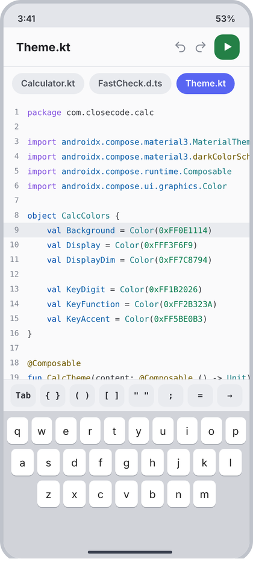
 
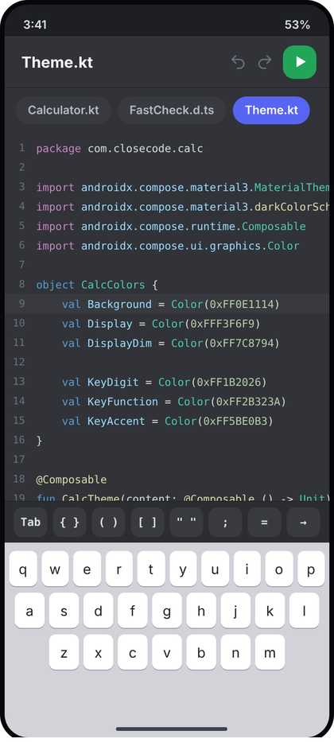

Left: light theme. Right: dark theme. All names and numbers in the pictures are examples.

What the picture shows. Same screen as 07 (see 07 for header, tabs and code) with the phone keyboard open. The code area is shorter (it ends at line 18, the rest is hidden behind the key row and keyboard), and a row of eight code keys sits between the code and the keyboard. The keyboard itself is the system keyboard: the app does not draw it. The header and tabs stay.

Numbers.

Key row: bg c.panel F1F2F5, 1 dp c.divider line on top, padding 10 horizontal and 6 vertical, gap 6. Total height 32 + 12 + 1 = 45 dp.

Key: weight 1 (all eight are the same width), height 32, radius 9, bg c.field, text mono 12 sp SemiBold c.text2, centred.

Labels in order: Tab, { }, ( ), [ ], " ", ;, =, and an arrow (-> drawn as the arrow glyph).

The shell: Modifier.imePadding() on the editor column (already in 07). In the mockup the system keyboard is 210 dp high; the real height is whatever the device gives.

Behaviour. Shown only while the keyboard is visible (WindowInsets.isImeVisible). Tap Tab: inserts the project's tab (spaces per Settings, Editor, Tab size). Tap a pair key: inserts both characters and places the caret between them (if text is selected, wraps the selection). Tap ; or =: inserts that character. Tap the arrow: moves the caret one character to the right (to jump over a closing bracket). Keys never take focus from the editor, so the keyboard stays up. While the keyboard is visible the sidebar swipe is off (SidebarHost ignores gestures when keyboardVisible, d4); hide the keyboard to swipe. Run and undo/redo in the header keep working.

Code. Delta only: base screen is 07. Add this and the if (imeVisible) KeyRow(onKey) line already present at the end of EditorScreen.

data class EditorKey(val label: String, val insert: String, val caretBack: Int = 0, val moveRight: Boolean = false)

private val CodeKeys = listOf(
    EditorKey("Tab", "\t"),
    EditorKey("{ }", "{}", caretBack = 1), EditorKey("( )", "()", caretBack = 1), EditorKey("[ ]", "[]", caretBack = 1),
    EditorKey("\" \"", "\"\"", caretBack = 1),
    EditorKey(";", ";"), EditorKey("=", "="),
    EditorKey("→", "", moveRight = true)
)

@Composable
fun KeyRow(onKey: (EditorKey) -> Unit) {
    val c = CcTheme.colors
    Column(Modifier.fillMaxWidth().background(c.panel)) {
        Box(Modifier.fillMaxWidth().height(1.dp).background(c.divider))
        Row(Modifier.fillMaxWidth().padding(horizontal = 10.dp, vertical = 6.dp), horizontalArrangement = Arrangement.spacedBy(6.dp)) {
            CodeKeys.forEach { k ->
                // pointerInput instead of clickable: a tap must not steal focus and close the keyboard
                Box(Modifier.weight(1f).height(32.dp).clip(RoundedCornerShape(9.dp)).background(c.field)
                    .pointerInput(k) { detectTapGestures { onKey(k) } }, contentAlignment = Alignment.Center) {
                    Text(k.label, style = CcType.code.copy(fontSize = 12.sp, fontWeight = FontWeight.SemiBold, lineHeight = 16.sp), color = c.text2)
                }
            }
        }
    }
}

The host applies a key like this: replace the selection with insert, then move the caret left by caretBack, or right by one when moveRight is true.

### 09 Swipe: sidebar opens under the editor


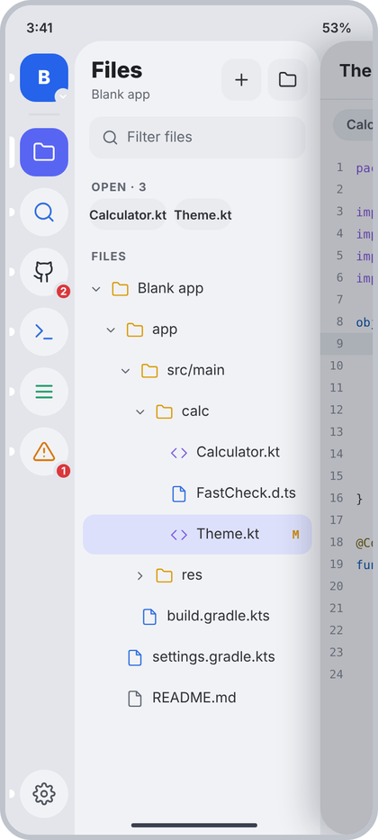
 
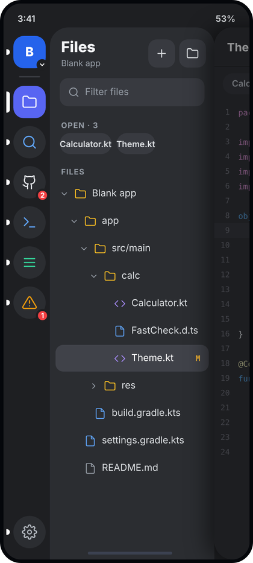

Left: light theme. Right: dark theme. All names and numbers in the pictures are examples.

What the picture shows. The editor card (screen 07) has been dragged 300 dp to the right and rests there. Under it, on the left, are the two sidebar layers: the 66 dp tool rail (project avatar on top, six tool tiles, Settings at the bottom; the Files tile is selected, accent with a white pill at the left edge) and the 234 dp Files panel (screen 10). The card keeps rounded left corners (radius 26), has a soft shadow, and is dimmed so only a strip of the editor is visible at the right edge. The numbers on the right strip are the editor's line numbers.

Numbers. (all from d4: SidebarHost, ToolRail, SidePanel; do not change them)

Sidebar width 300 dp = rail 66 + panel 234. Rail bg c.rail, panel bg c.panel with top-left radius 26 (CcShape.panelTopLeft).

Card offset at rest: 300 dp (translationX). Corner radius 26 x progress on the two left corners, shadow elevation 24 x progress. Dim over the card: c.dim at alpha 0.30 x progress (the picture shows the dim at full progress).

Gesture: touch slop with a horizontal start (horizontal movement more than twice the vertical), only rightwards when closed, both ways when open. Allowed when the code is at its left end, or when the touch started inside the 40 dp left edge zone, or when the sidebar is open. Ignored while the keyboard is up. Release: open when the offset passes 40% of 300 dp, or the fling is faster than 800 dp per second to the right; closed when faster to the left.

Spring: damping ratio 0.85, stiffness 400. Same spring for gesture release, Back and tapping a tool.

Rail pieces in the picture: avatar tile 46 x 46 (radius 15) with a 16 dp ring badge showing a small chevron (cd 10 dp, stroke 2.6); thin divider 30 x 2 below it; tool tiles 46 x 46, radius 23 (selected 15), gap 11; icons 22 dp stroke 1.8, selected icon white on c.accent, others on c.panel in their tool colour (Files c.yellow, Search c.blue, GitHub c.text2, Terminal c.blue, Logcat c.green, Problems c.orange); red count badges (19 dp, 3 dp ring in c.rail) on GitHub and Problems; Settings cog 22 dp c.textSoft at the bottom. The picture draws the Logcat tile with the menu glyph (three lines); the shared Tool enum in d4 names it bug, keep d4 and the enum.

Behaviour. The card follows the finger while dragging (no animation during the drag, snapTo), then springs to the end. While open, a tap on the dimmed card closes the sidebar; a tap on a file in the Files panel opens it and closes the sidebar; system Back closes it (d4 onBack: sheet, then top screen, then sidebar). The panel content comes from the selected tool (Crossfade, 120 ms). The only way to open the sidebar is this swipe. With no file open, the swipe still works from anywhere on the empty editor. If a file is wider than the screen, a right swipe first scrolls the code back to its left end (the swipe does not open the sidebar), and a swipe that starts inside the 40 dp left edge opens it anyway.

Code. Delta only: base is 07 with SidebarHost from d4. This is the wiring in MainScreen that makes the picture; SidebarHost itself is not changed.

@Composable
fun EditorWithSidebar(vm: MainViewModel, nav: AppNav) {
    val codeScroll = rememberScrollState()                        // shared by every code line (screen 07)
    val imeVisible = WindowInsets.isImeVisible
    val project by vm.project.collectAsState()
    SidebarHost(
        open = nav.sidebarOpen, onOpenChange = { nav.sidebarOpen = it }, keyboardVisible = imeVisible,
        canScrollLeft = { codeScroll.value > 0 },                 // right swipe scrolls the code first
        sidebar = {
            Row {
                ToolRail(project, nav.sidebarTool, vm.badges.collectAsState().value,
                    onSelect = { nav.sidebarTool = it }, onSettings = { nav.push(Route.Settings) },
                    onProjectClick = { nav.sheet = Sheet.ProjectSwitcher })
                Crossfade(nav.sidebarTool, animationSpec = tween(120), label = "tool") { tool ->
                    when (tool) {
                        Tool.Files -> FilesPanel(/* screen 10: rows, filter, callbacks from vm */)
                        else -> ToolPanel(tool, vm, nav)           // screens 12 to 31
                    }
                }
            }
        },
        editor = {
            EditorScreen(
                fileName = vm.activeFile.collectAsState().value?.name, tabs = vm.tabs.collectAsState().value,
                activePath = vm.activeFile.collectAsState().value?.path,
                canUndo = vm.canUndo.collectAsState().value, canRedo = vm.canRedo.collectAsState().value,
                lines = vm.highlightedLines.collectAsState().value, cursorLine = vm.cursorLine.collectAsState().value,
                scrollX = codeScroll, imeVisible = imeVisible, onKey = vm::applyKey,
                onTab = vm::activate, onUndo = vm::undo, onRedo = vm::redo, onRun = { nav.push(Route.Run) }
            )
        }
    )
}

Opening a file from the Files panel calls vm.activate(file); nav.closeSidebar().

## Screens 10 to 21 (files, search, GitHub, source control)

Notes that apply to every section below (screens 10 to 21). Imports are omitted in the snippets: they are the usual androidx.compose.foundation.*, foundation.layout.*, runtime.*, ui.*, material3.Text, plus CcTheme, CcType, CcShape, CcIcon, OneLine, ScreenHeader, HeaderAction, SidePanel, EmptyState, LoadingList, ErrorCard, PrimaryButton, CcConfirmDialog from d2/d3/d4. Two icons used here are not in the d2 table and must be added to CcIconPaths: "edit" to "M12 20h9M16.5 3.5a2.1 2.1 0 0 1 3 3L7 19l-4 1 1-4z" (Rename) and "back" to "M15 18l-6-6 6-6" (same path as cl; d3 already calls CcIcon("back")). All hex values below are the LIGHT theme.

Shared helpers used by several sections (written once, here, and then only called):

/** Small uppercase label above a group. Panels use (start 16, top 12, end 16, bottom 4). Full screens use (18, 16, 18, 6). */
@Composable
fun SecLabel(text: String, start: Dp = 16.dp, top: Dp = 12.dp, bottom: Dp = 4.dp) =
    Text(text.uppercase(), style = CcType.section, color = CcTheme.colors.muted,
        modifier = Modifier.padding(start = start, top = top, end = start, bottom = bottom))

enum class ChangeKind(val letter: String) { Modified("M"), Added("A"), Deleted("D"), Renamed("R") }

@Composable
fun changeColor(k: ChangeKind): Color = with(CcTheme.colors) {
    when (k) { ChangeKind.Modified -> amber; ChangeKind.Added -> green; ChangeKind.Deleted -> red; ChangeKind.Renamed -> blue }
}

/** 22 x 22 coloured square with the letter. Used in Source control (17) and Commit detail (20). */
@Composable
fun ChangeBadge(kind: ChangeKind) =
    Box(Modifier.size(22.dp).clip(RoundedCornerShape(7.dp)).background(changeColor(kind)), contentAlignment = Alignment.Center) {
        Text(kind.letter, style = CcType.small.copy(fontSize = 11.sp, fontWeight = FontWeight.ExtraBold), color = Color.White)
    }

/** The card used for a changed file: margin 0/14, radius 13, field background, padding 9/11, gap 10. */
@Composable
fun ChangedFileRow(kind: ChangeKind, name: String, sub: String, onClick: () -> Unit) {
    val c = CcTheme.colors
    Row(Modifier.fillMaxWidth().padding(start = 14.dp, end = 14.dp, bottom = 6.dp)
        .clip(RoundedCornerShape(13.dp)).background(c.field).clickable(onClick = onClick)
        .padding(horizontal = 11.dp, vertical = 9.dp), verticalAlignment = Alignment.CenterVertically) {
        ChangeBadge(kind); Spacer(Modifier.width(10.dp))
        Column(Modifier.weight(1f)) {
            OneLine(name, CcType.small.copy(fontSize = 13.5.sp, fontWeight = FontWeight.SemiBold), c.text)
            OneLine(sub, CcType.code.copy(fontSize = 10.5.sp, lineHeight = 14.sp), c.muted, Modifier.padding(top = 1.dp))
        }
    }
}

/** Same menu card as d3's CcPopupMenu but with dividers, free width, and an optional invisible icon (for check lists). */
sealed interface MenuEntry {
    data class Item(val icon: String, val text: String, val destructive: Boolean = false,
                    val iconVisible: Boolean = true, val onClick: () -> Unit) : MenuEntry
    data object Divider : MenuEntry
}

### 10 Files panel


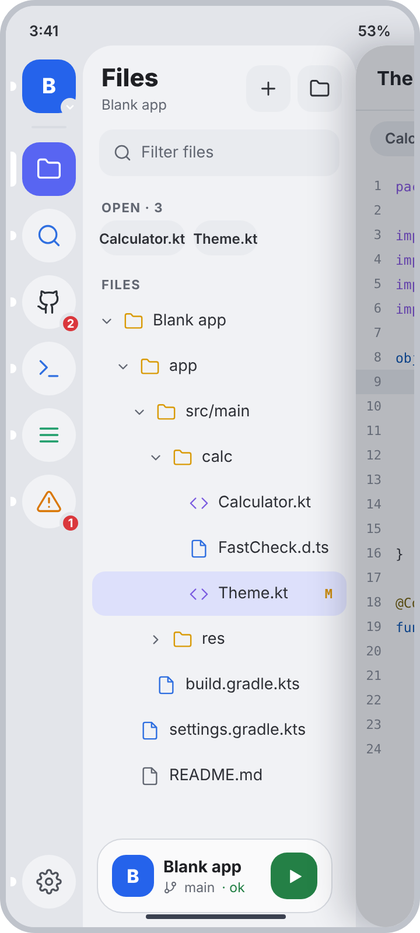
 
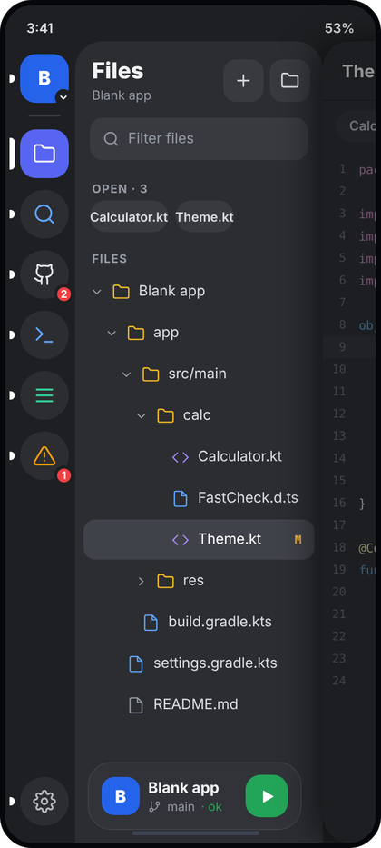

Left: light theme. Right: dark theme. All names and numbers in the pictures are examples.

What the picture shows. Layer 2 of the editor shell: the tool rail (66 dp) and the Files panel sit under the editor card, which has slid 300 dp to the right and is dimmed (only its left strip is visible at the right edge). The panel has the title "Files" with the project name under it, two square buttons (New file, New folder), a filter field, a row of chips for the open files, and the folder tree. The selected file (the one open in the editor) has a light accent highlight and a git letter on the right. A Run card floats at the bottom of the panel. The rail is the shared ToolRail; the Files tool is the selected one.

Numbers.

Panel: bg c.panel F1F2F5, top-left radius 26 (CcShape.panelTopLeft), width 234 (300 minus rail 66). Provided by SidePanel (d4).

Header: padding start 16, top 16, end 12, bottom 6. Title 21 sp ExtraBold c.text 1F2024. Subtitle 12 sp c.muted 626772, 2 dp under title. Actions: two 38 x 38 tiles (mock 38 x 40), radius 12, bg c.field E9EBEF, gap 6, icons plus and folder 18 dp stroke 1.9, tint c.text2 2E3036.

Filter field: outer padding 14 horizontal, 8 vertical. Field height 40, radius 12, bg c.field, padding 12 horizontal, gap 8. Icon search 16 dp stroke 1.9 c.muted. Hint "Filter files" 13.5 sp c.muted.

Section labels "OPEN · 3" and "FILES": 11 sp Bold, letter spacing 0.8, c.muted, padding 16 / 12 / 16 / 4.

Open chips: row padding 0 / 14 / 6, gap 7. Chip height 30, padding 12 horizontal, radius 15, bg c.field, text 12 sp SemiBold c.text2.

Tree row: height 38, outer margin 8 horizontal and 1 vertical, radius 11, text 13.5 sp c.text2, gap 8 between chevron (13 dp, stroke 2.2, c.faint 858A95), icon (17 dp, stroke 1.7) and name. Start padding = 6 + 14 x depth dp. Selected row bg c.selectedFile DDE0FB, text stays c.text2.

Icon colours: folder c.yellow D99A06, code files (kt, java, ts, js, py, html, css, xml, json, gradle, kts) c.purple 7B5CE0 with icon code, other files c.blue 2F6FE0 with icon file, README or text files (md, txt) c.muted with icon file.

Git letter at the right: mono 11 sp Bold, 12 dp from the edge, M = c.amber C98A0A, A = c.green 248046, D = c.red DA373C.

Run card: from d4 (RunCard), 64 high, left 12 / right 10 inside the panel, bottom 12.

Behaviour. Data: projectName from the real project, rows is the flattened visible tree built from the project folder on disk (expanded folders only), gitLetter from the real git status, openFiles from the open tabs. Tap a folder: expand or collapse, chevron turns 90 degrees in 120 ms. Tap a file: open it in the editor and close the sidebar. Long-press a row: Files menu (11). Typing in the filter shows only matching files (parents of matches stay). Empty tree: "This folder is empty" with a New file button. Filter with no match: "No files match". When no file is open the OPEN section is hidden. The chips scroll sideways when there are many.

Code.

data class TreeRowUi(
    val path: String, val name: String, val depth: Int, val isDir: Boolean,
    val expanded: Boolean, val selected: Boolean, val gitLetter: String?   // "M", "A", "D" or null
)

@Composable
fun FilesPanel(
    projectName: String?, openFiles: List<String>, rows: List<TreeRowUi>,
    filter: String, onFilter: (String) -> Unit,
    onNewFile: () -> Unit, onNewFolder: () -> Unit, onOpenTab: (String) -> Unit,
    onRowClick: (TreeRowUi) -> Unit, onRowLongClick: (TreeRowUi) -> Unit,
    runCard: (@Composable () -> Unit)?
) {
    SidePanel(
        title = "Files", subtitle = projectName,
        actions = {
            HeaderAction("plus", "New file", onClick = onNewFile)
            HeaderAction("folder", "New folder", onClick = onNewFolder)
        },
        runCard = runCard
    ) {
        PanelFilter(filter, onFilter, "Filter files")
        if (openFiles.isNotEmpty()) {
            SecLabel("Open · ${openFiles.size}")
            Row(Modifier.horizontalScroll(rememberScrollState()).padding(start = 14.dp, end = 14.dp, bottom = 6.dp),
                horizontalArrangement = Arrangement.spacedBy(7.dp)) {
                openFiles.forEach { name ->
                    Box(Modifier.height(30.dp).clip(RoundedCornerShape(15.dp)).background(CcTheme.colors.field)
                        .clickable { onOpenTab(name) }.padding(horizontal = 12.dp), contentAlignment = Alignment.Center) {
                        OneLine(name, CcType.caption.copy(fontWeight = FontWeight.SemiBold), CcTheme.colors.text2)
                    }
                }
            }
        }
        SecLabel("Files")
        when {
            rows.isEmpty() && filter.isNotEmpty() -> EmptyState("search", "No files match", "Try another name.")
            rows.isEmpty() -> EmptyState("folder", "This folder is empty", "Create a file or a folder.", "New file", onNewFile)
            else -> rows.forEach { TreeRow(it, { onRowClick(it) }, { onRowLongClick(it) }) }
        }
        Spacer(Modifier.height(8.dp))
    }
}

/** Filter pill used in the Files panel. */
@Composable
fun PanelFilter(value: String, onChange: (String) -> Unit, hint: String) {
    val c = CcTheme.colors
    Box(Modifier.padding(horizontal = 14.dp, vertical = 8.dp)) {
        Row(Modifier.fillMaxWidth().height(40.dp).clip(RoundedCornerShape(12.dp)).background(c.field).padding(horizontal = 12.dp),
            verticalAlignment = Alignment.CenterVertically) {
            CcIcon("search", c.muted, 16.dp, 1.9f); Spacer(Modifier.width(8.dp))
            Box(Modifier.weight(1f)) {
                if (value.isEmpty()) Text(hint, style = CcType.small.copy(fontSize = 13.5.sp), color = c.muted)
                BasicTextField(value, onChange, singleLine = true, cursorBrush = SolidColor(c.accent),
                    textStyle = CcType.small.copy(fontSize = 13.5.sp, color = c.text), modifier = Modifier.fillMaxWidth())
            }
        }
    }
}

@OptIn(ExperimentalFoundationApi::class)
@Composable
fun TreeRow(n: TreeRowUi, onClick: () -> Unit, onLongClick: () -> Unit) {
    val c = CcTheme.colors
    val rot by animateFloatAsState(if (n.expanded) 90f else 0f, tween(120), label = "chev")
    val ext = n.name.substringAfterLast('.', "").lowercase()
    val (icon, tint) = when {
        n.isDir -> "folder" to c.yellow
        ext in setOf("kt", "java", "ts", "js", "py", "html", "css", "xml", "json", "gradle", "kts") -> "code" to c.purple
        ext in setOf("md", "txt") -> "file" to c.muted
        else -> "file" to c.blue
    }
    Row(
        Modifier.fillMaxWidth().padding(horizontal = 8.dp, vertical = 1.dp).height(38.dp)
            .clip(RoundedCornerShape(11.dp)).background(if (n.selected) c.selectedFile else Color.Transparent)
            .combinedClickable(onClick = onClick, onLongClick = onLongClick)
            .padding(start = (6 + 14 * n.depth).dp),
        verticalAlignment = Alignment.CenterVertically
    ) {
        if (n.isDir) CcIcon("cr", c.faint, 13.dp, 2.2f, Modifier.rotate(rot)) else Spacer(Modifier.width(13.dp))
        Spacer(Modifier.width(8.dp))
        CcIcon(icon, tint, 17.dp, 1.7f); Spacer(Modifier.width(8.dp))
        OneLine(n.name, CcType.small.copy(fontSize = 13.5.sp), c.text2, Modifier.weight(1f))
        n.gitLetter?.let {
            Text(it, style = CcType.code.copy(fontSize = 11.sp, fontWeight = FontWeight.Bold, lineHeight = 14.sp),
                color = when (it) { "M" -> c.amber; "A" -> c.green; else -> c.red }, modifier = Modifier.padding(end = 12.dp))
        }
    }
}

### 11 Files menu (long-press)


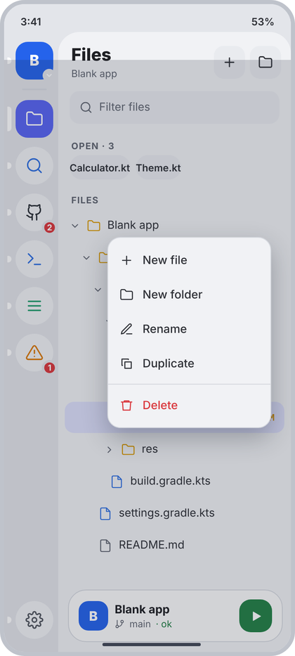
 
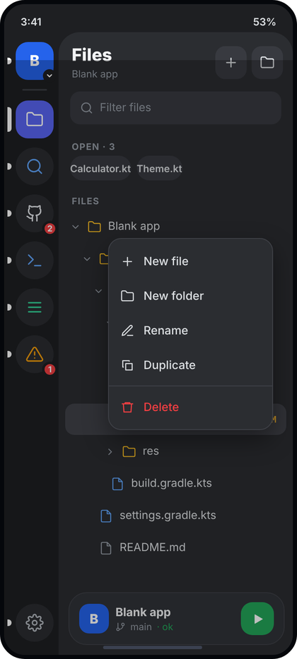

Left: light theme. Right: dark theme. All names and numbers in the pictures are examples.

What the picture shows. The same Files panel with a dim layer over the whole phone (rail and panel included) and a small popup menu on top of the tree. The menu belongs to the row that was long-pressed. It has New file, New folder, Rename, Duplicate, a thin line, then Delete in red. The editor card is not drawn here (the sidebar is open and only the panel is in focus).

Numbers.

Dim: covers everything under the status bar. Colour 1E2332 at 18% alpha (light theme; the dark theme uses a stronger one).

Menu card: width 200, radius 16 (CcShape.menu), bg c.panel F1F2F5, border 1 dp c.border D5D8DE, shadow 12 dp, vertical padding 6. In the picture it sits 24 dp from the right edge and 250 dp from the top of the content area. In the app, place it next to the pressed row and keep it inside the screen.

Item: height 42, horizontal padding 14, gap 11, icon 17 dp stroke 1.8, text 14 sp Medium. Colour c.text2 2E3036; Delete uses c.red DA373C for both icon and text.

Divider: 1 dp c.border, 4 dp above and below, full menu width.

Icons: plus, folder, edit, copy, trash.

Behaviour. Opens on long-press of a tree row (Sheet.FileMenu(path)). Tap outside, or system Back, closes it. Each item closes the menu and then runs its action: New file and New folder ask for a name (in the row's folder, or inside the folder if the row is a folder), Rename asks for a new name, Duplicate copies next to the original, Delete opens CcConfirmDialog (destructive) naming the real file. If the pressed row is a folder, Delete says the folder and everything in it will be removed.

Code.

/** Dim + popup card. `top` and `end` are measured from the top-right of the area under the status bar. */
@Composable
fun MenuOverlay(top: Dp, end: Dp, width: Dp, entries: List<MenuEntry>, onDismiss: () -> Unit) {
    val c = CcTheme.colors
    Box(Modifier.fillMaxSize().statusBarsPadding()
        .background(Color(0xFF1E2332).copy(alpha = 0.18f))
        .clickable(interactionSource = remember { MutableInteractionSource() }, indication = null, onClick = onDismiss)) {
        Column(
            Modifier.align(Alignment.TopEnd).padding(top = top, end = end).width(width)
                .shadow(12.dp, CcShape.menu).clip(CcShape.menu).background(c.panel)
                .border(1.dp, c.border, CcShape.menu)
                .clickable(enabled = false) {}            // taps on the card do not reach the dim layer
                .padding(vertical = 6.dp)
        ) {
            entries.forEach { e ->
                when (e) {
                    MenuEntry.Divider -> Box(Modifier.padding(vertical = 4.dp).fillMaxWidth().height(1.dp).background(c.border))
                    is MenuEntry.Item -> {
                        val col = if (e.destructive) c.red else c.text2
                        Row(Modifier.fillMaxWidth().height(42.dp).clickable { onDismiss(); e.onClick() }.padding(horizontal = 14.dp),
                            verticalAlignment = Alignment.CenterVertically) {
                            Box(Modifier.size(17.dp)) { if (e.iconVisible) CcIcon(e.icon, col, 17.dp, 1.8f) }
                            Spacer(Modifier.width(11.dp))
                            OneLine(e.text, CcType.body, col)
                        }
                    }
                }
            }
        }
    }
}

@Composable
fun FileMenuOverlay(
    anchorTop: Dp, onNewFile: () -> Unit, onNewFolder: () -> Unit, onRename: () -> Unit,
    onDuplicate: () -> Unit, onDelete: () -> Unit, onDismiss: () -> Unit
) = MenuOverlay(
    top = anchorTop, end = 24.dp, width = 200.dp, onDismiss = onDismiss,
    entries = listOf(
        MenuEntry.Item("plus", "New file", onClick = onNewFile),
        MenuEntry.Item("folder", "New folder", onClick = onNewFolder),
        MenuEntry.Item("edit", "Rename", onClick = onRename),
        MenuEntry.Item("copy", "Duplicate", onClick = onDuplicate),
        MenuEntry.Divider,
        MenuEntry.Item("trash", "Delete", destructive = true, onClick = onDelete)
    )
)

### 12 Search panel


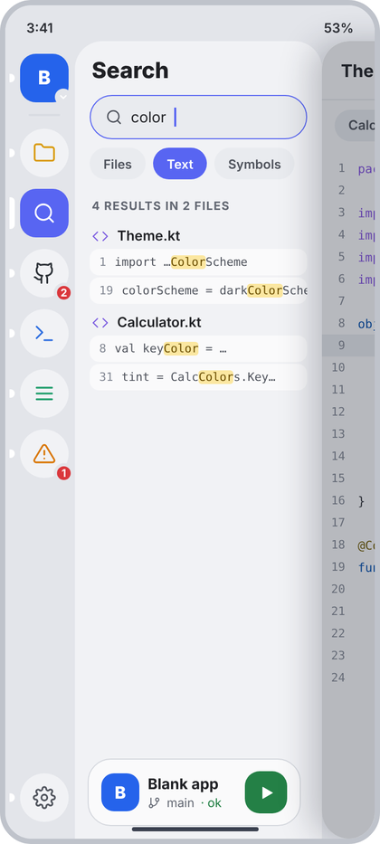
 
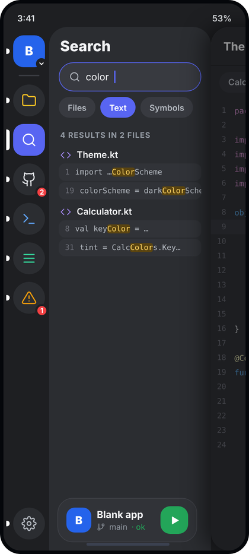

Left: light theme. Right: dark theme. All names and numbers in the pictures are examples.

What the picture shows. Layer 2 again, with the Search tool selected in the rail. The panel has the big title "Search" (no subtitle, no buttons), a pill search field with an accent ring (it is focused and shows a caret), three mode chips (Files, Text, Symbols; Text is selected), a count line, and results grouped by file. Each group has a file header with a code icon and the file name, and under it one card per hit with the line number and the line text, where the matched part is highlighted yellow. The Run card sits at the bottom.

Numbers.

Header: same as Files (padding 16 / 16 / 12 / 6, title 21 sp ExtraBold) but without subtitle and actions.

Search field: outer padding 14 horizontal, 4 top, 6 bottom. Height 42, radius 21 (full pill), bg c.field, border 1.5 dp c.accent 5865F2 while focused, padding 14 horizontal, gap 8. Icon search 16 dp c.textSoft 4F535C. Text 14 sp c.text. Caret 1.5 x 18 dp c.accent.

Mode chips: row padding 14 horizontal, 2 top, 6 bottom, gap 7. Chip height 30, padding 13, radius 15, text 12 sp SemiBold. Selected: bg c.accent, text white. Other: bg c.field, text c.textSoft. Labels exactly: Files, Text, Symbols.

Count line: SecLabel ("4 RESULTS IN 2 FILES", 11 sp Bold, spacing 0.8, c.muted).

File header: padding start 16, top 10, bottom 2, gap 8. Icon code 16 dp stroke 1.8 c.purple. Name 13 sp SemiBold c.text.

Hit card: horizontal margin 14, top margin 2, radius 9, bg c.content FAFAFB, padding 9 horizontal and 6 vertical, gap 8. Text mono 11 sp c.textSoft, one line, no wrap, clipped at the right edge. Line number c.faint 858A95. Match highlight: bg c.matchBg FBE7A1, text c.matchText 6B4E00, radius 3.

Behaviour. Data: query, mode, and state come from the search service that scans the real project files. Searching starts 300 ms after the last key. States: Idle (empty field): empty state "Search this project / Type at least 2 characters". Searching: LoadingList(3). Done with hits: groups as in the picture; the count uses real numbers and singular forms ("1 RESULT IN 1 FILE"). Done with none: "No results / Try different words or options." Failed: ErrorCard with the real message and Retry. Files mode lists matching file names (a group with no hits shows only the header). Symbols mode shows the declaration line. Tap a hit: open that file at that line and close the sidebar. Tap a header: open the file at the top. The options menu (13) opens when the selected Text chip is tapped again (the mock does not draw a separate options button; this is the trigger the code uses).

Code.

enum class SearchMode(val label: String) { Files("Files"), Text("Text"), Symbols("Symbols") }
data class SearchHit(val line: Int, val text: String, val matches: List<IntRange>)   // ranges inside `text`
data class SearchGroup(val path: String, val fileName: String, val hits: List<SearchHit>)
sealed interface SearchUi {
    data object Idle : SearchUi
    data object Searching : SearchUi
    data class Done(val groups: List<SearchGroup>) : SearchUi
    data class Failed(val message: String) : SearchUi
}

@Composable
fun SearchPanel(
    query: String, onQuery: (String) -> Unit, mode: SearchMode, onMode: (SearchMode) -> Unit,
    state: SearchUi, onOpenOptions: () -> Unit, onRetry: () -> Unit,
    onOpenFile: (path: String, line: Int) -> Unit, runCard: (@Composable () -> Unit)?
) {
    val c = CcTheme.colors
    var focused by remember { mutableStateOf(false) }
    SidePanel("Search", null, runCard = runCard) {
        Row(Modifier.padding(start = 14.dp, end = 14.dp, top = 4.dp, bottom = 6.dp).fillMaxWidth().height(42.dp)
            .clip(RoundedCornerShape(21.dp)).background(c.field)
            .border(if (focused) 1.5.dp else 0.dp, if (focused) c.accent else Color.Transparent, RoundedCornerShape(21.dp))
            .padding(horizontal = 14.dp), verticalAlignment = Alignment.CenterVertically) {
            CcIcon("search", c.textSoft, 16.dp, 1.9f); Spacer(Modifier.width(8.dp))
            Box(Modifier.weight(1f)) {
                if (query.isEmpty()) Text("Search", style = CcType.small.copy(fontSize = 14.sp), color = c.muted)
                BasicTextField(query, onQuery, singleLine = true, cursorBrush = SolidColor(c.accent),
                    textStyle = CcType.small.copy(fontSize = 14.sp, color = c.text),
                    modifier = Modifier.fillMaxWidth().onFocusChanged { focused = it.isFocused })
            }
        }
        Row(Modifier.padding(start = 14.dp, end = 14.dp, top = 2.dp, bottom = 6.dp), horizontalArrangement = Arrangement.spacedBy(7.dp)) {
            SearchMode.values().forEach { m ->
                val on = m == mode
                Box(Modifier.height(30.dp).clip(RoundedCornerShape(15.dp)).background(if (on) c.accent else c.field)
                    .clickable { if (on && m == SearchMode.Text) onOpenOptions() else onMode(m) }
                    .padding(horizontal = 13.dp), contentAlignment = Alignment.Center) {
                    OneLine(m.label, CcType.caption.copy(fontWeight = FontWeight.SemiBold), if (on) Color.White else c.textSoft)
                }
            }
        }
        when (state) {
            SearchUi.Idle -> EmptyState("search", "Search this project", "Type at least 2 characters.")
            SearchUi.Searching -> LoadingList(3)
            is SearchUi.Failed -> ErrorCard(state.message, onRetry)
            is SearchUi.Done -> if (state.groups.isEmpty()) EmptyState("search", "No results", "Try different words or options.") else {
                val hits = state.groups.sumOf { it.hits.size }.coerceAtLeast(state.groups.size)
                val n = state.groups.size
                SecLabel("$hits ${if (hits == 1) "result" else "results"} in $n ${if (n == 1) "file" else "files"}")
                state.groups.forEach { g ->
                    Row(Modifier.fillMaxWidth().clickable { onOpenFile(g.path, 1) }
                        .padding(start = 16.dp, end = 16.dp, top = 10.dp, bottom = 2.dp), verticalAlignment = Alignment.CenterVertically) {
                        CcIcon("code", c.purple, 16.dp, 1.8f); Spacer(Modifier.width(8.dp))
                        OneLine(g.fileName, CcType.small.copy(fontWeight = FontWeight.SemiBold), c.text)
                    }
                    g.hits.forEach { h -> HitRow(h) { onOpenFile(g.path, h.line) } }
                }
            }
        }
        Spacer(Modifier.height(8.dp))
    }
}

@Composable
private fun HitRow(h: SearchHit, onClick: () -> Unit) {
    val c = CcTheme.colors
    val styled = buildAnnotatedString {
        append(h.text)
        h.matches.forEach { addStyle(SpanStyle(background = c.matchBg, color = c.matchText), it.first, it.last + 1) }
    }
    Row(Modifier.fillMaxWidth().padding(start = 14.dp, end = 14.dp, top = 2.dp).clip(RoundedCornerShape(9.dp))
        .background(c.content).clickable(onClick = onClick).padding(horizontal = 9.dp, vertical = 6.dp)) {
        val mono = CcType.code.copy(fontSize = 11.sp, lineHeight = 16.sp)
        Text("${h.line}", style = mono, color = c.faint); Spacer(Modifier.width(8.dp))
        Text(styled, style = mono, color = c.textSoft, maxLines = 1, softWrap = false, overflow = TextOverflow.Clip)
    }
}

### 13 Search options menu


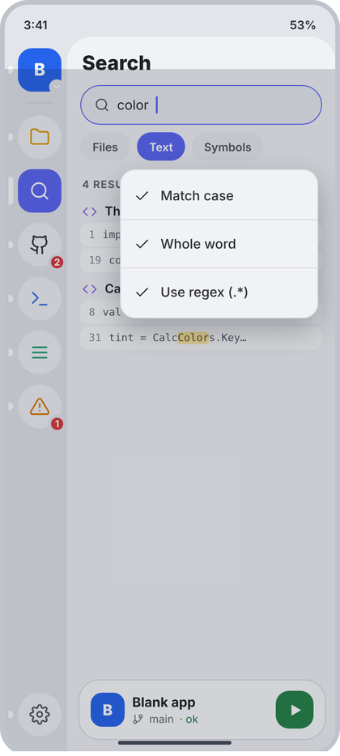
 
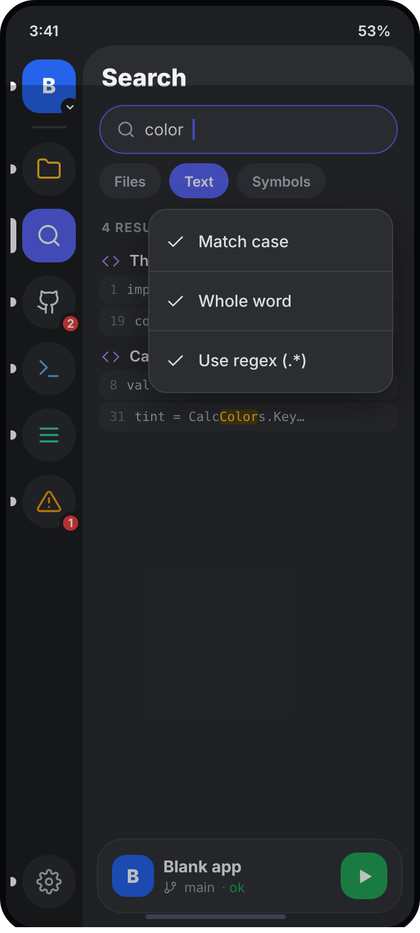

Left: light theme. Right: dark theme. All names and numbers in the pictures are examples.

What the picture shows. Same as 12 with the dim layer and a menu directly under the chip row. It is a check list of three search options: Match case, Whole word, Use regex (.*). In the picture all three have a tick (all on). It is the state "menu open" of screen 12. Base screen: 12 (this section gives only the delta).

Numbers.

Menu card: width 210, right margin 18, top 140 (just under the chips; anchor it to the chip row in the app), same card style as 11 (radius 16, c.panel, border 1 c.border, vertical padding 6).

Items: height 42, padding 14, gap 11, icon check 17 dp stroke 1.8 c.text2, text 14 sp Medium c.text2. Dividers (1 dp c.border, 4 dp margin) between the three items.

Dim: 1E2332 at 18% over everything under the status bar.

Behaviour. Each item toggles one option and keeps the menu open so the user can switch several; tapping outside or Back closes it. A tick is shown only when the option is on; when off the 17 dp icon slot stays empty so the texts keep their alignment. Changing an option re-runs the current search. The options are kept per project. Regex that does not compile shows the real compiler message in the panel as ErrorCard (state Failed).

Code.

data class SearchOptions(val matchCase: Boolean = false, val wholeWord: Boolean = false, val regex: Boolean = false)

/** Rendered by the shell (above rail and panel), not inside SearchPanel. */
@Composable
fun SearchOptionsOverlay(options: SearchOptions, onChange: (SearchOptions) -> Unit, onDismiss: () -> Unit) =
    MenuOverlay(
        top = 140.dp, end = 18.dp, width = 210.dp, onDismiss = {},   // keep it open while toggling; see the scrim below
        entries = listOf(
            MenuEntry.Item("check", "Match case", iconVisible = options.matchCase) { onChange(options.copy(matchCase = !options.matchCase)) },
            MenuEntry.Divider,
            MenuEntry.Item("check", "Whole word", iconVisible = options.wholeWord) { onChange(options.copy(wholeWord = !options.wholeWord)) },
            MenuEntry.Divider,
            MenuEntry.Item("check", "Use regex (.*)", iconVisible = options.regex) { onChange(options.copy(regex = !options.regex)) }
        )
    ).also { /* MenuOverlay calls onDismiss before every item action. To keep the menu open, pass a MenuOverlay variant
                that only dismisses on scrim taps: add a parameter `closeOnItem: Boolean = true` to MenuOverlay (11),
                call `if (closeOnItem) onDismiss()` in the item click, and here pass closeOnItem = false and onDismiss = onDismiss. */ }

### 14 GitHub panel (connected)


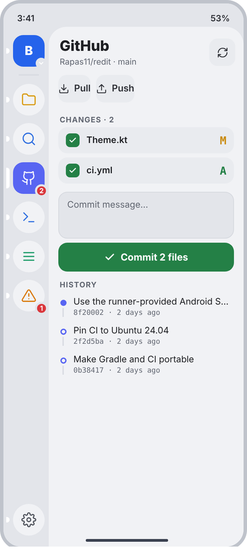
 
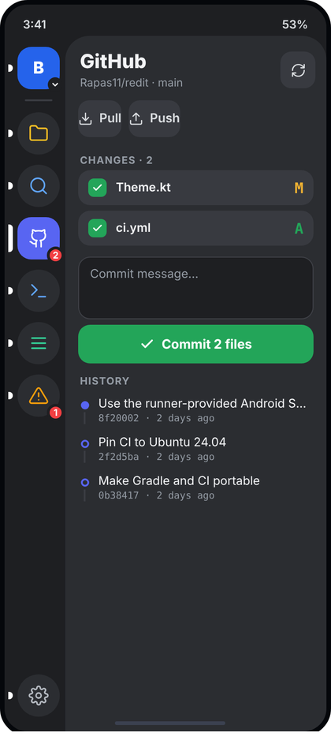

Left: light theme. Right: dark theme. All names and numbers in the pictures are examples.

What the picture shows. Layer 2 with the GitHub tool selected (a red badge with the number of changes sits on its rail icon). The panel header shows "GitHub" with "owner/repo · branch" under it and a refresh button. Under it two small buttons, Pull and Push. Then CHANGES with one card per changed file: a green tick box, the file name and the git letter. Then a commit message box, a wide green button "Commit 2 files", and HISTORY with the last three commits on a small timeline. There is no Run card on this panel.

Numbers.

Header: title "GitHub" 21 sp ExtraBold, subtitle 12 sp c.muted. One action: refresh icon 17 dp in a 38 tile (radius 12, c.field), tint c.text2.

Pull / Push row: padding 14 horizontal, 6 vertical, gap 8. Each button: height 40, radius 12, bg c.field, icon 16 dp (down, up), gap 7, text 13.5 sp SemiBold c.text2. The mock gives them no side padding (the text touches the edge); the code uses 10 dp side padding so the button is comfortable to hit. This is the only deliberate difference from the picture.

Label "CHANGES · 2": SecLabel.

Change card: margin 14 horizontal, 6 bottom, padding 11 horizontal and 9 vertical, radius 13, bg c.field E9EBEF, gap 10. Tick box 20 x 20, radius 6, bg c.green 248046, icon check 12 dp stroke 3 white. Name 13 sp SemiBold c.text. Letter: mono Bold 16 sp (browser default size in the mock), M c.amber, A c.green, D c.red.

Commit message box: margin 14 horizontal and 6 vertical, height 68, radius 13, bg c.rail E3E5EA, border 1 c.border, padding 12 horizontal and 10 vertical, text 13 sp, hint "Commit message..." c.muted.

Commit button: margin 14 horizontal, height 42, radius 13, bg c.green, gap 8, icon check 16 dp stroke 2.8 white, text 14 sp Bold white, "Commit N files" (N = number of ticked files; "Commit" when 0 or 1 file... use "Commit 1 file").

HISTORY: SecLabel. Commit row: padding 16 horizontal, 6 vertical, gap 10. Timeline column 10 wide, top padding 5: dot 9 x 9; newest commit (HEAD) filled c.accent, older ones only a 2 dp c.accent ring; line below the dot 2 dp wide, c.selectedRow-like D9DCE2, 3 dp from the dot. Message 13 sp c.text, one line, ellipsis. Under it mono 10.5 sp c.muted: "hash7 · 2 days ago", 2 dp below.

Behaviour. Data: account/repo/branch from vm.github and git, changes from the real working tree (the tick state is the staged state), commits the last 3 from the real log. Tap the refresh button: re-read status and fetch. Pull and Push run the real git actions; while one runs its button shows a spinner and is disabled; failures show the real message in a toast. Tap a change card (not the tick box): open Diff (21). Tap the tick box: stage or unstage that file. Commit is disabled (bg c.field, text c.muted) when the message is blank or nothing is ticked. After a commit the box clears. Tap a commit: open Commit detail (20). No changes: a one line "No changes" in c.muted. No commits: "No commits yet". The badge on the rail icon is the real change count. The panel opens from the rail; "Source control" (17) is reached from the push of a change card or the menu there.

Code.

data class ChangeUi(val path: String, val name: String, val kind: ChangeKind, val staged: Boolean)
data class CommitUi(val hash: String, val message: String, val author: String, val timeMillis: Long, val isHead: Boolean)

@Composable
fun GitHubPanel(
    repo: String, branch: String, changes: List<ChangeUi>, commits: List<CommitUi>, nowMillis: Long,
    message: String, onMessage: (String) -> Unit, busy: Boolean,
    onRefresh: () -> Unit, onPull: () -> Unit, onPush: () -> Unit,
    onToggleStage: (ChangeUi) -> Unit, onOpenChange: (ChangeUi) -> Unit,
    onCommit: () -> Unit, onOpenCommit: (CommitUi) -> Unit
) {
    val c = CcTheme.colors
    val staged = changes.count { it.staged }
    SidePanel("GitHub", "$repo · $branch", actions = { HeaderAction("refresh", "Refresh", onClick = onRefresh) }) {
        Row(Modifier.padding(horizontal = 14.dp, vertical = 6.dp), horizontalArrangement = Arrangement.spacedBy(8.dp)) {
            SmallAction("down", "Pull", enabled = !busy, onClick = onPull)
            SmallAction("up", "Push", enabled = !busy, onClick = onPush)
        }
        SecLabel("Changes · ${changes.size}")
        if (changes.isEmpty()) Text("No changes", style = CcType.small, color = c.muted, modifier = Modifier.padding(horizontal = 16.dp, vertical = 6.dp))
        changes.forEach { ch ->
            Row(Modifier.fillMaxWidth().padding(start = 14.dp, end = 14.dp, bottom = 6.dp).clip(RoundedCornerShape(13.dp))
                .background(c.field).clickable { onOpenChange(ch) }.padding(horizontal = 11.dp, vertical = 9.dp),
                verticalAlignment = Alignment.CenterVertically) {
                Box(Modifier.size(20.dp).clip(RoundedCornerShape(6.dp))
                    .background(if (ch.staged) c.green else Color.Transparent)
                    .border(if (ch.staged) 0.dp else 1.5.dp, c.toggleOff, RoundedCornerShape(6.dp))
                    .clickable { onToggleStage(ch) }, contentAlignment = Alignment.Center) {
                    if (ch.staged) CcIcon("check", Color.White, 12.dp, 3f)
                }
                Spacer(Modifier.width(10.dp))
                OneLine(ch.name, CcType.small.copy(fontWeight = FontWeight.SemiBold), c.text, Modifier.weight(1f))
                Text(ch.kind.letter, style = CcType.code.copy(fontSize = 16.sp, fontWeight = FontWeight.Bold), color = changeColor(ch.kind))
            }
        }
        // message box + commit button
        Box(Modifier.padding(horizontal = 14.dp, vertical = 6.dp).fillMaxWidth().height(68.dp).clip(RoundedCornerShape(13.dp))
            .background(c.rail).border(1.dp, c.border, RoundedCornerShape(13.dp)).padding(horizontal = 12.dp, vertical = 10.dp)) {
            if (message.isEmpty()) Text("Commit message…", style = CcType.small, color = c.muted)
            BasicTextField(message, onMessage, cursorBrush = SolidColor(c.accent), textStyle = CcType.small.copy(color = c.text), modifier = Modifier.fillMaxSize())
        }
        val canCommit = message.isNotBlank() && staged > 0 && !busy
        Row(Modifier.padding(horizontal = 14.dp).fillMaxWidth().height(42.dp).clip(RoundedCornerShape(13.dp))
            .background(if (canCommit) c.green else c.field).clickable(enabled = canCommit, onClick = onCommit),
            horizontalArrangement = Arrangement.Center, verticalAlignment = Alignment.CenterVertically) {
            CcIcon("check", if (canCommit) Color.White else c.muted, 16.dp, 2.8f); Spacer(Modifier.width(8.dp))
            Text(if (staged > 1) "Commit $staged files" else if (staged == 1) "Commit 1 file" else "Commit",
                style = CcType.body.copy(fontWeight = FontWeight.Bold), color = if (canCommit) Color.White else c.muted)
        }
        SecLabel("History", top = 18.dp)
        if (commits.isEmpty()) Text("No commits yet", style = CcType.small, color = c.muted, modifier = Modifier.padding(horizontal = 16.dp))
        commits.take(3).forEach { cm ->
            Row(Modifier.fillMaxWidth().height(IntrinsicSize.Min).clickable { onOpenCommit(cm) }.padding(horizontal = 16.dp, vertical = 6.dp)) {
                Column(Modifier.width(10.dp).fillMaxHeight().padding(top = 5.dp), horizontalAlignment = Alignment.CenterHorizontally) {
                    Box(Modifier.size(9.dp).clip(CircleShape).then(if (cm.isHead) Modifier.background(c.accent) else Modifier.border(2.dp, c.accent, CircleShape)))
                    Box(Modifier.padding(top = 3.dp).width(2.dp).weight(1f).background(Color(0xFFD9DCE2)))
                }
                Spacer(Modifier.width(10.dp))
                Column(Modifier.weight(1f)) {
                    OneLine(cm.message, CcType.small, c.text)
                    OneLine("${cm.hash.take(7)} · ${shortAgo(cm.timeMillis, nowMillis)}",
                        CcType.code.copy(fontSize = 10.5.sp, lineHeight = 14.sp), c.muted, Modifier.padding(top = 2.dp))
                }
            }
        }
    }
}

/** Small content-sized button used for Pull, Push (14) and Copy code, Open github.com (16). */
@Composable
fun SmallAction(icon: String, text: String, enabled: Boolean = true, onClick: () -> Unit) {
    val c = CcTheme.colors
    Row(Modifier.height(40.dp).clip(RoundedCornerShape(12.dp)).background(c.field).clickable(enabled = enabled, onClick = onClick)
        .padding(horizontal = 10.dp), verticalAlignment = Alignment.CenterVertically) {
        CcIcon(icon, if (enabled) c.text2 else c.faint, 16.dp, 1.9f); Spacer(Modifier.width(7.dp))
        OneLine(text, CcType.small.copy(fontSize = 13.5.sp, fontWeight = FontWeight.SemiBold), if (enabled) c.text2 else c.faint)
    }
}

/** "now", "5m ago", "2h ago", "Yesterday", "3 days ago", then "Oct 12". */
fun shortAgo(t: Long, now: Long): String {
    val m = (now - t) / 60_000
    return when {
        m < 1 -> "now"; m < 60 -> "${m}m ago"; m < 24 * 60 -> "${m / 60}h ago"
        m < 48 * 60 -> "Yesterday"; m < 7 * 24 * 60 -> "${m / (24 * 60)} days ago"
        else -> java.text.SimpleDateFormat("MMM d", java.util.Locale.getDefault()).format(java.util.Date(t))
    }
}

### 15 GitHub panel (not connected)


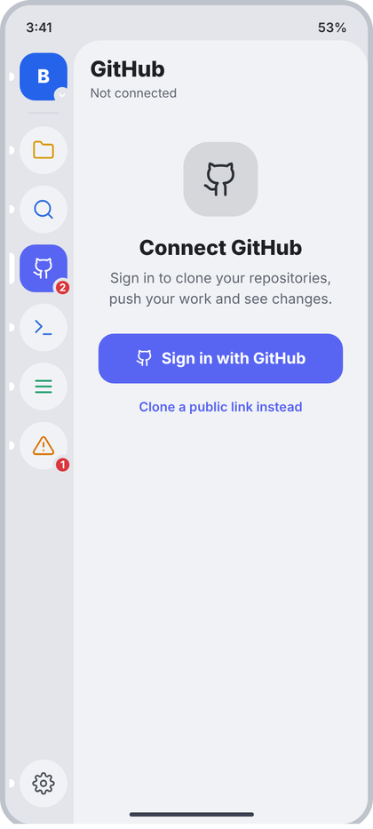
 
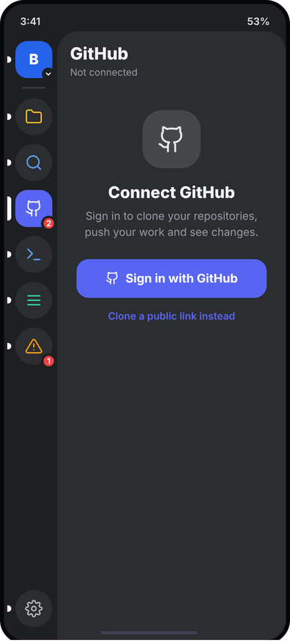

Left: light theme. Right: dark theme. All names and numbers in the pictures are examples.

What the picture shows. The GitHub panel when no account is stored. Header "GitHub" with the subtitle "Not connected" and no buttons. In the middle of the panel a centered block: a rounded square with the GitHub icon, the title "Connect GitHub", two lines of explanation, a wide accent button "Sign in with GitHub", and a text link "Clone a public link instead". There is no Run card.

Numbers.

Block: padding 34 top and bottom, 24 horizontal, everything centered.

Icon tile: 72 x 72, radius 24, bg text2 at 13% (c.text2.tint()), icon gh 36 dp stroke 1.6 c.text2.

Title: 20 sp ExtraBold c.text, 18 dp below the tile.

Text: 13.5 sp, line height 1.5 (20 sp), c.muted, 8 dp below the title and 22 dp above the button. Exact text: "Sign in to clone your repositories, push your work and see changes."

Button: full width of the block, height 48, radius 15, bg c.accent 5865F2, icon gh 17 dp stroke 2 white, gap 8, text "Sign in with GitHub" 15 sp Bold white (this is PrimaryButton from d3).

Link: 12.5 sp SemiBold c.accent, 16 dp below the button.

Behaviour. Shown when the account store is empty. Sign in pushes the Sign in screen (16). The link pushes Clone (a public link can be cloned without an account). If the stored token was rejected by GitHub (expired), the same screen shows with the subtitle "Signed out" and the title text "Sign in again" and the real reason in one c.red line under the text. The rail badge is hidden while not connected.

Code.

@Composable
fun GitHubSignedOutPanel(onSignIn: () -> Unit, onCloneLink: () -> Unit, problem: String? = null) {
    val c = CcTheme.colors
    SidePanel("GitHub", "Not connected") {
        Column(Modifier.fillMaxWidth().padding(horizontal = 24.dp, vertical = 34.dp), horizontalAlignment = Alignment.CenterHorizontally) {
            Box(Modifier.size(72.dp).clip(RoundedCornerShape(24.dp)).background(c.text2.tint()), contentAlignment = Alignment.Center) {
                CcIcon("gh", c.text2, 36.dp, 1.6f)
            }
            Spacer(Modifier.height(18.dp))
            Text("Connect GitHub", style = CcType.sheetTitle.copy(fontSize = 20.sp), color = c.text)
            Spacer(Modifier.height(8.dp))
            Text("Sign in to clone your repositories, push your work and see changes.",
                style = CcType.small.copy(fontSize = 13.5.sp, lineHeight = 20.sp), color = c.muted, textAlign = TextAlign.Center)
            if (problem != null) { Spacer(Modifier.height(8.dp)); Text(problem, style = CcType.caption, color = c.red, textAlign = TextAlign.Center) }
            Spacer(Modifier.height(22.dp))
            PrimaryButton("Sign in with GitHub", onSignIn, Modifier.fillMaxWidth(), icon = "gh")
            Spacer(Modifier.height(16.dp))
            Text("Clone a public link instead", style = CcType.small.copy(fontSize = 12.5.sp, fontWeight = FontWeight.SemiBold),
                color = c.accent, modifier = Modifier.clickable(onClick = onCloneLink))
        }
    }
}

### 16 GitHub sign-in (device code)


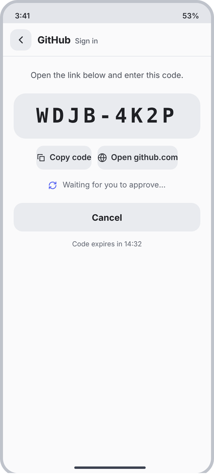
 
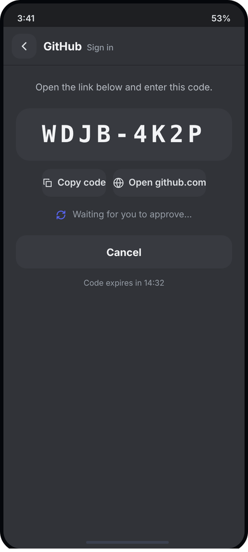

Left: light theme. Right: dark theme. All names and numbers in the pictures are examples.

What the picture shows. A full screen (layer 3) over everything. The header has the back button, "GitHub" in bold and "Sign in" in muted text. The body is centered: one sentence ("Open the link below and enter this code."), a big box with the one-time code in large mono letters, two small buttons (Copy code, Open github.com), a line "Waiting for you to approve..." with a turning refresh icon, a wide Cancel button, and "Code expires in 14:32" at the bottom of the block.

Numbers.

Screen bg c.content FAFAFB. Header: ScreenHeader("GitHub", "Sign in") (d3): 56 high, back tile 36 radius 12, bottom line 1 c.divider.

Body padding: 22 top and bottom, 18 horizontal, all text centered.

Sentence: 13.5 sp, line height 1.5 (20 sp), c.textSoft 4F535C.

Code box: margin top 20, bottom 6, full width, vertical padding 18, radius 20, bg c.field E9EBEF. Text mono 34 sp ExtraBold (use Bold, the mono family only has up to Bold), letter spacing 6 sp, c.text. Format "XXXX-XXXX".

Button row: top margin 12, bottom 18, gap 10, centered. Buttons: SmallAction (14): height 40, radius 12, bg c.field, icon 16 + gap 7 + text 13.5 sp SemiBold c.text2. Icons copy and globe. The mock shows no side padding; the code keeps the 10 dp of SmallAction.

Waiting line: gap 9, 13 sp c.muted, icon refresh 15 dp stroke 2.2 c.accent (rotates once per second, linear).

Cancel: 22 dp below, full width, height 48, radius 15, bg c.field, text 15 sp Bold c.text.

Expiry text: 11.5 sp c.muted, 14 dp below the button. Format mm:ss.

Behaviour. On open the app asks GitHub for a device code. Every value comes from that answer: userCode (the code), verificationHost (shown in the button text, for example "github.com"), secondsLeft (counts down from expires_in). Copy code puts the code on the clipboard and shows a toast "Copied". Open opens the verification link in the browser. The app polls GitHub every interval seconds; when approved the account is stored, this screen closes and the GitHub panel shows the connected view. Cancel stops polling and goes back. States: Requesting (no code yet): centered spinner and "Getting a code...". Failed (no network or GitHub error): ErrorCard with the real message and Retry. Expired (secondsLeft is 0): the code box is faded 40%, text "This code has expired", and the Cancel button becomes a primary "Get a new code". Denied by the user on GitHub: same as Failed with the real message.

Code.

sealed interface DeviceFlowUi {
    data object Requesting : DeviceFlowUi
    data class Waiting(val userCode: String, val verificationHost: String, val secondsLeft: Int) : DeviceFlowUi
    data class Failed(val message: String) : DeviceFlowUi
}

@Composable
fun GitHubSignInScreen(
    state: DeviceFlowUi, onBack: () -> Unit, onCopy: (String) -> Unit, onOpenLink: () -> Unit,
    onCancel: () -> Unit, onRetry: () -> Unit
) {
    val c = CcTheme.colors
    Column(Modifier.fillMaxSize().background(c.content)) {
        ScreenHeader("GitHub", "Sign in", onBack)
        Column(Modifier.fillMaxWidth().verticalScroll(rememberScrollState()).padding(horizontal = 18.dp, vertical = 22.dp),
            horizontalAlignment = Alignment.CenterHorizontally) {
            when (state) {
                DeviceFlowUi.Requesting -> Text("Getting a code…", style = CcType.small, color = c.muted)
                is DeviceFlowUi.Failed -> { ErrorCard(state.message, onRetry); Spacer(Modifier.height(14.dp)); PrimaryButton("Back", onCancel, Modifier.fillMaxWidth()) }
                is DeviceFlowUi.Waiting -> {
                    val expired = state.secondsLeft <= 0
                    Text("Open the link below and enter this code.", style = CcType.small.copy(fontSize = 13.5.sp, lineHeight = 20.sp),
                        color = c.textSoft, textAlign = TextAlign.Center)
                    Box(Modifier.padding(top = 20.dp, bottom = 6.dp).fillMaxWidth().alpha(if (expired) 0.4f else 1f)
                        .clip(RoundedCornerShape(20.dp)).background(c.field).padding(vertical = 18.dp), contentAlignment = Alignment.Center) {
                        Text(state.userCode, style = CcType.code.copy(fontSize = 34.sp, fontWeight = FontWeight.Bold, letterSpacing = 6.sp, lineHeight = 40.sp),
                            color = c.text, maxLines = 1)
                    }
                    Row(Modifier.padding(top = 12.dp, bottom = 18.dp), horizontalArrangement = Arrangement.spacedBy(10.dp)) {
                        SmallAction("copy", "Copy code", !expired) { onCopy(state.userCode) }
                        SmallAction("globe", "Open ${state.verificationHost}", !expired, onOpenLink)
                    }
                    if (expired) Text("This code has expired", style = CcType.small, color = c.red)
                    else Row(verticalAlignment = Alignment.CenterVertically) {
                        val turn = rememberInfiniteTransition(label = "wait")
                        val deg by turn.animateFloat(0f, 360f, infiniteRepeatable(tween(1000, easing = LinearEasing)), label = "deg")
                        CcIcon("refresh", c.accent, 15.dp, 2.2f, Modifier.rotate(deg)); Spacer(Modifier.width(9.dp))
                        Text("Waiting for you to approve…", style = CcType.small, color = c.muted)
                    }
                    Spacer(Modifier.height(22.dp))
                    if (expired) PrimaryButton("Get a new code", onRetry, Modifier.fillMaxWidth())
                    else Box(Modifier.fillMaxWidth().height(48.dp).clip(RoundedCornerShape(15.dp)).background(c.field).clickable(onClick = onCancel),
                        contentAlignment = Alignment.Center) { Text("Cancel", style = CcType.body.copy(fontSize = 15.sp, fontWeight = FontWeight.Bold), color = c.text) }
                    if (!expired) {
                        Spacer(Modifier.height(14.dp))
                        Text("Code expires in %d:%02d".format(state.secondsLeft / 60, state.secondsLeft % 60),
                            style = CcType.caption.copy(fontSize = 11.5.sp), color = c.muted)
                    }
                }
            }
        }
    }
}

### 17 Source control (changes)


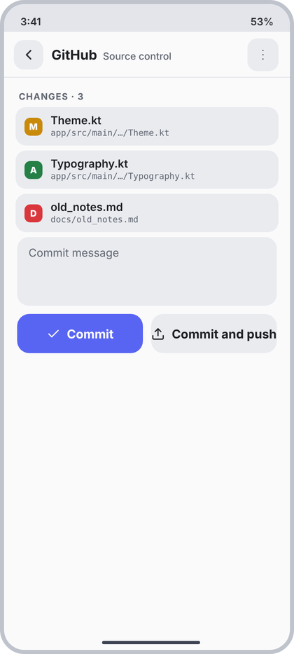
 
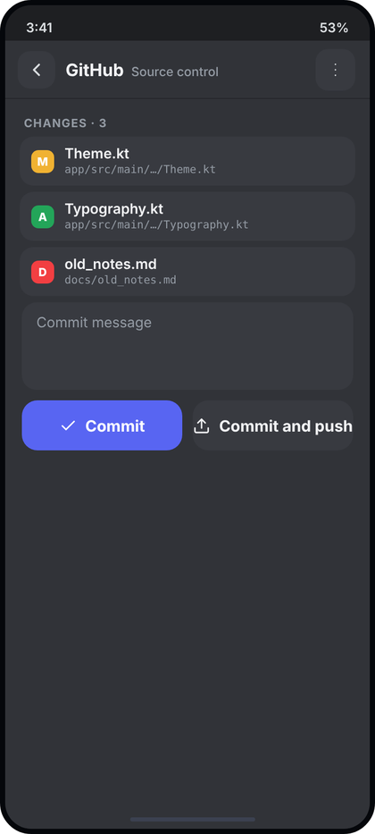

Left: light theme. Right: dark theme. All names and numbers in the pictures are examples.

What the picture shows. A full screen (layer 3) reached from the GitHub panel. The header shows "GitHub" (bold, where the user came from) and "Source control" (muted), with one icon button with three dots at the right. The body lists CHANGES with one card per changed file: a coloured letter square (M, A, D), the file name and a shortened path in mono. Below the list is a commit message box and two buttons side by side: Commit (accent, tick icon) and Commit and push (grey, upload icon).

Numbers.

Screen bg c.content. Header via ScreenHeader("GitHub", "Source control", onBack, actions = { HeaderAction("more", "Git actions") { ... } }): the action tile is 38 radius 12 c.field, icon more 18 dp.

Label "CHANGES · 3": SecLabel(start = 18, top = 16, bottom = 6).

File card (ChangedFileRow, defined at the top): margin 14 horizontal and 6 bottom, padding 11 / 9, radius 13, bg c.field, gap 10. Badge 22 x 22 radius 7, letter 11 sp ExtraBold white; colours M c.amber C98A0A, A c.green 248046, D c.red DA373C. Name 13.5 sp SemiBold c.text. Path mono 10.5 sp c.muted, 1 dp below the name.

Message box: margin 16 horizontal, 6 top, 10 bottom, height 84, radius 14, bg c.field, padding 14 horizontal and 12 vertical, text 13.5 sp, hint "Commit message" c.muted.

Buttons: row with horizontal padding 16, gap 10, two equal halves (weight 1). Height 48, radius 15, text 15 sp Bold, icon 17 dp stroke 2, gap 8. Commit: bg c.accent, white text, icon check. Commit and push: bg c.field, text c.text, icon up. Disabled: bg c.field, text and icon c.muted.

Behaviour. Data: changes from the real git status (working tree and index), the list refreshes when the screen opens and after each action. Tap a card: open Diff (21) for that file. The path in the card is the real path, shortened in the middle when it has more than 3 folders ("app/src/main/.../Theme.kt"). Commit: runs git add for all listed changes, then git commit -m <message>, clears the box, refreshes. Commit and push does the same and then pushes; if the push fails the commit stays and the real error is shown in a toast. Both buttons are disabled when the message is blank or the list is empty; while running they show the disabled look. Empty list: EmptyState("check", "No changes", "Your files match the last commit.") and the message box and buttons are hidden. Loading first status: LoadingList(3). The three-dot button opens the menu of screen 18.

Code.

data class FileChangeUi(val path: String, val kind: ChangeKind)

fun shortPath(p: String): String {
    val parts = p.split('/')
    return if (parts.size <= 3) p else parts.take(3).joinToString("/") + "/…/" + parts.last()
}

@Composable
fun SourceControlScreen(
    origin: String?, changes: List<FileChangeUi>?, message: String, onMessage: (String) -> Unit, busy: Boolean,
    onBack: () -> Unit, onOpenMenu: () -> Unit, onOpenDiff: (FileChangeUi) -> Unit,
    onCommit: () -> Unit, onCommitAndPush: () -> Unit
) {
    val c = CcTheme.colors
    val can = message.isNotBlank() && !changes.isNullOrEmpty() && !busy
    Column(Modifier.fillMaxSize().background(c.content)) {
        ScreenHeader(origin, "Source control", onBack, actions = { HeaderAction("more", "Git actions", onClick = onOpenMenu) })
        Column(Modifier.weight(1f).verticalScroll(rememberScrollState())) {
            when {
                changes == null -> LoadingList(3)
                changes.isEmpty() -> EmptyState("check", "No changes", "Your files match the last commit.")
                else -> {
                    SecLabel("Changes · ${changes.size}", start = 18.dp, top = 16.dp, bottom = 6.dp)
                    changes.forEach { ch ->
                        ChangedFileRow(ch.kind, ch.path.substringAfterLast('/'), shortPath(ch.path)) { onOpenDiff(ch) }
                    }
                    Box(Modifier.padding(start = 16.dp, end = 16.dp, top = 6.dp, bottom = 10.dp).fillMaxWidth().height(84.dp)
                        .clip(RoundedCornerShape(14.dp)).background(c.field).padding(horizontal = 14.dp, vertical = 12.dp)) {
                        if (message.isEmpty()) Text("Commit message", style = CcType.small.copy(fontSize = 13.5.sp), color = c.muted)
                        BasicTextField(message, onMessage, cursorBrush = SolidColor(c.accent),
                            textStyle = CcType.small.copy(fontSize = 13.5.sp, color = c.text), modifier = Modifier.fillMaxSize())
                    }
                    Row(Modifier.padding(horizontal = 16.dp), horizontalArrangement = Arrangement.spacedBy(10.dp)) {
                        WideButton("Commit", "check", can, true, Modifier.weight(1f), onCommit)
                        WideButton("Commit and push", "up", can, false, Modifier.weight(1f), onCommitAndPush)
                    }
                }
            }
        }
    }
}

@Composable
private fun WideButton(text: String, icon: String, enabled: Boolean, primary: Boolean, modifier: Modifier, onClick: () -> Unit) {
    val c = CcTheme.colors
    val bg = if (enabled && primary) c.accent else c.field
    val fg = when { !enabled -> c.muted; primary -> Color.White; else -> c.text }
    Row(modifier.height(48.dp).clip(RoundedCornerShape(15.dp)).background(bg).clickable(enabled = enabled, onClick = onClick),
        horizontalArrangement = Arrangement.Center, verticalAlignment = Alignment.CenterVertically) {
        CcIcon(icon, fg, 17.dp, 2f); Spacer(Modifier.width(8.dp))
        OneLine(text, CcType.body.copy(fontSize = 15.sp, fontWeight = FontWeight.Bold), fg)
    }
}

### 18 Source control, git actions menu


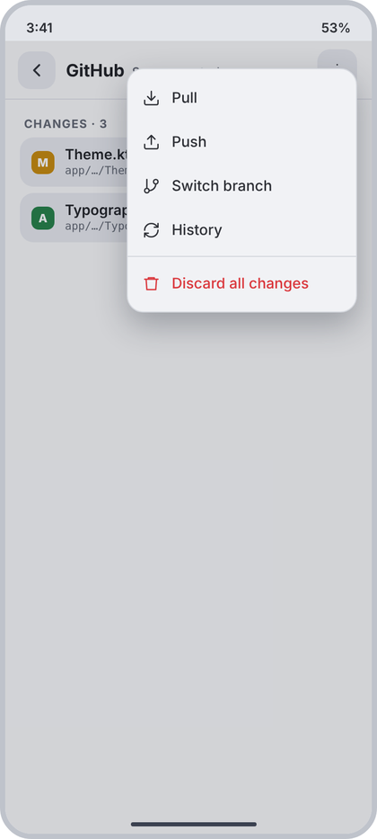
 
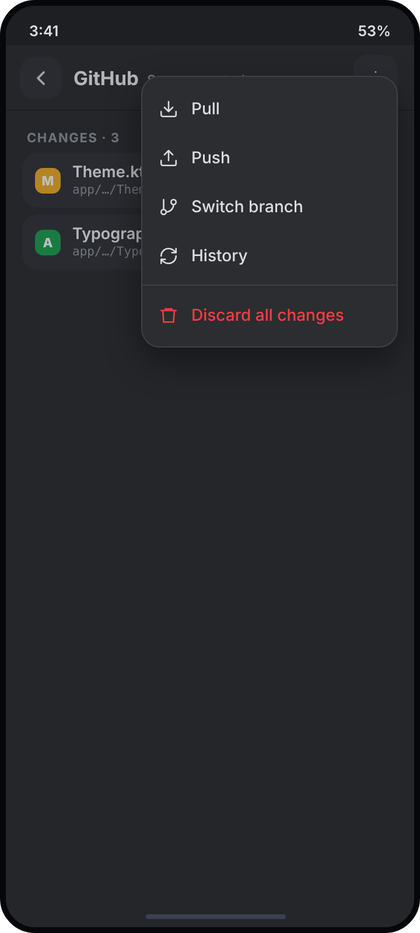

Left: light theme. Right: dark theme. All names and numbers in the pictures are examples.

What the picture shows. The state "menu open" of screen 17 (base screen: 17). A dim layer covers everything under the status bar, including the header, and a menu hangs under the three-dot button. Items: Pull, Push, Switch branch, History, a thin line, then Discard all changes in red. Only the first two change cards are visible behind the dim.

Numbers.

Dim: 1E2332 at 18%.

Menu card: width 220, right margin 14, top 60 from the top of the screen (directly under the three-dot button), radius 16, bg c.panel F1F2F5, border 1 c.border, vertical padding 6, shadow 12 dp.

Items: height 42, padding 14, gap 11, icon 17 dp stroke 1.8, text 14 sp Medium. Icons: down (Pull), up (Push), branch (Switch branch), refresh (History, as drawn in the picture), trash (Discard). Colour c.text2; Discard c.red DA373C.

Divider 1 dp c.border, 4 dp margin, before Discard all changes.

Behaviour. Pull and Push run the real git actions (same as in the GitHub panel). Switch branch opens a bottom sheet listing the real local branches (current one ticked). History pushes screen 19. Discard all changes opens CcConfirmDialog(title = "Discard all changes?", text = "N files will go back to the last commit. This cannot be undone.", confirmText = "Discard", destructive = true) with the real count; the item is hidden when there are no changes. Tap outside or Back closes the menu.

Code. (delta only, add to 17: var menu by remember { mutableStateOf(false) }, onOpenMenu = { menu = true }, and render this on top of the screen)

@Composable
fun GitActionsMenu(
    showDiscard: Boolean, onPull: () -> Unit, onPush: () -> Unit, onSwitchBranch: () -> Unit,
    onHistory: () -> Unit, onDiscardAll: () -> Unit, onDismiss: () -> Unit
) = MenuOverlay(
    top = 60.dp - 34.dp,   // 60 dp from the screen top; MenuOverlay starts under the 34 dp status bar
    end = 14.dp, width = 220.dp, onDismiss = onDismiss,
    entries = buildList {
        add(MenuEntry.Item("down", "Pull", onClick = onPull))
        add(MenuEntry.Item("up", "Push", onClick = onPush))
        add(MenuEntry.Item("branch", "Switch branch", onClick = onSwitchBranch))
        add(MenuEntry.Item("refresh", "History", onClick = onHistory))
        if (showDiscard) {
            add(MenuEntry.Divider)
            add(MenuEntry.Item("trash", "Discard all changes", destructive = true, onClick = onDiscardAll))
        }
    }
)

### 19 History


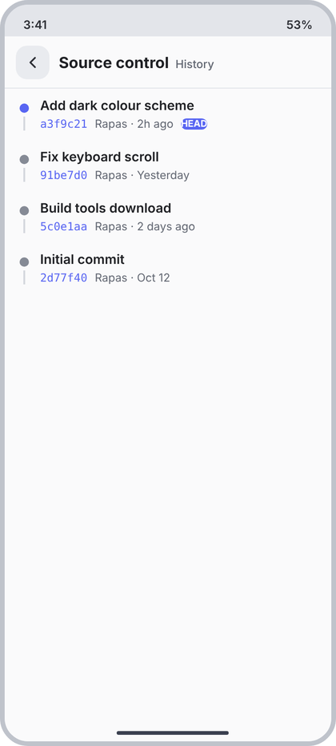
 
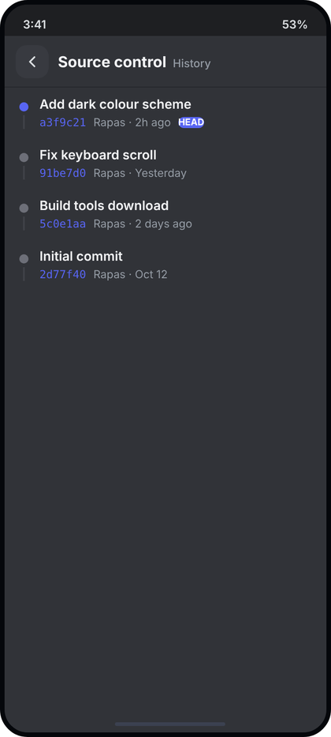

Left: light theme. Right: dark theme. All names and numbers in the pictures are examples.

What the picture shows. A full screen with the header "Source control" (bold) and "History" (muted). The body is a plain list of commits, newest first. Each commit has a dot on the left with a short line under it (a timeline), the commit message in bold, and under it the short hash in mono accent colour, the author, the time and, on the newest, a small "HEAD" pill. No cards, no dividers.

Numbers.

Screen bg c.content FAFAFB. Header ScreenHeader("Source control", "History", onBack).

Row: padding 16 horizontal and 10 vertical, gap 12.

Timeline column: 10 wide, top padding 6. Dot 10 x 10 circle: HEAD c.accent 5865F2, others c.faint 858A95. Line: 2 dp wide, c.border D5D8DE, 4 dp below the dot, fills the rest of the row's content height.

Message: 14 sp SemiBold c.text.

Meta row: 3 dp below the message, 12 sp c.muted, gap 8. Hash: mono, c.accent, 7 characters. Then "Author · time". HEAD pill: bg c.accent, white text 10 sp Bold, radius 8, padding 7 horizontal and 1 vertical (the mock has a typo and renders it tight; use these numbers).

Behaviour. Data: the real commit log of the current branch (git log), loaded in pages of 50, more when the list is scrolled to the end. Time: shortAgo (14): "2h ago", "Yesterday", "2 days ago", then a date like "Oct 12". The HEAD pill is on the commit the branch points at. Tap a row: push Commit detail (20) with the full hash. Loading: LoadingList(4). Empty: EmptyState("history", "No commits yet", "Commit your changes to see them here."). Error: ErrorCard with the real message.

Code.

@Composable
fun HistoryScreen(
    origin: String?, commits: List<CommitUi>?, error: String?, nowMillis: Long,
    onBack: () -> Unit, onOpen: (CommitUi) -> Unit, onLoadMore: () -> Unit, onRetry: () -> Unit
) {
    val c = CcTheme.colors
    Column(Modifier.fillMaxSize().background(c.content)) {
        ScreenHeader(origin, "History", onBack)
        when {
            error != null -> ErrorCard(error, onRetry)
            commits == null -> LoadingList(4)
            commits.isEmpty() -> EmptyState("history", "No commits yet", "Commit your changes to see them here.")
            else -> LazyColumn(Modifier.weight(1f)) {
                itemsIndexed(commits, key = { _, it -> it.hash }) { i, cm ->
                    if (i == commits.lastIndex) LaunchedEffect(commits.size) { onLoadMore() }
                    Row(Modifier.fillMaxWidth().height(IntrinsicSize.Min).clickable { onOpen(cm) }
                        .padding(horizontal = 16.dp, vertical = 10.dp)) {
                        Column(Modifier.width(10.dp).fillMaxHeight().padding(top = 6.dp), horizontalAlignment = Alignment.CenterHorizontally) {
                            Box(Modifier.size(10.dp).clip(CircleShape).background(if (cm.isHead) c.accent else c.faint))
                            Box(Modifier.padding(top = 4.dp).width(2.dp).weight(1f).background(c.border))
                        }
                        Spacer(Modifier.width(12.dp))
                        Column(Modifier.weight(1f)) {
                            OneLine(cm.message, CcType.itemTitle.copy(fontSize = 14.sp), c.text)
                            Row(Modifier.padding(top = 3.dp), verticalAlignment = Alignment.CenterVertically, horizontalArrangement = Arrangement.spacedBy(8.dp)) {
                                Text(cm.hash.take(7), style = CcType.code.copy(fontSize = 12.sp, lineHeight = 16.sp), color = c.accent)
                                OneLine("${cm.author} · ${shortAgo(cm.timeMillis, nowMillis)}", CcType.caption, c.muted, Modifier.weight(1f, fill = false))
                                if (cm.isHead) Text("HEAD", style = CcType.section.copy(fontSize = 10.sp, letterSpacing = 0.sp), color = Color.White,
                                    modifier = Modifier.clip(RoundedCornerShape(8.dp)).background(c.accent).padding(horizontal = 7.dp, vertical = 1.dp))
                            }
                        }
                    }
                }
            }
        }
    }
}

### 20 Commit detail


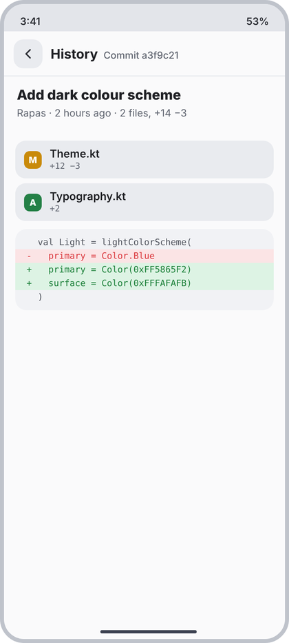
 
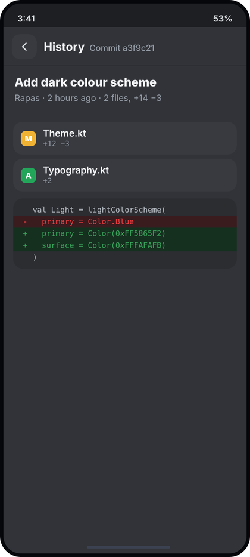

Left: light theme. Right: dark theme. All names and numbers in the pictures are examples.

What the picture shows. A full screen reached from History. The header shows "History" (bold) and "Commit a3f9c21" (muted, the short hash). Under it a title block with the commit subject in large bold and a line with author, time and the totals. Then one card per changed file (letter square, file name, "+added -removed"), and at the bottom a small diff preview box with green added and red removed lines.

Numbers.

Screen bg c.content. Header ScreenHeader(origin = "History", title = "Commit " + hash7, onBack).

Title block: padding 16 horizontal, 14 vertical. Subject 17 sp ExtraBold c.text. Meta line 12.5 sp c.muted, 5 dp below the subject and 12 dp above the cards: "Author · 2 hours ago · 2 files, +14 −3".

File cards: ChangedFileRow (17): sub line mono 10.5 sp c.muted "+12 −3" (for an added file only "+2", for a deleted file only "−5").

Diff preview box: margin 14 horizontal and 10 vertical, radius 14, bg c.panel F1F2F5, padding 8 vertical, content clipped. Line: mono 11 sp, line height 1.55 (17 sp), padding 14 horizontal, no wrap. Marker column 14 dp wide. Added line: bg c.diffAddBg DDF3E4, text c.diffAddText 1A7F37. Removed line: bg c.diffDelBg FBE4E5, text c.diffDelText DA373C. Context: no bg, text c.textSoft 4F535C.

Behaviour. Data: git show of the full hash: subject, author, date, the changed files with counts, and the first hunk of the first file for the preview (at most 12 lines). Tap a file card: open the full diff of that file at this commit (21 layout, read only, without the Discard and Stage buttons). The totals line adds up the real counts; singular "1 file". Loading: LoadingList(3). Error: ErrorCard. A commit with no file changes shows only the title block. Time in long form: "2 hours ago", "yesterday", "Oct 12".

Code.

data class CommitFileUi(val path: String, val kind: ChangeKind, val added: Int, val removed: Int)
data class DiffLineUi(val kind: Char, val oldNo: Int?, val newNo: Int?, val text: String)   // kind: ' ', '+', '-'
data class CommitDetailUi(val hash: String, val subject: String, val author: String, val whenText: String,
                          val files: List<CommitFileUi>, val preview: List<DiffLineUi>)

fun countsText(f: CommitFileUi): String = listOfNotNull(
    if (f.added > 0) "+${f.added}" else null, if (f.removed > 0) "−${f.removed}" else null).joinToString(" ")

@Composable
fun DiffText(kind: Char, text: String, modifier: Modifier = Modifier, numberText: String? = null, fontSize: TextUnit = 11.sp, lineHeight: TextUnit = 17.sp) {
    val c = CcTheme.colors
    val bg = when (kind) { '+' -> c.diffAddBg; '-' -> c.diffDelBg; else -> Color.Transparent }
    val fg = when (kind) { '+' -> c.diffAddText; '-' -> c.diffDelText; else -> c.textSoft }
    val style = CcType.code.copy(fontSize = fontSize, lineHeight = lineHeight)
    Row(modifier.background(bg)) {
        if (numberText != null) Text(numberText, style = style, color = c.faint, textAlign = TextAlign.End, modifier = Modifier.width(34.dp).padding(end = 8.dp))
        Text(if (kind == ' ') "" else kind.toString(), style = style, color = fg, modifier = Modifier.width(14.dp))
        Text(text, style = style, color = fg, softWrap = false)
    }
}

@Composable
fun CommitDetailScreen(
    detail: CommitDetailUi?, error: String?, onBack: () -> Unit, onOpenFile: (CommitFileUi) -> Unit, onRetry: () -> Unit
) {
    val c = CcTheme.colors
    Column(Modifier.fillMaxSize().background(c.content)) {
        ScreenHeader("History", "Commit " + (detail?.hash?.take(7) ?: ""), onBack)
        when {
            error != null -> ErrorCard(error, onRetry)
            detail == null -> LoadingList(3)
            else -> Column(Modifier.weight(1f).verticalScroll(rememberScrollState())) {
                val add = detail.files.sumOf { it.added }; val del = detail.files.sumOf { it.removed }
                Column(Modifier.padding(horizontal = 16.dp, vertical = 14.dp)) {
                    Text(detail.subject, style = CcType.sheetTitle.copy(fontSize = 17.sp), color = c.text)
                    val n = detail.files.size
                    Text("${detail.author} · ${detail.whenText} · $n ${if (n == 1) "file" else "files"}, +$add −$del",
                        style = CcType.caption.copy(fontSize = 12.5.sp), color = c.muted, modifier = Modifier.padding(top = 5.dp, bottom = 12.dp))
                }
                detail.files.forEach { f -> ChangedFileRow(f.kind, f.path.substringAfterLast('/'), countsText(f)) { onOpenFile(f) } }
                if (detail.preview.isNotEmpty()) {
                    Column(Modifier.padding(horizontal = 14.dp, vertical = 10.dp).fillMaxWidth().clip(RoundedCornerShape(14.dp))
                        .background(c.panel).padding(vertical = 8.dp)) {
                        detail.preview.forEach { l -> DiffText(l.kind, l.text, Modifier.fillMaxWidth().padding(horizontal = 14.dp)) }
                    }
                }
            }
        }
    }
}

### 21 Diff


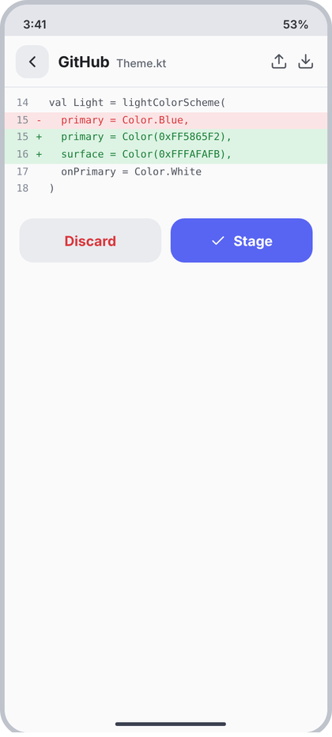
 
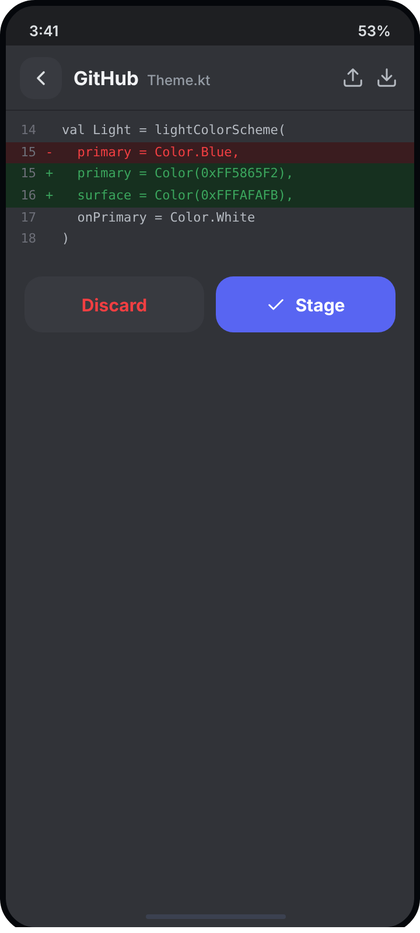

Left: light theme. Right: dark theme. All names and numbers in the pictures are examples.

What the picture shows. A full screen for one changed file. The header shows "GitHub" (bold) and the file name (muted), and two bare icons on the right (an upload tray and a download tray, 19 dp, no tile). The body is a diff: line numbers on the left, a marker column (+ or -), then the code in mono. Added lines have a green band across the full width, removed lines a red band. Below the diff, two buttons side by side: Discard (grey, red text) and Stage (accent, tick icon).

Numbers.

Screen bg c.content. Header ScreenHeader("GitHub", fileName, onBack, actions = {...}). The two icons: up and down, 19 dp, stroke 1.8, tint c.textSoft 4F535C, no background, 10 dp apart (the header's action gap).

Diff block: top and bottom padding 8. Line: mono 11 sp, line height 1.7 (18.7 sp), no wrap, full-width band. Number column 34 dp wide, right aligned, 8 dp right padding, c.faint 858A95. Marker column 14 dp. Code text follows.

Colours: added band c.diffAddBg DDF3E4 with text c.diffAddText 1A7F37; removed band c.diffDelBg FBE4E5 with text c.diffDelText DA373C; context text c.textSoft 4F535C, no band.

Number rule (as in the picture): a removed line shows the OLD line number, all other lines show the NEW line number (so 15 appears twice: removed line 15 and added line 15).

Buttons: margin 16 horizontal and 14 top, directly under the diff (not pinned to the bottom), gap 10, two halves. Height 48, radius 15, text 15 sp Bold. Discard: bg c.field, text c.red. Stage: bg c.accent, white text, icon check 17 dp stroke 2, gap 8.

Behaviour. Data: the real unified diff of the file (working tree vs last commit), parsed into lines with old and new numbers; unchanged lines around each change are context (3 lines). Long lines scroll sideways together (one horizontal scroll for the whole block). The two header icons jump to the previous and next change in the diff (tray icons are the glyphs the design uses). Stage stages the file and changes to "Unstage" if it is already staged; after staging the screen stays open. Discard opens CcConfirmDialog ("Discard changes in Theme.kt?", destructive) and on confirm restores the file from the last commit and goes back. Binary file: "Binary file, no preview" in c.muted. No differences: "No changes in this file". Loading: LoadingList(4). Opened from a commit (20): read only, hide both buttons.

Code.

@Composable
fun DiffScreen(
    origin: String?, fileName: String, lines: List<DiffLineUi>?, staged: Boolean, readOnly: Boolean, error: String?,
    onBack: () -> Unit, onPrevChange: () -> Unit, onNextChange: () -> Unit,
    onDiscard: () -> Unit, onStageToggle: () -> Unit, onRetry: () -> Unit
) {
    val c = CcTheme.colors
    Column(Modifier.fillMaxSize().background(c.content)) {
        ScreenHeader(origin, fileName, onBack, actions = {
            Box(Modifier.size(19.dp).clickable(onClick = onPrevChange).semantics { contentDescription = "Previous change" }) { CcIcon("up", c.textSoft, 19.dp, 1.8f) }
            Box(Modifier.size(19.dp).clickable(onClick = onNextChange).semantics { contentDescription = "Next change" }) { CcIcon("down", c.textSoft, 19.dp, 1.8f) }
        })
        when {
            error != null -> ErrorCard(error, onRetry)
            lines == null -> LoadingList(4)
            lines.isEmpty() -> Text("No changes in this file", style = CcType.small, color = c.muted, modifier = Modifier.padding(16.dp))
            else -> Column(Modifier.weight(1f).verticalScroll(rememberScrollState())) {
                Box(Modifier.horizontalScroll(rememberScrollState())) {
                    Column(Modifier.padding(vertical = 8.dp).widthIn(min = 360.dp)) {
                        lines.forEach { l ->
                            val no = if (l.kind == '-') l.oldNo else l.newNo
                            DiffText(l.kind, l.text, Modifier.fillMaxWidth(), numberText = no?.toString() ?: "", lineHeight = 18.7.sp)
                        }
                    }
                }
                if (!readOnly) Row(Modifier.padding(start = 16.dp, end = 16.dp, top = 14.dp), horizontalArrangement = Arrangement.spacedBy(10.dp)) {
                    Box(Modifier.weight(1f).height(48.dp).clip(RoundedCornerShape(15.dp)).background(c.field).clickable(onClick = onDiscard),
                        contentAlignment = Alignment.Center) { Text("Discard", style = CcType.body.copy(fontSize = 15.sp, fontWeight = FontWeight.Bold), color = c.red) }
                    PrimaryButton(if (staged) "Unstage" else "Stage", onStageToggle, Modifier.weight(1f), icon = "check")
                }
            }
        }
    }
}

## Screens 22 to 31 (terminal, run and build, preview, console, previews, logcat, problems)

Common notes for all ten sections. The PNGs are 720 px wide = 360 dp, so divide picture pixels by 2 for dp. The generators draw the dark twin colours; the light mapping used below is: #313338 = c.content, #2b2d31 = c.panel, #383a40 = c.field, #1e1f22 = c.rail (segment track, progress track), #4a4d55 = c.toggleOff, #f2f3f5 = c.text, #dbdee1 = c.text2, #b5bac1 = c.textSoft, #949ba4 = c.muted, #6d6f78 = c.faint, #26272b / #3f4147 = c.divider / c.border, #23a559 = c.green, #f0b232 = c.amber, #f23f42 = c.red, #60a5fa = c.blue, #a78bfa = c.purple, #34d399 = c.teal, #3a1c1f / #2a1a1c = c.diffDelBg. Imports are the same as in d3 (androidx.compose.foundation.*, foundation.layout.*, ui.*, material3.Text, CcTheme, CcType, CcShape, CcIcon, OneLine, CcChip, CcToggle, PrimaryButton, SecondaryButton, CcTextField, EmptyState, ScreenHeader, SidePanel). Icon names used: term, plus, cr, bolt, send, user, x, layers, check, refresh, more, play, trash, globe, bug, down, share, search, alert, code, branch, cl (back chevron is drawn inside ScreenHeader).

### 22 Terminal (sidebar tool)


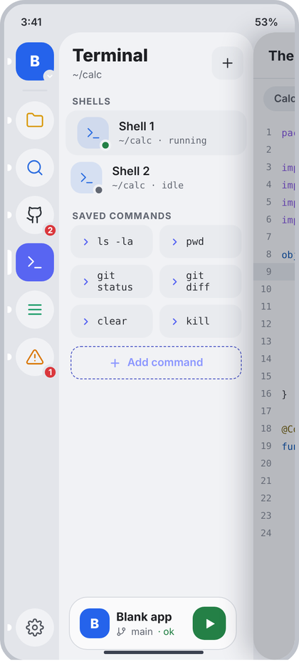
 
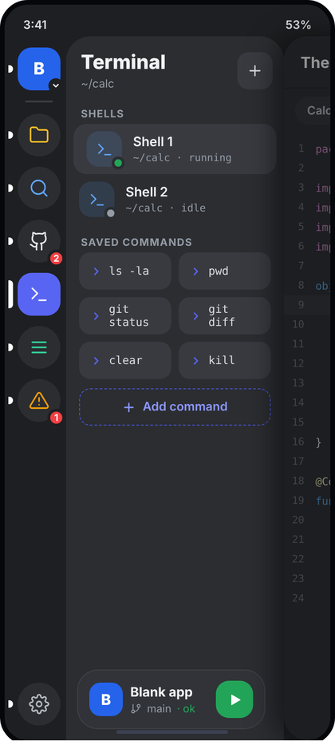

Left: light theme. Right: dark theme. All names and numbers in the pictures are examples.

What the picture shows. The sidebar is open (layer 2) with the Terminal tool selected in the rail (accent tile, white pill on its left). The 234 dp side panel has the title "Terminal" with the working folder under it and a square plus button on the right. Below are two groups: SHELLS (one row per open shell, the current one highlighted) and SAVED COMMANDS (a two-column grid of mono chips, then a dashed "Add command" button). The Run card sits at the bottom of the panel (shared RunCard from d4). The editor card is pushed right and dimmed.

Numbers.

Frame: SidePanel from d4 (234 dp wide, radius 26 top-left, c.panel). Title CcType.panelTitle (21 sp, ExtraBold, c.text), subtitle CcType.caption (12 sp, c.muted, 2 dp under title). Header padding 16 start / 16 top / 12 end, gap 6.

Plus button: 38 w x 40 h, radius 12, c.field, icon "plus" 18 dp, c.text2, stroke 1.9.

Section label: CcType.section (11 sp Bold, letter spacing 0.8, c.muted), padding 16 start/end, 12 top, 4 bottom.

Shell row: padding 8 vertical, 14 horizontal, gap 12. Selected row: margin 8 horizontal, c.field, radius 14. Avatar 38 x 38, radius 12, background c.blue at 13%, icon "term" 19 dp c.blue. Status dot 14 dp circle, border 3 dp in c.panel, offset -3/-3 at bottom-right; green (c.green) = running, c.muted = idle. Name 14 sp SemiBold c.text. Sub line: mono 11 sp c.muted, 2 dp below name ("folder · running").

Command grid: 2 columns, gap 8, horizontal padding 14. Chip: height 40, radius 12, c.field, padding 12 horizontal, gap 7, icon "cr" 13 dp c.accent stroke 2.6, text mono 12 sp c.text2, max 2 lines (long commands wrap, see "git status").

Add command: margin 10 vertical / 14 horizontal, height 40, radius 12, dashed border 1.5 dp (c.accent), icon "plus" 15 dp stroke 2.4, text 13 sp SemiBold, content in c.accent, gap 7, centered.

Rail: the generic ToolRail from d4; red badge 2 on GitHub, 1 on Problems come from vm.badges.

Behaviour.

Folder under the title = the shell working folder of the current project (shortened with ~). Shells come from the terminal manager (list of open sessions, each with id, name, folder, running flag). Saved commands come from the user's saved-command store (Settings > Terminal also edits it).

Tap a shell row: push Route.TerminalSession(id, name) (screen 23). Tap plus: start a new shell, then open it. Tap a command chip: open the current shell session and run it there (nothing is typed into a hidden shell). Tap Add command: push the New command screen (24, shown as Sheet.NewCommand in AppState if you keep it as a sheet, or a route).

Empty states: no shells -> one muted line "No shells open. Tap + to start one." (13 sp, c.muted, padding 16/8). No saved commands -> only the Add command button is shown.

Code.

data class ShellUi(val id: String, val name: String, val folder: String, val running: Boolean)
data class SavedCommandUi(val id: String, val text: String)

@Composable
fun TerminalPanel(
    folder: String, shells: List<ShellUi>, selectedShellId: String?, commands: List<SavedCommandUi>,
    onNewShell: () -> Unit, onOpenShell: (ShellUi) -> Unit,
    onRunCommand: (SavedCommandUi) -> Unit, onAddCommand: () -> Unit,
    runCard: (@Composable () -> Unit)?
) {
    val c = CcTheme.colors
    SidePanel(
        title = "Terminal", subtitle = folder, runCard = runCard,
        actions = {
            Box(Modifier.size(38.dp, 40.dp).clip(RoundedCornerShape(12.dp)).background(c.field)
                .clickable(onClick = onNewShell).semantics { contentDescription = "New shell" },
                contentAlignment = Alignment.Center) { CcIcon("plus", c.text2, 18.dp, 1.9f) }
        }
    ) {
        PanelSection("SHELLS")
        if (shells.isEmpty())
            Text("No shells open. Tap + to start one.", style = CcType.small, color = c.muted,
                modifier = Modifier.padding(horizontal = 16.dp, vertical = 8.dp))
        shells.forEach { s ->
            val sel = s.id == selectedShellId
            Row(Modifier.fillMaxWidth().padding(horizontal = if (sel) 8.dp else 0.dp)
                .clip(RoundedCornerShape(14.dp)).background(if (sel) c.field else Color.Transparent)
                .clickable { onOpenShell(s) }.padding(horizontal = 14.dp, vertical = 8.dp),
                verticalAlignment = Alignment.CenterVertically) {
                Box(Modifier.size(38.dp)) {
                    Box(Modifier.fillMaxSize().clip(RoundedCornerShape(12.dp)).background(c.blue.tint()),
                        contentAlignment = Alignment.Center) { CcIcon("term", c.blue, 19.dp) }
                    Box(Modifier.align(Alignment.BottomEnd).offset(3.dp, 3.dp).size(14.dp).clip(CircleShape)
                        .background(c.panel).padding(3.dp).clip(CircleShape)
                        .background(if (s.running) c.green else c.muted))
                }
                Spacer(Modifier.width(12.dp))
                Column(Modifier.weight(1f)) {
                    OneLine(s.name, CcType.itemTitle.copy(fontSize = 14.sp), c.text)
                    OneLine("${s.folder} · ${if (s.running) "running" else "idle"}",
                        CcType.log.copy(fontSize = 11.sp, lineHeight = 15.sp), c.muted, Modifier.padding(top = 2.dp))
                }
            }
        }
        PanelSection("SAVED COMMANDS")
        Column(Modifier.padding(horizontal = 14.dp), verticalArrangement = Arrangement.spacedBy(8.dp)) {
            commands.chunked(2).forEach { pair ->
                Row(horizontalArrangement = Arrangement.spacedBy(8.dp)) {
                    pair.forEach { cmd ->
                        Row(Modifier.weight(1f).height(40.dp).clip(RoundedCornerShape(12.dp)).background(c.field)
                            .clickable { onRunCommand(cmd) }.padding(horizontal = 12.dp),
                            verticalAlignment = Alignment.CenterVertically) {
                            CcIcon("cr", c.accent, 13.dp, 2.6f); Spacer(Modifier.width(7.dp))
                            Text(cmd.text, style = CcType.log.copy(fontSize = 12.sp, lineHeight = 14.sp), color = c.text2, maxLines = 2)
                        }
                    }
                    if (pair.size == 1) Spacer(Modifier.weight(1f))
                }
            }
        }
        val dash = c.accent
        Row(Modifier.padding(horizontal = 14.dp, vertical = 10.dp).fillMaxWidth().height(40.dp)
            .drawBehind {
                drawRoundRect(dash, cornerRadius = CornerRadius(12.dp.toPx()),
                    style = Stroke(1.5.dp.toPx(), pathEffect = PathEffect.dashPathEffect(floatArrayOf(6.dp.toPx(), 4.dp.toPx()))))
            }.clip(RoundedCornerShape(12.dp)).clickable(onClick = onAddCommand),
            horizontalArrangement = Arrangement.Center, verticalAlignment = Alignment.CenterVertically) {
            CcIcon("plus", c.accent, 15.dp, 2.4f); Spacer(Modifier.width(7.dp))
            Text("Add command", style = CcType.small.copy(fontWeight = FontWeight.SemiBold), color = c.accent)
        }
    }
}

@Composable
private fun PanelSection(text: String) = Text(text, style = CcType.section, color = CcTheme.colors.muted,
    modifier = Modifier.padding(start = 16.dp, end = 16.dp, top = 12.dp, bottom = 4.dp))

### 23 Terminal session


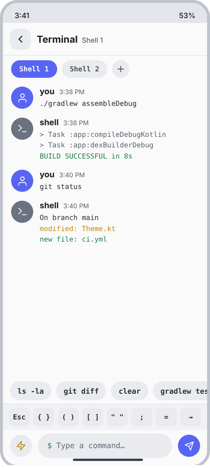
 
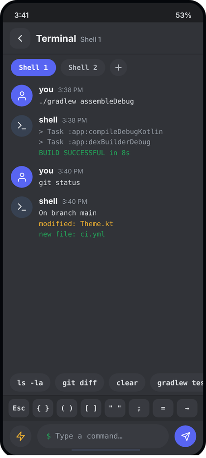

Left: light theme. Right: dark theme. All names and numbers in the pictures are examples.

What the picture shows. A full screen (layer 3) over the editor. Header: back button, "Terminal" in bold (origin) and "Shell 1" muted. Under it a row of shell tabs (current one in accent) and a round plus to open another. The middle is a chat-style log: each block has a round avatar ("you" = the command typed, "shell" = its output), a name, a time and the text in mono. At the bottom: a row of quick command chips (scrolls sideways), the key row for characters a phone keyboard hides, and the input bar with a saved-commands button on the left and a send button on the right.

Numbers.

Header: ScreenHeader(origin = "Terminal", title = shell name), 56 dp, bottom divider 1 dp c.divider. No right actions.

Tab row: bg c.content, padding 8 vertical / 14 horizontal, gap 8. Tab: height 30, padding 14 horizontal, radius 15, mono 12 sp SemiBold; selected c.accent + white text; others c.field + c.textSoft. Plus: 30 x 30 circle, c.field, icon "plus" 16 dp c.textSoft stroke 2.2.

Log row: padding 7 vertical / 14 horizontal, gap 11. Avatar 38 circle: you = c.accent, shell = #6B7280 (read from the picture), icon "user" / "term" 19 dp white stroke 1.8. Name 14 sp Bold c.text; time 11 sp c.muted; gap 8, baseline aligned. Body mono 12 sp, line height 1.55 (18.6 sp), 3 dp below the name, c.text2. Line tones: dim = c.muted, success = c.green, warning = c.amber.

Quick chips row: bg c.content, padding 6 vertical / 12 horizontal, gap 8. Chip height 32, padding 13, radius 16, c.field, mono 12.5 sp SemiBold, text c.text2 (picture shows it a bit darker than the key row).

Key row: bg c.panel, top border 1 dp c.divider, padding 6 vertical / 10 horizontal, gap 6. Keys (in this order): Esc, { }, ( ), [ ], " ", ;, =, arrow right. Each: weight 1, height 32, radius 9, c.field, mono 12 sp SemiBold, c.text2.

Input bar: bg c.content, padding 6 top / 12 sides / 12 bottom, gap 10. Left button: 38 circle c.field, icon "bolt" 18 dp c.amber. Field: weight 1, height 42, radius 21, c.field, padding 16, mono 13 sp; prompt "$" in c.green then a space then hint "Type a command..." in c.muted. Send: 38 circle c.accent, icon "send" 17 dp white stroke 1.9.

Behaviour.

Messages come from the shell session (list: fromUser, time, lines with tone). Time is the real time of the line. The list sticks to the bottom: when a new line arrives scroll to the last item.

Tabs = open shells; tap switches the session, plus opens a new shell. Key row inserts the text at the cursor (Esc sends the ESC byte; arrow = Tab char). Quick chips = the saved commands; tap puts the command in the input and runs it. Bolt button opens the saved commands (same list as the chips, plus Add command which goes to screen 24). Send runs the input and clears it; disabled look is not drawn in the picture, simply ignore taps while the input is empty.

Empty log: centered muted text "Nothing here yet. Type a command below." (13 sp). Keyboard open: the input bar rides above the keyboard (imePadding); key row stays directly above the input.

Code.

enum class Tone { Normal, Dim, Success, Warning }
data class TermLine(val text: String, val tone: Tone = Tone.Normal)
data class TermMessage(val id: String, val fromUser: Boolean, val time: String, val lines: List<TermLine>)

@Composable
fun TerminalSessionScreen(
    shellName: String, shells: List<ShellUi>, selectedShellId: String, messages: List<TermMessage>,
    quickCommands: List<String>, input: String,
    onInput: (String) -> Unit, onSend: () -> Unit, onKey: (String) -> Unit,
    onSelectShell: (ShellUi) -> Unit, onNewShell: () -> Unit, onSavedCommands: () -> Unit,
    onQuick: (String) -> Unit, onBack: () -> Unit
) {
    val c = CcTheme.colors
    val list = rememberLazyListState()
    LaunchedEffect(messages.size) { if (messages.isNotEmpty()) list.animateScrollToItem(messages.lastIndex) }
    Column(Modifier.fillMaxSize().background(c.content).imePadding()) {
        ScreenHeader("Terminal", shellName, onBack)
        Row(Modifier.horizontalScroll(rememberScrollState()).padding(horizontal = 14.dp, vertical = 8.dp),
            horizontalArrangement = Arrangement.spacedBy(8.dp), verticalAlignment = Alignment.CenterVertically) {
            shells.forEach { s ->
                val sel = s.id == selectedShellId
                Box(Modifier.height(30.dp).clip(RoundedCornerShape(15.dp)).background(if (sel) c.accent else c.field)
                    .clickable { onSelectShell(s) }.padding(horizontal = 14.dp), contentAlignment = Alignment.Center) {
                    Text(s.name, style = CcType.log.copy(fontSize = 12.sp, fontWeight = FontWeight.SemiBold),
                        color = if (sel) Color.White else c.textSoft)
                }
            }
            Box(Modifier.size(30.dp).clip(CircleShape).background(c.field).clickable(onClick = onNewShell),
                contentAlignment = Alignment.Center) { CcIcon("plus", c.textSoft, 16.dp, 2.2f) }
        }
        Box(Modifier.weight(1f)) {
            if (messages.isEmpty()) Text("Nothing here yet. Type a command below.", style = CcType.small, color = c.muted,
                modifier = Modifier.align(Alignment.Center))
            LazyColumn(state = list) {
                items(messages, key = { it.id }) { m ->
                    Row(Modifier.padding(horizontal = 14.dp, vertical = 7.dp)) {
                        Box(Modifier.size(38.dp).clip(CircleShape).background(if (m.fromUser) c.accent else Color(0xFF6B7280)),
                            contentAlignment = Alignment.Center) { CcIcon(if (m.fromUser) "user" else "term", Color.White, 19.dp) }
                        Spacer(Modifier.width(11.dp))
                        Column(Modifier.weight(1f)) {
                            Row(horizontalArrangement = Arrangement.spacedBy(8.dp), verticalAlignment = Alignment.Bottom) {
                                Text(if (m.fromUser) "you" else "shell", style = CcType.body.copy(fontWeight = FontWeight.Bold), color = c.text)
                                Text(m.time, style = CcType.caption.copy(fontSize = 11.sp), color = c.muted)
                            }
                            Column(Modifier.padding(top = 3.dp)) {
                                m.lines.forEach { l ->
                                    Text(l.text, style = CcType.log.copy(fontSize = 12.sp, lineHeight = 18.6.sp),
                                        color = when (l.tone) { Tone.Dim -> c.muted; Tone.Success -> c.green; Tone.Warning -> c.amber; else -> c.text2 })
                                }
                            }
                        }
                    }
                }
            }
        }
        Row(Modifier.horizontalScroll(rememberScrollState()).padding(horizontal = 12.dp, vertical = 6.dp),
            horizontalArrangement = Arrangement.spacedBy(8.dp)) {
            quickCommands.forEach { q ->
                Box(Modifier.height(32.dp).clip(RoundedCornerShape(16.dp)).background(c.field)
                    .clickable { onQuick(q) }.padding(horizontal = 13.dp), contentAlignment = Alignment.Center) {
                    Text(q, style = CcType.log.copy(fontSize = 12.5.sp, fontWeight = FontWeight.SemiBold), color = c.text2, maxLines = 1)
                }
            }
        }
        Column(Modifier.background(c.panel)) {
            Box(Modifier.fillMaxWidth().height(1.dp).background(c.divider))
            Row(Modifier.padding(horizontal = 10.dp, vertical = 6.dp), horizontalArrangement = Arrangement.spacedBy(6.dp)) {
                listOf("Esc" to "\u001B", "{ }" to "{}", "( )" to "()", "[ ]" to "[]", "\" \"" to "\"\"", ";" to ";", "=" to "=", "→" to "\t")
                    .forEach { (label, send) ->
                        Box(Modifier.weight(1f).height(32.dp).clip(RoundedCornerShape(9.dp)).background(c.field)
                            .clickable { onKey(send) }, contentAlignment = Alignment.Center) {
                            Text(label, style = CcType.log.copy(fontSize = 12.sp, fontWeight = FontWeight.SemiBold), color = c.text2)
                        }
                    }
            }
        }
        Row(Modifier.padding(start = 12.dp, end = 12.dp, top = 6.dp, bottom = 12.dp), verticalAlignment = Alignment.CenterVertically,
            horizontalArrangement = Arrangement.spacedBy(10.dp)) {
            Box(Modifier.size(38.dp).clip(CircleShape).background(c.field).clickable(onClick = onSavedCommands)
                .semantics { contentDescription = "Saved commands" }, contentAlignment = Alignment.Center) { CcIcon("bolt", c.amber, 18.dp) }
            Row(Modifier.weight(1f).height(42.dp).clip(RoundedCornerShape(21.dp)).background(c.field).padding(horizontal = 16.dp),
                verticalAlignment = Alignment.CenterVertically) {
                val mono = CcType.log.copy(fontSize = 13.sp)
                Text("$ ", style = mono, color = c.green)
                Box(Modifier.weight(1f)) {
                    if (input.isEmpty()) Text("Type a command…", style = mono, color = c.muted)
                    BasicTextField(input, onInput, singleLine = true, textStyle = mono.copy(color = c.text),
                        cursorBrush = SolidColor(c.accent), modifier = Modifier.fillMaxWidth(),
                        keyboardOptions = KeyboardOptions(imeAction = ImeAction.Send), keyboardActions = KeyboardActions(onSend = { onSend() }))
                }
            }
            Box(Modifier.size(38.dp).clip(CircleShape).background(c.accent).clickable(enabled = input.isNotBlank(), onClick = onSend)
                .semantics { contentDescription = "Send" }, contentAlignment = Alignment.Center) { CcIcon("send", Color.White, 17.dp, 1.9f) }
        }
    }
}

### 24 Terminal: new command


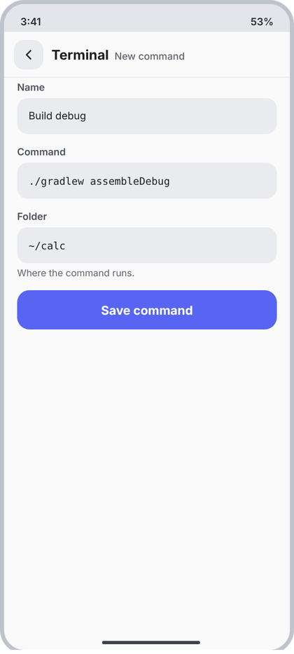
 
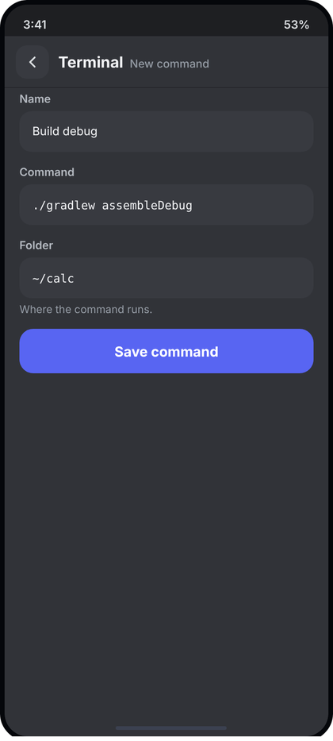

Left: light theme. Right: dark theme. All names and numbers in the pictures are examples.

What the picture shows. A plain full-screen form (layer 3, pushed from "Add command" in the Terminal panel or session). Header: back, "Terminal" bold, "New command" muted. Three labelled fields (Name, Command, Folder) with a one-line hint under Folder, then one big accent button "Save command". The rest of the screen is empty.

Numbers.

Header: ScreenHeader("Terminal", "New command"). No actions.

Field block: horizontal padding 16, bottom padding 10. Label 12 sp SemiBold c.textSoft, margin 4 top / 6 bottom. Box height 44, radius 13, c.field, padding 14 horizontal, text 12.5 sp, c.text. Name = Inter; Command and Folder = mono (CcType.code at 12.5 sp, line height 18). Hint: 11.5 sp c.muted, 5 dp below the box.

Button: wrapper padding 4 vertical / 16 horizontal; PrimaryButton height 48, radius 15, c.accent, text 15 sp Bold white, no icon, full width.

Body starts directly under the header divider (no extra top padding).

Behaviour.

Fields start empty. Hints when empty: Name "Build debug" is only an example of a value: leave the placeholder as "Name" style text in c.muted, Command placeholder "Command to run", Folder prefilled with the current project folder (real value, editable). Hint under Folder: "Where the command runs."

Save command is disabled (c.field background, c.muted text, the PrimaryButton disabled look) until Name and Command are not blank. Tap saves to the saved-command store, pops this route, and the new chip shows in screens 22 and 23. Error: if the name already exists show CcTextField error "A command with this name already exists." in c.red under the Name box.

Code.

@Composable
fun NewCommandScreen(
    name: String, command: String, folder: String, nameError: String?,
    onName: (String) -> Unit, onCommand: (String) -> Unit, onFolder: (String) -> Unit,
    onSave: () -> Unit, onBack: () -> Unit
) {
    val c = CcTheme.colors
    Column(Modifier.fillMaxSize().background(c.content).imePadding()) {
        ScreenHeader("Terminal", "New command", onBack)
        Column(Modifier.verticalScroll(rememberScrollState())) {
            Column(Modifier.padding(start = 16.dp, end = 16.dp, top = 4.dp, bottom = 10.dp)) {
                CcTextField(name, onName, label = "Name", hint = "Name", error = nameError)
            }
            Column(Modifier.padding(start = 16.dp, end = 16.dp, top = 4.dp, bottom = 10.dp)) {
                CcTextField(command, onCommand, label = "Command", hint = "Command to run", mono = true)
            }
            Column(Modifier.padding(start = 16.dp, end = 16.dp, top = 4.dp, bottom = 10.dp)) {
                CcTextField(folder, onFolder, label = "Folder", hint = "Project folder", mono = true)
                Text("Where the command runs.", style = CcType.caption.copy(fontSize = 11.5.sp), color = c.muted,
                    modifier = Modifier.padding(top = 5.dp))
            }
            PrimaryButton("Save command", onSave, Modifier.padding(horizontal = 16.dp, vertical = 4.dp).fillMaxWidth(),
                enabled = name.isNotBlank() && command.isNotBlank())
        }
    }
}

### 25 Run and build


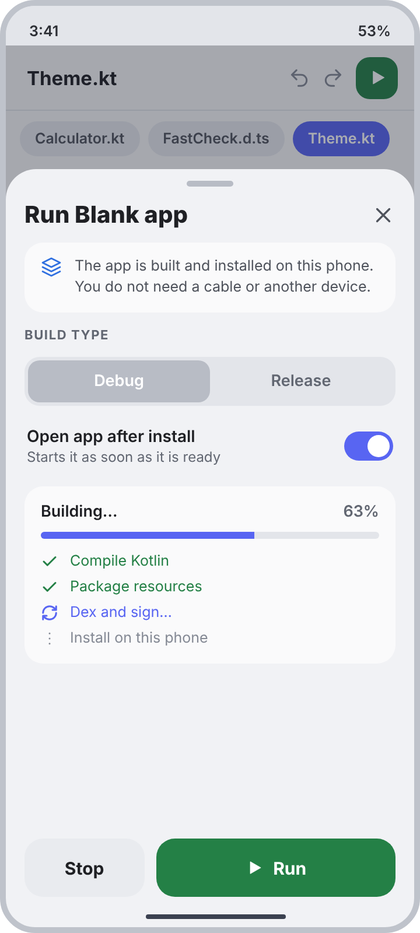
 
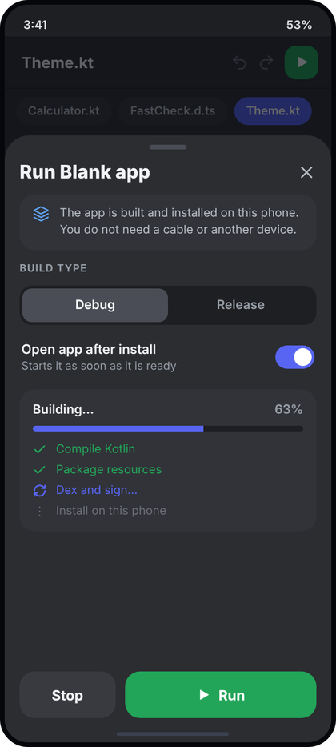

Left: light theme. Right: dark theme. All names and numbers in the pictures are examples.

What the picture shows. A bottom sheet (layer 4) opened from the green Run button; it covers about 82 percent of the screen. The editor behind is dimmed (c.dim). The sheet has a grab handle, the title "Run <project name>" with a close X, an info card that explains the app is installed on this phone, a BUILD TYPE segmented control (Debug / Release), an "Open app after install" toggle, a progress card (title "Building...", percent, a bar and a list of steps), and two buttons at the bottom: Stop and a wider green Run.

Numbers.

Sheet: top corners radius 26 (CcShape.sheetTop), c.panel, padding 10 top / 16 sides / 26 bottom, children gap 12. Height 82 percent of screen (top edge at about 145 dp of 800). Scrim c.dim.

Handle: 40 x 5, radius 3, c.toggleOff, centered.

Title row: title 20 sp ExtraBold c.text, weight 1; close icon "x" 21 dp c.textSoft (tap area 40 dp).

Info card: padding 12 vertical / 14 horizontal, radius 16, c.content, gap 11, top aligned. Icon "layers" 18 dp c.blue. Text 12.5 sp, line height 1.45 (18 sp), c.textSoft: "The app is built and installed on this phone. You do not need a cable or another device."

Section label "BUILD TYPE": CcType.section, c.muted (no side padding, the sheet padding applies).

Segmented control: padding 3, radius 13, track c.rail; two segments weight 1, height 36, radius 10, text 13.5 sp SemiBold. Selected: c.toggleOff fill + white text. Not selected: c.muted text.

Toggle row: padding 6 vertical / 2 horizontal, gap 12. Title 14 sp SemiBold c.text; sub 12 sp c.muted, 1 dp below. CcToggle (42 x 25) at the end. Text: "Open app after install" / "Starts it as soon as it is ready".

Progress card: padding 14, radius 16, c.content. Header row: label 13.5 sp SemiBold c.text left, percent 13.5 sp SemiBold c.muted right. Bar: height 6, radius 3, track c.rail, fill c.accent, margin 9 top / 12 bottom. Steps column gap 7; each step: icon 15 dp stroke 2.4 + 12.5 sp text, gap 10. Done = "check" c.green; active = "refresh" c.accent; waiting = "more" c.faint.

Bottom buttons: row gap 10, pushed to bottom by a weight-1 spacer. Stop: weight 1, height 50, radius 16, c.field, text 15 sp Bold c.text. Run: weight 2, height 50, radius 16, c.green, icon "play" 16 dp white (filled) + gap 8 + "Run" 15 sp Bold white.

Behaviour.

Title uses the real project name. Debug is selected by default; Release is saved per project. Toggle value is saved in settings.

States: idle = no progress card, Stop is disabled look (c.field with c.faint text), Run active. Building = progress card visible, percent and steps come from the build pipeline (list of steps with Done / Active / Waiting), Run disabled look (c.field, c.muted text), Stop active (stops the build and goes back to idle). Success = sheet closes and screen 26 is pushed. Failure = the failing step shows "x" in c.red with its real error line under it (same Run sheet stays open) and Run is active again to retry.

Close X or swipe down or system Back closes the sheet; a running build keeps running in the background and the Run card in the panel shows its state.

Code.

enum class StepState { Done, Active, Waiting }
data class BuildStepUi(val label: String, val state: StepState)

@OptIn(ExperimentalMaterial3Api::class)
@Composable
fun RunSheet(
    projectName: String, release: Boolean, openAfterInstall: Boolean,
    building: Boolean, percent: Float, steps: List<BuildStepUi>,
    onRelease: (Boolean) -> Unit, onOpenAfterInstall: (Boolean) -> Unit,
    onRun: () -> Unit, onStop: () -> Unit, onDismiss: () -> Unit
) {
    val c = CcTheme.colors
    ModalBottomSheet(
        onDismissRequest = onDismiss, containerColor = c.panel, scrimColor = c.dim, shape = CcShape.sheetTop,
        sheetState = rememberModalBottomSheetState(skipPartiallyExpanded = true),
        dragHandle = { Box(Modifier.padding(top = 10.dp).size(40.dp, 5.dp).clip(RoundedCornerShape(3.dp)).background(c.toggleOff)) }
    ) {
        Column(Modifier.fillMaxHeight(0.82f).padding(start = 16.dp, end = 16.dp, top = 12.dp, bottom = 26.dp),
            verticalArrangement = Arrangement.spacedBy(12.dp)) {
            Row(verticalAlignment = Alignment.CenterVertically) {
                OneLine("Run $projectName", CcType.sheetTitle.copy(fontSize = 20.sp), c.text, Modifier.weight(1f))
                Box(Modifier.size(40.dp).clickable(onClick = onDismiss).semantics { contentDescription = "Close" },
                    contentAlignment = Alignment.CenterEnd) { CcIcon("x", c.textSoft, 21.dp) }
            }
            Row(Modifier.fillMaxWidth().clip(RoundedCornerShape(16.dp)).background(c.content).padding(horizontal = 14.dp, vertical = 12.dp)) {
                CcIcon("layers", c.blue, 18.dp); Spacer(Modifier.width(11.dp))
                Text("The app is built and installed on this phone. You do not need a cable or another device.",
                    style = CcType.caption.copy(fontSize = 12.5.sp, lineHeight = 18.sp), color = c.textSoft)
            }
            Text("BUILD TYPE", style = CcType.section, color = c.muted)
            Row(Modifier.fillMaxWidth().clip(RoundedCornerShape(13.dp)).background(c.rail).padding(3.dp)) {
                listOf("Debug" to false, "Release" to true).forEach { (label, isRelease) ->
                    val on = release == isRelease
                    Box(Modifier.weight(1f).height(36.dp).clip(RoundedCornerShape(10.dp))
                        .background(if (on) c.toggleOff else Color.Transparent).clickable { onRelease(isRelease) },
                        contentAlignment = Alignment.Center) {
                        Text(label, style = CcType.body.copy(fontSize = 13.5.sp, fontWeight = FontWeight.SemiBold),
                            color = if (on) Color.White else c.muted)
                    }
                }
            }
            Row(Modifier.padding(horizontal = 2.dp, vertical = 6.dp), verticalAlignment = Alignment.CenterVertically) {
                Column(Modifier.weight(1f)) {
                    Text("Open app after install", style = CcType.itemTitle.copy(fontSize = 14.sp), color = c.text)
                    Text("Starts it as soon as it is ready", style = CcType.caption, color = c.muted, modifier = Modifier.padding(top = 1.dp))
                }
                Spacer(Modifier.width(12.dp))
                CcToggle(openAfterInstall, onOpenAfterInstall)
            }
            if (building) Column(Modifier.fillMaxWidth().clip(RoundedCornerShape(16.dp)).background(c.content).padding(14.dp)) {
                Row {
                    Text("Building…", style = CcType.body.copy(fontSize = 13.5.sp, fontWeight = FontWeight.SemiBold), color = c.text, modifier = Modifier.weight(1f))
                    Text("${(percent * 100).toInt()}%", style = CcType.body.copy(fontSize = 13.5.sp, fontWeight = FontWeight.SemiBold), color = c.muted)
                }
                Box(Modifier.padding(top = 9.dp, bottom = 12.dp).fillMaxWidth().height(6.dp).clip(RoundedCornerShape(3.dp)).background(c.rail)) {
                    Box(Modifier.fillMaxHeight().fillMaxWidth(percent.coerceIn(0f, 1f)).background(c.accent))
                }
                Column(verticalArrangement = Arrangement.spacedBy(7.dp)) {
                    steps.forEach { s ->
                        val col = when (s.state) { StepState.Done -> c.green; StepState.Active -> c.accent; StepState.Waiting -> c.faint }
                        Row(verticalAlignment = Alignment.CenterVertically) {
                            CcIcon(when (s.state) { StepState.Done -> "check"; StepState.Active -> "refresh"; StepState.Waiting -> "more" }, col, 15.dp, 2.4f)
                            Spacer(Modifier.width(10.dp))
                            Text(s.label, style = CcType.caption.copy(fontSize = 12.5.sp), color = col)
                        }
                    }
                }
            }
            Spacer(Modifier.weight(1f))
            Row(horizontalArrangement = Arrangement.spacedBy(10.dp)) {
                Box(Modifier.weight(1f).height(50.dp).clip(RoundedCornerShape(16.dp)).background(c.field)
                    .clickable(enabled = building, onClick = onStop), contentAlignment = Alignment.Center) {
                    Text("Stop", style = CcType.body.copy(fontSize = 15.sp, fontWeight = FontWeight.Bold), color = if (building) c.text else c.faint)
                }
                Row(Modifier.weight(2f).height(50.dp).clip(RoundedCornerShape(16.dp)).background(if (building) c.field else c.green)
                    .clickable(enabled = !building, onClick = onRun), horizontalArrangement = Arrangement.Center, verticalAlignment = Alignment.CenterVertically) {
                    CcIcon("play", if (building) c.muted else Color.White, 16.dp); Spacer(Modifier.width(8.dp))
                    Text("Run", style = CcType.body.copy(fontSize = 15.sp, fontWeight = FontWeight.Bold), color = if (building) c.muted else Color.White)
                }
            }
        }
    }
}

### 26 Build finished


 


Left: light theme. Right: dark theme. All names and numbers in the pictures are examples.

What the picture shows. A full screen (layer 3) pushed over the editor after a successful build and install. Header: back, "Run" bold, "Build finished" muted. In the upper part a big green circle with a check, the title "Built and installed", a grey line with the APK file name, size and time, and two full-width buttons: green "Open app" and a grey "Build output". The rest is empty.

Numbers.

Header: ScreenHeader("Run", "Build finished"). The picture subtitle in the generator is "Blank app - Debug" but it is replaced by the origin pair above; use the origin pair.

Content: padding 26 top / 18 sides, centered column.

Circle: 72 dp, c.green at 13% (tint()), icon "check" 38 dp c.green stroke 2.4.

Title: 21 sp ExtraBold c.text, 16 dp under the circle.

Info line: 13.5 sp c.muted, 6 dp under title, 22 dp above the first button. Format "<apk file> · <size> · <seconds> s".

Open app: height 48, radius 15, c.green, icon "play" 17 dp white + gap 8 + "Open app" 15 sp Bold white. In the picture the triangle is an outline; CcIcon("play") is filled, which is accepted.

Gap 10 dp, then Build output: height 48, radius 15, c.field, icon "term" 17 dp c.text, text 15 sp Bold c.text.

Behaviour.

All values are real: apk file name from the build result, size from the file length (format MB with one decimal), time from the build timer (seconds, whole). Nothing is drawn if the build did not succeed: this route is pushed only on success.

Open app: launches the installed package (same as the "Open app after install" action). Build output: goes to the build log in the terminal (opens Terminal session of the build). Back returns to the editor.

Code.

@Composable
fun BuildFinishedScreen(
    apkName: String, sizeText: String, seconds: Int,
    onOpenApp: () -> Unit, onBuildOutput: () -> Unit, onBack: () -> Unit
) {
    val c = CcTheme.colors
    Column(Modifier.fillMaxSize().background(c.content)) {
        ScreenHeader("Run", "Build finished", onBack)
        Column(Modifier.fillMaxWidth().padding(start = 18.dp, end = 18.dp, top = 26.dp), horizontalAlignment = Alignment.CenterHorizontally) {
            Box(Modifier.size(72.dp).clip(CircleShape).background(c.green.tint()), contentAlignment = Alignment.Center) {
                CcIcon("check", c.green, 38.dp, 2.4f)
            }
            Text("Built and installed", style = CcType.panelTitle, color = c.text, modifier = Modifier.padding(top = 16.dp))
            Text("$apkName · $sizeText · $seconds s", style = CcType.small.copy(fontSize = 13.5.sp), color = c.muted,
                modifier = Modifier.padding(top = 6.dp, bottom = 22.dp))
            PrimaryButton("Open app", onOpenApp, Modifier.fillMaxWidth(), icon = "play", container = c.green)
            Spacer(Modifier.height(10.dp))
            Row(Modifier.fillMaxWidth().height(48.dp).clip(RoundedCornerShape(15.dp)).background(c.field).clickable(onClick = onBuildOutput),
                horizontalArrangement = Arrangement.Center, verticalAlignment = Alignment.CenterVertically) {
                CcIcon("term", c.text, 17.dp, 2f); Spacer(Modifier.width(8.dp))
                Text("Build output", style = CcType.body.copy(fontSize = 15.sp, fontWeight = FontWeight.Bold), color = c.text)
            }
        }
    }
}

### 27 Website preview


 


Left: light theme. Right: dark theme. All names and numbers in the pictures are examples.

What the picture shows. A full screen (layer 3) for website projects, opened from Run. Header: back, "Run" bold, "Preview" muted. Under it a toolbar: a pill with a green dot, the open file name and the local address; then three square buttons: reload, open in browser (globe) and a bug button with a red count of console errors. Under the toolbar three size chips (Phone, Tablet, Desktop). The rest is the live page in a white rounded frame.

Numbers.

Header: ScreenHeader("Run", "Preview").

Toolbar: padding 8 vertical / 12 horizontal, gap 8. Pill: weight 1, height 34, radius 17, c.field, gap 8; in the picture the dot sits close to the left edge (padding start about 4 dp) and the file name is about 13 sp; use padding start 4 dp, end 12 dp. Dot 7 dp circle c.green. File name 13 sp c.text. Address mono 11 sp c.muted ("localhost:8080" = the real port of the preview server).

Buttons: 34 w x 40 h, radius 12, c.field, icons 16 dp c.text2 ("refresh", "globe", "bug"). Bug badge: min 19 x 19 circle, c.red, 3 dp border in c.content, offset top -5 / end -4, count 10 sp Bold white; hidden when 0.

Size chips row: padding 0 top / 12 sides / 8 bottom, gap 8. CcChip: height 30, padding 13, radius 15, 12 sp SemiBold; selected c.accent + white; others c.field + c.textSoft.

Page frame: margin 6 vertical / 14 horizontal, radius 16, white (Color.White, always, not themed), height 430 in the mockup (in the app: fill the remaining height). Contents are the real WebView.

Behaviour.

The WebView loads the local server URL of the open file. File name = the file being previewed. Reload reloads the page. Globe opens the same URL in the system browser. Bug opens Console (screen 28) with its origin "Preview"; badge = error count from the console buffer.

Chips switch the viewport width of the page (Phone = full width of the frame; Tablet and Desktop = wider layout width, scaled down to fit; the exact widths are not in the picture, choose standard values). Default Phone.

Empty / error: if the server is not running or the page fails, show EmptyState("globe", "Can not show the page", <real error text>, "Retry") inside the frame (white frame is replaced by c.content).

Code.

@Composable
fun WebsitePreviewScreen(
    fileName: String, address: String, errorCount: Int, sizeOptions: List<String>, selectedSize: Int,
    onSize: (Int) -> Unit, onReload: () -> Unit, onOpenBrowser: () -> Unit, onConsole: () -> Unit, onBack: () -> Unit,
    page: @Composable () -> Unit            // the WebView, supplied by the caller
) {
    val c = CcTheme.colors
    Column(Modifier.fillMaxSize().background(c.content)) {
        ScreenHeader("Run", "Preview", onBack)
        Row(Modifier.padding(horizontal = 12.dp, vertical = 8.dp), horizontalArrangement = Arrangement.spacedBy(8.dp),
            verticalAlignment = Alignment.CenterVertically) {
            Row(Modifier.weight(1f).height(34.dp).clip(RoundedCornerShape(17.dp)).background(c.field).padding(start = 4.dp, end = 12.dp),
                verticalAlignment = Alignment.CenterVertically) {
                Box(Modifier.size(7.dp).clip(CircleShape).background(c.green)); Spacer(Modifier.width(8.dp))
                OneLine(fileName, CcType.small, c.text, Modifier.weight(1f, fill = false)); Spacer(Modifier.width(8.dp))
                OneLine(address, CcType.log.copy(fontSize = 11.sp), c.muted)
            }
            PreviewBtn("refresh", "Reload", onReload)
            PreviewBtn("globe", "Open in browser", onOpenBrowser)
            Box {
                PreviewBtn("bug", "Console", onConsole)
                if (errorCount > 0) Box(Modifier.align(Alignment.TopEnd).offset(4.dp, (-5).dp).defaultMinSize(19.dp, 19.dp)
                    .clip(CircleShape).background(c.red).border(3.dp, c.content, CircleShape).padding(horizontal = 3.dp),
                    contentAlignment = Alignment.Center) {
                    Text("$errorCount", style = CcType.caption.copy(fontSize = 10.sp, fontWeight = FontWeight.Bold), color = Color.White)
                }
            }
        }
        Row(Modifier.padding(start = 12.dp, end = 12.dp, bottom = 8.dp), horizontalArrangement = Arrangement.spacedBy(8.dp)) {
            sizeOptions.forEachIndexed { i, label -> CcChip(label, i == selectedSize) { onSize(i) } }
        }
        Box(Modifier.weight(1f).padding(horizontal = 14.dp, vertical = 6.dp).clip(RoundedCornerShape(16.dp)).background(Color.White)) { page() }
    }
}

@Composable
private fun PreviewBtn(icon: String, description: String, onClick: () -> Unit) {
    Box(Modifier.size(34.dp, 40.dp).clip(RoundedCornerShape(12.dp)).background(CcTheme.colors.field)
        .clickable(onClick = onClick).semantics { contentDescription = description }, contentAlignment = Alignment.Center) {
        CcIcon(icon, CcTheme.colors.text2, 16.dp)
    }
}

### 28 Console


 


Left: light theme. Right: dark theme. All names and numbers in the pictures are examples.

What the picture shows. A full screen (layer 3) with the JavaScript console messages of the website preview. Header: back, "Preview" bold, "Console" muted, and a trash button on the right. Under it three filter chips (All, Errors N, Warnings N). Then one row per message: a level letter (E, W, I), the message in mono, and the source file and line on the right. Error rows have a red tint.

Numbers.

Header: ScreenHeader("Preview", "Console") with one action: 38 w x 40 h, radius 12, c.field, icon "trash" 17 dp c.text2.

Chip row: padding 8 vertical / 12 horizontal, gap 8; CcChip labels "All", "Errors <n>", "Warnings <n>" (the count is added only when above 0 in the picture; counts shown here are real).

Row: mono, font 10.5 sp, line height 1.45 (15.2 sp), padding 7 vertical / 14 horizontal, gap 8, bottom border 1 dp c.divider. Error rows: background c.diffDelBg.

Letter: width 12 dp, ExtraBold (w800), colour E = c.red, W = c.amber, I = c.blue.

Message: weight 1, c.text2, wraps to several lines. Source: c.faint ("script.js:12"), wraps never (end aligned).

Behaviour.

Rows come from the WebView console buffer (level, message, source file, line). Newest at the bottom; keep scrolled to the bottom unless the user scrolled up. Chips filter the list (single select, All default). Trash clears the buffer and the badge on screen 27.

Empty: EmptyState("term", "No messages", "Console output from your page shows here.").

Code.

enum class ConsoleLevel { Error, Warning, Info }
data class ConsoleEntry(val id: Long, val level: ConsoleLevel, val message: String, val source: String)

@Composable
fun ConsoleScreen(
    entries: List<ConsoleEntry>, filter: ConsoleLevel?, onFilter: (ConsoleLevel?) -> Unit,
    onClear: () -> Unit, onBack: () -> Unit
) {
    val c = CcTheme.colors
    val errors = entries.count { it.level == ConsoleLevel.Error }
    val warnings = entries.count { it.level == ConsoleLevel.Warning }
    val shown = if (filter == null) entries else entries.filter { it.level == filter }
    Column(Modifier.fillMaxSize().background(c.content)) {
        ScreenHeader("Preview", "Console", onBack, actions = {
            Box(Modifier.size(38.dp, 40.dp).clip(RoundedCornerShape(12.dp)).background(c.field).clickable(onClick = onClear)
                .semantics { contentDescription = "Clear" }, contentAlignment = Alignment.Center) { CcIcon("trash", c.text2, 17.dp) }
        })
        Row(Modifier.padding(horizontal = 12.dp, vertical = 8.dp), horizontalArrangement = Arrangement.spacedBy(8.dp)) {
            CcChip("All", filter == null) { onFilter(null) }
            CcChip(if (errors > 0) "Errors $errors" else "Errors", filter == ConsoleLevel.Error) { onFilter(ConsoleLevel.Error) }
            CcChip(if (warnings > 0) "Warnings $warnings" else "Warnings", filter == ConsoleLevel.Warning) { onFilter(ConsoleLevel.Warning) }
        }
        if (shown.isEmpty()) EmptyState("term", "No messages", "Console output from your page shows here.")
        else LazyColumn {
            items(shown, key = { it.id }) { e ->
                val col = when (e.level) { ConsoleLevel.Error -> c.red; ConsoleLevel.Warning -> c.amber; ConsoleLevel.Info -> c.blue }
                val mono = CcType.log.copy(fontSize = 10.5.sp, lineHeight = 15.2.sp)
                Column {
                    Row(Modifier.fillMaxWidth().background(if (e.level == ConsoleLevel.Error) c.diffDelBg else Color.Transparent)
                        .padding(horizontal = 14.dp, vertical = 7.dp), horizontalArrangement = Arrangement.spacedBy(8.dp)) {
                        Text(when (e.level) { ConsoleLevel.Error -> "E"; ConsoleLevel.Warning -> "W"; ConsoleLevel.Info -> "I" },
                            style = mono.copy(fontWeight = FontWeight.ExtraBold), color = col, modifier = Modifier.width(12.dp))
                        Text(e.message, style = mono, color = c.text2, modifier = Modifier.weight(1f))
                        Text(e.source, style = mono, color = c.faint, maxLines = 1)
                    }
                    Box(Modifier.fillMaxWidth().height(1.dp).background(c.divider))
                }
            }
        }
    }
}

### 29 Screen previews (Compose)


 


Left: light theme. Right: dark theme. All names and numbers in the pictures are examples.

What the picture shows. A full screen (layer 3) for Android projects that lists the Compose @Preview functions as pictures. Header: back, "Run" bold, "Previews" muted, refresh button on the right. Under it three chips (device, Light, Dark). Then two cards side by side, each with the preview function name in mono above a white rounded frame that holds the rendered picture. At the bottom a grey note explains that these are pictures only.

Numbers.

Header: ScreenHeader("Run", "Previews") with refresh action: 38 w x 40 h, radius 12, c.field, icon "refresh" 17 dp c.text2.

Chip row: padding 8 top / 12 sides / 4 bottom, gap 8, CcChip (30 high). First chip selected in the picture.

Card row: padding 10 vertical / 14 horizontal, gap 12; each card weight 1. Name: mono 11 sp c.muted, 6 dp above the frame. Frame: height 240, radius 16, white (Color.White), 1 dp border c.border, padding 14. In the picture the frame holds placeholder drawings (title, two bars, a blue button); in the app the frame holds the real rendered bitmap of that preview, scaled to fit (ContentScale.Fit). Do not draw the placeholders.

Note box: margin 4 vertical / 14 horizontal, padding 12 vertical / 14 horizontal, radius 14, c.field, text 12 sp c.textSoft, line height 1.45 (17.4 sp): "These are pictures. To test taps, use Open app from the build panel."

Behaviour.

Cards = every @Preview function found in the project (name = function name). Pictures come from the preview renderer; refresh re-renders. Chips pick the device frame, light or dark theme: they come from the available options (the picture lists Pixel 8, Light, Dark; keep the list in a state object).

States: rendering = frame filled c.field with a small "refresh" icon 20 dp c.muted centered; failed = frame shows the real error message in c.red 11 sp; none found = EmptyState("image", "No previews found", "Add @Preview to a composable and tap refresh.").

More than two previews: the row wraps into a LazyVerticalGrid with 2 columns (same gaps).

Code.

data class PreviewCardUi(val name: String, val image: ImageBitmap?, val error: String?)
data class ChipUi(val label: String, val selected: Boolean)

@Composable
fun ComposePreviewsScreen(
    chips: List<ChipUi>, previews: List<PreviewCardUi>,
    onChip: (Int) -> Unit, onRefresh: () -> Unit, onBack: () -> Unit
) {
    val c = CcTheme.colors
    Column(Modifier.fillMaxSize().background(c.content)) {
        ScreenHeader("Run", "Previews", onBack, actions = {
            Box(Modifier.size(38.dp, 40.dp).clip(RoundedCornerShape(12.dp)).background(c.field).clickable(onClick = onRefresh)
                .semantics { contentDescription = "Refresh" }, contentAlignment = Alignment.Center) { CcIcon("refresh", c.text2, 17.dp) }
        })
        Column(Modifier.verticalScroll(rememberScrollState())) {
            Row(Modifier.padding(start = 12.dp, end = 12.dp, top = 8.dp, bottom = 4.dp), horizontalArrangement = Arrangement.spacedBy(8.dp)) {
                chips.forEachIndexed { i, ch -> CcChip(ch.label, ch.selected) { onChip(i) } }
            }
            if (previews.isEmpty()) EmptyState("image", "No previews found", "Add @Preview to a composable and tap refresh.")
            previews.chunked(2).forEach { pair ->
                Row(Modifier.padding(horizontal = 14.dp, vertical = 10.dp), horizontalArrangement = Arrangement.spacedBy(12.dp)) {
                    pair.forEach { p ->
                        Column(Modifier.weight(1f)) {
                            OneLine(p.name, CcType.log.copy(fontSize = 11.sp), c.muted, Modifier.padding(bottom = 6.dp))
                            Box(Modifier.fillMaxWidth().height(240.dp).clip(RoundedCornerShape(16.dp)).background(Color.White)
                                .border(1.dp, c.border, RoundedCornerShape(16.dp)).padding(14.dp), contentAlignment = Alignment.Center) {
                                when {
                                    p.image != null -> Image(p.image, p.name, contentScale = ContentScale.Fit, modifier = Modifier.fillMaxSize())
                                    p.error != null -> Text(p.error, style = CcType.log.copy(fontSize = 11.sp), color = c.red)
                                    else -> CcIcon("refresh", c.muted, 20.dp)
                                }
                            }
                        }
                    }
                    if (pair.size == 1) Spacer(Modifier.weight(1f))
                }
            }
            Text("These are pictures. To test taps, use Open app from the build panel.",
                style = CcType.caption.copy(lineHeight = 17.4.sp), color = c.textSoft,
                modifier = Modifier.padding(horizontal = 14.dp, vertical = 4.dp).fillMaxWidth()
                    .clip(RoundedCornerShape(14.dp)).background(c.field).padding(horizontal = 14.dp, vertical = 12.dp))
        }
    }
}

### 30 Logcat


 


Left: light theme. Right: dark theme. All names and numbers in the pictures are examples.

What the picture shows. The Logcat tool shown as a full screen (layer 3). Header: back and "Logcat" with two plain icons on the right (save to file, clear). Under it a search field "Filter logs", then four level chips (All, Info, Warn N, Error N). The list takes the rest of the height: one line per log entry with a small coloured level badge, the time, the tag in bold colour and the message (single line, cut with an ellipsis). Error lines have a red tint. Two buttons at the bottom: Pause and Share.

Numbers.

Header: ScreenHeader(origin = null, title = "Logcat"). Actions: two bare icons (no background), "down" 19 dp and "trash" 19 dp, c.textSoft, stroke 1.9, 10 dp apart, each with a 38 dp tap area.

Search field: wrapper padding 10 top / 14 sides / 4 bottom; field height 40, radius 12, c.field, padding 12, gap 8; icon "search" 16 dp c.muted; hint "Filter logs" 13 sp c.muted; typed text 13 sp c.text.

Chips: padding 6 top / 14 sides / 8 bottom, gap 7; CcChip (30 high). Labels: "All", "Info", "Warn <n>", "Error <n>" (count only when above 0).

List: top border 1 dp c.divider. Row: mono 10.5 sp, line height 1.45, padding 5 vertical / 14 horizontal, gap 8. Level badge: 14 x 16 dp, radius 4, fill = level colour at 20% alpha, letter in level colour, Bold, centered. Time: c.faint, no wrap. Tag: level colour, SemiBold, then a space, then the message in c.textSoft; whole thing one line with ellipsis. Error rows: row background c.diffDelBg.

Level colours: I = c.blue, D = c.teal, W = c.amber, E = c.red.

Bottom buttons: padding 8 top / 14 sides / 16 bottom, gap 10; each weight 1, height 42, radius 14, c.field, 13 sp SemiBold c.text2, icon 15 dp + gap 7: Pause = "x" stroke 2.4, Share = "share".

Behaviour.

The list is the live logcat of the app being run (and system lines for it): time = real time of the line, tag and message from the entry. Auto scroll to the end while not paused. Pause freezes the list (the button then reads "Resume" with the "play" icon); new lines wait in the buffer. Search filters by tag or message. Chips filter by level (All default). Save icon writes the current filtered list to a text file in the project folder and shows a toast with the path. Trash clears the buffer. Share sends the filtered text through the system share sheet.

Empty: EmptyState("bug", "No logs yet", "Run the app and its messages show here.").

Code.

enum class LogLevel(val letter: String) { Info("I"), Debug("D"), Warn("W"), Error("E") }
data class LogEntry(val id: Long, val level: LogLevel, val time: String, val tag: String, val message: String)

@Composable
fun LogcatScreen(
    entries: List<LogEntry>, query: String, onQuery: (String) -> Unit,
    filter: LogLevel?, onFilter: (LogLevel?) -> Unit, paused: Boolean,
    onSave: () -> Unit, onClear: () -> Unit, onPause: () -> Unit, onShare: () -> Unit, onBack: () -> Unit
) {
    val c = CcTheme.colors
    fun LogLevel.color() = when (this) { LogLevel.Info -> c.blue; LogLevel.Debug -> c.teal; LogLevel.Warn -> c.amber; LogLevel.Error -> c.red }
    val warns = entries.count { it.level == LogLevel.Warn }; val errs = entries.count { it.level == LogLevel.Error }
    val shown = entries.filter { (filter == null || it.level == filter) && (query.isBlank() || it.tag.contains(query, true) || it.message.contains(query, true)) }
    val listState = rememberLazyListState()
    LaunchedEffect(shown.size, paused) { if (!paused && shown.isNotEmpty()) listState.scrollToItem(shown.lastIndex) }
    Column(Modifier.fillMaxSize().background(c.content)) {
        ScreenHeader(null, "Logcat", onBack, actions = {
            Box(Modifier.size(38.dp).clickable(onClick = onSave).semantics { contentDescription = "Save to file" }, contentAlignment = Alignment.Center) { CcIcon("down", c.textSoft, 19.dp) }
            Box(Modifier.size(38.dp).clickable(onClick = onClear).semantics { contentDescription = "Clear" }, contentAlignment = Alignment.Center) { CcIcon("trash", c.textSoft, 19.dp) }
        })
        Box(Modifier.padding(start = 14.dp, end = 14.dp, top = 10.dp, bottom = 4.dp)) {
            CcTextField(query, onQuery, hint = "Filter logs", leadingIcon = "search", modifier = Modifier.fillMaxWidth())
        }
        Row(Modifier.horizontalScroll(rememberScrollState()).padding(start = 14.dp, end = 14.dp, top = 6.dp, bottom = 8.dp),
            horizontalArrangement = Arrangement.spacedBy(7.dp)) {
            CcChip("All", filter == null) { onFilter(null) }
            CcChip("Info", filter == LogLevel.Info) { onFilter(LogLevel.Info) }
            CcChip(if (warns > 0) "Warn $warns" else "Warn", filter == LogLevel.Warn) { onFilter(LogLevel.Warn) }
            CcChip(if (errs > 0) "Error $errs" else "Error", filter == LogLevel.Error) { onFilter(LogLevel.Error) }
        }
        Box(Modifier.fillMaxWidth().height(1.dp).background(c.divider))
        Box(Modifier.weight(1f)) {
            if (shown.isEmpty()) EmptyState("bug", "No logs yet", "Run the app and its messages show here.")
            else LazyColumn(state = listState) {
                items(shown, key = { it.id }) { e ->
                    val col = e.level.color()
                    val mono = CcType.log.copy(fontSize = 10.5.sp, lineHeight = 15.2.sp)
                    Row(Modifier.fillMaxWidth().background(if (e.level == LogLevel.Error) c.diffDelBg else Color.Transparent)
                        .padding(horizontal = 14.dp, vertical = 5.dp), horizontalArrangement = Arrangement.spacedBy(8.dp)) {
                        Box(Modifier.size(14.dp, 16.dp).clip(RoundedCornerShape(4.dp)).background(col.copy(alpha = 0.2f)), contentAlignment = Alignment.Center) {
                            Text(e.level.letter, style = mono.copy(fontWeight = FontWeight.Bold), color = col)
                        }
                        Text(e.time, style = mono, color = c.faint, maxLines = 1)
                        Text(buildAnnotatedString {
                            withStyle(SpanStyle(color = col, fontWeight = FontWeight.SemiBold)) { append(e.tag) }
                            append(" "); append(e.message)
                        }, style = mono, color = c.textSoft, maxLines = 1, overflow = TextOverflow.Ellipsis)
                    }
                }
            }
        }
        Row(Modifier.padding(start = 14.dp, end = 14.dp, top = 8.dp, bottom = 16.dp), horizontalArrangement = Arrangement.spacedBy(10.dp)) {
            LogButton(if (paused) "play" else "x", if (paused) "Resume" else "Pause", Modifier.weight(1f), onPause)
            LogButton("share", "Share", Modifier.weight(1f), onShare)
        }
    }
}

@Composable
private fun LogButton(icon: String, label: String, modifier: Modifier, onClick: () -> Unit) {
    val c = CcTheme.colors
    Row(modifier.height(42.dp).clip(RoundedCornerShape(14.dp)).background(c.field).clickable(onClick = onClick),
        horizontalArrangement = Arrangement.Center, verticalAlignment = Alignment.CenterVertically) {
        CcIcon(icon, c.text2, 15.dp, 2.4f); Spacer(Modifier.width(7.dp))
        Text(label, style = CcType.small.copy(fontWeight = FontWeight.SemiBold), color = c.text2)
    }
}

### 31 Problems (sidebar tool)


 


Left: light theme. Right: dark theme. All names and numbers in the pictures are examples.

What the picture shows. The sidebar is open with the Problems tool selected (orange tool, accent tile when selected, a red badge with the error count on its rail icon). The side panel shows "Problems" with a summary line, three filter chips (All, Errors, Warn), and the problems grouped by file. Each file has a small header (code icon + name), and under it one row per problem: a square tile with a red X (error) or an amber triangle (warning), the message, and the position (file:line:column) in mono. The Run card sits at the bottom.

Numbers.

Frame: SidePanel (d4), title "Problems" (21 sp ExtraBold), subtitle "<n> in <m> files" (12 sp c.muted). No header actions.

Chip row: padding 6 vertical / 14 horizontal, gap 7; CcChip labels "All <total>", "Errors <n>", "Warn <n>".

File header: padding 10 top / 16 sides / 0 bottom, gap 8, 12 sp Bold c.muted; icon "code" 14 dp c.purple stroke 1.7.

Problem row: padding 8 vertical / 16 horizontal, gap 10. Tile 34 x 34, radius 11, colour at 13% (c.red for error, c.amber for warning); icon "x" or "alert" 17 dp stroke 1.9 in the colour. Message 13 sp c.text, line height 1.35 (17.5 sp), wraps. Position: mono 10.5 sp c.muted, 3 dp below ("Theme.kt:19:20").

Rail badge: red count = number of errors only (shows 1 on the Problems icon); rail is the d4 ToolRail.

Behaviour.

Data = diagnostics from the code-intelligence service for the open project, grouped by file (file name only in the header; the position line shows file:line:column). The summary counts all problems and distinct files. Chips filter by severity (All default).

Tap a problem: close the sidebar, open that file in the editor and put the cursor at line:column.

Empty (no problems): EmptyState("check", "No problems", "Your code has no errors or warnings.") and the subtitle reads "All clear". Still analysing: subtitle "Checking..." and no rows.

Code.

enum class Severity { Error, Warning }
data class ProblemUi(val id: String, val severity: Severity, val message: String, val file: String, val line: Int, val column: Int?)

@Composable
fun ProblemsPanel(
    problems: List<ProblemUi>, filter: Severity?, onFilter: (Severity?) -> Unit,
    onOpen: (ProblemUi) -> Unit, runCard: (@Composable () -> Unit)?
) {
    val c = CcTheme.colors
    val errors = problems.count { it.severity == Severity.Error }
    val warnings = problems.size - errors
    val files = problems.map { it.file }.distinct().size
    val shown = problems.filter { filter == null || it.severity == filter }
    SidePanel(
        title = "Problems",
        subtitle = if (problems.isEmpty()) "All clear" else "${problems.size} in $files ${if (files == 1) "file" else "files"}",
        runCard = runCard
    ) {
        Row(Modifier.horizontalScroll(rememberScrollState()).padding(horizontal = 14.dp, vertical = 6.dp),
            horizontalArrangement = Arrangement.spacedBy(7.dp)) {
            CcChip("All ${problems.size}", filter == null) { onFilter(null) }
            CcChip("Errors $errors", filter == Severity.Error) { onFilter(Severity.Error) }
            CcChip("Warn $warnings", filter == Severity.Warning) { onFilter(Severity.Warning) }
        }
        if (problems.isEmpty()) EmptyState("check", "No problems", "Your code has no errors or warnings.")
        shown.groupBy { it.file }.forEach { (file, list) ->
            Row(Modifier.padding(start = 16.dp, end = 16.dp, top = 10.dp), verticalAlignment = Alignment.CenterVertically) {
                CcIcon("code", c.purple, 14.dp, 1.7f); Spacer(Modifier.width(8.dp))
                OneLine(file, CcType.caption.copy(fontWeight = FontWeight.Bold), c.muted)
            }
            list.forEach { p ->
                val col = if (p.severity == Severity.Error) c.red else c.amber
                Row(Modifier.fillMaxWidth().clickable { onOpen(p) }.padding(horizontal = 16.dp, vertical = 8.dp)) {
                    Box(Modifier.size(34.dp).clip(RoundedCornerShape(11.dp)).background(col.tint()), contentAlignment = Alignment.Center) {
                        CcIcon(if (p.severity == Severity.Error) "x" else "alert", col, 17.dp, 1.9f)
                    }
                    Spacer(Modifier.width(10.dp))
                    Column(Modifier.weight(1f)) {
                        Text(p.message, style = CcType.small.copy(lineHeight = 17.5.sp), color = c.text)
                        Text("${p.file}:${p.line}" + (p.column?.let { ":$it" } ?: ""),
                            style = CcType.log.copy(fontSize = 10.5.sp, lineHeight = 14.sp), color = c.muted, modifier = Modifier.padding(top = 3.dp))
                    }
                }
            }
        }
    }
}

## Screens 32 to 45 (settings)

### 32 Settings categories


 


Left: light theme. Right: dark theme. All names and numbers in the pictures are examples.

What the picture shows. The Settings tool inside the sidebar (layer 2, under the editor card). On the left the 66 dp tool rail with the Settings button selected (accent tile, white cog). On the right the 234 dp panel (c.panel, top-left corner 26 dp) with the title "Settings", the app name as subtitle, and one row per settings category. The row of the page that was opened last (here General) has the selected background. At the bottom, in mono, the app version line. Tapping a row pushes that settings page as a full screen (33 to 44).

Numbers.

Panel header: padding start 16, top 16, end 12, bottom 6. Title 21 sp ExtraBold c.text (CcType.panelTitle). Subtitle 12 sp c.muted (CcType.caption), 2 dp under the title.

List: top padding 4 dp. Row: padding 6 dp vertical, 14 dp horizontal, gap 12. Selected row: margin 0 / 8 dp horizontal, radius 14, background c.selectedRow (#DCDFE5).

Tile 36 x 36, radius 12, background = tint at 13%; icon 18 dp, stroke 1.8. Title 14.5 sp SemiBold c.text, one line. Chevron CcIcon("cr") 15 dp, stroke 2.2, c.faint (#858A95).

Categories, icon, tint: General cog c.blue; Editor code c.purple; Code Intelligence flask c.yellow; Build & Toolchain play c.green; Terminal term c.blue; Git & GitHub gh c.text2; Appearance moon c.purple; Storage db c.orange; Security lock c.teal; About info c.faint.

Footer: padding 16 start/end, 10 top, 18 bottom; JetBrains Mono 10.5 sp, c.faint, wraps to two lines.

Rail Settings button: 46 x 46, radius 15, c.accent, cog 22 dp white, stroke 1.8 (RailItem in d4).

Behaviour. The list is fixed (the categories exist in the app). Tap a row: onOpen(category), the host does nav.push(Route.SettingsPage(category.title)); the sidebar stays open under the new screen. selected is the title of the last opened page, or null (nothing highlighted). The version line comes from BuildConfig (version name, version code, git short hash, build type); never typed by hand. No loading or error state: nothing here is fetched.

Shared code for ALL settings pages (33 to 44 and 45 use it). Written once here. Pages call SettingsPage, SetGroup and Item; they only list rows. It replaces SettingsGroup/SettingRow from d3 for these screens because the picture lets titles wrap, puts a status or value at the right, and colours some sub lines.

Code.

package com.closecode.ui.settings

import androidx.compose.foundation.background
import androidx.compose.foundation.clickable
import androidx.compose.foundation.layout.*
import androidx.compose.foundation.rememberScrollState
import androidx.compose.foundation.shape.RoundedCornerShape
import androidx.compose.foundation.verticalScroll
import androidx.compose.material3.Text
import androidx.compose.runtime.Composable
import androidx.compose.ui.Alignment
import androidx.compose.ui.Modifier
import androidx.compose.ui.draw.clip
import androidx.compose.ui.graphics.Color
import androidx.compose.ui.text.font.FontWeight
import androidx.compose.ui.unit.dp
import androidx.compose.ui.unit.sp
import com.closecode.app.SidePanel
import com.closecode.ui.components.*
import com.closecode.ui.icons.CcIcon
import com.closecode.ui.theme.*

// ---------- shared by every settings page ----------

/** Full screen. Header = "Settings" (bold origin) + page title (muted). Scrolls. */
@Composable
fun SettingsPage(title: String, onBack: () -> Unit, origin: String? = "Settings",
                 content: @Composable ColumnScope.() -> Unit) {
    val c = CcTheme.colors
    Column(Modifier.fillMaxSize().background(c.content)) {
        ScreenHeader(origin, title, onBack)
        Column(Modifier.weight(1f).verticalScroll(rememberScrollState()).padding(bottom = 24.dp), content = content)
    }
}

/** Counts rows so the 1 dp divider is drawn between rows, not above the first. */
class SetGroupScope { var count = 0 }

/** Group label (11 sp bold, letter spacing 0.8) above a rounded card (radius 18, c.field, margin 12). */
@Composable
fun SetGroup(label: String, content: @Composable SetGroupScope.() -> Unit) {
    val c = CcTheme.colors
    Text(label.uppercase(), style = CcType.section, color = c.muted,
        modifier = Modifier.padding(start = 18.dp, top = 16.dp, bottom = 6.dp))
    Column(Modifier.padding(horizontal = 12.dp).fillMaxWidth().clip(CcShape.card).background(c.field)) {
        SetGroupScope().content()
    }
}

/**
 * One row. Tile 36 (radius 12, tint 13%), title 14.5 SemiBold (may wrap), sub 12 sp muted line height 1.4,
 * then at the right: value text (13 sp) and/or chevron, or a custom trailing (toggle, status, action).
 */
@Composable
fun SetGroupScope.Item(
    icon: String, tint: Color, title: String, sub: String? = null, subColor: Color? = null,
    value: String? = null, mono: Boolean = false, chevron: Boolean = false,
    onClick: (() -> Unit)? = null, trailing: @Composable (() -> Unit)? = null
) {
    val c = CcTheme.colors
    if (count++ > 0) Box(Modifier.padding(start = 62.dp).fillMaxWidth().height(1.dp).background(c.divider))
    Row(
        Modifier.fillMaxWidth().then(if (onClick != null) Modifier.clickable(onClick = onClick) else Modifier)
            .padding(horizontal = 14.dp, vertical = 12.dp),
        verticalAlignment = Alignment.CenterVertically
    ) {
        Box(Modifier.size(36.dp).clip(RoundedCornerShape(12.dp)).background(tint.tint()), contentAlignment = Alignment.Center) {
            CcIcon(icon, tint, 18.dp, 1.8f)
        }
        Spacer(Modifier.width(12.dp))
        Column(Modifier.weight(1f)) {
            Text(title, style = CcType.itemTitle, color = c.text)
            if (sub != null) Text(sub, style = CcType.caption.copy(lineHeight = 16.8.sp),
                color = subColor ?: c.muted, modifier = Modifier.padding(top = 2.dp))
        }
        if (trailing != null) { Spacer(Modifier.width(8.dp)); trailing() }
        else {
            if (value != null) {
                Spacer(Modifier.width(8.dp))
                if (mono) OneLine(value, CcType.code.copy(fontSize = 11.sp, lineHeight = 16.sp), c.muted, Modifier.widthIn(max = 130.dp))
                else OneLine(value, CcType.small, c.muted)
            }
            if (chevron) {
                Spacer(Modifier.width(4.dp))
                CcIcon("cr", if (value != null) c.muted else c.faint, if (value != null) 15.dp else 17.dp, 2.2f)
            }
        }
    }
}

/** Right-side words: "Ready", "Not installed", "On" (12 sp bold). */
@Composable fun StatusText(text: String, color: Color) = Text(text, style = CcType.caption.copy(fontWeight = FontWeight.Bold), color = color)
/** Right-side tappable words: "Clear", "Sign out" (12.5 sp bold). */
@Composable fun ActionText(text: String, color: Color, onClick: () -> Unit) =
    Text(text, style = CcType.caption.copy(fontSize = 12.5.sp, fontWeight = FontWeight.Bold), color = color, modifier = Modifier.clickable(onClick = onClick))

// ---------- screen 32 ----------
data class SettingsCategory(val title: String, val icon: String, val tint: @Composable () -> Color)

@Composable
fun settingsCategories(): List<SettingsCategory> {
    val c = CcTheme.colors
    return listOf(
        SettingsCategory("General", "cog") { c.blue }, SettingsCategory("Editor", "code") { c.purple },
        SettingsCategory("Code Intelligence", "flask") { c.yellow }, SettingsCategory("Build & Toolchain", "play") { c.green },
        SettingsCategory("Terminal", "term") { c.blue }, SettingsCategory("Git & GitHub", "gh") { c.text2 },
        SettingsCategory("Appearance", "moon") { c.purple }, SettingsCategory("Storage", "db") { c.orange },
        SettingsCategory("Security", "lock") { c.teal }, SettingsCategory("About", "info") { c.faint }
    )
}

@Composable
fun SettingsPanel(appName: String, versionLine: String, selected: String?, onOpen: (SettingsCategory) -> Unit) {
    val c = CcTheme.colors
    SidePanel(title = "Settings", subtitle = appName) {
        Spacer(Modifier.height(4.dp))
        settingsCategories().forEach { cat ->
            val on = cat.title == selected
            Row(
                Modifier.fillMaxWidth().padding(horizontal = if (on) 8.dp else 0.dp)
                    .clip(RoundedCornerShape(14.dp)).background(if (on) c.selectedRow else Color.Transparent)
                    .clickable { onOpen(cat) }.padding(horizontal = 14.dp, vertical = 6.dp),
                verticalAlignment = Alignment.CenterVertically
            ) {
                val tint = cat.tint()
                Box(Modifier.size(36.dp).clip(RoundedCornerShape(12.dp)).background(tint.tint()), contentAlignment = Alignment.Center) {
                    CcIcon(cat.icon, tint, 18.dp, 1.8f)
                }
                Spacer(Modifier.width(12.dp))
                OneLine(cat.title, CcType.itemTitle, c.text, Modifier.weight(1f))
                CcIcon("cr", c.faint, 15.dp, 2.2f)
            }
        }
        Spacer(Modifier.weight(1f, fill = false))
        Text(versionLine, style = CcType.log.copy(fontSize = 10.5.sp), color = c.faint,
            modifier = Modifier.padding(start = 16.dp, end = 16.dp, top = 10.dp, bottom = 18.dp))
    }
}

Imports for all later pages: the same block as above plus androidx.compose.runtime.Composable. Note for CcToggle (d3): in the pictures the OFF knob is grey #8A93A6 (not white). Change .background(Color.White) to .background(if (checked) Color.White else Color(0xFF8A93A6)).

### 33 Settings: General


 


Left: light theme. Right: dark theme. All names and numbers in the pictures are examples.

What the picture shows. Full screen (layer 3), pushed from 32. Header: back button, "Settings" bold, "General" muted. Two groups: STARTUP with four rows (a path value, a toggle, a status word, a value with chevron) and PERFORMANCE with one toggle row. The first row's title wraps to two lines because the path value takes room.

Numbers. All rows use the shared layout in 32 (tile 36, padding 12/14, divider from x=62).

Default project location: folder, c.yellow; value mono 11 sp c.muted, max width 130 dp, one line.

Open last project: play, c.blue; sub "Start where you stopped"; CcToggle (42 x 25).

Auto-save: check, c.green; sub "Always on. Every change is saved."; StatusText "On" 12 sp bold c.green (#248046).

Setup guide: flag, c.purple; sub "Downloads and first-time setup"; value "Open" 13 sp c.muted + chevron 15 dp stroke 2.2.

PERFORMANCE: Performance overlay: bolt, c.amber (#C98A0A); sub "Frame times and line counts in the editor" (wraps to 2 lines); CcToggle off.

Behaviour. Location value = the real projects root from settings, shown shortened with a leading ellipsis (".../" + last two segments); if unset show "Not set". Tapping it opens the Android folder picker. Open last project and Performance overlay write to DataStore at once. Auto-save is always on (the word On is a label, not a switch). Setup guide pushes the first-setup screen.

Code.

data class GeneralSettings(val projectsPath: String?, val openLastProject: Boolean, val perfOverlay: Boolean)

@Composable
fun GeneralSettingsPage(
    s: GeneralSettings, onBack: () -> Unit, onPickLocation: () -> Unit,
    onOpenLast: (Boolean) -> Unit, onPerfOverlay: (Boolean) -> Unit, onSetupGuide: () -> Unit
) {
    val c = CcTheme.colors
    SettingsPage("General", onBack) {
        SetGroup("Startup") {
            Item("folder", c.yellow, "Default project location", value = s.projectsPath?.let(::shortPath) ?: "Not set",
                mono = true, onClick = onPickLocation)
            Item("play", c.blue, "Open last project", "Start where you stopped",
                trailing = { CcToggle(s.openLastProject, onOpenLast) })
            Item("check", c.green, "Auto-save", "Always on. Every change is saved.",
                trailing = { StatusText("On", c.green) })
            Item("flag", c.purple, "Setup guide", "Downloads and first-time setup",
                value = "Open", chevron = true, onClick = onSetupGuide)
        }
        SetGroup("Performance") {
            Item("bolt", c.amber, "Performance overlay", "Frame times and line counts in the editor",
                trailing = { CcToggle(s.perfOverlay, onPerfOverlay) })
        }
    }
}

private fun shortPath(p: String): String {
    val parts = p.trimEnd('/').split('/').filter { it.isNotEmpty() }
    return if (parts.size <= 2) p else ".../" + parts.takeLast(2).joinToString("/")
}

### 34 Settings: Editor


 


Left: light theme. Right: dark theme. All names and numbers in the pictures are examples.

What the picture shows. Same page frame as 33, header "Settings" + "Editor". Group TEXT: Font size (value 14 and chevron), Word wrap (toggle off, sub), Show line numbers (toggle on). Group TYPING: Auto-save (toggle on, sub), Auto close brackets (toggle on), Tab size (value and chevron).

Numbers. Shared layout from 32.

Font size: code, c.purple, value + chevron. Word wrap: menu, c.blue, sub "Wrap long lines", toggle. Show line numbers: check, c.teal (#1F9D6B), toggle.

TYPING: Auto-save: bolt, c.yellow (#D99A06), sub "Always on", toggle. Auto close brackets: code, c.purple, toggle. Tab size: layers, c.blue, value + chevron.

Rows without a sub line are 60 dp tall (12 + 36 + 12); rows with a sub are about 61 dp.

Behaviour. Each toggle and value is the real editor setting; tapping Font size or Tab size opens a CcBottomSheet with the allowed choices (CcChip row), writes at once and closes. Tab size value text is "$n spaces". Auto-save row: if the app keeps auto-save always on, show the toggle checked; do not invent an off state the app cannot have.

Code.

data class EditorSettings(
    val fontSize: Int, val wordWrap: Boolean, val lineNumbers: Boolean,
    val autoSave: Boolean, val autoCloseBrackets: Boolean, val tabSize: Int
)

@Composable
fun EditorSettingsPage(
    s: EditorSettings, onBack: () -> Unit, onPickFontSize: () -> Unit, onPickTabSize: () -> Unit,
    onWordWrap: (Boolean) -> Unit, onLineNumbers: (Boolean) -> Unit,
    onAutoSave: (Boolean) -> Unit, onAutoClose: (Boolean) -> Unit
) {
    val c = CcTheme.colors
    SettingsPage("Editor", onBack) {
        SetGroup("Text") {
            Item("code", c.purple, "Font size", value = "${s.fontSize}", chevron = true, onClick = onPickFontSize)
            Item("menu", c.blue, "Word wrap", "Wrap long lines", trailing = { CcToggle(s.wordWrap, onWordWrap) })
            Item("check", c.teal, "Show line numbers", trailing = { CcToggle(s.lineNumbers, onLineNumbers) })
        }
        SetGroup("Typing") {
            Item("bolt", c.yellow, "Auto-save", "Always on", trailing = { CcToggle(s.autoSave, onAutoSave) })
            Item("code", c.purple, "Auto close brackets", trailing = { CcToggle(s.autoCloseBrackets, onAutoClose) })
            Item("layers", c.blue, "Tab size", value = "${s.tabSize} spaces", chevron = true, onClick = onPickTabSize)
        }
    }
}

### 35 Settings: Code Intelligence


 


Left: light theme. Right: dark theme. All names and numbers in the pictures are examples.

What the picture shows. Same frame, header "Settings" + "Code Intelligence". Group LANGUAGE HELP with three toggles (two on, one off). Group LANGUAGES with one row per supported language, a green tick at the right when its language support is ready.

Numbers. Shared layout from 32.

Suggestions: flask, c.yellow, sub "Show while typing", toggle. Show problems: alert, c.orange (#D97706), sub "Errors and warnings in code", toggle. Format on save: code, c.purple, toggle (no sub).

Language rows: code icon, tints c.purple (Kotlin), c.blue (TypeScript), c.orange (HTML and CSS); sub "Ready" c.muted 12 sp; trailing CcIcon("check") 18 dp, stroke 2.4, c.green.

Behaviour. The LANGUAGES list is built from the real language engines the app ships (languages: List<LanguageUi>); each has a state: Ready (green tick), Downloading (sub shows percent, no tick), Not installed (sub "Not installed", tap to install), Failed (sub = real error in c.red, tap to retry). Empty list: the group is not drawn. Toggles write at once.

Code.

enum class LangState { Ready, Downloading, NotInstalled, Failed }
data class LanguageUi(val name: String, val tint: @Composable () -> Color, val state: LangState, val detail: String?)
data class IntelSettings(val suggestions: Boolean, val showProblems: Boolean, val formatOnSave: Boolean)

@Composable
fun CodeIntelligencePage(
    s: IntelSettings, languages: List<LanguageUi>, onBack: () -> Unit,
    onSuggestions: (Boolean) -> Unit, onProblems: (Boolean) -> Unit, onFormat: (Boolean) -> Unit,
    onLanguage: (LanguageUi) -> Unit
) {
    val c = CcTheme.colors
    SettingsPage("Code Intelligence", onBack) {
        SetGroup("Language help") {
            Item("flask", c.yellow, "Suggestions", "Show while typing", trailing = { CcToggle(s.suggestions, onSuggestions) })
            Item("alert", c.orange, "Show problems", "Errors and warnings in code", trailing = { CcToggle(s.showProblems, onProblems) })
            Item("code", c.purple, "Format on save", trailing = { CcToggle(s.formatOnSave, onFormat) })
        }
        if (languages.isNotEmpty()) SetGroup("Languages") {
            languages.forEach { l ->
                val sub = when (l.state) {
                    LangState.Ready -> "Ready"; LangState.NotInstalled -> "Not installed"
                    else -> l.detail ?: ""
                }
                Item("code", l.tint(), l.name, sub, subColor = if (l.state == LangState.Failed) c.red else null,
                    onClick = { onLanguage(l) },
                    trailing = if (l.state == LangState.Ready) ({ CcIcon("check", c.green, 18.dp, 2.4f) }) else null)
            }
        }
    }
}

### 36 Settings: Build and Toolchain


 


Left: light theme. Right: dark theme. All names and numbers in the pictures are examples.

What the picture shows. Same frame, header "Settings" + "Build & Toolchain". Group TOOLCHAIN with two rows (Build tools: Ready; Shell tools: Not installed). Between the groups a download card (title in accent with percent, speed at the right, progress bar, bytes and time left, Pause and Cancel pills). Group DEFAULTS with two value rows and group REMOVE with one destructive row.

Numbers. Shared layout from 32.

Build tools: check, c.green, sub "Kotlin, Java, dex and signer", StatusText "Ready" c.green. Shell tools: term, c.blue, sub "Git, Python, Node, curl, zip, jq" (wraps), StatusText "Not installed" c.amber (#C98A0A).

Download card: margin 10 top, 14 horizontal; padding 14; radius 18; background c.field. Line 1: 13 sp, left Bold c.accent "Downloading shell tools 44%", right c.muted "3.2 MB/s". Bar: 9 dp below, height 7, radius 4, track c.rail (#E3E5EA), fill c.accent. Line 3: 9 dp below; left 12 sp c.muted "42 of 96 MB . 17s left"; right two pills, gap 8: height 30, padding 14, radius 15, background c.content, text 12 sp SemiBold c.text.

DEFAULTS: Default build type play c.green, value "Debug" + chevron; Download over down c.blue, value "Wi-Fi and mobile" + chevron.

REMOVE: Delete build tools trash c.red (#DA373C), sub "You can download them again", no chevron.

Behaviour. Status words come from the real install check: Ready (green), Not installed (amber, tap the row to start the download), Downloading (the card appears), Failed (StatusText "Failed" c.red and the real error as sub). The card exists only while a download runs: percent, speed, bytes and time left are the real download values; Pause toggles to "Resume"; Cancel stops and deletes the part file. Default build type and Download over open a bottom sheet with the options. Delete build tools asks first with CcConfirmDialog (destructive); it is disabled (no click) when the tools are not installed.

Code.

data class DownloadUi(val title: String, val percent: Int, val speed: String, val bytes: String, val paused: Boolean)
data class BuildSettings(
    val buildToolsReady: Boolean, val shellToolsReady: Boolean, val buildType: String,
    val downloadOver: String, val download: DownloadUi?
)

@Composable
fun BuildSettingsPage(
    s: BuildSettings, onBack: () -> Unit, onInstallShell: () -> Unit, onPauseResume: () -> Unit, onCancel: () -> Unit,
    onPickBuildType: () -> Unit, onPickNetwork: () -> Unit, onDeleteTools: () -> Unit
) {
    val c = CcTheme.colors
    SettingsPage("Build & Toolchain", onBack) {
        SetGroup("Toolchain") {
            Item("check", c.green, "Build tools", "Kotlin, Java, dex and signer",
                trailing = { if (s.buildToolsReady) StatusText("Ready", c.green) else StatusText("Not installed", c.amber) })
            Item("term", c.blue, "Shell tools", "Git, Python, Node, curl, zip, jq",
                onClick = if (s.shellToolsReady) null else onInstallShell,
                trailing = { if (s.shellToolsReady) StatusText("Ready", c.green) else StatusText("Not installed", c.amber) })
        }
        s.download?.let { d ->
            Column(Modifier.padding(start = 14.dp, end = 14.dp, top = 10.dp).fillMaxWidth()
                .clip(CcShape.card).background(c.field).padding(14.dp)) {
                Row {
                    Text("${d.title} ${d.percent}%", style = CcType.small.copy(fontWeight = FontWeight.Bold), color = c.accent, modifier = Modifier.weight(1f))
                    Text(d.speed, style = CcType.small, color = c.muted)
                }
                Box(Modifier.padding(top = 9.dp).fillMaxWidth().height(7.dp).clip(RoundedCornerShape(4.dp)).background(c.rail)) {
                    Box(Modifier.fillMaxHeight().fillMaxWidth(d.percent / 100f).background(c.accent))
                }
                Row(Modifier.padding(top = 9.dp), verticalAlignment = Alignment.CenterVertically) {
                    Text(d.bytes, style = CcType.caption, color = c.muted, modifier = Modifier.weight(1f))
                    Pill(if (d.paused) "Resume" else "Pause", onPauseResume)
                    Spacer(Modifier.width(8.dp))
                    Pill("Cancel", onCancel)
                }
            }
        }
        SetGroup("Defaults") {
            Item("play", c.green, "Default build type", value = s.buildType, chevron = true, onClick = onPickBuildType)
            Item("down", c.blue, "Download over", value = s.downloadOver, chevron = true, onClick = onPickNetwork)
        }
        SetGroup("Remove") {
            Item("trash", c.red, "Delete build tools", "You can download them again",
                onClick = if (s.buildToolsReady) onDeleteTools else null)
        }
    }
}

@Composable
private fun Pill(text: String, onClick: () -> Unit) {
    val c = CcTheme.colors
    Box(Modifier.height(30.dp).clip(RoundedCornerShape(15.dp)).background(c.content)
        .clickable(onClick = onClick).padding(horizontal = 14.dp), contentAlignment = Alignment.Center) {
        Text(text, style = CcType.caption.copy(fontWeight = FontWeight.SemiBold), color = c.text)
    }
}

### 37 Settings: Terminal


 


Left: light theme. Right: dark theme. All names and numbers in the pictures are examples.

What the picture shows. Same frame, header "Settings" + "Terminal". Group SHELL: a toggle row for the pipe terminal fallback and two value rows (start folder, font size). Group SAVED COMMANDS: one row that opens the saved commands list, with the number of commands as its sub line.

Numbers. Shared layout from 32.

Use pipe terminal: term, c.blue, sub "Fallback if PTY is not available", toggle. Start folder: layers, c.purple, value "Project root" + chevron. Font size: code, c.teal, value "12" + chevron.

Manage saved commands: bolt, c.yellow, sub "N commands", chevron 17 dp stroke 2.2 c.faint.

Behaviour. Values are the real terminal settings. Start folder opens a sheet (Project root, Home, last used). Font size opens a sheet of sizes. The count is the real number of saved commands; with zero show "No commands yet" and the row still opens the (empty) list.

Code.

data class TerminalSettings(val pipeTerminal: Boolean, val startFolder: String, val fontSize: Int, val savedCount: Int)

@Composable
fun TerminalSettingsPage(
    s: TerminalSettings, onBack: () -> Unit, onPipe: (Boolean) -> Unit,
    onPickFolder: () -> Unit, onPickFontSize: () -> Unit, onManageCommands: () -> Unit
) {
    val c = CcTheme.colors
    SettingsPage("Terminal", onBack) {
        SetGroup("Shell") {
            Item("term", c.blue, "Use pipe terminal", "Fallback if PTY is not available", trailing = { CcToggle(s.pipeTerminal, onPipe) })
            Item("layers", c.purple, "Start folder", value = s.startFolder, chevron = true, onClick = onPickFolder)
            Item("code", c.teal, "Font size", value = "${s.fontSize}", chevron = true, onClick = onPickFontSize)
        }
        SetGroup("Saved commands") {
            Item("bolt", c.yellow, "Manage saved commands",
                if (s.savedCount == 0) "No commands yet" else "${s.savedCount} commands",
                chevron = true, onClick = onManageCommands)
        }
    }
}

### 38 Settings: Git and GitHub


 


Left: light theme. Right: dark theme. All names and numbers in the pictures are examples.

What the picture shows. Same frame, header "Settings" + "Git & GitHub". Group ACCOUNT: one row with the GitHub mark, the signed-in user name, "Signed in with GitHub" and a red "Sign out" word at the right. Group COMMITS: two rows, author name and author email, each with its current value at the right (no chevron in the picture; the email is cut with "...").

Numbers. Shared layout from 32.

Account row: gh, c.text2; title = user login (real); sub "Signed in with GitHub"; ActionText "Sign out" 12.5 sp bold c.red (#DA373C).

Author name: user, c.blue, value 13 sp c.muted. Author email: file, c.teal, value 13 sp c.muted, one line, ellipsis.

Behaviour. If not signed in the ACCOUNT row reads: title "GitHub", sub "Not signed in", ActionText "Sign in" in c.accent, which pushes the Sign-in route. Sign out asks first (CcConfirmDialog, destructive). Author name and email open a CcBottomSheet with a CcTextField (hint = current git value; empty shows "Not set"). Both are written to the git config used for commits.

Code.

data class GitSettings(val login: String?, val authorName: String, val authorEmail: String)

@Composable
fun GitSettingsPage(
    s: GitSettings, onBack: () -> Unit, onSignIn: () -> Unit, onSignOut: () -> Unit,
    onEditName: () -> Unit, onEditEmail: () -> Unit
) {
    val c = CcTheme.colors
    SettingsPage("Git & GitHub", onBack) {
        SetGroup("Account") {
            if (s.login != null) Item("gh", c.text2, s.login, "Signed in with GitHub",
                trailing = { ActionText("Sign out", c.red, onSignOut) })
            else Item("gh", c.text2, "GitHub", "Not signed in",
                trailing = { ActionText("Sign in", c.accent, onSignIn) })
        }
        SetGroup("Commits") {
            Item("user", c.blue, "Author name", value = s.authorName.ifBlank { "Not set" }, onClick = onEditName)
            Item("file", c.teal, "Author email", value = s.authorEmail.ifBlank { "Not set" }, onClick = onEditEmail)
        }
    }
}

### 40 Settings: Appearance


 


Left: light theme. Right: dark theme. All names and numbers in the pictures are examples.

What the picture shows. Same frame, header "Settings" + "Appearance" (there is no 39). Top: THEME with three picture tiles (Light selected with a 2.5 dp accent ring, Dark, System half light half dark), each with its name under it. Then ACCENT COLOR: a row of six round swatches, the chosen one has a white check and a white ring. Then group CODE with three rows and under it a small code preview box that shows the chosen font, size and syntax colours.

Numbers.

Group label style as in 32 ("THEME" padding 16/18/6; "ACCENT COLOR" padding 18/18/8).

Theme row: horizontal padding 14, gap 10, three tiles weight 1. Tile: height 92, radius 16, padding 10, four bars 7 dp high, radius 3, gap 5, widths 60%, 85%, 45%, 70% of the tile; first bar alpha 0.9, others 0.4. Unselected: 1 dp border c.border (#D5D8DE). Selected: ring 2.5 dp c.accent with 2 dp gap outside.

Light tile: background #E3E5EA (c.rail), bars #2E3036. Dark tile: background #1F2024, bars #DBDEE1. System tile: left half #E3E5EA, right half #1F2024, bars #8A8F98.

Tile name: 12.5 sp SemiBold, 8 dp below the tile, centred; selected c.text, others c.muted.

Swatches: row padding start 18, gap 12, circles 34 dp. Colours: #5865F2 (c.accent), #2563EB, #248046, #C98A0A, #DA373C, #EC4899. Selected: white ring 2.5 dp with 2 dp gap, CcIcon("check") 16 dp white, stroke 3.

CODE group: Code font: code, c.purple, sub = font name, chevron 17. Code size: search, c.blue, value "14" (no chevron). Syntax colors: layers, c.teal, sub = scheme name, chevron 17.

Preview box: margin 12 top, 14 horizontal; radius 16; background c.rail; padding 10 vertical, 12 horizontal; JetBrains Mono 11 sp, line height 18.7 sp (1.7). Colours in the picture (light scheme): keyword #7B5CE0, type #1F8A8A, property #0B5CAD, punctuation c.text2, number #0A7A4D. Take them from the chosen syntax scheme, not hard-coded.

Behaviour. The tile and swatch with the active value are marked; tapping one saves at once and the whole app recolours (CcTheme reads the saved theme and accent). "System" follows the phone's dark mode. Code font and Syntax colors open a sheet list; Code size opens a size sheet. The preview text is a short sample built by the editor's highlighter from the chosen scheme, font and size (parameter preview: AnnotatedString), so it changes live. The page never shows tiles that the app cannot apply.

Code.

enum class ThemeMode(val label: String) { Light("Light"), Dark("Dark"), System("System") }

@Composable
fun AppearanceSettingsPage(
    mode: ThemeMode, accent: Color, accents: List<Color>, codeFont: String, codeSize: Int,
    syntaxScheme: String, preview: AnnotatedString, onBack: () -> Unit,
    onMode: (ThemeMode) -> Unit, onAccent: (Color) -> Unit,
    onPickFont: () -> Unit, onPickSize: () -> Unit, onPickSyntax: () -> Unit
) {
    val c = CcTheme.colors
    SettingsPage("Appearance", onBack) {
        SectionLabel("Theme", top = 16.dp, bottom = 6.dp)
        Row(Modifier.padding(horizontal = 14.dp), horizontalArrangement = Arrangement.spacedBy(10.dp)) {
            ThemeMode.entries.forEach { m -> ThemeTile(m, m == mode, Modifier.weight(1f)) { onMode(m) } }
        }
        SectionLabel("Accent color", top = 18.dp, bottom = 8.dp)
        Row(Modifier.padding(horizontal = 18.dp), horizontalArrangement = Arrangement.spacedBy(12.dp)) {
            accents.forEach { col ->
                val on = col == accent
                Box(Modifier.size(34.dp).then(if (on) Modifier.ringed(Color.White) else Modifier)
                    .clip(CircleShape).background(col).clickable { onAccent(col) }, contentAlignment = Alignment.Center) {
                    if (on) CcIcon("check", Color.White, 16.dp, 3f)
                }
            }
        }
        SetGroup("Code") {
            Item("code", c.purple, "Code font", codeFont, chevron = true, onClick = onPickFont)
            Item("search", c.blue, "Code size", value = "$codeSize", onClick = onPickSize)
            Item("layers", c.teal, "Syntax colors", syntaxScheme, chevron = true, onClick = onPickSyntax)
        }
        Box(Modifier.padding(start = 14.dp, end = 14.dp, top = 12.dp).fillMaxWidth()
            .clip(RoundedCornerShape(16.dp)).background(c.rail).padding(horizontal = 12.dp, vertical = 10.dp)) {
            Text(preview, style = CcType.code.copy(fontSize = 11.sp, lineHeight = 18.7.sp), color = c.text2)
        }
    }
}

@Composable
private fun SectionLabel(t: String, top: androidx.compose.ui.unit.Dp, bottom: androidx.compose.ui.unit.Dp) =
    Text(t.uppercase(), style = CcType.section, color = CcTheme.colors.muted, modifier = Modifier.padding(start = 18.dp, top = top, bottom = bottom))

/** 2.5 dp ring with a 2 dp gap, drawn outside the 34 dp circle. */
private fun Modifier.ringed(color: Color) = this.drawBehind {
    drawCircle(color, radius = size.minDimension / 2 + 2.dp.toPx() + 1.25.dp.toPx(), style = Stroke(2.5.dp.toPx()))
}

@Composable
private fun ThemeTile(mode: ThemeMode, selected: Boolean, modifier: Modifier, onClick: () -> Unit) {
    val c = CcTheme.colors
    val light = Color(0xFFE3E5EA); val dark = Color(0xFF1F2024)
    val bar = when (mode) { ThemeMode.Light -> Color(0xFF2E3036); ThemeMode.Dark -> Color(0xFFDBDEE1); ThemeMode.System -> Color(0xFF8A8F98) }
    val bg = when (mode) {
        ThemeMode.Light -> Brush.linearGradient(listOf(light, light))
        ThemeMode.Dark -> Brush.linearGradient(listOf(dark, dark))
        ThemeMode.System -> Brush.horizontalGradient(0f to light, 0.5f to light, 0.5f to dark, 1f to dark)
    }
    Column(modifier.clickable(onClick = onClick), horizontalAlignment = Alignment.CenterHorizontally) {
        Column(
            Modifier.fillMaxWidth().height(92.dp).padding(if (selected) 2.dp else 0.dp)   // gap inside ring
                .border(if (selected) 2.5.dp else 1.dp, if (selected) c.accent else c.border, RoundedCornerShape(16.dp))
                .clip(RoundedCornerShape(16.dp)).background(bg).padding(10.dp),
            verticalArrangement = Arrangement.spacedBy(5.dp)
        ) {
            listOf(0.6f to 0.9f, 0.85f to 0.4f, 0.45f to 0.4f, 0.7f to 0.4f).forEach { (w, a) ->
                Box(Modifier.fillMaxWidth(w).height(7.dp).clip(RoundedCornerShape(3.dp)).background(bar.copy(alpha = a)))
            }
        }
        Text(mode.label, style = CcType.small.copy(fontSize = 12.5.sp, fontWeight = FontWeight.SemiBold),
            color = if (selected) c.text else c.muted, modifier = Modifier.padding(top = 8.dp))
    }
}

Extra imports: androidx.compose.foundation.border, shape.CircleShape, androidx.compose.ui.draw.drawBehind, androidx.compose.ui.graphics.Brush, drawscope.Stroke, androidx.compose.ui.text.AnnotatedString.

### 41 Settings: Storage


 


Left: light theme. Right: dark theme. All names and numbers in the pictures are examples.

What the picture shows. Same frame, header "Settings" + "Storage". One group, USED BY CLOSECODE, with four rows. Each shows how much space a part of the app uses in the sub line. The first three open a list; the last (Caches) has the word "Clear" in accent at the right.

Numbers. Shared layout from 32.

Projects: folder, c.yellow, sub = size, chevron 17. Build tools: play, c.teal, sub = size, chevron. Shell tools: term, c.blue, sub = size, chevron. Caches: db, c.purple, sub = size, ActionText "Clear" 12.5 sp bold c.accent (#5865F2).

Behaviour. Sizes are measured from the real folders on a background thread (StorageUsage); while measuring show sub "Measuring..." and no action. Format with 1 decimal GB above 1 GB, else whole MB. Projects opens a list of projects with their sizes; Build tools and Shell tools open a page to remove them (same confirm as 36). Clear asks first with CcConfirmDialog ("Clear caches?", message with the size), then shows the new size. When Caches is 0 the word Clear is not shown.

Code.

data class StorageUsage(val projects: String?, val buildTools: String?, val shellTools: String?, val caches: String?, val cachesBytes: Long)

@Composable
fun StorageSettingsPage(
    u: StorageUsage, onBack: () -> Unit, onProjects: () -> Unit, onBuildTools: () -> Unit,
    onShellTools: () -> Unit, onClearCaches: () -> Unit
) {
    val c = CcTheme.colors
    SettingsPage("Storage", onBack) {
        SetGroup("Used by CloseCode") {
            Item("folder", c.yellow, "Projects", u.projects ?: "Measuring...", chevron = true, onClick = onProjects)
            Item("play", c.teal, "Build tools", u.buildTools ?: "Measuring...", chevron = true, onClick = onBuildTools)
            Item("term", c.blue, "Shell tools", u.shellTools ?: "Measuring...", chevron = true, onClick = onShellTools)
            Item("db", c.purple, "Caches", u.caches ?: "Measuring...",
                trailing = if (u.cachesBytes > 0) ({ ActionText("Clear", c.accent, onClearCaches) }) else null)
        }
    }
}

### 42 Settings: Security


 


Left: light theme. Right: dark theme. All names and numbers in the pictures are examples.

What the picture shows. Same frame, header "Settings" + "Security". One group, PRIVACY, with three rows: App lock (toggle off), Send usage data (toggle off), Saved sign-ins (chevron).

Numbers. Shared layout from 32.

App lock: lock, c.purple, sub "Ask for fingerprint", toggle. Send usage data: globe, c.blue, sub "Off by default", toggle. Saved sign-ins: gh, c.text2, sub = names of services signed in, chevron 17.

Behaviour. App lock on: first ask the phone's biometric prompt once; only turn the setting on if it succeeds; if the phone has no fingerprint or screen lock, the toggle is disabled and the sub reads "Set a screen lock on your phone first". Send usage data is off until the user turns it on. Saved sign-ins lists the real stored sign-ins (GitHub token); empty: sub "None", tap does nothing. Removing one asks first with CcConfirmDialog.

Code.

data class SecuritySettings(val appLock: Boolean, val canLock: Boolean, val usageData: Boolean, val signIns: List<String>)

@Composable
fun SecuritySettingsPage(
    s: SecuritySettings, onBack: () -> Unit, onAppLock: (Boolean) -> Unit,
    onUsageData: (Boolean) -> Unit, onSavedSignIns: () -> Unit
) {
    val c = CcTheme.colors
    SettingsPage("Security", onBack) {
        SetGroup("Privacy") {
            Item("lock", c.purple, "App lock",
                if (s.canLock) "Ask for fingerprint" else "Set a screen lock on your phone first",
                trailing = { CcToggle(s.appLock && s.canLock) { if (s.canLock) onAppLock(it) } })
            Item("globe", c.blue, "Send usage data", "Off by default", trailing = { CcToggle(s.usageData, onUsageData) })
            Item("gh", c.text2, "Saved sign-ins", if (s.signIns.isEmpty()) "None" else s.signIns.joinToString(", "),
                chevron = true, onClick = if (s.signIns.isEmpty()) null else onSavedSignIns)
        }
    }
}

### 43 Settings: About


 


Left: light theme. Right: dark theme. All names and numbers in the pictures are examples.

What the picture shows. Same frame, header "Settings" + "About". One group, APP, with three rows: the app name with a one-line description (no chevron, not tappable), Source code with the address, and Licences.

Numbers. Shared layout from 32.

CloseCode: info, c.blue, sub "Open source Android IDE", no trailing. Source code: globe, c.teal, sub = address, chevron 17. Licences: file, c.yellow, no sub, chevron 17.

Behaviour. The name comes from the app label; the address is the real repository URL in BuildConfig. Source code opens the link in the browser (ACTION_VIEW). Licences pushes a list of the real open source licences the app ships (read from the licence asset); if that asset is missing the row is not drawn. The version line is in screen 32's footer, not here.

Code.

@Composable
fun AboutSettingsPage(appName: String, sourceUrl: String, hasLicences: Boolean,
                      onBack: () -> Unit, onOpenSource: () -> Unit, onLicences: () -> Unit) {
    val c = CcTheme.colors
    SettingsPage("About", onBack) {
        SetGroup("App") {
            Item("info", c.blue, appName, "Open source Android IDE")
            Item("globe", c.teal, "Source code", sourceUrl.removePrefix("https://"), chevron = true, onClick = onOpenSource)
            if (hasLicences) Item("file", c.yellow, "Licences", chevron = true, onClick = onLicences)
        }
    }
}

### 44 Settings: Developer


 


Left: light theme. Right: dark theme. All names and numbers in the pictures are examples.

What the picture shows. Same frame, header "Settings" + "Developer". Three groups: DIAGNOSTICS (debug log toggle, self-test, last crash with a green status line, share debug report), STORAGE (clear build cache, delete build tools) and DANGER ZONE (crash test). Rows that start an action have red or blue tiles; destructive ones are red.

Numbers. Shared layout from 32.

Debug log: bug, c.orange, sub "Keeps the last 500 lines. Off at every start." (wraps to two lines), toggle. Self-test: flask, c.purple, sub "16 quick checks, one sentence each", chevron 17. Last crash: alert, c.green, sub "No crash recorded" in c.green, chevron. Share debug report: share, c.blue, sub "Version, self-test, last 200 log lines", chevron.

STORAGE: Clear build cache: refresh, c.blue, sub "Deletes this project's build output", chevron. Delete build tools: trash, c.red, sub "You can download them again", no chevron.

DANGER ZONE: Crash test: alert, c.red, sub "Stops the app on purpose to test the report", no chevron.

Behaviour. Debug log toggle is the real log switch (resets to off on every start; the 500 and 200 come from the real limits, not typed). Self-test pushes the self-test screen; the check count is the real number of checks. Last crash: if one was recorded, sub = its date and first line in c.red, tap opens the report; else "No crash recorded" in c.green. Share debug report builds the real report and opens the Android share sheet. Clear build cache, Delete build tools and Crash test each ask first with CcConfirmDialog (destructive, confirm text "Clear", "Delete", "Crash"); Delete build tools is disabled if not installed.

Code.

data class DeveloperState(val debugLog: Boolean, val checkCount: Int, val lastCrash: String?, val buildToolsInstalled: Boolean)

@Composable
fun DeveloperSettingsPage(
    s: DeveloperState, onBack: () -> Unit, onDebugLog: (Boolean) -> Unit, onSelfTest: () -> Unit,
    onLastCrash: () -> Unit, onShareReport: () -> Unit, onClearCache: () -> Unit,
    onDeleteTools: () -> Unit, onCrashTest: () -> Unit   // the last three open CcConfirmDialog in the host
) {
    val c = CcTheme.colors
    SettingsPage("Developer", onBack) {
        SetGroup("Diagnostics") {
            Item("bug", c.orange, "Debug log", "Keeps the last 500 lines. Off at every start.", trailing = { CcToggle(s.debugLog, onDebugLog) })
            Item("flask", c.purple, "Self-test", "${s.checkCount} quick checks, one sentence each", chevron = true, onClick = onSelfTest)
            Item("alert", c.green, "Last crash", s.lastCrash ?: "No crash recorded",
                subColor = if (s.lastCrash == null) c.green else c.red, chevron = true, onClick = onLastCrash)
            Item("share", c.blue, "Share debug report", "Version, self-test, last 200 log lines", chevron = true, onClick = onShareReport)
        }
        SetGroup("Storage") {
            Item("refresh", c.blue, "Clear build cache", "Deletes this project's build output", chevron = true, onClick = onClearCache)
            Item("trash", c.red, "Delete build tools", "You can download them again",
                onClick = if (s.buildToolsInstalled) onDeleteTools else null)
        }
        SetGroup("Danger zone") {
            Item("alert", c.red, "Crash test", "Stops the app on purpose to test the report", onClick = onCrashTest)
        }
    }
}

### 45 Project settings


 


Left: light theme. Right: dark theme. All names and numbers in the pictures are examples.

What the picture shows. Full screen (layer 3) opened from the Run card or the project switcher. Header: the project name in bold, "Project settings" muted. It scrolls; the picture is cut after the first row of SIGNING, the Release key row is below. Groups: APP (name, package, app icon, icons), VERSION (name, code), ANDROID (min and target SDK), SIGNING (debug key, release key).

Numbers. Shared layout from 32, but the header origin is the project name (bold, from nav.originOf), and the page title is "Project settings".

APP: App name: file, c.blue, value + chevron 15. Package name: layers, c.purple, value only (no chevron, not editable here). App icon: image, c.pink (#DB4C9B), chevron 17. Icons: layers, c.purple, sub "Logo, project icons and icon packs", chevron 17.

VERSION: Version name: flag, c.green, value + chevron. Version code: plus, c.blue, value + chevron.

ANDROID: Minimum SDK: play, c.green, value + chevron. Target SDK: play, c.yellow, value + chevron.

SIGNING: Debug key: lock, c.teal, sub "Created automatically", StatusText "Ready" c.green. Release key: lock, c.amber, sub "Needed to publish", value "Not set" + chevron (when a key exists: StatusText "Ready" c.green).

Behaviour. Every value is read from the project's Gradle and manifest files and written back when edited (App name, Version name, Version code, Minimum SDK, Target SDK open a CcBottomSheet with a CcTextField; the SDK ones with a number list). Package name is shown but not edited. App icon opens the app icon screen, Icons the icon manager, Release key the signing screen (or the ready-key screen when a key exists). If the project cannot be read, show ErrorCard with the real message and Retry in place of the groups. Debug key shows "Ready" only when the debug keystore really exists, else "Not created" c.amber.

Code.

data class ProjectSettingsUi(
    val appName: String, val packageName: String, val versionName: String, val versionCode: Int,
    val minSdk: Int, val targetSdk: Int, val debugKeyReady: Boolean, val releaseKeyReady: Boolean
)

@Composable
fun ProjectSettingsPage(
    projectName: String, s: ProjectSettingsUi?, error: String?, onBack: () -> Unit, onRetry: () -> Unit,
    onEdit: (field: String) -> Unit, onAppIcon: () -> Unit, onIcons: () -> Unit, onReleaseKey: () -> Unit
) {
    val c = CcTheme.colors
    SettingsPage("Project settings", onBack, origin = projectName) {
        if (error != null) { ErrorCard(error, onRetry); return@SettingsPage }
        if (s == null) { LoadingList(); return@SettingsPage }
        SetGroup("App") {
            Item("file", c.blue, "App name", value = s.appName, chevron = true, onClick = { onEdit("appName") })
            Item("layers", c.purple, "Package name", value = s.packageName)
            Item("image", c.pink, "App icon", chevron = true, onClick = onAppIcon)
            Item("layers", c.purple, "Icons", "Logo, project icons and icon packs", chevron = true, onClick = onIcons)
        }
        SetGroup("Version") {
            Item("flag", c.green, "Version name", value = s.versionName, chevron = true, onClick = { onEdit("versionName") })
            Item("plus", c.blue, "Version code", value = "${s.versionCode}", chevron = true, onClick = { onEdit("versionCode") })
        }
        SetGroup("Android") {
            Item("play", c.green, "Minimum SDK", value = "${s.minSdk}", chevron = true, onClick = { onEdit("minSdk") })
            Item("play", c.yellow, "Target SDK", value = "${s.targetSdk}", chevron = true, onClick = { onEdit("targetSdk") })
        }
        SetGroup("Signing") {
            Item("lock", c.teal, "Debug key", "Created automatically",
                trailing = { if (s.debugKeyReady) StatusText("Ready", c.green) else StatusText("Not created", c.amber) })
            if (s.releaseKeyReady) Item("lock", c.amber, "Release key", "Needed to publish", onClick = onReleaseKey,
                trailing = { StatusText("Ready", c.green) })
            else Item("lock", c.amber, "Release key", "Needed to publish", value = "Not set", chevron = true, onClick = onReleaseKey)
        }
    }
}

## Screens 46 to 57 (project settings, signing, icons)

### 46 App icon


 


Left: light theme. Right: dark theme. All names and numbers in the pictures are examples.

What the picture shows. A full screen pushed from Project settings (row "App icon"). Header: back tile, "Project settings" bold, "App icon" muted. A card shows the project's current launcher icon large, with three small previews (circle, rounded, square) because phones crop differently. Below: the "Choose an image" button, a row of six background colours, and a pinned footer with Reset and Apply to project.

Numbers. (light hex in brackets; dark-only hexes in the generator map to these tokens)

Screen bg c.content (#FAFAFB). Header: ScreenHeader from d3 (56 dp, back tile 36 r12 c.field, icon "back" 20 stroke 2.2, divider 1 dp c.divider).

Card: margin 10 v / 16 h, padding 16, radius 20, c.field (#E9EBEF).

Big icon 88x88 r24. Gap 16 to text. Title "Current icon" 15sp/700 c.text; sub 12.5sp c.muted, line height ~18sp, 3 dp under title.

Preview row: top 16 dp, space-around. Tiles 52x52 with radius 26 (circle), 16 (rounded), 4 (square). Label 11sp c.muted, 6 dp under tile.

Section label (shared SectionLabel): 11sp/700, letter spacing 0.8sp, c.muted, padding 16 top, 18 h, 6 bottom.

Button "Choose an image": height 48, radius 15, c.accent (#5865F2), icon "image" 17 stroke 2 white, text 15sp/700 white, gap 8. Inside 16 dp side padding.

Hint text 12.5sp c.muted, line height 19sp, 8 dp above.

Swatches: 34x34, r12, gap 10, row padding start 16, top 2. Selected: 2 dp c.accent ring offset 2 dp. Colours: #2563EB #16A34A #EA580C #0E7490 #7C3AED #BE185D (the six project colours).

Footer: pinned, 16 dp sides, 24 dp bottom, gap 10. Reset = weight 1, c.field, text c.text2. Apply = weight 1.6, c.accent, icon "check".

Behaviour.

Current icon is read from res/mipmap-* of the open project. If none: draw the default Android icon and write "No icon yet" in the title, sub line "Your app uses the default Android icon.".

"Choose an image" launches the picker (logic: applyIcon in d8). Too small or unreadable: red 12.5sp line under the button with the real reason, nothing is written.

Picking a colour updates the three previews at once. Reset restores what the project had. Apply is disabled until a picture or a changed colour exists, then shows a progress state; write failure shows the real error and Retry.

Code.

// ---- shared by screens 46-57 (put in ui/components/IconScreens.kt) ----
@Composable
fun ScreenFrame(origin: String, title: String, onBack: () -> Unit,
                footer: (@Composable RowScope.() -> Unit)? = null,
                content: @Composable ColumnScope.() -> Unit) {
    val c = CcTheme.colors
    Column(Modifier.fillMaxSize().background(c.content)) {
        ScreenHeader(origin, title, onBack)
        Box(Modifier.weight(1f).fillMaxWidth()) {
            Column(Modifier.fillMaxSize().verticalScroll(rememberScrollState())
                .padding(bottom = if (footer != null) 96.dp else 24.dp), content = content)
            if (footer != null) Row(Modifier.align(Alignment.BottomCenter).fillMaxWidth()
                .padding(start = 16.dp, end = 16.dp, bottom = 24.dp), horizontalArrangement = Arrangement.spacedBy(10.dp), content = footer)
        }
    }
}
@Composable fun SectionLabel(t: String) = Text(t.uppercase(), style = CcType.section, color = CcTheme.colors.muted,
    modifier = Modifier.padding(start = 18.dp, end = 18.dp, top = 16.dp, bottom = 6.dp))
@Composable fun NoteText(t: String, modifier: Modifier = Modifier, color: Color = CcTheme.colors.muted) =
    Text(t, style = CcType.caption.copy(fontSize = 12.5.sp, lineHeight = 19.sp), color = color, modifier = modifier.padding(top = 8.dp))
@Composable fun Card20(modifier: Modifier = Modifier, content: @Composable ColumnScope.() -> Unit) =
    Column(modifier.padding(horizontal = 16.dp, vertical = 10.dp).fillMaxWidth()
        .clip(RoundedCornerShape(20.dp)).background(CcTheme.colors.field).padding(16.dp), content = content)
@Composable fun BigButton(text: String, onClick: () -> Unit, modifier: Modifier = Modifier, icon: String? = null,
    bg: Color = CcTheme.colors.accent, fg: Color = Color.White, enabled: Boolean = true) {
    val c = CcTheme.colors
    Row(modifier.height(48.dp).clip(RoundedCornerShape(15.dp)).background(if (enabled) bg else c.field)
        .clickable(enabled = enabled, onClick = onClick).padding(horizontal = 16.dp),
        horizontalArrangement = Arrangement.Center, verticalAlignment = Alignment.CenterVertically) {
        val col = if (enabled) fg else c.muted
        if (icon != null) { CcIcon(icon, col, 17.dp, 2f); Spacer(Modifier.width(8.dp)) }
        OneLine(text, CcType.body.copy(fontSize = 15.sp, fontWeight = FontWeight.Bold), col)
    }
}
@Composable fun LetterOrImage(image: ImageBitmap?, size: Dp, radius: Dp) {
    val c = CcTheme.colors
    val shape = RoundedCornerShape(radius)
    if (image != null) Image(image, null, Modifier.size(size).clip(shape), contentScale = ContentScale.Crop)
    else Box(Modifier.size(size).clip(shape).background(c.faint.copy(alpha = .35f)), Alignment.Center) {
        CcIcon("image", c.muted, size * .4f, 1.6f) }   // real default launcher icon if you have one
}

// ---- screen 46 ----
@Composable
fun AppIconScreen(
    current: ImageBitmap?, hasIcon: Boolean, bgColors: List<Color>, selectedBg: Int,
    error: String?, canApply: Boolean, onBack: () -> Unit, onChoose: () -> Unit,
    onPickColor: (Int) -> Unit, onReset: () -> Unit, onApply: () -> Unit
) {
    val c = CcTheme.colors
    ScreenFrame("Project settings", "App icon", onBack, footer = {
        BigButton("Reset", onReset, Modifier.weight(1f), bg = c.field, fg = c.text2)
        BigButton("Apply to project", onApply, Modifier.weight(1.6f), icon = "check", enabled = canApply)
    }) {
        Card20 {
            Row(verticalAlignment = Alignment.CenterVertically) {
                LetterOrImage(current, 88.dp, 24.dp)
                Spacer(Modifier.width(16.dp))
                Column(Modifier.weight(1f)) {
                    Text(if (hasIcon) "Current icon" else "No icon yet",
                        style = CcType.itemTitle.copy(fontSize = 15.sp, fontWeight = FontWeight.Bold), color = c.text)
                    Text(if (hasIcon) "Read from this project's res folder" else "Your app uses the default Android icon.",
                        style = CcType.caption.copy(fontSize = 12.5.sp, lineHeight = 18.sp), color = c.muted,
                        modifier = Modifier.padding(top = 3.dp))
                }
            }
            Row(Modifier.fillMaxWidth().padding(top = 16.dp), horizontalArrangement = Arrangement.SpaceAround) {
                listOf("Circle" to 26, "Rounded" to 16, "Square" to 4).forEach { (n, r) ->
                    Column(horizontalAlignment = Alignment.CenterHorizontally) {
                        LetterOrImage(current, 52.dp, r.dp)
                        Text(n, style = CcType.caption.copy(fontSize = 11.sp), color = c.muted, modifier = Modifier.padding(top = 6.dp))
                    }
                }
            }
        }
        SectionLabel("Icon image")
        Column(Modifier.padding(horizontal = 16.dp)) {
            BigButton("Choose an image", onChoose, Modifier.fillMaxWidth(), icon = "image")
            if (error != null) Text(error, style = CcType.caption.copy(fontSize = 12.5.sp), color = c.red, modifier = Modifier.padding(top = 8.dp))
            NoteText("Pick a square PNG from Files or Gallery. 1024 by 1024 is best, 512 by 512 is the smallest.")
        }
        SectionLabel("Background colour")
        Row(Modifier.padding(start = 16.dp, top = 2.dp), horizontalArrangement = Arrangement.spacedBy(10.dp)) {
            bgColors.forEachIndexed { i, col ->
                Box(Modifier.size(34.dp).then(if (i == selectedBg) Modifier.border(2.dp, c.accent, RoundedCornerShape(14.dp)).padding(2.dp) else Modifier)
                    .clip(RoundedCornerShape(12.dp)).background(col).clickable { onPickColor(i) })
            }
        }
        NoteText("Pictures with transparent edges (an adaptive icon foreground) sit on this colour.", Modifier.padding(start = 16.dp, end = 16.dp, top = 8.dp))
    }
}

### 47 Signing keys


 


Left: light theme. Right: dark theme. All names and numbers in the pictures are examples.

What the picture shows. Full screen from Project settings > Signing. Two cards. The Debug key card (green lock tile, green "Ready" pill, fingerprint) has no buttons. The Release key card (amber lock tile, amber "Not set" pill) explains why the key matters and has two stacked buttons: Create a new key and Import a key file. A small note under the cards says keys stay on the phone.

Numbers.

Header "Project settings" / "Signing". Cards = Card20 (margin 10/16, padding 16, r20, c.field).

Tile 42x42 r13, colour at 13% (c.teal #1F9D6B debug, c.amber #C98A0A release), lock icon 21 stroke 1.8. Gap 12.

Title 15sp/700 c.text. Sub 12sp c.muted, 2 dp below.

Pill: height 24, h-padding 10, r12, 12sp/700. Ready: text c.green on c.green at 13%. Not set: text c.amber on c.amber at 20%.

Note 12.5sp c.muted, line 19sp, 8 dp above. Divider 1 dp c.toggleOff, margin 12 top / 4 bottom. KV row: vertical padding 7, 12.5sp, key c.muted, value c.text 600 (SHA in mono), gap 12.

Buttons: column gap 10, top margin 14. Create: c.accent, icon "plus". Import: c.panel (#F1F2F5) bg, text c.text2, icon "folder".

Footer text: margin 6 v / 18 h, 12sp c.muted, line 18sp.

Behaviour. Debug fingerprint is read from the real debug keystore; if not yet created show "Made when you first build" and no fingerprint. Release card shows "Not set" with both buttons only when no release key exists; if one exists, this tap goes to screen 48. Create opens 49, Import opens 50. Loading: show the pills as empty field chips. Logic: see d8 (key location, secrets).

Code.

data class KeyCardUi(val ready: Boolean, val sha256: String?)

@Composable
fun SigningScreen(debug: KeyCardUi, releaseSet: Boolean, onBack: () -> Unit, onCreate: () -> Unit, onImport: () -> Unit) {
    val c = CcTheme.colors
    ScreenFrame("Project settings", "Signing", onBack) {
        Card20 {
            KeyHeader(c.teal, "Debug key", "Made by the app, automatically", debug.ready)
            NoteText("Signs the builds you install on your own phone while testing. You do not create it. It cannot be used to publish to Google Play.")
            if (debug.sha256 != null) {
                Box(Modifier.padding(top = 12.dp, bottom = 4.dp).fillMaxWidth().height(1.dp).background(c.toggleOff))
                KvRow("SHA-256", debug.sha256, mono = true)
            }
        }
        Card20 {
            KeyHeader(c.amber, "Release key", "Needed to publish", ok = false)
            NoteText("This is the real key of your app. Google Play only accepts updates signed with the same key, so make it once and keep a backup.")
            Column(Modifier.padding(top = 14.dp), verticalArrangement = Arrangement.spacedBy(10.dp)) {
                BigButton("Create a new key", onCreate, Modifier.fillMaxWidth(), icon = "plus")
                BigButton("Import a key file", onImport, Modifier.fillMaxWidth(), icon = "folder", bg = c.panel, fg = c.text2)
            }
        }
        Text("Keys stay on this phone, in the app's private storage. They are never uploaded. You can import a key you made before (.jks, .keystore or .p12).",
            style = CcType.caption.copy(lineHeight = 18.sp), color = c.muted, modifier = Modifier.padding(horizontal = 18.dp, vertical = 6.dp))
    }
}

@Composable
fun KeyHeader(tint: Color, title: String, sub: String, ok: Boolean) {
    val c = CcTheme.colors
    Row(verticalAlignment = Alignment.CenterVertically) {
        Box(Modifier.size(42.dp).clip(RoundedCornerShape(13.dp)).background(tint.copy(alpha = .13f)), Alignment.Center) {
            CcIcon("lock", tint, 21.dp, 1.8f) }
        Spacer(Modifier.width(12.dp))
        Column(Modifier.weight(1f)) {
            Text(title, style = CcType.itemTitle.copy(fontSize = 15.sp, fontWeight = FontWeight.Bold), color = c.text)
            Text(sub, style = CcType.caption, color = c.muted, modifier = Modifier.padding(top = 2.dp))
        }
        StatusPill(if (ok) "Ready" else "Not set", if (ok) c.green else c.amber, if (ok) .13f else .2f)
    }
}
@Composable
fun StatusPill(text: String, fg: Color, bgAlpha: Float) =
    Box(Modifier.height(24.dp).clip(RoundedCornerShape(12.dp)).background(fg.copy(alpha = bgAlpha)).padding(horizontal = 10.dp), Alignment.Center) {
        OneLine(text, CcType.caption.copy(fontWeight = FontWeight.Bold), fg) }
@Composable
fun KvRow(k: String, v: String, mono: Boolean = false) {
    val c = CcTheme.colors
    Row(Modifier.fillMaxWidth().padding(vertical = 7.dp), horizontalArrangement = Arrangement.spacedBy(12.dp)) {
        Text(k, style = CcType.caption.copy(fontSize = 12.5.sp), color = c.muted)
        Text(v, Modifier.weight(1f), textAlign = TextAlign.End, maxLines = 1, overflow = TextOverflow.Ellipsis, color = c.text,
            style = (if (mono) CcType.code.copy(fontSize = 12.5.sp, lineHeight = 18.sp) else CcType.small.copy(fontSize = 12.5.sp))
                .copy(fontWeight = FontWeight.SemiBold))
    }
}

### 48 Release key ready


 


Left: light theme. Right: dark theme. All names and numbers in the pictures are examples.

What the picture shows. Same screen frame as 47, opened when a release key exists. One card with green lock tile, "Created on this phone", green Ready pill and key facts. Two side-by-side buttons (Back up, Replace), a red Remove button, and an amber warning card.

Numbers.

Header "Project settings" / "Release key". Card = Card20; header as KeyHeader (green, ok = true) with sub "Created on this phone". Divider 1 dp c.toggleOff, 12 top / 4 bottom.

KV rows: Alias, Valid until, Owner, SHA-256 (mono), Key file (mono).

Buttons row: padding 16 h, gap 10, two weight-1 buttons c.field, text c.text2, icons "up" (Back up) and "refresh" (Replace), 17 stroke 2. Remove: padding 10 top / 16 h, full width, c.field, text and icon "trash" in c.red.

Warning card: margin 14 v / 16 h, padding 14, r16, c.amber at 20%, text c.amber 12.5sp/600, line 19sp.

Behaviour. All values come from the real keystore (alias, notAfter year, subject CN, SHA-256, file name; see d8 readKeyInfo). Back up opens the system save/share sheet with the .jks. Replace and Remove each open CcConfirmDialog (Remove destructive = true, text repeats that the key cannot be recovered unless backed up). Error reading the file: ErrorCard with Retry above the card.

Code.

data class ReleaseKeyUi(val alias: String, val validUntil: String, val owner: String, val sha256: String, val fileName: String)

@Composable
fun ReleaseKeyScreen(key: ReleaseKeyUi, onBack: () -> Unit, onBackup: () -> Unit, onReplace: () -> Unit, onRemove: () -> Unit) {
    val c = CcTheme.colors
    ScreenFrame("Project settings", "Release key", onBack) {
        Card20 {
            KeyHeader(c.green, "Release key", "Created on this phone", ok = true)
            Box(Modifier.padding(top = 12.dp, bottom = 4.dp).fillMaxWidth().height(1.dp).background(c.toggleOff))
            KvRow("Alias", key.alias); KvRow("Valid until", key.validUntil); KvRow("Owner", key.owner)
            KvRow("SHA-256", key.sha256, mono = true); KvRow("Key file", key.fileName, mono = true)
        }
        Row(Modifier.padding(horizontal = 16.dp), horizontalArrangement = Arrangement.spacedBy(10.dp)) {
            BigButton("Back up", onBackup, Modifier.weight(1f), icon = "up", bg = c.field, fg = c.text2)
            BigButton("Replace", onReplace, Modifier.weight(1f), icon = "refresh", bg = c.field, fg = c.text2)
        }
        BigButton("Remove from this phone", onRemove, Modifier.padding(start = 16.dp, end = 16.dp, top = 10.dp).fillMaxWidth(),
            icon = "trash", bg = c.field, fg = c.red)
        Text("Back up this key now. If you lose it you cannot update your app on Google Play.",
            style = CcType.caption.copy(fontSize = 12.5.sp, lineHeight = 19.sp, fontWeight = FontWeight.SemiBold), color = c.amber,
            modifier = Modifier.padding(horizontal = 16.dp, vertical = 14.dp).fillMaxWidth()
                .clip(RoundedCornerShape(16.dp)).background(c.amber.copy(alpha = .2f)).padding(14.dp))
    }
}

### 49 Create a key


 


Left: light theme. Right: dark theme. All names and numbers in the pictures are examples.

What the picture shows. Full form screen (header "Signing" / "Create a key"). Fields for alias, name and country code, a row of three validity chips, a password field with hint, a toggle to remember the password, and a pinned Create key button.

Numbers.

Fields: label 12sp/600 c.textSoft, 6 dp gap; box 44 high r13 c.field, h-padding 14, 12.5sp; side padding 16, bottom 10. Hint 11.5sp c.muted, 5 dp above. Use d3 CcTextField plus the hint line.

Section label "VALID FOR". Chips row: padding 16 h, 12 bottom, gap 8, CcChip (30 high, r15; selected c.accent/white, else c.field/c.textSoft).

Toggle row: padding 18 h / 4 v, gap 12. Title 13.5sp/600 c.text, sub 12sp c.muted (2 dp below). CcToggle 42x25.

Footer button: pinned, 16 sides, 24 bottom, c.accent, icon "check".

Behaviour. Defaults: alias "release", years 25, remember = on, password generated by the app (random, strong). Country code: 2 letters, upper-cased. Create key is disabled until alias, name and country are valid and password has 6+ characters; while working it shows "Creating..." and a ProgressLine; success opens 48; failure shows the real error text in a red line above the button. Password is masked (add a visualTransformation parameter to CcTextField and pass it to BasicTextField). Logic: createReleaseKey in d8.

Code.

data class CreateKeyForm(val alias: String = "release", val name: String = "", val country: String = "",
    val years: Int = 25, val password: String = "", val remember: Boolean = true)

@Composable
fun CreateKeyScreen(f: CreateKeyForm, busy: Boolean, error: String?, onChange: (CreateKeyForm) -> Unit,
                    onBack: () -> Unit, onCreate: () -> Unit) {
    val c = CcTheme.colors
    val valid = f.alias.isNotBlank() && f.name.isNotBlank() && f.country.length == 2 && f.password.length >= 6
    ScreenFrame("Signing", "Create a key", onBack, footer = {
        Column(Modifier.fillMaxWidth()) {
            if (error != null) Text(error, style = CcType.caption.copy(fontSize = 12.5.sp), color = c.red, modifier = Modifier.padding(bottom = 8.dp))
            BigButton(if (busy) "Creating..." else "Create key", onCreate, Modifier.fillMaxWidth(), icon = "check", enabled = valid && !busy)
        }
    }) {
        @Composable fun Field(label: String, v: String, hint: String = "", set: (String) -> Unit) =
            Column(Modifier.padding(start = 16.dp, end = 16.dp, bottom = 10.dp)) {
                CcTextField(v, set, Modifier.fillMaxWidth(), label = label)
                if (hint.isNotEmpty()) Text(hint, style = CcType.caption.copy(fontSize = 11.5.sp), color = c.muted, modifier = Modifier.padding(top = 5.dp))
            }
        Spacer(Modifier.height(4.dp))
        Field("Key alias", f.alias) { onChange(f.copy(alias = it)) }
        Field("Your name", f.name) { onChange(f.copy(name = it)) }
        Field("Country code", f.country) { onChange(f.copy(country = it.take(2).uppercase())) }
        SectionLabel("Valid for")
        Row(Modifier.padding(start = 16.dp, end = 16.dp, bottom = 12.dp), horizontalArrangement = Arrangement.spacedBy(8.dp)) {
            listOf(25, 30, 50).forEach { y -> CcChip("$y years", f.years == y) { onChange(f.copy(years = y)) } }
        }
        Field("Password", f.password, "Made for you. Change it if you want. You need it to use the key.") { onChange(f.copy(password = it)) }
        Row(Modifier.padding(horizontal = 18.dp, vertical = 4.dp), verticalAlignment = Alignment.CenterVertically) {
            Column(Modifier.weight(1f)) {
                Text("Remember the password on this phone", style = CcType.small.copy(fontSize = 13.5.sp, fontWeight = FontWeight.SemiBold), color = c.text)
                Text("Kept in the app's protected storage", style = CcType.caption, color = c.muted, modifier = Modifier.padding(top = 2.dp))
            }
            Spacer(Modifier.width(12.dp))
            CcToggle(f.remember) { onChange(f.copy(remember = it)) }
        }
    }
}

### 50 Import a key


 


Left: light theme. Right: dark theme. All names and numbers in the pictures are examples.

What the picture shows. Header "Signing" / "Import a key". Step 1 shows the chosen key file in a card (blue file tile, name, size and source, refresh icon to pick another). Step 2 is the store password field. After it unlocks, a radio list of keys inside the file. Step 3 is the optional key password. Pinned Import key button.

Numbers.

Label "KEY FILE". File card = Card20 (margin 10/16): tile 42 r13 c.blue at 13%, icon "file" 21 stroke 1.8 c.blue; name 14.5sp/700 c.text, sub 12sp c.muted; trailing "refresh" 18 c.muted.

Fields as in 49 (44 high). Label "KEY INSIDE".

Radio list: margin 0/16, r16, c.field, row padding 13 v / 14 h, gap 12. Radio 20 dp circle, selected = 6 dp c.accent ring (empty centre). Alias 14sp/600 c.text; "SHA-256 ..." mono 11sp c.muted, 2 dp below.

Key password field sits 12 dp below the list; hint "Leave empty if it is the same as the store password."

Footer: c.accent, icon "down", "Import key".

Behaviour. File name and size come from the picked Uri (real values). When the user leaves the store-password field, call openKeystore/aliasesOf (d8): success fills aliases, first is selected; wrong password shows "Wrong password" in red under the field and hides the list. Import key is disabled until a key is selected. Success opens 48; failure shows the real message. Before a file is chosen show only the "Choose key file" button (BigButton, icon "folder") instead of the file card.

Code.

data class KeyAliasUi(val alias: String, val sha256: String)
data class ImportKeyUi(val fileName: String?, val fileInfo: String, val aliases: List<KeyAliasUi>, val selected: Int,
                       val storePass: String, val keyPass: String, val passError: String?, val busy: Boolean)

@Composable
fun ImportKeyScreen(s: ImportKeyUi, onBack: () -> Unit, onPickFile: () -> Unit, onStorePass: (String) -> Unit,
                    onStorePassDone: () -> Unit, onSelect: (Int) -> Unit, onKeyPass: (String) -> Unit, onImport: () -> Unit) {
    val c = CcTheme.colors
    ScreenFrame("Signing", "Import a key", onBack, footer = {
        BigButton("Import key", onImport, Modifier.fillMaxWidth(), icon = "down", enabled = s.aliases.isNotEmpty() && !s.busy)
    }) {
        SectionLabel("Key file")
        if (s.fileName == null) BigButton("Choose key file", onPickFile, Modifier.padding(horizontal = 16.dp).fillMaxWidth(), icon = "folder")
        else Card20 {
            Row(verticalAlignment = Alignment.CenterVertically) {
                Box(Modifier.size(42.dp).clip(RoundedCornerShape(13.dp)).background(c.blue.copy(alpha = .13f)), Alignment.Center) {
                    CcIcon("file", c.blue, 21.dp, 1.8f) }
                Spacer(Modifier.width(12.dp))
                Column(Modifier.weight(1f)) {
                    OneLine(s.fileName, CcType.itemTitle.copy(fontSize = 14.5.sp, fontWeight = FontWeight.Bold), c.text)
                    OneLine(s.fileInfo, CcType.caption, c.muted)
                }
                CcIcon("refresh", c.muted, 18.dp, modifier = Modifier.clickable(onClick = onPickFile))
            }
        }
        Column(Modifier.padding(horizontal = 16.dp)) {
            CcTextField(s.storePass, onStorePass, Modifier.fillMaxWidth().onFocusChanged { if (!it.isFocused) onStorePassDone() },
                label = "Store password", error = s.passError)
        }
        if (s.aliases.isNotEmpty()) {
            SectionLabel("Key inside")
            Column(Modifier.padding(horizontal = 16.dp).fillMaxWidth().clip(RoundedCornerShape(16.dp)).background(c.field)) {
                s.aliases.forEachIndexed { i, k ->
                    Row(Modifier.fillMaxWidth().clickable { onSelect(i) }.padding(horizontal = 14.dp, vertical = 13.dp),
                        verticalAlignment = Alignment.CenterVertically) {
                        Box(Modifier.size(20.dp).clip(CircleShape).border(if (i == s.selected) 6.dp else 2.dp,
                            if (i == s.selected) c.accent else c.toggleOff, CircleShape))
                        Spacer(Modifier.width(12.dp))
                        Column {
                            Text(k.alias, style = CcType.body.copy(fontWeight = FontWeight.SemiBold), color = c.text)
                            Text("SHA-256 ${k.sha256}", style = CcType.code.copy(fontSize = 11.sp, lineHeight = 14.sp), color = c.muted, modifier = Modifier.padding(top = 2.dp))
                        }
                    }
                }
            }
            Column(Modifier.padding(start = 16.dp, end = 16.dp, top = 12.dp)) {
                CcTextField(s.keyPass, onKeyPass, Modifier.fillMaxWidth(), label = "Key password")
                Text("Leave empty if it is the same as the store password.", style = CcType.caption.copy(fontSize = 11.5.sp), color = c.muted, modifier = Modifier.padding(top = 5.dp))
            }
        }
    }
}

### 51 Self-test


 


Left: light theme. Right: dark theme. All names and numbers in the pictures are examples.

What the picture shows. Full screen from Settings > Developer. A summary card with the result count, duration and a Run again pill, then one row per check (green tick, amber triangle or red cross tile, title, one sentence), and a pinned Share report button.

Numbers.

Header "Developer" / "Self-test". Summary = Card20, title 15sp/800 c.text, sub 12.5sp c.muted (2 dp below). Pill "Run again": height 24, h-padding 10, r12, c.accent bg, white 12sp/700.

List top margin 4. Row: padding 10 v / 16 h, gap 12. Status tile 30x30 r10, colour at 13% (c.green, c.amber, c.red). Icon 16: "check" stroke 2.4, "alert" stroke 2, "x" stroke 2.4. Title 14sp/600 c.text; sentence 12sp c.muted, 1 dp below.

Footer: BigButton "Share report", icon "share", c.field, text c.text2.

Behaviour. Rows come from the real Check list (d8): Pass shows passText, Warn/Fail show their msg. Show rows in the order they ran. While running: summary reads "Running..." with no pill and checks appear as they finish (pending ones as a 30 dp c.field tile). Summary text: "{n} passed" plus " · {m} to check" only when m > 0. Run again re-runs; Share report shares text.

Code.

enum class CheckState { Pass, Warn, Fail }
data class CheckRowUi(val title: String, val text: String, val state: CheckState)

@Composable
fun SelfTestScreen(rows: List<CheckRowUi>, running: Boolean, seconds: Float?, onBack: () -> Unit, onRunAgain: () -> Unit, onShare: () -> Unit) {
    val c = CcTheme.colors
    val passed = rows.count { it.state == CheckState.Pass }; val attention = rows.size - passed
    ScreenFrame("Developer", "Self-test", onBack, footer = {
        BigButton("Share report", onShare, Modifier.fillMaxWidth(), icon = "share", bg = c.field, fg = c.text2, enabled = !running)
    }) {
        Card20 {
            Row(verticalAlignment = Alignment.CenterVertically) {
                Column(Modifier.weight(1f)) {
                    Text(if (running) "Running..." else "$passed passed" + if (attention > 0) " · $attention to check" else "",
                        style = CcType.itemTitle.copy(fontSize = 15.sp, fontWeight = FontWeight.ExtraBold), color = c.text)
                    if (!running && seconds != null) Text("Finished in ${"%.1f".format(seconds)} s",
                        style = CcType.caption.copy(fontSize = 12.5.sp), color = c.muted, modifier = Modifier.padding(top = 2.dp))
                }
                if (!running) Box(Modifier.height(24.dp).clip(RoundedCornerShape(12.dp)).background(c.accent)
                    .clickable(onClick = onRunAgain).padding(horizontal = 10.dp), Alignment.Center) {
                    Text("Run again", style = CcType.caption.copy(fontWeight = FontWeight.Bold), color = Color.White) }
            }
        }
        Spacer(Modifier.height(4.dp))
        rows.forEach { r ->
            val (col, icon, sw) = when (r.state) {
                CheckState.Pass -> Triple(c.green, "check", 2.4f)
                CheckState.Warn -> Triple(c.amber, "alert", 2f)
                CheckState.Fail -> Triple(c.red, "x", 2.4f)
            }
            Row(Modifier.fillMaxWidth().padding(horizontal = 16.dp, vertical = 10.dp), verticalAlignment = Alignment.CenterVertically) {
                Box(Modifier.size(30.dp).clip(RoundedCornerShape(10.dp)).background(col.copy(alpha = .13f)), Alignment.Center) {
                    CcIcon(icon, col, 16.dp, sw) }
                Spacer(Modifier.width(12.dp))
                Column(Modifier.weight(1f)) {
                    Text(r.title, style = CcType.body.copy(fontWeight = FontWeight.SemiBold), color = c.text)
                    Text(r.text, style = CcType.caption, color = c.muted, modifier = Modifier.padding(top = 1.dp))
                }
            }
        }
    }
}

### 52 Icons: This project


 


Left: light theme. Right: dark theme. All names and numbers in the pictures are examples.

What the picture shows. Full screen "Project settings" / "Icons". Top: a three-part segmented control (This project, Browse, Code). Then the logo card (project's launcher icon, text, accent Change logo button) and the grouped list of icons already in the project, ending with an accent "Add an SVG file" row. This section also holds the shared shell (IconsShell) and row/segment helpers used by 53-57.

Numbers.

Segmented: margin 4 top / 16 h / 8 bottom, padding 3, r13, track c.rail (#E3E5EA). Item height 34, r10, 13sp/600; selected bg c.toggleOff (#B8BCC5) white text, others c.muted.

Logo card: margin 8 top / 16 h / 4 bottom, padding 16, r22, c.panel, 1 dp c.border, gap 16. Logo 84x84 r24. Title 17sp/800 c.text; line 12.5sp c.muted, 3 dp above, line 18sp. Button: height 36, h-padding 14, r12, c.accent, 10 dp above, icon "image" 15 stroke 2 white, text 13sp/700, gap 6.

Label "ICONS IN THIS PROJECT · N" (SectionLabel).

Group: margin 0/12, r18, c.field. Row: padding 11 v / 14 h, gap 12, divider 1 dp c.toggleOff between rows (not after last). Tile 36 r12 c.toggleOff, icon 19 stroke 1.8 c.text2. Title 14.5sp/600 c.text, sub 12sp c.muted (1 dp). Chevron "cr" 15 stroke 2.2 c.faint.

Add row: tile c.accent at 20%, icon "plus" c.accent; no chevron; title "Add an SVG file", sub "Turns it into an Android vector".

Behaviour. Logo = the real project launcher icon (same source as 46). Rows = files in res/drawable that are vectors; title = file name without extension, sub = "Vector · {size} dp" read from the file. N = real count. Row tap opens a sheet (rename, copy as code, delete with confirm). Add row opens the .svg file picker; conversion failure shows the real reason in a red line above the list. Change logo opens screen 46. Segment switches the tab without leaving the screen.

Code.

data class ProjectIconUi(val fileName: String, val sizeDp: Int, val vector: ImageVector?)

@Composable
fun IconsShell(tab: Int, onTab: (Int) -> Unit, onBack: () -> Unit,
               footer: (@Composable RowScope.() -> Unit)? = null, content: @Composable ColumnScope.() -> Unit) =
    ScreenFrame("Project settings", "Icons", onBack, footer) {
        val c = CcTheme.colors
        Row(Modifier.padding(start = 16.dp, end = 16.dp, top = 4.dp, bottom = 8.dp).fillMaxWidth()
            .clip(RoundedCornerShape(13.dp)).background(c.rail).padding(3.dp)) {
            listOf("This project", "Browse", "Code").forEachIndexed { i, t ->
                Box(Modifier.weight(1f).height(34.dp).clip(RoundedCornerShape(10.dp))
                    .background(if (i == tab) c.toggleOff else Color.Transparent).clickable { onTab(i) }, Alignment.Center) {
                    OneLine(t, CcType.small.copy(fontWeight = FontWeight.SemiBold), if (i == tab) Color.White else c.muted) }
            }
        }
        content()
    }

@Composable
fun IconGroup(content: @Composable ColumnScope.() -> Unit) =
    Column(Modifier.padding(horizontal = 12.dp).fillMaxWidth().clip(RoundedCornerShape(18.dp)).background(CcTheme.colors.field), content = content)

@Composable
fun IconRow(title: String, sub: String, last: Boolean, onClick: () -> Unit, tile: Color = CcTheme.colors.toggleOff,
            tileIcon: @Composable () -> Unit, trailing: @Composable () -> Unit = { CcIcon("cr", CcTheme.colors.faint, 15.dp, 2.2f) }) {
    val c = CcTheme.colors
    Column {
        Row(Modifier.fillMaxWidth().clickable(onClick = onClick).padding(horizontal = 14.dp, vertical = 11.dp), verticalAlignment = Alignment.CenterVertically) {
            Box(Modifier.size(36.dp).clip(RoundedCornerShape(12.dp)).background(tile), Alignment.Center) { tileIcon() }
            Spacer(Modifier.width(12.dp))
            Column(Modifier.weight(1f)) {
                OneLine(title, CcType.itemTitle, c.text)
                OneLine(sub, CcType.caption, c.muted, Modifier.padding(top = 1.dp))
            }
            trailing()
        }
        if (!last) Box(Modifier.fillMaxWidth().height(1.dp).background(c.toggleOff))
    }
}

@Composable
fun LogoCard(logo: ImageBitmap?, onClick: () -> Unit) {
    val c = CcTheme.colors
    Row(Modifier.padding(start = 16.dp, end = 16.dp, top = 8.dp, bottom = 4.dp).fillMaxWidth()
        .clip(RoundedCornerShape(22.dp)).background(c.panel).border(1.dp, c.border, RoundedCornerShape(22.dp)).padding(16.dp),
        verticalAlignment = Alignment.CenterVertically) {
        if (logo != null) Image(logo, null, Modifier.size(84.dp).clip(RoundedCornerShape(24.dp)))
        else Box(Modifier.size(84.dp).drawBehind {
            drawRoundRect(c.faint, cornerRadius = CornerRadius(24.dp.toPx()), style = Stroke(2.dp.toPx(), pathEffect = PathEffect.dashPathEffect(floatArrayOf(10f, 8f))))
        }, Alignment.Center) { CcIcon("image", c.faint, 32.dp, 1.6f) }
        Spacer(Modifier.width(16.dp))
        Column(Modifier.weight(1f)) {
            Text(if (logo != null) "Your logo" else "No logo yet", style = CcType.itemTitle.copy(fontSize = 17.sp, fontWeight = FontWeight.ExtraBold), color = c.text)
            Text(if (logo != null) "Shown on the phone home screen and in the Play Store." else "Your app uses the default Android icon.",
                style = CcType.caption.copy(fontSize = 12.5.sp, lineHeight = 18.sp), color = c.muted, modifier = Modifier.padding(top = 3.dp))
            Row(Modifier.padding(top = 10.dp).height(36.dp).clip(RoundedCornerShape(12.dp)).background(c.accent)
                .clickable(onClick = onClick).padding(horizontal = 14.dp), verticalAlignment = Alignment.CenterVertically) {
                CcIcon("image", Color.White, 15.dp, 2f); Spacer(Modifier.width(6.dp))
                Text(if (logo != null) "Change logo" else "Choose your logo", style = CcType.small.copy(fontWeight = FontWeight.Bold), color = Color.White)
            }
        }
    }
}

@Composable
fun IconsProjectTab(logo: ImageBitmap?, icons: List<ProjectIconUi>, error: String?,
                    onLogo: () -> Unit, onIcon: (ProjectIconUi) -> Unit, onAddSvg: () -> Unit, onBrowse: () -> Unit) {
    val c = CcTheme.colors
    LogoCard(logo, onLogo)
    if (error != null) Text(error, style = CcType.caption.copy(fontSize = 12.5.sp), color = c.red, modifier = Modifier.padding(horizontal = 18.dp, vertical = 6.dp))
    if (icons.isEmpty()) { NoProjectIcons(onAddSvg); return }            // screen 53
    SectionLabel("Icons in this project · ${icons.size}")
    IconGroup {
        icons.forEach { i -> IconRow(i.fileName, "Vector · ${i.sizeDp} dp", false, { onIcon(i) },
            tileIcon = { if (i.vector != null) Icon(i.vector, null, tint = c.text2, modifier = Modifier.size(19.dp)) }) }
        IconRow("Add an SVG file", "Turns it into an Android vector", true, onAddSvg, tile = c.accent.copy(alpha = .2f),
            tileIcon = { CcIcon("plus", c.accent, 19.dp, 1.8f) }, trailing = {})
    }
}
// usage: IconsShell(tab, onTab, onBack) { when (tab) { 0 -> IconsProjectTab(...); 1 -> BrowseTab(...); else -> CodeTab(...) } }

### 53 Icons: empty


 


Left: light theme. Right: dark theme. All names and numbers in the pictures are examples.

What the picture shows. State of 52 (base screen 52): the project has no logo and no icons. The logo card shows the dashed tile, "No logo yet" and "Choose your logo"; below it a centred empty message with an Add an SVG button.

Numbers. Everything in 52, plus:

Empty block: padding 40 v / 32 h, centred. Title 15sp/700 c.text. Text 13sp c.muted, line 19.5sp, 4 dp below. Button: 16 dp above, height 40, h-padding 18, r13, c.field, text 13.5sp/600 c.text2, icon "plus" 16 stroke 2, gap 8.

Dashed logo tile 84x84 r24, 2 dp dashed c.faint (#858A95), icon "image" 32 stroke 1.6.

Behaviour. Shown when the real icon list is empty (the icons.isEmpty() branch in IconsProjectTab). Text: "No icons in this project" / "Add an SVG file, or open Browse to take icons from a pack." The button opens the SVG file picker. After the first icon is saved from Browse the list replaces this block.

Code. (delta only; the logo card is LogoCard(null, ...) from 52)

@Composable
fun NoProjectIcons(onAddSvg: () -> Unit) {
    val c = CcTheme.colors
    Column(Modifier.fillMaxWidth().padding(horizontal = 32.dp, vertical = 40.dp), horizontalAlignment = Alignment.CenterHorizontally) {
        Text("No icons in this project", style = CcType.itemTitle.copy(fontSize = 15.sp, fontWeight = FontWeight.Bold), color = c.text)
        Text("Add an SVG file, or open Browse to take icons from a pack.",
            style = CcType.small.copy(lineHeight = 19.5.sp), color = c.muted, textAlign = TextAlign.Center, modifier = Modifier.padding(top = 4.dp))
        Row(Modifier.padding(top = 16.dp).height(40.dp).clip(RoundedCornerShape(13.dp)).background(c.field)
            .clickable(onClick = onAddSvg).padding(horizontal = 18.dp), verticalAlignment = Alignment.CenterVertically) {
            CcIcon("plus", c.text2, 16.dp, 2f); Spacer(Modifier.width(8.dp))
            Text("Add an SVG file", style = CcType.small.copy(fontSize = 13.5.sp, fontWeight = FontWeight.SemiBold), color = c.text2)
        }
    }
}

### 54 Icons: Browse, getting a pack


 


Left: light theme. Right: dark theme. All names and numbers in the pictures are examples.

What the picture shows. Same screen as 52 with the Browse part selected. A short sentence, then the grouped list "ICON PACKS". The first pack is downloading (progress text, percent bar, red Stop). The second waits with an outlined Get pill.

Numbers.

Intro text: padding 14 top / 18 h / 2 bottom, 12.5sp c.muted, line 19sp.

Group = IconGroup; row = IconRow with tile icon "layers" 19 stroke 1.8. Sub line "{count} icons · {size}".

Pill button: height 32, h-padding 14, r16, border 1.5 dp, 13sp/700, gap 6. Get: c.accent with "down" 14 stroke 2.2. Stop: c.red, no icon.

Progress block: padding 0 top / 14 h / 14 bottom. Left "Downloading N%" 12.5sp/700 c.accent, right "x of y MB" 12.5sp c.muted. Bar 7 dp high, r4, track c.rail, fill c.accent, 7 dp under the text.

Done pack: Get is replaced by a 22 dp c.green tick (icon "check").

Behaviour. The list comes from the downloaded packs.json index (id, name, count, bytes, url, style); never typed in. Get starts downloadPack (d9) in a foreground service/WorkManager so the user can leave; progress is the real float. Stop cancels and deletes the .part file. Failed: red real message and a Retry pill. Index not loaded and offline: ErrorCard with Retry. Loading: LoadingList(2).

Code.

sealed interface PackState {
    data object NotLoaded : PackState
    data class Downloading(val fraction: Float, val doneText: String) : PackState
    data object Ready : PackState
    data class Failed(val message: String) : PackState
}
data class PackUi(val id: String, val name: String, val countText: String, val sizeText: String, val state: PackState)

@Composable
private fun PillButton(text: String, color: Color, icon: String?, onClick: () -> Unit) =
    Row(Modifier.height(32.dp).clip(RoundedCornerShape(16.dp)).border(1.5.dp, color, RoundedCornerShape(16.dp))
        .clickable(onClick = onClick).padding(horizontal = 14.dp), verticalAlignment = Alignment.CenterVertically) {
        if (icon != null) { CcIcon(icon, color, 14.dp, 2.2f); Spacer(Modifier.width(6.dp)) }
        Text(text, style = CcType.small.copy(fontWeight = FontWeight.Bold), color = color)
    }

@Composable
fun IconsBrowseTab(packs: List<PackUi>, onGet: (PackUi) -> Unit, onStop: (PackUi) -> Unit) {
    val c = CcTheme.colors
    Text("Get a pack once. It stays on this phone, so it works with no internet.",
        style = CcType.caption.copy(fontSize = 12.5.sp, lineHeight = 19.sp), color = c.muted,
        modifier = Modifier.padding(start = 18.dp, end = 18.dp, top = 14.dp, bottom = 2.dp))
    SectionLabel("Icon packs")
    IconGroup {
        packs.forEachIndexed { i, p ->
            val dl = p.state as? PackState.Downloading
            IconRow(p.name, "${p.countText} · ${p.sizeText}", last = i == packs.lastIndex && dl == null, onClick = {},
                tileIcon = { CcIcon("layers", c.text2, 19.dp, 1.8f) },
                trailing = when (val s = p.state) {
                    is PackState.Downloading -> ({ PillButton("Stop", c.red, null) { onStop(p) } })
                    PackState.Ready -> ({ Box(Modifier.size(22.dp).clip(RoundedCornerShape(7.dp)).background(c.green), Alignment.Center) { CcIcon("check", Color.White, 13.dp, 3f) } })
                    else -> ({ PillButton(if (s is PackState.Failed) "Retry" else "Get", c.accent, "down") { onGet(p) } })
                })
            if (dl != null) Column(Modifier.padding(start = 14.dp, end = 14.dp, bottom = 14.dp)) {
                ProgressLine("Downloading ${(dl.fraction * 100).toInt()}%", dl.fraction, dl.doneText)   // d3; bar 7 dp in this screen
            }
            (p.state as? PackState.Failed)?.let { Text(it.message, style = CcType.caption, color = c.red, modifier = Modifier.padding(start = 62.dp, bottom = 10.dp)) }
        }
        if (packs.isEmpty()) Text("No packs found. Check your connection and try again.", style = CcType.small, color = c.muted, modifier = Modifier.padding(16.dp))
    }
}

### 55 Icons: Browse, pack ready


 


Left: light theme. Right: dark theme. All names and numbers in the pictures are examples.

What the picture shows. Browse part after a pack is downloaded. A Pack selector row, a Find field, a count line and one rounded surface with the icons in 5 columns; the tapped icon has a soft accent background and a 2 dp accent outline.

Numbers.

Pack selector: margin 6 top / 16 h / 8 bottom, height 44, r13, c.field, h-padding 14, gap 10. "Pack" 12sp c.muted; name 14sp/600 c.text (weight 1); "cd" 16 stroke 2.2 c.muted.

Find: margin 0/16/8, height 44, r13, c.field, h-padding 14, gap 10, icon "search" 16 c.muted, text 13.5sp.

Count line: padding 0 top, 20 h, 8 bottom, 12sp c.muted.

Grid surface: margin 0/16, padding 8, r20, c.field, 5 columns, gap 2. Cell height 52, r14, icon 24 stroke 1.8 c.text2 (use the real pack vector; fill packs are drawn filled, stroke packs stroked). Selected: c.accent at 20% fill + 2 dp c.accent border.

Behaviour. Pack name, count and icons are read from the downloaded pack file. Search filters by name after 150 ms (debounce in the ViewModel). Count line: "{n} icons · tap one to use it" with the filtered count. Tap selects a cell and opens screen 56. Selector lists only downloaded packs; none downloaded: show "Get a pack in Browse" with a button back to screen 54. No results: "No icon named ..." centred. Each cell has the icon name as contentDescription.

Code.

data class LibIconUi(val name: String, val vector: ImageVector)

@Composable
fun IconsLibraryTab(packName: String, total: Int, query: String, icons: List<LibIconUi>, selected: String?,
                    onPack: () -> Unit, onQuery: (String) -> Unit, onTap: (LibIconUi) -> Unit) {
    val c = CcTheme.colors
    Row(Modifier.padding(start = 16.dp, end = 16.dp, top = 6.dp, bottom = 8.dp).fillMaxWidth().height(44.dp)
        .clip(RoundedCornerShape(13.dp)).background(c.field).clickable(onClick = onPack).padding(horizontal = 14.dp),
        verticalAlignment = Alignment.CenterVertically) {
        Text("Pack", style = CcType.caption, color = c.muted); Spacer(Modifier.width(10.dp))
        Text(packName, Modifier.weight(1f), style = CcType.body.copy(fontWeight = FontWeight.SemiBold), color = c.text)
        CcIcon("cd", c.muted, 16.dp, 2.2f)
    }
    Box(Modifier.padding(start = 16.dp, end = 16.dp, bottom = 8.dp)) {
        CcTextField(query, onQuery, Modifier.fillMaxWidth(), hint = "Find an icon", leadingIcon = "search")
    }
    Text("${"%,d".format(icons.size.takeIf { query.isNotBlank() } ?: total)} icons · tap one to use it",
        style = CcType.caption, color = c.muted, modifier = Modifier.padding(start = 20.dp, end = 20.dp, bottom = 8.dp))
    if (icons.isEmpty() && query.isNotBlank()) { Text("No icon named \"$query\"", style = CcType.small, color = c.muted, modifier = Modifier.padding(32.dp)); return }
    // inside a scrolling ScreenFrame use a fixed-height grid; for 4,000+ icons make this tab's body the LazyVerticalGrid itself
    LazyVerticalGrid(GridCells.Fixed(5), Modifier.padding(horizontal = 16.dp).heightIn(max = 560.dp)
        .clip(RoundedCornerShape(20.dp)).background(c.field).padding(8.dp),
        horizontalArrangement = Arrangement.spacedBy(2.dp), verticalArrangement = Arrangement.spacedBy(2.dp)) {
        items(icons, key = { it.name }) { i ->
            val sel = i.name == selected
            Box(Modifier.height(52.dp).clip(RoundedCornerShape(14.dp))
                .then(if (sel) Modifier.background(c.accent.copy(alpha = .2f)).border(2.dp, c.accent, RoundedCornerShape(14.dp)) else Modifier)
                .clickable { onTap(i) }.semantics { contentDescription = i.name }, Alignment.Center) {
                Icon(i.vector, null, tint = c.text2, modifier = Modifier.size(24.dp)) }
        }
    }
}

### 56 Icons: Use this icon (sheet)


 


Left: light theme. Right: dark theme. All names and numbers in the pictures are examples.

What the picture shows. A bottom sheet over screen 55 (dimmed behind). Handle, title "Use this icon", a preview band with the icon, its name and pack, six colour dots, a size segment (24, 32, 48 dp), the File name field with a hint, and two buttons: Copy code and Save to project.

Numbers.

Sheet: c.panel (#F1F2F5), top radius 26, padding 10 top / 16 sides / 24 bottom, handle 40x5 r3 c.toggleOff, title 19sp/800 c.text (use CcBottomSheet, d3). Content starts 10 dp below title.

Preview band: height 96, r20, c.field, centred, gap 16, 14 below. Icon 52 stroke 1.8 c.text2. Name 17sp/800 c.text; pack 12.5sp c.muted (2 dp).

Colour dots: 32 circle, gap 12, 14 below. Selected: 2 dp c.accent ring, 2 dp offset. Colours: c.text2, c.accent, c.green, c.amber, c.red, c.purple.

Size segment: same as 52 segmented (rail track, selected c.toggleOff / white), 6 below.

File name field (label "File name", hint "Saved in res/drawable"). Buttons row gap 10: Copy code weight 1 (c.field, text c.text2, icon "copy"), Save to project weight 1.4 (c.accent, icon "check").

Behaviour. Preview shows the real icon in the chosen colour. Default name is ic_<icon name> (lower case, digits, underscores only). If the file already exists show "A file with this name already exists" in red under the field and disable Save. Copy code puts toComposeCode (d9) on the clipboard and shows a toast. Save runs addToProject (d9), closes the sheet, toast "Saved". Colour hex for the file comes from the chosen dot.

Code.

@Composable
fun UseIconSheet(icon: LibIconUi, packName: String, colors: List<Color>, colorIndex: Int, sizeIndex: Int,
                 fileName: String, nameError: String?, onColor: (Int) -> Unit, onSize: (Int) -> Unit,
                 onName: (String) -> Unit, onCopy: () -> Unit, onSave: () -> Unit, onDismiss: () -> Unit) {
    val c = CcTheme.colors
    CcBottomSheet("Use this icon", onDismiss) {
        Row(Modifier.fillMaxWidth().height(96.dp).clip(RoundedCornerShape(20.dp)).background(c.field),
            horizontalArrangement = Arrangement.spacedBy(16.dp, Alignment.CenterHorizontally), verticalAlignment = Alignment.CenterVertically) {
            Icon(icon.vector, null, tint = colors[colorIndex], modifier = Modifier.size(52.dp))
            Column {
                Text(icon.name.replace('_', ' ').replaceFirstChar { it.uppercase() }, style = CcType.itemTitle.copy(fontSize = 17.sp, fontWeight = FontWeight.ExtraBold), color = c.text)
                Text(packName, style = CcType.caption.copy(fontSize = 12.5.sp), color = c.muted, modifier = Modifier.padding(top = 2.dp))
            }
        }
        Row(Modifier.padding(top = 14.dp, bottom = 14.dp, start = 2.dp), horizontalArrangement = Arrangement.spacedBy(12.dp)) {
            colors.forEachIndexed { i, col ->
                Box(Modifier.size(32.dp).then(if (i == colorIndex) Modifier.border(2.dp, c.accent, CircleShape).padding(2.dp) else Modifier)
                    .clip(CircleShape).background(col).clickable { onColor(i) })
            }
        }
        Row(Modifier.fillMaxWidth().padding(bottom = 6.dp).clip(RoundedCornerShape(13.dp)).background(c.rail).padding(3.dp)) {
            listOf("24 dp", "32 dp", "48 dp").forEachIndexed { i, t ->
                Box(Modifier.weight(1f).height(34.dp).clip(RoundedCornerShape(10.dp)).background(if (i == sizeIndex) c.toggleOff else Color.Transparent)
                    .clickable { onSize(i) }, Alignment.Center) {
                    Text(t, style = CcType.small.copy(fontWeight = FontWeight.SemiBold), color = if (i == sizeIndex) Color.White else c.muted) }
            }
        }
        CcTextField(fileName, onName, Modifier.fillMaxWidth(), label = "File name", mono = true, error = nameError)
        if (nameError == null) Text("Saved in res/drawable", style = CcType.caption.copy(fontSize = 11.5.sp), color = c.muted, modifier = Modifier.padding(top = 5.dp, bottom = 10.dp))
        Row(Modifier.padding(top = 10.dp), horizontalArrangement = Arrangement.spacedBy(10.dp)) {
            BigButton("Copy code", onCopy, Modifier.weight(1f), icon = "copy", bg = c.field, fg = c.text2)
            BigButton("Save to project", onSave, Modifier.weight(1.4f), icon = "check", enabled = nameError == null && fileName.isNotBlank())
        }
    }
}

### 57 Icons: Code


 


Left: light theme. Right: dark theme. All names and numbers in the pictures are examples.

What the picture shows. Full screen with the Code part selected. A line of explanation, a mono code block with the Compose ImageVector for the selected saved icon, then "SAVED ICONS · N" as a grouped list with green ticks, and a pinned button "Copy code for N icons".

Numbers.

Intro: padding 12 top / 18 h / 2 bottom, 12.5sp c.muted.

Code block: margin 6 v / 16 h, padding 14, r18, c.rail (#E3E5EA), mono 10.8sp, line height ~17sp, c.text2, no wrapping (horizontal scroll). Long path data is shortened with "..." only in the display; the copied text is complete.

Label "SAVED ICONS · N". Rows = IconRow (52): tile 36 c.toggleOff with the saved icon 19 stroke 1.8, title 14.5sp/600, sub "Used in N files" 12sp c.muted. Trailing tick: 22x22, r7, c.green, "check" 13 stroke 3 white.

Footer: BigButton "Copy code for N icons", icon "copy".

Behaviour. Saved icons = icons saved from Browse in this project (real list). Tapping a row selects it and the block shows that icon's real toComposeCode text (d9). "Used in N files" is counted by searching the project for R.drawable.<name> and AppIcons.<Name>; hide the sub line if the count is unknown. Copy puts the code of all saved icons on the clipboard and shows a toast. Empty state: "Icons you save appear here as code." and no footer button.

Code.

data class SavedIconUi(val title: String, val usedIn: Int?, val vector: ImageVector)

@Composable
fun IconsCodeTab(code: String, saved: List<SavedIconUi>, selected: Int, onSelect: (Int) -> Unit) {
    val c = CcTheme.colors
    if (saved.isEmpty()) {
        Text("Icons you save appear here as code.", style = CcType.small, color = c.muted, textAlign = TextAlign.Center,
            modifier = Modifier.fillMaxWidth().padding(horizontal = 32.dp, vertical = 40.dp)); return
    }
    Text("Compose code for the icons you saved.", style = CcType.caption.copy(fontSize = 12.5.sp), color = c.muted,
        modifier = Modifier.padding(start = 18.dp, end = 18.dp, top = 12.dp, bottom = 2.dp))
    Text(code, style = CcType.code.copy(fontSize = 10.8.sp, lineHeight = 17.sp), color = c.text2, softWrap = false,
        modifier = Modifier.padding(horizontal = 16.dp, vertical = 6.dp).fillMaxWidth().clip(RoundedCornerShape(18.dp))
            .background(c.rail).horizontalScroll(rememberScrollState()).padding(14.dp))
    SectionLabel("Saved icons · ${saved.size}")
    IconGroup {
        saved.forEachIndexed { i, s ->
            IconRow(s.title, if (s.usedIn != null) "Used in ${s.usedIn} files" else "", last = i == saved.lastIndex, onClick = { onSelect(i) },
                tileIcon = { Icon(s.vector, null, tint = c.text2, modifier = Modifier.size(19.dp)) },
                trailing = { Box(Modifier.size(22.dp).clip(RoundedCornerShape(7.dp)).background(c.green), Alignment.Center) {
                    CcIcon("check", Color.White, 13.dp, 3f) } })
        }
    }
}
// footer for this tab, passed to IconsShell:
// footer = { BigButton("Copy code for ${saved.size} icons", onCopyAll, Modifier.fillMaxWidth(), icon = "copy") }

## Logic code for screens 46 to 57 (signing, keys, self-test, icon packs)

## 2.7 Project settings: App icon, Signing keys and Self-test (screens 45 to 51)

These screens exist in the app today as rows (App icon, Debug key, Release key, Self-test). This section says what happens when each row is opened. Every value in the pictures is an example. Everything shown must be read from the real project and the real device.

### 45 Project settings (the screen that opens them)

The App group has App name, Package name and App icon (a small preview of the real icon on the right, then a chevron). The Signing group has Debug key (green "Ready") and Release key (amber "Not set", or green "Ready" when a key exists). Tapping App icon opens screen 46. Tapping either key row opens screen 47 (or 48 when a release key already exists).

### 46 App icon

What it is: the place where the user gives the app its launcher icon. The user does not choose from ready-made icon types. The user picks their own picture and the app makes every size the project needs.

How it opens: a full screen, header "Project settings" (bold) and "App icon" (muted). At the top a card shows the current icon of this project (read from the project's res/mipmap folder; if the project has none, show the default Android icon and the text "No icon yet") and three small previews of the same icon as a circle, a rounded square and a square, because phones crop icons differently.

What the user can do:

Tap Choose an image. The Android file picker opens (ActivityResultContracts.PickVisualMedia for the gallery or OpenDocument for Files). The user picks a square PNG or JPG. 1024 by 1024 is best; 512 by 512 is the smallest. If it is smaller or not square the screen shows a red line with the real reason and does not apply it. (A non-square picture can be cropped to the centre square.)

Choose a background colour from the six project colours. It fills behind a picture that has transparent edges.

The three preview icons update at once.

Tap Apply to project. The app writes the icon files into the project (see code). The row in Project settings shows the new icon. Tap Reset to go back to what the project had.

Where the files go: res/mipmap-mdpi (48 px), hdpi (72), xhdpi (96), xxhdpi (144), xxxhdpi (192): ic_launcher.png and ic_launcher_round.png in each. For adaptive icons also res/mipmap-anydpi-v26/ic_launcher.xml with the foreground picture and res/values/ic_launcher_background.xml with the colour.

suspend fun applyIcon(project: Project, source: Uri, background: Int, ctx: Context) = withContext(Dispatchers.IO) {
    val bmp = ctx.contentResolver.openInputStream(source).use { BitmapFactory.decodeStream(it) }
        ?: error("This file is not a readable picture")
    require(minOf(bmp.width, bmp.height) >= 512) { "The picture is too small. Use at least 512 by 512." }
    val side = minOf(bmp.width, bmp.height)
    val square = Bitmap.createBitmap(bmp, (bmp.width - side) / 2, (bmp.height - side) / 2, side, side)
    val sizes = mapOf("mdpi" to 48, "hdpi" to 72, "xhdpi" to 96, "xxhdpi" to 144, "xxxhdpi" to 192)
    sizes.forEach { (density, px) ->
        val dir = File(project.dir, "app/src/main/res/mipmap-$density").apply { mkdirs() }
        val scaled = Bitmap.createScaledBitmap(square, px, px, true)
        File(dir, "ic_launcher.png").outputStream().use { scaled.compress(Bitmap.CompressFormat.PNG, 100, it) }
        File(dir, "ic_launcher_round.png").outputStream().use { roundOf(scaled).compress(Bitmap.CompressFormat.PNG, 100, it) }
    }
    File(project.dir, "app/src/main/res/values/ic_launcher_background.xml").writeText(
        """<resources><color name="ic_launcher_background">#%06X</color></resources>""".format(background and 0xFFFFFF))
}

Empty and error states: no icon yet (default icon and text), picture too small or unreadable (red line, nothing is written), write failed (real error with Retry).

### 47 Signing keys (Debug key and Release key)

First the idea, in plain words, because it is easy to mix up:

|  | Debug key | Release key |
|---|---|---|---|---|
| What it is | A key the app makes by itself the first time it builds | The real key of the app, made by the user (or imported) |
| Used for | Installing test builds on the user's own phone | Publishing to Google Play and every later update |
| Can publish to Play | No | Yes |
| Who creates it | Nobody, it is automatic | The user, once. The app can generate it for the user (button "Create a new key") or the user can import one made before |
| If lost | Nothing happens, a new one is made | The app can never be updated on Google Play under the same listing. Back it up |

How it opens: two cards. The Debug key card says "Made by the app, automatically", shows a green Ready pill and its fingerprint, and has no buttons. The Release key card says "Needed to publish" and has an amber "Not set" pill with two buttons: Create a new key and Import a key file. Under the cards a small text says keys stay on this phone in the app's private storage and are never uploaded.

Can the key be imported? Yes. Android signing keys are normal files: .jks, .keystore or .p12 (PKCS12). Many developers already have one. Can the app make it automatically? Yes. Create a new key makes the key on the phone with a strong random password and keeps it in the app's private storage. The user can still change the password. Either way, the app tells the user to back it up.

Where it is kept: the key file is copied into the app's private folder (filesDir/keys/<project id>/release.jks). Passwords are not saved as plain text. They are encrypted with a key held by the Android Keystore system (EncryptedSharedPreferences or Tink) and only when "Remember the password on this phone" is on. Never write the password to a log.

### 48 Release key (ready)

Opens when a release key exists. Shows the real alias, the date it is valid until, the owner (CN), the SHA-256 fingerprint and the key file name. Buttons: Back up (opens the Android share sheet or save dialog with the .jks file so the user can store it safely), Replace (asks to confirm, then goes to Create or Import), Remove from this phone (red, confirm dialog that repeats the warning that the key cannot be recovered unless it was backed up). An amber warning card keeps telling the user to back it up.

### 49 Create a key

Fields: Key alias (default release), Your name, Country code (two letters), Valid for (25, 30 or 50 years, 25 is selected), Password (made by the app, can be changed), toggle "Remember the password on this phone" (on by default). Create key is disabled until the alias, name and country code are valid and the password has at least 6 characters. While it works it shows a progress line. On success it opens screen 48. On failure it shows the real error.

suspend fun createReleaseKey(p: Project, alias: String, name: String, country: String, years: Int, password: CharArray): KeyInfo =
    withContext(Dispatchers.IO) {
        val file = File(ctx.filesDir, "keys/${p.id}/release.jks").apply { parentFile!!.mkdirs() }
        // uses the keytool of the build tools the app already has
        val cmd = listOf(keytool, "-genkeypair", "-v", "-keystore", file.path, "-alias", alias,
            "-keyalg", "RSA", "-keysize", "2048", "-validity", (years * 365).toString(),
            "-storepass", String(password), "-keypass", String(password),
            "-dname", "CN=$name, C=$country")
        val r = runProcess(cmd)
        if (r.exitCode != 0) { file.delete(); error(r.stderr.lastLine()) }
        secrets.save(p.id, alias, password)          // only if the toggle is on
        readKeyInfo(file, password, alias)
    }

### 50 Import a key

Step 1: Choose key file opens the file picker (OpenDocument with .jks, .keystore, .p12). The picked name and size show in a card. Step 2: Store password. When the user types it and leaves the field, the app tries to open the file and lists the keys inside (alias and fingerprint) as radio rows. A wrong password shows "Wrong password" in red under the field. Step 3: Key password (optional, empty means the same as the store password). Import key copies the file into the private folder and opens screen 48.

fun openKeystore(file: File, storePass: CharArray): KeyStore {
    for (type in listOf("PKCS12", "JKS")) {
        try { return KeyStore.getInstance(type).apply { file.inputStream().use { load(it, storePass) } } } catch (_: Exception) {}
    }
    error("Wrong password or not a key file")
}
fun aliasesOf(ks: KeyStore) = ks.aliases().toList().filter { ks.isKeyEntry(it) }

### 51 Self-test

What it is: a quick health check of the app on this phone, found in Settings, Developer, Self-test. It exists so the user (or the developer) can see why a build or a feature fails without reading logs.

How it opens: a full screen, header "Developer" (bold) and "Self-test" (muted). It runs the checks at once. A summary card at the top says "15 passed · 1 to check" and the time it took, with a Run again button. Under it is the list, one row per check, each with a green tick, an amber triangle (needs attention but not fatal, for example "Shell tools: not installed, optional") or a red cross (fails), a short title and one sentence that says the result in plain words. At the bottom Share report shares the results as text (version, self-test and the last 200 log lines).

The 16 checks are the real ones the app already has. The rows in the picture are examples. Do not add or invent checks. Each check returns Pass, Warn(message) or Fail(message); the list shows them in the order they ran.

sealed interface CheckResult { data object Pass : CheckResult; data class Warn(val msg: String) : CheckResult; data class Fail(val msg: String) : CheckResult }
data class Check(val title: String, val passText: String, val run: suspend () -> CheckResult)

## 2.8 Icons: logo, project icons and icon packs (NEW FEATURE, screens 52 to 57)

This is a new feature. It is not in the app today. Build it only after the restyle is finished, and do not let it change anything that already works. Like everything else: build exactly what the pictures show and invent nothing. The design is our own. It must not be copied from any other app, so keep the names, wording and layout exactly as written here.

What it is for: one place to manage the icons of the open project: the app logo (screen 46), the project's own icons, and icon packs the user can get and use without internet.

How it opens: Project settings has a new row Icons (App group, under App icon, sub line "Logo, project icons and icon packs"). It opens a full screen with the header "Project settings" (bold) and "Icons" (muted). At the top is a segmented control (the same component as in Components) with three parts: This project, Browse, Code. Back goes to Project settings.

### 52 and 53 This project

Logo card at the top (radius 22, panel colour, 1 dp border, padding 16): the project's real launcher icon at 84 by 84 (radius 24) on the left; on the right the title "Your logo", the line "Shown on the phone home screen and in the Play Store." and a small accent button Change logo. The button opens screen 46 (the app logo screen). If the project has no logo, the left tile is a dashed grey outline with an image icon, the title is "No logo yet", the line is "Your app uses the default Android icon." and the button reads Choose your logo.

Icons in this project · N: one grouped list (settings-group style). Each row: tile 36 with the icon, the file name, and the line "Vector · 24 dp" (the real kind and size). N is the real count. Tap a row for a sheet to rename, copy as code or delete (delete asks to confirm). The last row, Add an SVG file ("Turns it into an Android vector"), opens the file picker for .svg files. The app converts the file to an Android vector drawable in res/drawable. If it cannot be converted, show the real reason in a red line.

Empty (53): the text "No icons in this project. Add an SVG file, or open Browse to take icons from a pack." with an Add an SVG file button.

### 54 Browse, getting a pack

A short line says a pack is downloaded once and then works without internet. Icon packs is one grouped list. Two packs are offered at launch, and only these two:

Material Symbols (Google's Android icon set, about 4,304 icons, Outlined style, weight 400, Apache 2.0). It is the main pack and matches the look of Android and Compose.

Lucide (the most popular community line-icon set, about 1,500 icons, ISC licence). It gives a clean, modern alternative.

Each row shows the name, the number of icons and the download size, and a Get button (outlined pill, accent). While a pack downloads, its row shows a progress bar with the real percent and size, and the button becomes a red Stop. A downloaded pack shows a tick instead of Get. A failed download shows the real message and a Retry. The picture shows Material Symbols at 62% and Lucide waiting. The icon counts and sizes in the picture are examples: show the real numbers from the index file.

The list comes from one small index file the app downloads (packs.json: id, name, icon count, size, url, licence). Do not type the list into the app. This way a third pack can be added later without an app update. Keep both licence texts in About.

Building the two pack files (one time, by the developer, not in the app):

Material Symbols: use the Outlined, weight 400, 24 px SVGs. Their canvas is 960 units (viewBox="0 -960 960 960"), so scale every path to the 24 by 24 grid when you build the pack file, or write the vector with viewportWidth=960, viewportHeight=960 and shift it down by 960. If you skip this the icons will be huge or off-screen.

Lucide: its SVGs are 24 by 24 line icons (stroke 2, round caps and joins, no fill). The pack file must keep a style field ("fill" or "stroke"). When saving to the project, write android:fillColor for fill packs, and android:strokeColor, android:strokeWidth="2", android:strokeLineCap="round" and android:strokeLineJoin="round" with no fill for stroke packs. In the Compose code use addPath(... stroke = SolidColor(...), strokeLineWidth = 2f, strokeLineCap = StrokeCap.Round, strokeLineJoin = StrokeJoin.Round). Draw Lucide icons in the grid with stroke too, not filled.

### 55 Browse, a pack is ready

A Pack selector row (tap to choose between the downloaded packs, Material Symbols or Lucide; only downloaded packs are listed, and if none is downloaded show "Get a pack in Browse" with a button to the pack list), a field "Find an icon", a line such as "4,304 icons · tap one to use it" (the real count of the chosen pack), and one rounded surface with the icons in 5 columns (icons only, no boxes, each cell 52 tall, radius 14). The tapped icon gets a soft accent background and a 2 dp accent outline. Searching filters by name after 150 ms. Use a LazyVerticalGrid so 4,304 icons stay smooth. Give every cell the icon name as its accessibility description.

### 56 Use this icon (bottom sheet)

Title "Use this icon". A large preview band with the icon and its name and pack. Six colour dots. A segmented control for size (24, 32 or 48 dp). A File name field (default ic_<name>; lower case letters, numbers and underscores only; red line if the name already exists). Two buttons: Copy code and Save to project (writes res/drawable/<name>.xml, closes the sheet, toast "Saved").

### 57 Code

Shows the Compose code (ImageVector) of the selected saved icon in a mono block, then Saved icons · N as a list with ticks. The button at the bottom reads Copy code for N icons. Empty state: "Icons you save appear here as code."

// ---- data
data class IconPack(val id: String, val name: String, val count: Int, val bytes: Long, val url: String,
                    val style: String)                      // "fill" (Material Symbols) or "stroke" (Lucide)
data class LibIcon(val name: String, val pathData: String, val style: String)   // 24 x 24 grid

// ---- download once, then keep on the phone
suspend fun downloadPack(pack: IconPack, onProgress: (Float) -> Unit): File = withContext(Dispatchers.IO) {
    val out = File(ctx.filesDir, "iconpacks/${pack.id}.json").apply { parentFile!!.mkdirs() }
    val tmp = File(out.path + ".part")
    http.newCall(Request.Builder().url(pack.url).build()).execute().use { r ->
        check(r.isSuccessful) { "Download failed (${r.code})" }
        val total = r.body!!.contentLength().takeIf { it > 0 } ?: pack.bytes
        r.body!!.byteStream().use { input -> tmp.outputStream().use { o ->
            val buf = ByteArray(16 * 1024); var done = 0L
            while (true) { val n = input.read(buf); if (n < 0) break; o.write(buf, 0, n); done += n
                onProgress((done.toFloat() / total).coerceIn(0f, 1f)); ensureActive() } } }
    }
    tmp.renameTo(out); out
}

// ---- SVG path data -> Android vector drawable file
fun toVectorXml(icon: LibIcon, colorHex: String, sizeDp: Int) = """<vector xmlns:android="http://schemas.android.com/apk/res/android"
    android:width="${sizeDp}dp" android:height="${sizeDp}dp" android:viewportWidth="24" android:viewportHeight="24">
    ${if (icon.style == "fill")
        """<path android:fillColor="$colorHex" android:pathData="${icon.pathData}"/>"""
      else
        """<path android:strokeColor="$colorHex" android:strokeWidth="2" android:strokeLineCap="round"
        android:strokeLineJoin="round" android:pathData="${icon.pathData}"/>"""}
</vector>"""

suspend fun addToProject(p: Project, icon: LibIcon, fileName: String, colorHex: String, sizeDp: Int) = withContext(Dispatchers.IO) {
    require(Regex("[a-z][a-z0-9_]*").matches(fileName)) { "Use lower case letters, numbers and underscores" }
    val f = File(p.dir, "app/src/main/res/drawable/$fileName.xml")
    require(!f.exists()) { "A file with this name already exists" }
    f.parentFile!!.mkdirs(); f.writeText(toVectorXml(icon, colorHex, sizeDp))
}

// ---- Compose code for the same icon
fun toComposeCode(icon: LibIcon, name: String, sizeDp: Int) = """val AppIcons.$name: ImageVector by lazy {
    ImageVector.Builder("$name", ${sizeDp}.dp, ${sizeDp}.dp, 24f, 24f).addPath(
        pathData = PathParser().parsePathString("${icon.pathData}").toNodes(),
        ${if (icon.style == "fill") "fill = SolidColor(Color.Black)"
          else "stroke = SolidColor(Color.Black), strokeLineWidth = 2f, strokeLineCap = StrokeCap.Round, strokeLineJoin = StrokeJoin.Round"}
    ).build()
}"""

// ---- the grid
@Composable
fun IconGrid(icons: List<LibIcon>, onTap: (LibIcon) -> Unit) {
    val c = CcTheme.colors
    LazyVerticalGrid(GridCells.Fixed(3), contentPadding = PaddingValues(16.dp),
        horizontalArrangement = Arrangement.spacedBy(8.dp), verticalArrangement = Arrangement.spacedBy(8.dp)) {
        items(icons, key = { it.name }) { i ->
            Column(Modifier.clip(RoundedCornerShape(18.dp)).background(c.field).clickable { onTap(i) }.padding(vertical = 14.dp),
                horizontalAlignment = Alignment.CenterHorizontally) {
                Icon(rememberVector(i.pathData), null, tint = c.text2, modifier = Modifier.size(26.dp))
                Spacer(Modifier.height(9.dp))
                OneLine(i.name.replace('_', ' '), CcType.caption, c.textSoft, Modifier.padding(horizontal = 6.dp))
            }
        }
    }
}

Tab bar code: use TabRow with containerColor = c.content, contentColor = c.accent, a 2 dp indicator in accent, and divider 1 dp in c.divider. Unselected tab text is c.muted.

Rules for this feature: nothing is typed in (icon names, counts, sizes and project icons all come from the real pack index, the real downloaded file and the real project folder); works offline after the first download; never block the screen while a download runs (the user can leave and come back, the download continues in a foreground service or WorkManager); show the real error text if anything fails.

# PART 4. NAVIGATION, SCREEN TABLE AND ACCEPTANCE

## Navigation and back rules

### Layout

The editor is the root screen. It fills the full width. There is no permanent sidebar and no bottom bar.

| Action | Result |
|---|---|---|---|
| Swipe right anywhere on the editor (mostly horizontal, and the code cannot scroll further left). A swipe from the left 40 dp always works | The editor card slides right 300 dp and keeps a 60 dp strip visible. Its left corners are rounded, radius 26. The tool rail (66) and the side panel appear behind it. Follows the finger, settles open past 40% or on a fast fling |
| Tap the dimmed editor card, or swipe left | Sidebar closes |
| Tap a rail tool | The panel changes to that tool. The sidebar stays open |
| Tap a file in the Files panel | The file opens in the editor, the sidebar closes |
| Tap the project avatar | Project switcher sheet |
| Tap a tool's action button (for example Clone) | A full screen opens over the sidebar, with a back button |

There is no menu button that opens the sidebar. Swipe is the only way, and it works from anywhere on the editor.

### Back rules

Every screen that is not the editor has the back button as the first item in the header.

The back button and the system Back do exactly the same: go back one step, to the screen the user came from.

A sheet, menu or dialog closes first, before any screen goes back.

When the sidebar is open, Back closes the sidebar.

At the editor with the sidebar closed, the first Back shows the toast "Press back again to exit" for 2 seconds. A second Back inside that time leaves the app. Do not exit on the first press.

Unsaved text in a form is kept when going back and forth. Ask before discarding only when the user has typed something that cannot be rebuilt.

Keep the back stack as a real stack. Opening Settings then Developer then back returns to Settings, not to the editor.

### Header shows where you came from

Every nested header shows two texts: the origin screen in bold (the screen the user came from) and the current screen in muted text after it. The origin is whatever screen opened this one, so build it from the real back stack and do not hard-code a table. Typical results:

| Current screen | Origin shown in bold | Muted text |
|---|---|---|---|---|
| Clone a repository | GitHub | Clone a repository |
| Source control | GitHub | Source control |
| History | Source control | History |
| A commit | History | the short hash of that commit |
| Shell | Terminal | the shell name |
| Preview | Run | Preview |
| Console (preview) | Preview | Console |
| Project settings | the project name | Project settings |
| Any settings page | Settings | the page name |
| Developer | Settings | Developer |

If the origin name is long, it is cut with an ellipsis before the muted text is cut. If there is no origin (the screen was opened from outside), show only the current name in bold.

### Project switcher

Bottom sheet. Lists the user's real projects (name, tile in the project colour, letter, last-opened time). The current one is marked with a check. Buttons: New project, Open folder, Clone a repository. When there are no projects the list is replaced by the empty state described in the States section.

## Every screen: layout and where the data comes from

The pictures are examples. Names, files, commits and numbers in them are samples only. In the app every value comes from the user's real projects, files, git repository, device and settings. Screens are numbered like the PNG files (01 to 57; there is no screen 39).

| No. | Screen | Layout | Data comes from |
|---|---|---|---|---|---|
| 01 | Welcome | Logo tile, app name, one line of text, buttons Start a project, Clone a repository, Open a folder (52 tall, 12 apart). Recent projects list below when any exist | Recent projects from the app's project database. No projects: only the buttons |
| 02 | Start a project | Header with back. Template cards (2 per row), name field, location row, Create button at the bottom | Templates the app really supports. Location from the real storage path chosen by the user |
| 03 | Switch project | Bottom sheet over the editor | Project database; current project marked |
| 04 | Clone a repository | Header with back. URL field, branch field (optional), destination, Clone button | User input. Sign-in state from the stored GitHub account |
| 05 | Cloning progress | Progress bar, current step text, Cancel button | Real clone progress from git. Real error if it fails |
| 06 | First-time setup | Checklist cards with progress | Real check of each tool the app needs on this device. Only tools the app really uses |
| 07 | Editor | Header (file name, tabs), code area, key row | The open file from disk. Tabs are the files the user opened |
| 08 | Editor with keyboard | Same, keyboard up, key row above it | Same |
| 09 | Swipe sidebar | Editor card slid right, rail and panel visible | Panel that was last open |
| 10 | Files | Title "Files", project name, new file and new folder buttons, filter, tree, Run card | Real folder tree, real git status letters |
| 11 | Files menu | Popup menu on a row | Actions the app supports (New file, New folder, Rename, Duplicate, Delete, Copy path). Only supported ones |
| 12 | Search | Query field, replace toggle, results grouped by file, Run card | Real search across project files |
| 13 | Search options | Chips: match case, whole word, regex, include and exclude globs | User input |
| 14 | GitHub | Account card, repositories and actions list | Signed-in account and real repository state |
| 15 | GitHub not connected | Empty state with Sign in button | Shown when no account is stored |
| 16 | GitHub sign in | Header with back, the sign-in steps the app really uses, code field if the flow has one | Real sign-in flow |
| 17 | Source control | Branch row, Pull and Push small buttons, changes list (staged, unstaged), commit message field, Commit button | Real git status |
| 18 | Source control more | Popup menu | Real supported git actions |
| 19 | History | List of commits (hash, message, author, time) | Real git log |
| 20 | Commit detail | Header with hash, message, files changed list | Real commit |
| 21 | Diff | File name header, unified lines with the diff colours | Real diff |
| 22 | Terminal | Panel with the sessions list and New session button, Run card | Real sessions |
| 23 | Terminal session | Full screen output (mono 12), input row, key row (Tab, Ctrl, Esc, arrows) | Real shell |
| 24 | New command | Bottom sheet with command field and recent commands | Command history stored by the app |
| 25 | Run / build | Full screen with step list and progress, log below | Real build output |
| 26 | Build finished | Ready badge, time taken, Open app and Share buttons | Real build result. On failure: red badge and the real error text |
| 27 | Website preview | Header with back, address pill, page area, Console button | The real local page |
| 28 | Console | Mono log lines coloured by level | Real console messages |
| 29 | Compose previews | List of preview cards | Real preview functions found in the project. None: empty state |
| 30 | Logcat | Filter chips, search, log lines (time, level letter, tag, message) | Real device log |
| 31 | Problems | Counts by level, list grouped by file, line number per row | Real diagnostics |
| 32 | Settings | Grouped list of categories | Fixed list of the categories the app has |
| 33 to 44 | Settings pages | Section labels plus grouped cards with rows and controls from Components | Real stored settings. Each toggle, value and path shows what is saved and writes back on change |
| 45 | Project settings | Project name, colour, icon letter, package id, SDK versions, build variants. App icon row shows the real icon. Signing rows show the real key state | Real project config files |
| 46 | App icon | Current icon card with circle, rounded and square previews, Choose an image, background colour, Reset and Apply to project | The project's real res/mipmap files and the picture the user picks |
| 47 | Signing keys | Debug key card (automatic, Ready), Release key card (Not set) with Create a new key and Import a key file | Real key files in the app's private storage |
| 48 | Release key (ready) | Alias, valid until, owner, SHA-256, key file, Back up, Replace, Remove, back-up warning | Real key file |
| 49 | Create a key | Alias, name, country, validity chips, password, remember toggle, Create key | User input |
| 50 | Import a key | Key file card, store password, key inside (radio list), key password, Import key | The picked key file |
| 51 | Self-test | Summary card with Run again, one row per real check, Share report | The app's real checks |
| 52 to 57 | Icons (NEW) | Segmented control This project, Browse, Code. This project: logo card with Change logo, list of project icons, Add an SVG file (52, empty 53). Browse: the two icon packs Material Symbols and Lucide with Get (54), pack selector, find field and 5-column icon grid (55), Use this icon sheet (56). Code: Compose code and saved icons (57) | Real project resources, downloaded pack files, the pack index |

Settings pages: 33 General, 34 Editor, 35 Code intelligence, 36 Build and toolchain, 37 Terminal, 38 GitHub, 40 Appearance, 41 Storage, 42 Security, 43 About, 44 Developer. Show only the rows that match features the app really has; delete any row in a picture that has no matching feature, and add rows for real settings the pictures do not show.

### Rules for every screen

Use the header, back button, rail, panel, list and button specs from Components with no changes.

Never fill a list with sample items. Lists show what exists. Zero items show the empty state.

Loading shows a progress bar or skeleton lines in the field colour, never an empty white screen.

Errors show the real message from the system in a red line or card, with a Retry button when retry makes sense.

Counts, sizes, times and names are formatted from real values. Times are relative ("2 min ago") up to one day, then a date.

## Screens that are not shown

This document does not show every screen. The app already works and has more features than the pictures cover. Do not remove or hide any existing feature because it has no picture. Restyle it with this design system so it looks like part of the same app.

### Method for any screen

Find the closest pictured screen (a list, a form, a log, a settings page, a sheet) and copy its structure.

Replace the header with the standard header: back button first, origin name in bold, current name muted.

Page background is the content colour. Cards and groups use the field colour with radius 18. Panels use the panel colour.

Replace every colour, font size, radius and spacing with the tokens in Design numbers. No colours outside the table.

Replace icons with the ones in the Icons section. If a needed icon is missing, draw a new one in the same style: 24 by 24 grid, stroke 2, round caps and joins, no fill.

Keep all existing logic, data and behaviour. Only the look changes.

### Recipes

| Kind of screen | Build it like |
|---|---|---|---|
| List of items | Panel row (tile 42, title, sub line, chevron) on the content colour |
| Settings or options | Settings group cards with toggles, values and chevrons |
| Form | Labelled text fields (44 tall), primary button at the bottom, 48 tall |
| Confirmation | Confirm dialog, red button for destructive actions |
| Choice from a few options | Bottom sheet with rows, or segmented control when 2 to 3 |
| Long log or output | Mono 12 sp on field colour, level colours from the syntax and status tokens |
| Progress | Progress bar with label, Cancel button below |
| Permission or sign in | Centred icon tile 64, title 19 sp / 800, text 13.5 sp muted, one primary button |
| Info or about | Settings group with read only rows |

### Empty, loading and error states

| State | Look |
|---|---|---|---|
| Empty | Centred tile 64 (radius 20, field colour, muted icon 28), title 16 sp / 700, one line 13 sp muted saying what appears here, and the action button that creates the first item when one exists |
| Loading | Progress bar 6 tall or 3 to 5 skeleton rows in field colour |
| Error | Red tint card (diffDelBg, radius 14, padding 12) with the real message in red, and a Retry button |
| Offline | Same as error with a wifi-off icon and the text that the action needs network |

### Existing dialogs, toasts and notifications

Restyle them with Sheets and menus. Keep their text and behaviour. Android system dialogs that the app cannot style stay as they are.

## States, errors and acceptance checklist

### Empty states to build

| Place | Message | Action |
|---|---|---|---|---|
| No projects (Welcome, switcher) | No projects yet | Start a project, Clone a repository, Open a folder |
| Empty folder (Files) | This folder is empty | New file, New folder |
| No search results | No results for the query | Change options |
| No changes (Source control) | No changes | none |
| No commits (History) | No commits yet | none |
| GitHub not connected | Sign in to use GitHub | Sign in |
| No terminal sessions | No sessions | New session |
| No logs (Logcat, Console) | Waiting for logs | none |
| No problems | No problems found | none |
| No previews | No previews found in this project | none |

### Acceptance checklist

Tick each line on a real device before handing the build back.

Data

☐ No project, file, commit, user, count or path is typed into the code. All of them come from the real app data.

☐ A fresh install with no projects shows the empty states, not sample content.

☐ Creating, renaming and deleting a project updates every list at once.

☐ Settings show and save the real stored values.

Scope

☐ The scope statement in "Read this first" is respected, and the existing app keeps working.

☐ Every existing feature still works. Features without a picture are restyled using this design system and not removed.

Look

☐ Colours, sizes, radii, fonts and icons match the numbers in this document. Accent is blurple 5865F2, not blue.

☐ The tool rail is only visible while the sidebar is open, and the sidebar opens only by swipe.

☐ Rail items are icon only, with no text labels. The selected item has the accent tile and the white pill.

☐ The side panel has rounded top left corner 26 and the Run card floats at the bottom on the panels listed.

☐ Text never wraps in headers, buttons and rows; it is cut with an ellipsis. Buttons never overlap.

☐ Project sub lines show each value once (no repeated names).

☐ There is no Save button, More button, device list or AI button.

Navigation

☐ Every nested screen has the back button first, and it does the same as system Back.

☐ Headers show the origin in bold and the current screen muted, built from the real back stack.

☐ At the editor, Back shows the toast first and exits on the second press within 2 seconds.

☐ Sheets and menus close before the screen goes back.

Quality

☐ Works on screens 360 to 430 wide and with large system font sizes.

☐ Keyboard never hides the focused field or the key row.

☐ Touch targets are at least 44 dp.

☐ Every error shows the real message with Retry where useful.
